# EnergieBee v2 architecture

A thing-based, plugin-driven platform for homes, devices and energy intelligence.

Status: proposal · Date: 22 October 2026 · Greenfield design for a new prototype.

> **Superseded in part by [architecture-v3.md](architecture-v3.md).** v2 remains the target-state reference for schemas, algorithms and features. Where they differ, v3 wins. Superseded in v2: the central OpenRemote Manager and realm per home (sections 3, 5.8, 12.7 and decisions 11 and 17); OpenRemote protection rules and the edge executor design (10.9); Timescale compression from day one and row-level security on series (6.4, 12.4, 13); the range-level incremental DAG (7); plugin isolation by WebAssembly and out-of-process sandboxes (4.5); cells, Kafka, Temporal and ClickHouse as early components (13); and the WebAssembly evaluator (10.7). v3 adds the Hub Link Protocol, scope tiers, spikes with kill criteria, and the regulation, economics, operations, testing, product and team sections.

Numbers marked **projection** are arithmetic on stated assumptions, not measurements. Items marked **unverified** need a spike before they are relied on.

## Contents

1. [Goals and tenets](#1-goals-and-tenets)
2. [System overview](#2-system-overview)
3. [OpenRemote boundary](#3-openremote-boundary)
4. [Plugin architecture](#4-plugin-architecture)
5. [Unified thing schema](#5-unified-thing-schema)
6. [Data model](#6-data-model)
7. [Computation DAG](#7-computation-dag)
8. [Algorithms](#8-algorithms)
9. [Control plane and safety](#9-control-plane-and-safety)
10. [Scheduler, schedules and automations](#10-scheduler-schedules-and-automations)
11. [Multi-site, groups and digital twins](#11-multi-site-groups-and-digital-twins)
12. [Security and tenant isolation](#12-security-and-tenant-isolation)
13. [Scale and operations](#13-scale-and-operations)
14. [Evolvability](#14-evolvability)
15. [Roadmap](#15-roadmap)
16. [Decisions to lock and open risks](#16-decisions-to-lock-and-open-risks)

---

## 1. Goals and tenets

**Goal.** One platform in which every device, provider feed and home is a *thing*. Data from things feeds views, controls, analytics and intelligence (battery and tariff planning in the style of Predbat, heating prediction in the style of PredHeat, anomaly detection and savings suggestions). Adding a provider, device type, forecaster, detector or suggestion must not require changing the kernel.

**Tenets.**

1. **Small kernel, everything else a plugin.** The kernel owns identity, time, storage, scheduling, lineage, control and safety.
2. **Declare, don't code.** A plugin ships a manifest (what it reads, writes, needs, guarantees) and a pure implementation. The kernel wires it from the manifest.
3. **Everything is a series with provenance.** Measured, derived, forecast and expected values are all series, each with lineage and a quality state.
4. **Sense, decide and act are separate.** Deciding code emits plans and intents. Only the control plane touches devices, and only through the safety validator.
5. **Deterministic and replayable.** The same inputs, versions and method give the same output.
6. **No invented data.** Gaps are flagged, never silently filled. Imputed values live in separately labelled series.
7. **The home is the unit of locality.** Schedule, shard and rebuild per home. Cross-home features are explicit aggregations.
8. **One schema for every thing.** Hubs, devices, components and derived values share one descriptor. A hub is a thing and the root of its tree (section 5).
9. **Isolation by default.** No user, hub, plugin or staff member reaches data outside their scope without verified identity and an explicit grant, and each layer re-checks it (section 12).

---

## 2. System overview

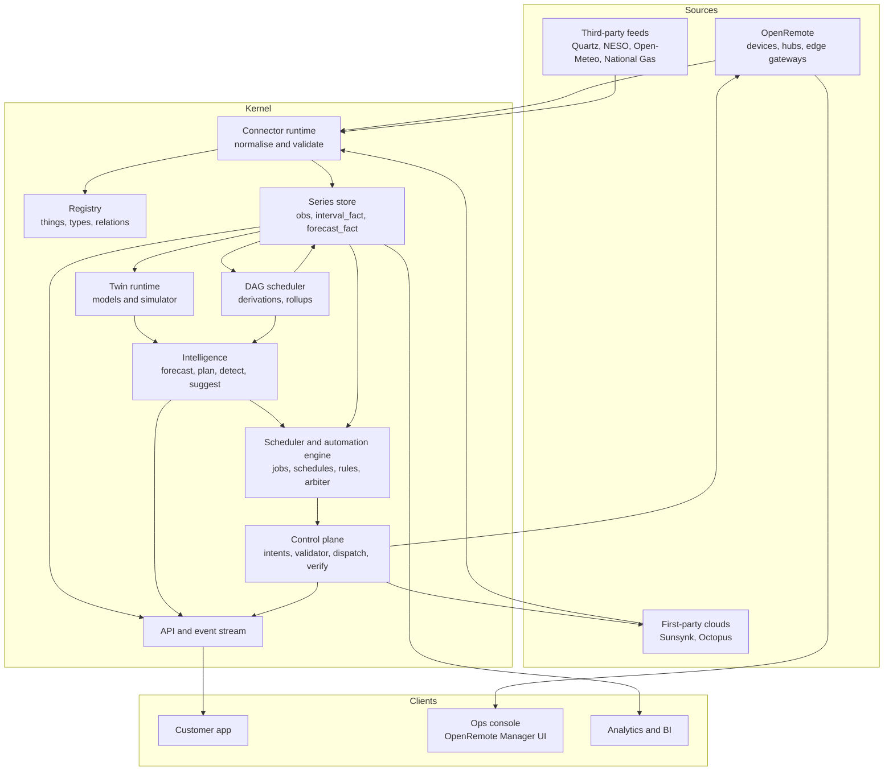

**Ownership.**

| Concern | Owner |
|---|---|
| Device connectivity, protocol agents, hubs, live asset state, local edge rules, installer UI | OpenRemote |
| Provider adapters for cloud APIs, tariffs, VAT, reconciliation, derived series, forecasts, plans, anomalies, suggestions, groups, grants, customer API | EnergieBee kernel |
| Raw payload archive, long-term analytics | EnergieBee (object store and analytics store) |

---

## 3. OpenRemote boundary

> [!CAUTION]
> <span style="color:#d00000">**Superseded.** The evidence record in [architecture-v3.md, section 2](architecture-v3.md#2-evidence-that-changed-the-design) shows that a central OpenRemote Manager does not scale horizontally and is sized for thousands to tens of thousands of assets. It is not suitable as the central platform for a consumer product at massive scale. Read this section as the OpenRemote option only.</span>

OpenRemote is the device and edge layer. The kernel does not duplicate its asset registry. It stores the OpenRemote asset id in `thing.ext_ref` and treats OpenRemote as a connector plus an actuator.

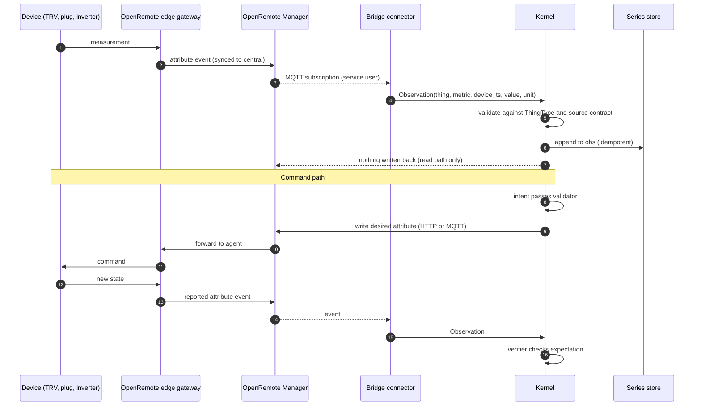

**Rules of the boundary.**

- **One-way read, explicit write.** Attribute events flow into the kernel through an MQTT subscription. The kernel writes only to attributes declared as controllable in the ThingType.
- **Do not read OpenRemote's database.** Its schema is not ours to depend on, and its datapoint retention is short by default (one month unless `dataPointsMaxAgeDays` is set). Keep a copy in `obs` with kernel-defined retention.
- **Desired and reported are separate attributes.** OpenRemote has no built-in device shadow. By convention each controllable thing has a pair such as `targetTemperature` and `temperature`.
- **Realm per home (superseded by v3).** OpenRemote realms are isolated silos. Each home gets its own realm, with the hub as the gateway asset and the thing tree below it (hub = root thing, see section 5). Customers have no OpenRemote logins. Groups, organisations and cross-home benchmarks exist only in the kernel. Reasoning and hardening: section 12.7.
- **Mapping:** hub = gateway asset, device and component = asset, point = attribute (a setpoint plus its paired state is two attributes), event = attribute event.
- **Cloud providers stay as kernel connectors.** Sunsynk and Octopus need authentication, pagination, revision handling and contracts that a generic HTTP agent should not carry. Their results may be mirrored into OpenRemote as attributes for the ops UI.
- **Context feeds stay in the kernel.** Quartz, carbon, weather and regional prices are shared across homes and do not fit realm-scoped assets.
- **Edge safety is local and independent.** Frost protection, over-temperature cut-offs and minimum-state rules are installed as native OpenRemote rules on the gateway at provisioning, generated from the type pack's safety limits. The cloud and the hub agent cannot override them. User schedules and automations run in a separate signed hub agent (section 10.9).
- **OpenRemote rules are the protection layer, not the automation engine.** The docs describe When-Then (attribute value, sunrise and sunset timers, duration, recurrence, AND and OR; actions to write attributes, notify, alarm, call webhooks), Flow and Groovy rules. Reset and wait behaviour is undocumented, a forum report says there is no else branch, and the docs do not say how rules reach an edge instance. Customer-facing logic therefore uses our own rule model and evaluator (section 10.7 to 10.9).

**Unverified, to settle in a spike:** Manager clustering and horizontal scaling; whether datapoints use TimescaleDB; Matter support (Zigbee is listed only on a hosting vendor's page); data produced during an uplink outage is synced after reconnect (one forum report says it was not); gateway footprint on target hardware; how rules are installed and updated on an edge instance and whether they run with the uplink down (the edge tutorial says they do); reset, wait and full operator support in When-Then; whether to reuse OpenRemote's energy optimisation service or keep our own planner.

---

## 4. Plugin architecture

### 4.1 Ports

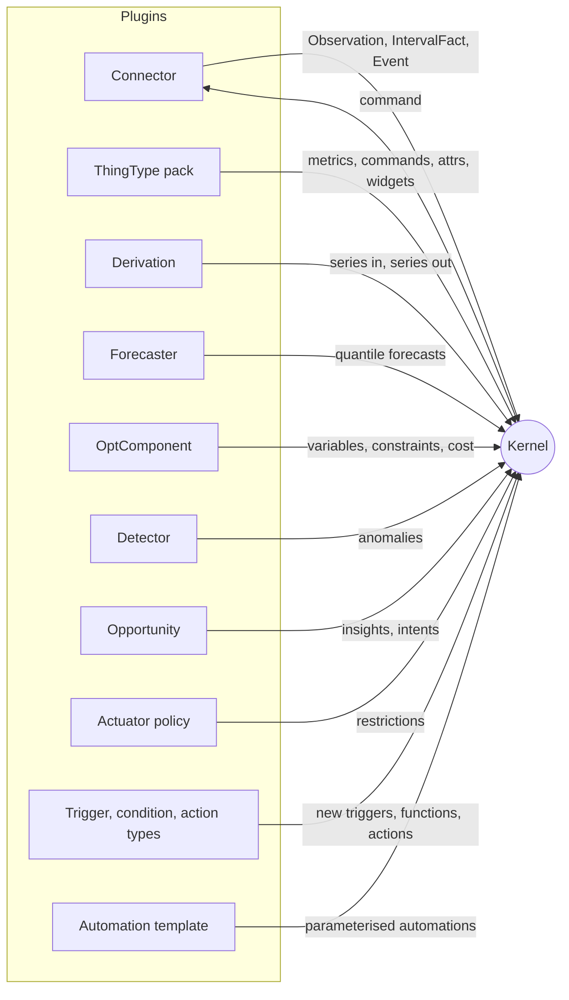

| Port | Contract | Examples |
|---|---|---|
| **Connector** | `pull`, `push`, `backfill`, `command`; auth scheme; rate-limit profile; **source contract** (time zone, signs, units, missing data, revisions, upstream history). Emits `Observation`, `IntervalFact` or `Event` only. | sunsynk, octopus, quartz, neso, openremote-bridge |
| **ThingType pack** | Metrics (kind, unit, sign), commands (params, hard limits), attribute schema, allowed relations, twin models, UI widgets. | battery, inverter, trv, heat_pump, ev_charger |
| **Derivation** | Declared input selectors, output series, lookback window, version. Pure and deterministic. | house load, energy flows, costing, group rollups |
| **Forecaster** | `fit(history, covariates)` and `predict(ctx, horizon)` returning quantiles. Scored by backtest. | solar, load, heat demand |
| **OptComponent** | Adds variables, constraints and cost terms to a home's optimisation problem. | battery, grid, EV, heat pump, hot-water tank |
| **Detector** | `evaluate(window, expected, actual, ctx)` returning anomalies. Declares a kind: invariant, residual or change-point. | stuck sensor, panel underperformance, TRV not reaching setpoint |
| **Opportunity** | `evaluate(snapshot)` returning insights, with a counterfactual from the twin and a typed action. | cheap-slot charge, solar diversion, setpoint reduction |
| **Actuator policy** | Safety rules per command and thing type. Plugin rules can only restrict further. | minimum SoC, maximum flow temperature, frost protection |
| **Trigger, condition, action type** | Declares parameters, evaluation function and whether it can run at the edge. Pure and side-effect free except actions, which emit intents only. | `price` trigger, `carbon_below` condition, `notify` action |
| **Automation template** | A parameterised automation definition with a typed parameter form. A suggestion can instantiate one. | cheap-slot EV charge, solar diversion, away-mode heating |

### 4.2 Manifest example

```yaml
kind: detector
id: pv-underperformance
version: 1.2.0
requires_kernel: ">=2.0 <3.0"
needs:
  thing_types: [inverter]
  series:
    - { role: actual,   metric: pv_power }
    - { role: expected, metric: pv_power_expected }
emits: anomaly
params:
  window: 3d
  z_threshold: 3.5
  min_daylight_slots: 12
tests:
  fixtures: tests/fixtures/*.json
  golden: tests/golden/*.json
```

### 4.3 Plugin lifecycle

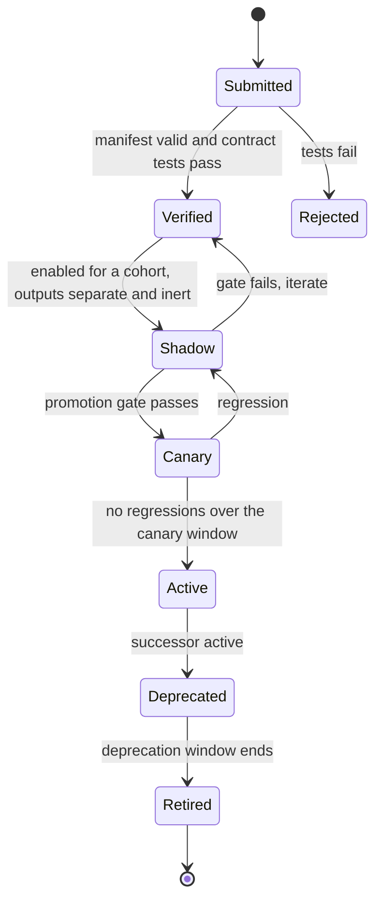

### 4.4 Extensibility acceptance tests

These define "plug and play". Each must hold before v2 is called done.

1. A new vendor's heat pump needs one connector and a mapping onto the existing `heat_pump` ThingType. No kernel change, no UI change, no schema migration.
2. A new detector is dropped in and enabled for one tenant without redeploying any other service.
3. A new appliance type needs one ThingType pack and one OptComponent. The planner includes it automatically.
4. Replacing the load forecaster is a registry change after a backtest shows the challenger wins.
5. A provider changing its payload format quarantines that source, raises an alert, and leaves other sources unaffected.

### 4.5 Isolation and compatibility

- First-party plugins run in-process in worker pools. Third-party plugins run out of process over gRPC or as WASM, with CPU, memory and network quotas.
- Contracts use semantic versions. A plugin declares the kernel range it supports. Deprecations carry a window.
- Config and ThingType schemas migrate with expand/contract steps.
- Plugins are enabled per tenant, site or cohort.

---

## 5. Unified thing schema

Every hub, device, component and derived value is a **thing** described by one schema. Things differ in their points and attributes, not in their shape. A hub is a thing too: the **root of its tree**.

### 5.1 The common pattern

All things do the same few jobs: they report measurements and state, accept setpoints and commands, emit events, hold configuration, and relate to other things. One envelope captures that, so views, controls, analytics, security and the twin runtime are written once.

| Facet | What it answers | Same for hub and device? |
|---|---|---|
| **Identity** | Who is it: id, type, external references, make, model, firmware | Yes |
| **Topology** | Where in the tree: root, parent, path, relations | Yes (hub is the root) |
| **Points** | What it reports and accepts: measures, states, setpoints, commands, events, attributes | Yes |
| **Link** | How it is reached: transport, endpoint, last seen, signal | Yes (richest on hubs) |
| **Lifecycle** | Where it is in its life: provisioned, claimed, active, degraded, offline, retired | Yes |
| **Security** | Credential reference, trust level, allowed actions | Yes |

### 5.2 Roles and the tree

A thing has one **role**:

| Role | Meaning | Examples |
|---|---|---|
| `hub` | Root of a tree. The point of connection to the platform. | OpenRemote edge gateway in a home; a cloud provider connection (Sunsynk account, Octopus account); a shared context feed (Quartz); the per-site kernel hub that owns derived things |
| `device` | A physical or logical unit reached through a hub | Inverter, battery, smart meter, TRV, smart plug, EV charger, heat pump |
| `component` | A part of a device with its own points | PV string, battery module, heating zone, meter register |
| `virtual` | A derived or blended thing computed by the kernel | House load, heating total, solar-to-battery |

Hub types: `hub.edge` (physical gateway), `hub.cloud` (provider account), `hub.feed` (shared context feed, no tenant), `hub.kernel` (derived things). Every thing therefore has a hub as root, including virtual ones, which hang under the site's kernel hub.

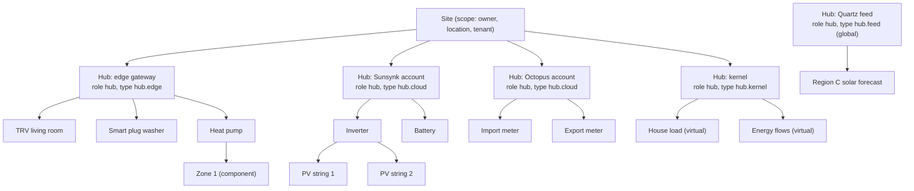

A **site** is a scope, not a thing: it holds the owner, location, timezone and tenant. A site has one or more hubs, so its things form a forest, one tree per hub. Cross-tree relations (for example "this battery is charged by that inverter") are explicit `thing_rel` rows.

**Invariants** enforced by the registry:

1. A tree has exactly one root. The root has `role = hub` and no parent. Every other thing has a parent in the same tree.
2. `root_id` equals the hub's id and `path` is the materialised ancestor path (maximum depth 5).
3. `tenant_id` and `site_id` are inherited from the root and cannot differ in a child. Feeds are the only things with no tenant.
4. A thing's type must list its parent's type in `allowed_parents`.
5. Point keys are unique within a thing. A `setpoint` names the `state` point that reports its effect, or is explicitly marked `no_readback` and treated as lower trust.
6. Suspending or revoking a hub suspends its whole subtree in one transaction (security and offboarding).
7. `id` never changes. External references are unique per `(root_id, provider, external_id)`.

### 5.3 The thing descriptor

One document format describes every thing. The kernel stores it as relational rows (section 6) and exchanges it as JSON between connectors, the registry and the API.

```yaml
schema: thing/1                     # additive changes bump the minor, breaking changes the major
id: 0192f3a1-7c2e-7a10-9b0e-2d5f7e1c0001      # UUIDv7, immutable
role: device                        # hub | device | component | virtual
type: { key: battery, version: 3 }  # selects the type pack
tenant_id: 0192f3a1-0000-7000-8000-000000000001
site_id:   0192f3a1-0000-7000-8000-0000000000aa
root_id:   0192f3a1-7c2e-7a10-9b0e-2d5f7e1c0000   # the hub
parent_id: 0192f3a1-7c2e-7a10-9b0e-2d5f7e1c0000
path: "hub.battery"                 # materialised ancestor path

name: "Home battery"
labels: { room: garage, owner_label: "Main battery" }

identity:
  external:                         # how other systems name it
    - { provider: sunsynk,    id: "2210XXXX" }
    - { provider: openremote, id: "5AbCdEf..." }
  manufacturer: Sunsynk
  model: "Battery 10"
  firmware: "1.4.2"
  hardware_rev: "B"

link:                               # how it is reached (always present, richest on hubs)
  transport: cloud-api              # mqtt | zigbee | zwave | modbus | cloud-api | derived
  via: 0192f3a1-7c2e-7a10-9b0e-2d5f7e1c0000
  last_seen: 2026-10-22T09:35:48Z
  expected_interval: PT5M
  signal: { rssi: null }

points:                             # see 5.4
  - { key: soc,           role: state,    metric: battery_soc,       unit: "%",  access: r,  kind: gauge }
  - { key: power,         role: measure,  metric: battery_power,     unit: W,    access: r,  kind: gauge, sign: "+ discharge" }
  - { key: charge_limit,  role: setpoint, metric: battery_charge_limit, unit: W, access: rw, pair: power,
      limits: { min: 0, max: 5000, step: 100, max_rate: PT1M } }
  - { key: fault,         role: event,    metric: battery_fault,     kind: event }
  - { key: capacity_kwh,  role: attribute, value_ref: attrs.capacity_kwh }

attrs:                              # validated by the type pack's attribute schema, bitemporal
  capacity_kwh: 10.2
  min_soc_pct: 10
  max_charge_w: 5000

lifecycle: { state: active, since: 2026-10-16T06:10:45Z }

security:
  credential_ref: kms://tenant/…/battery-link   # reference only, never the secret
  trust_level: verified             # unverified | verified | attested
  allow: [read, command]

twin:
  models: [ { kind: battery_soc_curve, ref: twin_model/… } ]

provenance: { created_by: connector:sunsynk@1.3.0, schema_hash: "…" }
```

A hub uses the same document. Only the role, type and link carry more weight:

```yaml
schema: thing/1
id: 0192f3a1-7c2e-7a10-9b0e-2d5f7e1c0000
role: hub
type: { key: hub.edge, version: 1 }
tenant_id: 0192f3a1-0000-7000-8000-000000000001
site_id:   0192f3a1-0000-7000-8000-0000000000aa
root_id:   0192f3a1-7c2e-7a10-9b0e-2d5f7e1c0000   # itself
parent_id: null
path: "hub"
name: "Home hub"
identity:
  external: [ { provider: openremote, id: "gateway-asset-id" } ]
  manufacturer: "…"
  model: "…"
  firmware: "2.3.1"
link:
  transport: mqtt
  endpoint: "h/0192f3a1…"           # topic root; no inbound address
  last_seen: 2026-10-22T09:35:48Z
  expected_interval: PT1M
  cert: { fingerprint: "…", not_after: 2026-10-23T09:35:48Z }
  realm: "home-0192f3a1"            # OpenRemote realm for this home
points:
  - { key: online,        role: state,    metric: hub_online,        kind: state, access: r }
  - { key: uplink_rssi,   role: measure,  metric: hub_uplink_rssi,   unit: dBm,   access: r }
  - { key: cpu_load,      role: measure,  metric: hub_cpu_load,      unit: "%",   access: r }
  - { key: disk_free,     role: measure,  metric: hub_disk_free,     unit: "%",   access: r }
  - { key: reboot,        role: command,  metric: hub_reboot,        access: w }
  - { key: pairing_mode,  role: setpoint, metric: hub_pairing_mode,  access: rw, pair: pairing_state,
      limits: { max_duration: PT3M } }
  - { key: pairing_state, role: state,    metric: hub_pairing_state, kind: state, access: r }
lifecycle: { state: active, since: 2026-10-16T06:10:45Z }
security: { trust_level: attested, allow: [read, command] }
```

### 5.4 Points: the one abstraction behind data and control

A **point** is a named capability of a thing. Reading data, issuing a command and raising an event are all expressed as points, so the same code handles every type.

| Role | Direction | Stored as | Used by |
|---|---|---|---|
| `measure` | thing to platform | Series in `obs`, or `interval_fact` if revisable | Views, analytics, twin fitting |
| `state` | thing to platform, discrete or latest-value | Series (kind `state`) and `thing_state` | Reported state, verification |
| `setpoint` | platform to thing, persistent target | `intent`, paired with a `state` | Planner, user control |
| `command` | platform to thing, one-shot action | `intent`, no persistent value | Reboot, start charging, identify |
| `event` | thing to platform, discrete occurrence | `thing_event` | Faults, alarms, button presses |
| `attribute` | configuration and metadata | `thing_attr_version`, bitemporal | Capacity, tilt, limits, labels |

Point fields:

| Field | Meaning |
|---|---|
| `key` | Unique within the thing |
| `role` | One of the six roles above |
| `metric` | Entry in the metric registry (unit, kind, aggregation, sign) |
| `access` | `r`, `w` or `rw` |
| `kind` | `gauge`, `counter`, `state`, `event` |
| `pair` | For a setpoint, the state point that proves it took effect |
| `limits` | `min`, `max`, `step`, `max_rate`, `max_duration`. Enforced by the validator, and by the edge where possible |
| `expected_interval` | How often a value should arrive. Drives freshness and offline detection |
| `quality` | Freshness SLO and plausible range, used by checks |
| `sign` | Sign convention, converted to separate direction metrics at the connector |

Every point maps one to one onto an OpenRemote attribute: a `measure` or `state` to a read-only attribute, a `setpoint` to a writable attribute plus its paired state attribute (the desired and reported convention from section 3), and an `event` to an attribute event. Naming and structure also line up with the "properties, actions, events" model of W3C Web of Things and with Matter's cluster attributes and commands, so adapting to those later is mechanical.

### 5.5 Schema model

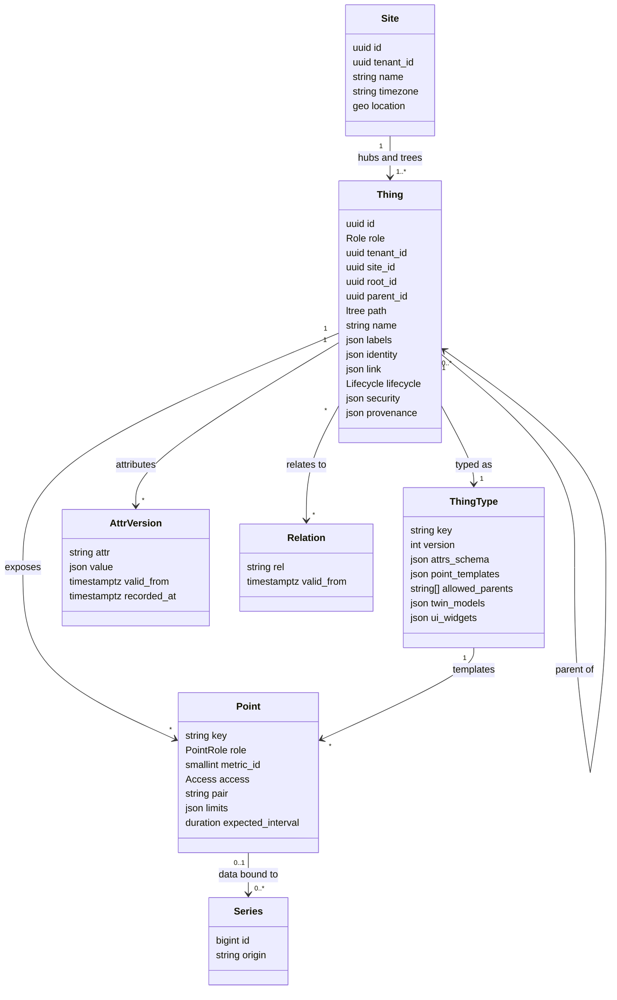

### 5.6 Type packs specialise the envelope

The envelope never changes per type. A **type pack** supplies defaults and constraints:

- point templates (which points a `battery` has, with metrics, limits and pairs);
- the attribute schema (`capacity_kwh` is a number between 0.5 and 200);
- `allowed_parents` (a `trv` may sit under `hub.edge`, not under a `meter`);
- twin model kinds that apply;
- UI widgets for the point set;
- safety limits the validator applies.

When a connector or hub announces a thing, its descriptor must conform to the type pack. A new vendor's device that fits an existing type needs no new code. A new kind of device needs only a type pack.

### 5.7 Lifecycle

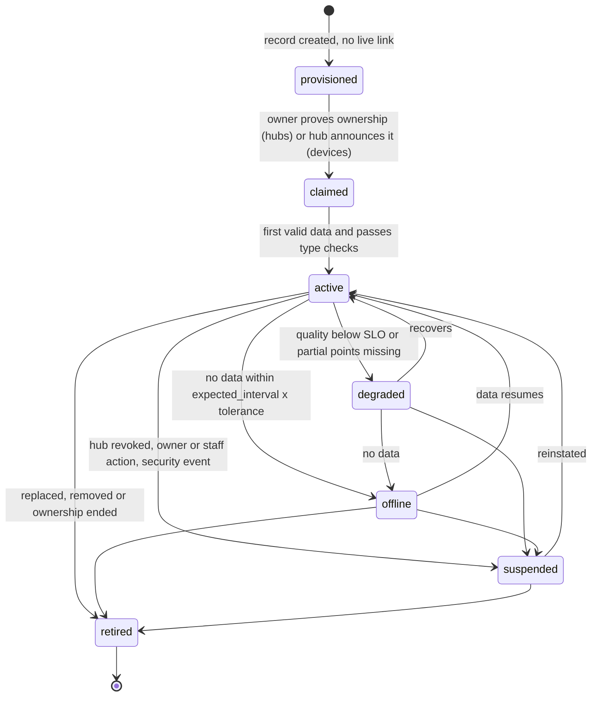

`offline` is derived from `expected_interval`, not from a flag a device sets. A hub going offline moves its subtree to offline and raises one incident rather than many (section 8.4). `suspended` things are read-blocked and command-blocked everywhere. `retired` things are kept for history and never deleted until the retention rule says so.

### 5.8 Registration and discovery (plug and play)

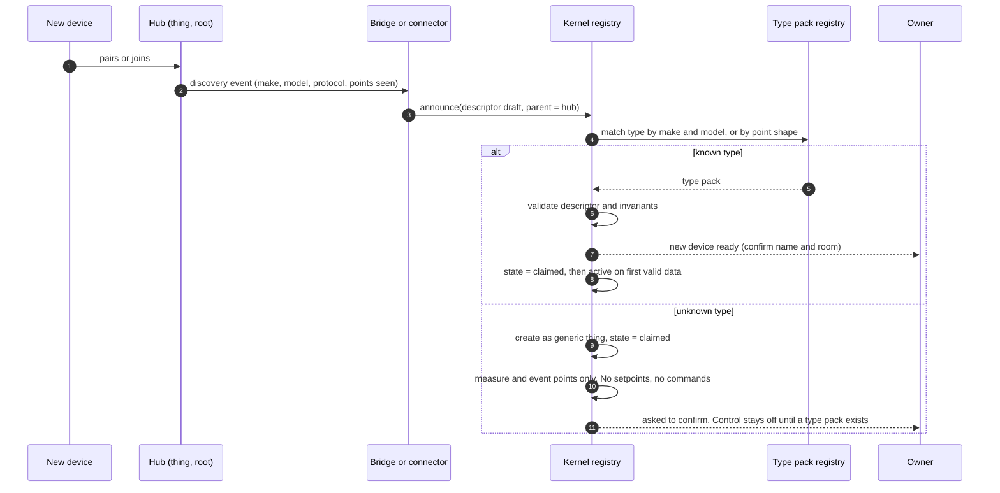

Rules:

- A thing can be created only under an existing hub in the caller's site and tenant. A device cannot attach itself to another home's hub.
- **Unknown devices are read-only.** Without a type pack there are no limits to enforce, so no control point is exposed.
- The announced descriptor is validated against the type pack and the invariants. A conflicting or oversized descriptor is rejected and logged.
- Re-announcing an existing thing updates the descriptor by version. Identity and external references are matched, never duplicated.

### 5.9 Schema versioning

- The descriptor carries `schema: thing/<major>.<minor>`. Minor versions only add optional fields. Major versions need a migration plan and a dual-read period.
- Type packs are versioned separately. A thing records the type version it was created under and can be migrated to a newer version by a tested migration.
- Changes follow expand and contract: add the new field, write both, migrate readers, remove the old field.

---

## 6. Data model

### 6.1 Entity relationships

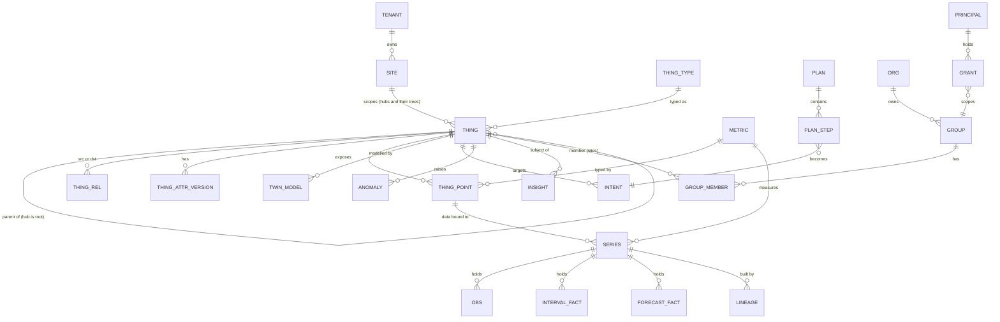

### 6.2 Core tables

```sql
-- registry (OLTP)
thing_type(key, version, manifest jsonb, PRIMARY KEY (key, version));

site(                                  -- scope, not a thing
  id uuid PRIMARY KEY, tenant_id uuid NOT NULL,
  name text, timezone text NOT NULL, location jsonb, created_at timestamptz NOT NULL
);

thing(                                 -- one table for hubs, devices, components, virtual things
  id uuid PRIMARY KEY,                 -- UUIDv7, immutable
  role text NOT NULL CHECK (role IN ('hub','device','component','virtual')),
  tenant_id uuid,                      -- NULL only for hub.feed trees (shared context)
  site_id uuid REFERENCES site(id),    -- NULL only for hub.feed trees
  root_id uuid NOT NULL,               -- the hub; = id for a hub
  parent_id uuid REFERENCES thing(id), -- NULL only for a hub
  path ltree NOT NULL,                 -- ancestor path, depth <= 5
  type_key text NOT NULL, type_version int NOT NULL,
  name text, labels jsonb,
  identity jsonb,                      -- {"external":[{"provider":"openremote","id":"..."}],"manufacturer":..,"model":..,"firmware":..}
  link jsonb,                          -- transport, endpoint, last_seen, expected_interval, cert fingerprint, realm
  security jsonb,                      -- credential_ref (never the secret), trust_level, allow[]
  provenance jsonb,
  lifecycle text NOT NULL CHECK (lifecycle IN
    ('provisioned','claimed','active','degraded','offline','suspended','retired')),
  lifecycle_since timestamptz NOT NULL,
  schema_version text NOT NULL,        -- 'thing/1.0'
  created_at timestamptz NOT NULL, retired_at timestamptz,
  CHECK ((role = 'hub') = (parent_id IS NULL)),
  CHECK ((role = 'hub') = (root_id = id)),
  CHECK (tenant_id IS NOT NULL OR type_key = 'hub.feed' OR type_key LIKE 'feed.%')
);
CREATE UNIQUE INDEX thing_external ON thing (root_id, ((identity->'external'->0->>'provider')),
                                             ((identity->'external'->0->>'id')));
CREATE INDEX thing_path ON thing USING gist (path);
CREATE INDEX thing_site ON thing (tenant_id, site_id, role);
-- Triggers enforce: child.tenant_id/site_id/root_id equal parent's; type.allowed_parents contains parent type;
-- suspending a hub suspends its whole subtree in one transaction.

thing_point(                           -- the capabilities of a thing (section 5.4)
  thing_id uuid REFERENCES thing(id), key text,
  role text NOT NULL CHECK (role IN ('measure','state','setpoint','command','event','attribute')),
  metric_id smallint,                  -- NULL for pure attributes
  access text NOT NULL CHECK (access IN ('r','w','rw')),
  pair_key text,                       -- for setpoint: the state point that reports its effect
  limits jsonb, expected_interval interval, quality jsonb,
  PRIMARY KEY (thing_id, key)
);

thing_attr_version(                    -- bitemporal
  thing_id uuid, attr text, value jsonb,
  valid_from timestamptz, valid_to timestamptz,
  recorded_at timestamptz, source text,
  PRIMARY KEY (thing_id, attr, recorded_at)
);

thing_rel(src uuid, rel text, dst uuid, valid_from timestamptz, valid_to timestamptz);
                                       -- inside, powers, measures, heats, located_in

metric(
  id smallint PRIMARY KEY, code text UNIQUE, unit text,
  kind text CHECK (kind IN ('gauge','counter','state','event')),
  time_role text CHECK (time_role IN ('instant','interval')),
  aggregation text CHECK (aggregation IN ('sum','mean','last','integrate','weighted')),
  weight_metric_id smallint
);

series(
  id bigint PRIMARY KEY, thing_id uuid, point_key text, metric_id smallint,
  origin text NOT NULL,                -- source:<connector>@v | derived:<builder>@v
                                       -- | forecast:<model>@v | expected:<model>@v
  UNIQUE (thing_id, metric_id, origin)
);
```

```sql
-- time series (Timescale hypertables)
obs(                                   -- instant telemetry: append-only, idempotent
  series_id bigint, ts timestamptz, value double precision, q smallint,
  PRIMARY KEY (series_id, ts)
);

interval_fact(                         -- revisable cloud intervals: versioned
  series_id bigint, start timestamptz, dur interval, value double precision,
  q smallint, recorded_at timestamptz, superseded_at timestamptz
);

forecast_fact(                         -- stored only when the value changes
  series_id bigint, issued_at timestamptz, target_ts timestamptz,
  p10 double precision, p50 double precision, p90 double precision, model_version text
);

thing_event(thing_id uuid, ts timestamptz, type text, payload jsonb);

lineage(series_id bigint, range tstzrange, builder text, builder_version text,
        input_hash bytea, output_hash bytea, built_at timestamptz);
```

```sql
-- control and intelligence
intent(
  id uuid PRIMARY KEY, thing_id uuid, command text, params jsonb,
  source text, plan_id uuid, precedence smallint, ttl timestamptz,
  idempotency_key text UNIQUE, status text, expect jsonb, created_at timestamptz
);
command_attempt(intent_id uuid, n int, sent_at timestamptz, result jsonb);
audit_log(at timestamptz, actor text, action text, subject text, detail jsonb);

twin_model(thing_id uuid, kind text, params jsonb, fit_window tstzrange,
           fit_error double precision, version text, valid_from timestamptz, valid_to timestamptz);

plan(id uuid PRIMARY KEY, home_id uuid, horizon interval, model_versions jsonb,
     input_hash bytea, objective text, est_cost numeric, created_at timestamptz);
plan_step(plan_id uuid, thing_id uuid, slot timestamptz, command text, params jsonb);

anomaly(id uuid PRIMARY KEY, detector text, series_id bigint, win tstzrange,
        severity smallint, evidence jsonb, state text);

insight(id uuid PRIMARY KEY, home_id uuid, type text, things uuid[],
        evidence jsonb, counterfactual jsonb,
        saving_gbp numrange, saving_kwh numrange, co2_kg numrange,
        confidence real, valid_until timestamptz, dedupe_key text, status text);

-- groups and access
org(id uuid PRIMARY KEY, name text);
grp(id uuid PRIMARY KEY, org_id uuid, kind text CHECK (kind IN ('tree','cohort')),
    path ltree, rule jsonb);
group_member(group_id uuid, site_id uuid, valid_from timestamptz, valid_to timestamptz);
grant_(principal uuid, scope_kind text, scope_id uuid, role text,
       consent_ref text, expires_at timestamptz);
group_hh(group_id uuid, slot_start timestamptz, metric_id smallint,
         value double precision, members int, final_members int, provisional_members int, missing_members int,
         PRIMARY KEY (group_id, metric_id, slot_start));
```

### 6.3 Modelling decisions

| Decision | Reason |
|---|---|
| Hot tables hold only `series_id`, `ts`, `value`, `q`, with a single primary key index | Insert rate is the constraint. Secondary indexes on the hot table cost the most for the least benefit. |
| Instant telemetry is idempotent append, not bitemporal | It is rarely revised. Versioning would multiply storage for no benefit. |
| Revisable cloud data (`interval_fact`), attributes and forecasts are versioned | Revisions are real here (late Octopus data, restated values, re-issued forecasts) and you need "as known at". |
| Counters are stored raw and differenced with reset detection in rollups | Treating a cumulative kWh counter as a gauge produces wrong totals after resets. |
| Derived, forecast and expected values are ordinary series with an `origin` | One query path for views, analytics and the planner. Lineage is explicit. |
| Context feeds are global series keyed by region, hung under `hub.feed` hubs with no tenant | Fetched once, read by every home in that region. Only feed trees may have a null tenant. |
| One `thing` table for hubs, devices, components and virtual things, with `root_id` and `path` | One schema, one access check, one lifecycle. Subtree queries (suspend a hub, list a hub's devices) are a path or `root_id` lookup. |
| Capabilities are rows in `thing_point`, not columns or per-type tables | A new device type adds point rows from a type pack, not schema. Control, views and the twin read the same table. |
| Site is a scope, not a thing | It carries ownership, location and time zone. Things belong to a site through their hub. |
| Group membership is temporal | Last quarter's total must use last quarter's membership. |
| Aggregation semantics live in the `metric` row | Prevents summing prices or averaging energy. |

### 6.4 Series tiers and retention

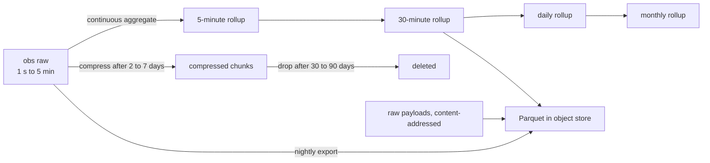

Rollups and the lake are kept long term. Raw instant data is kept for 30 to 90 days hot. Raw provider payloads are stored content-addressed (hash), so a repeated payload is stored once.

---

## 7. Computation DAG

All derived values are produced by Derivations arranged in a DAG over series and evaluated incrementally.

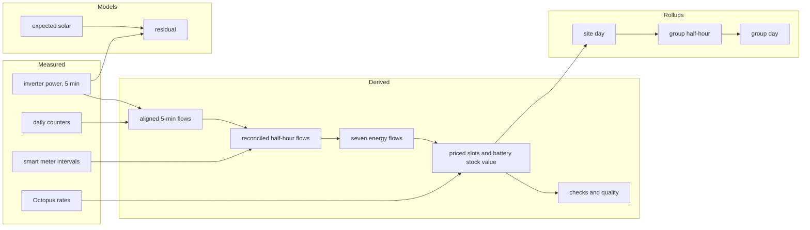

**Incremental rules.**

1. **Dependencies are tracked at (series, time range).** A late or revised input marks only dependent output ranges dirty.
2. **Content-hash short-circuit.** After rebuilding a range, compare `output_hash` with the stored one. If identical, stop propagation.
3. **Coalescing.** Dirty ranges merge per home. Within a home, jobs run in topological order. Across homes, in parallel.
4. **Determinism.** A builder is pure given `(input_hash, builder_version)`. Rebuilding any derived range "as known now" must reproduce the stored rows, and this is checked for every derived series.
5. **Group rollups are nodes in the same DAG**, reading site series with membership as of the bucket.

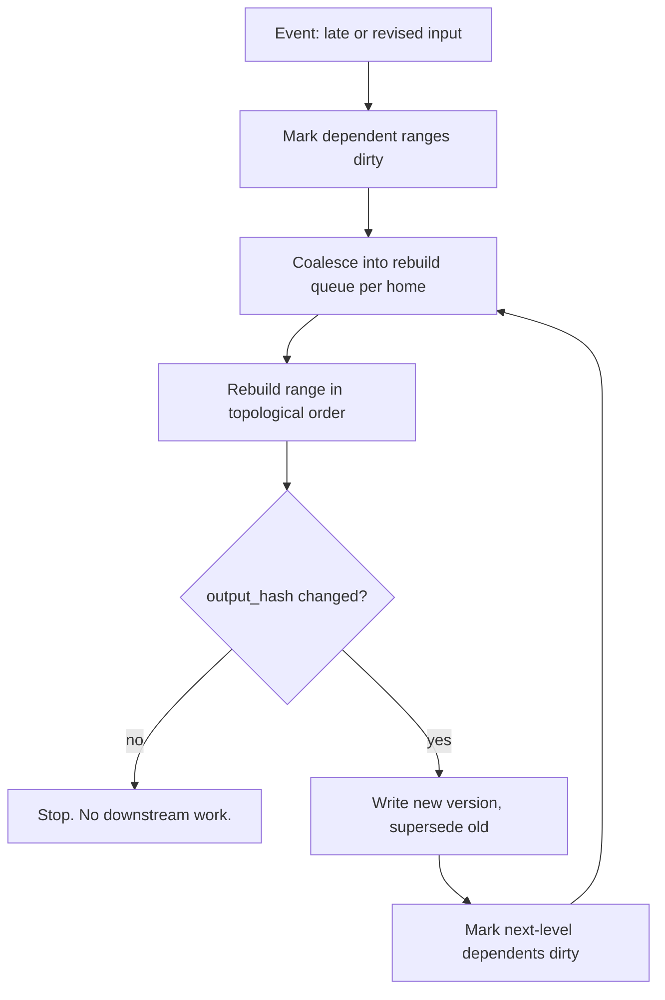

---

## 8. Algorithms

### 8.1 Data quality and reconciliation

- **Per-observation checks:** range, rate of change, stuck value, Hampel filter for spikes. Outcomes are bits in `q`. Values are never edited.
- **Gaps:** never filled in measured series. Where a model needs continuity, an `imputed` series is derived, labelled, and excluded from savings claims.
- **Reconciliation.** Replace the rule "smart meter beats clamp" with constrained weighted least squares over each half-hour:

  minimise Σᵢ (xᵢ − x̂ᵢ)² / σᵢ² subject to the energy balance Σ flows = 0 (plus non-negativity).

  Each sensor's variance σᵢ² is estimated from its historical balance residuals. The output is the reconciled flows and the residual, which becomes the quality score. The meter-versus-clamp check becomes an estimate of relative sensor variance.

### 8.2 Forecasting

All forecasters return quantiles (p10, p50, p90).

| Target | Method | Uncertainty |
|---|---|---|
| Solar | Physical baseline (clear-sky × panel geometry) with Quartz as the prior. Online bias correction of the clear-sky index per home (recursive least squares or Kalman filter). | Conformal intervals on rolling residuals. |
| Load | Decomposition: baseload + temperature-dependent part (piecewise degree-hour regression) + calendar profile (time of day × weekday). LightGBM quantile model once enough history exists. | Quantile loss. |
| Price, carbon | Published values used as deterministic inputs. Forecast only where unpublished. | Stated where applicable. |
| Heat demand, indoor temperature | Grey-box RC model in state-space form (1R1C first, 2R2C if data supports it). Parameters by maximum likelihood, tracked online with an extended Kalman filter. Heat pumps add a COP curve versus outdoor and flow temperature. | State covariance. |

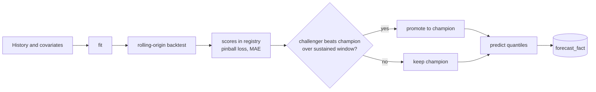

Cold start: new homes use cohort priors (section 11.4) and abstain from claims until the fit passes its quality threshold.

### 8.3 Planner

The planner assembles one mixed-integer linear program from the home's thing graph. Each OptComponent contributes its part.

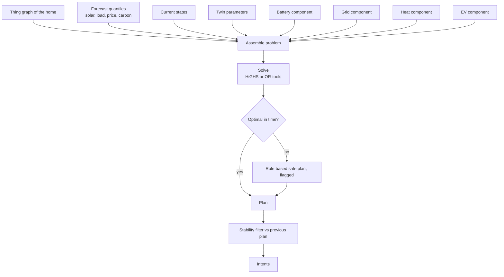

**Formulation, slots t = 1..T (typically 96 half-hours).**

- Battery: `soc[t+1] = soc[t] + η_c·p_c[t]·Δ − p_d[t]·Δ/η_d`, with `soc_min ≤ soc ≤ soc_max`, `0 ≤ p_c ≤ P_c`, `0 ≤ p_d ≤ P_d`, plus a throughput cost for degradation. Exclusivity of charge and discharge is enforced only where prices could make simultaneous operation profitable.
- Grid: balance `import − export = load + p_c − p_d − pv_used`, with import and export caps.
- Heat: `T[t+1] = T[t] + (Δ/C)(Q[t] − UA·(T[t] − T_out[t]))`, comfort band as a soft constraint with a penalty, heat-pump minimum run and off times as binaries, and the hot-water tank as a second store.
- EV: energy required by departure, maximum power, allowed windows.
- Objective: `Σ (price_imp·imp − price_exp·exp) + λ_carbon·carbon + degradation + comfort_penalty + μ·|plan − previous plan|`.

**Operational rules.**

- **Robustness:** plan against quantile scenarios, using p10 solar and p90 load for SoC safety margins. Use a small scenario tree only where the value justifies it.
- **Receding horizon:** re-solve every slot or on a trigger, commit only the first steps, warm start from the previous solution.
- **Stability:** the change penalty keeps plans from flapping and limits device writes (provider rate limits, hardware wear).
- **Cost:** a 96-slot problem is expected to solve in on the order of 100 ms *(to be measured)*. At 100k homes re-planning every 30 minutes that is about 55 solves per second *(projection)*.
- **Fallback:** on timeout or failure, use a deterministic rule-based plan and record that it was used.

### 8.4 Anomaly detection

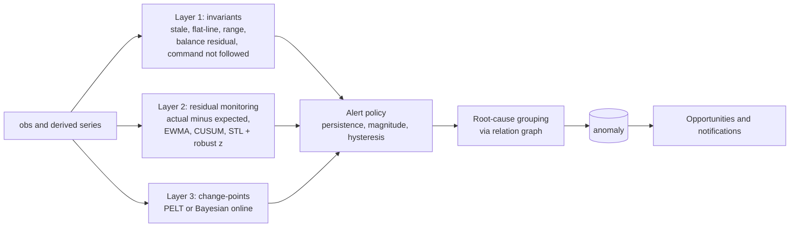

- Severity = impact (£ or comfort) × confidence.
- A hub going offline suppresses its devices' stale alerts and raises one incident.
- ML detectors (isolation forest, autoencoder) are added only once labelled outcomes exist.

### 8.5 Suggestion engine

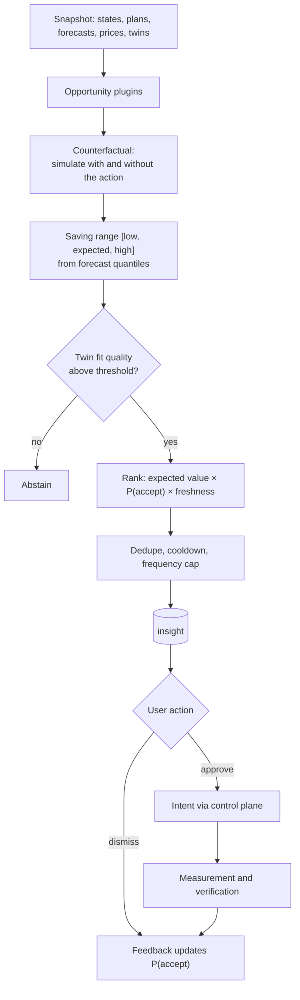

- A suggestion never carries a single number. It carries a range with its assumptions.
- **"Lower setpoint by 1 °C":** energy saved ≈ UA × Δ(degree-hours) ÷ COP from the fitted thermal model, priced at the forecast tariff. Not shown if the thermal fit is below threshold.
- **"Charge now" and "divert surplus solar":** taken from the plan and price distribution, net of round-trip losses.
- **Measurement and verification:** compare actual use after adoption with a weather-normalised baseline regression (in the spirit of IPMVP option C). Report realised savings with uncertainty. This also trains P(accept).

### 8.6 Digital twin runtime

A twin is `(state, models, simulator)`.

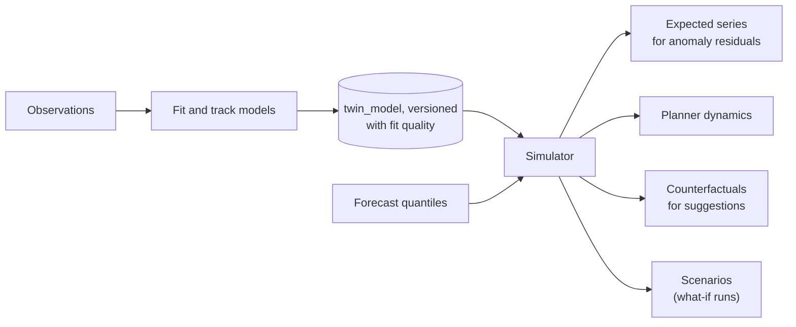

One implementation of the physics serves all four consumers, so their numbers agree. A twin below its fit threshold reports "insufficient data", and consumers abstain. Scenario runs store `(baseline model version, changes, input_hash, result)` and are reproducible.

---

## 9. Control plane and safety

### 9.1 Intent state machine

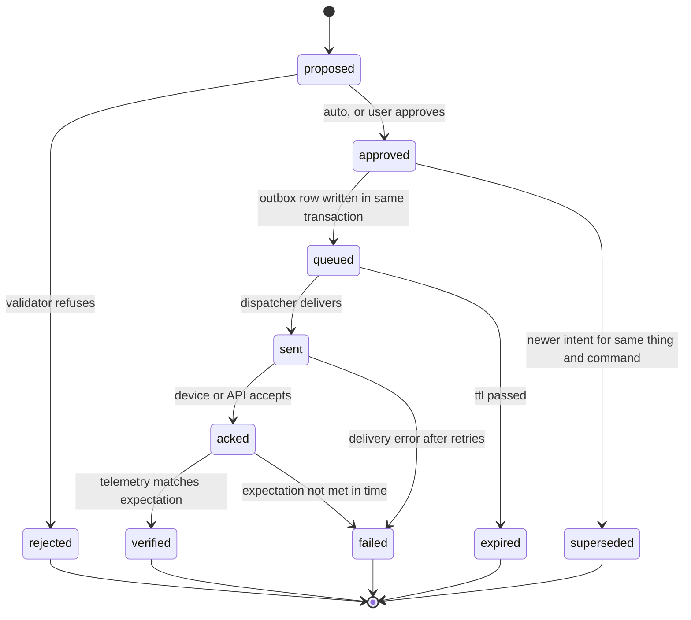

### 9.2 Dispatch and verification

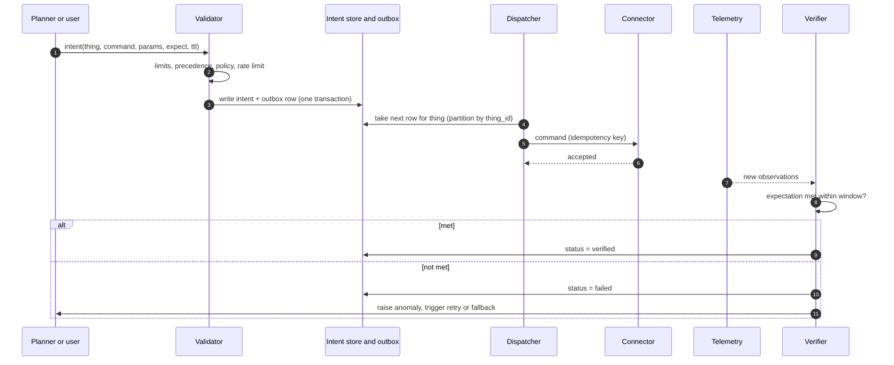

**Rules.**

- Schedules, automations, scenes and the planner all resolve through one arbiter before they become intents (section 10.11).
- Only intents reach devices. Planners, suggestions and users create intents. Nothing else writes to a connector's command path.
- **Validator** is deterministic code, separate from every planner. Hard limits come from the ThingType and versioned attributes (minimum SoC, maximum charge rate, maximum flow temperature, frost protection). Precedence is manual over schedule over planner. Plugins can add restrictions and never remove them.
- **Delivery** is at-least-once through a transactional outbox, with idempotent connectors and per-thing serialisation.
- **Verification:** every intent declares an expectation on telemetry (for example, battery power below −X within 5 minutes). A failure raises an anomaly and triggers retry or fallback.
- **Edge-first execution:** plans are pushed to the OpenRemote gateway as timed schedules with a TTL. If the cloud is lost, the gateway runs until expiry and then reverts to a safe default. Frost and over-temperature protection are local and cannot be overridden by the cloud.
- **Autonomy ladder** per automation and per tenant: suggest, approve, auto. Group actions use staged rollout (canary, 10%, all), per-provider rate limits and a kill switch.

---

## 10. Scheduler, schedules and automations

### 10.1 Scope and principle

"Scheduler" means three different things here. Each has its own design, and they meet at the control plane.

| Concern | What it is | Section |
|---|---|---|
| **Platform job scheduling** | Internal work: polling providers, rebuilding the DAG, forecasting, planning, detection | 10.2 |
| **User schedules and scenes** | "Heating 21 °C on weekdays 06:30 to 08:30", modes such as Away and Holiday | 10.4 to 10.5 |
| **Automations** | Reactive rules: when X and Y, do Z | 10.4 to 10.9 |

**Principle: schedules, automations, scenes, the planner and accepted suggestions all produce intents and nothing else.** An intent goes through the same arbiter, validator, dispatch and verification path as any other command (section 9). Safety, audit and precedence therefore exist once. No automation talks to a device directly.

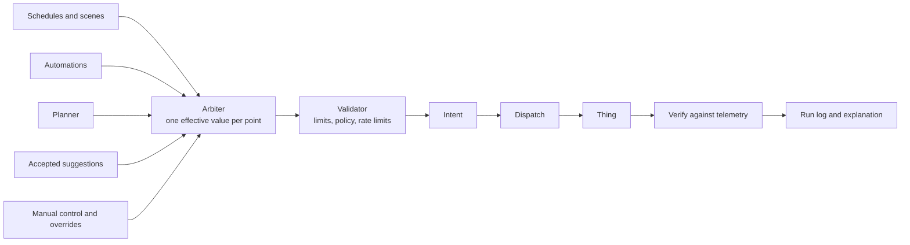

### 10.2 Platform job scheduler

Internal jobs are classed by urgency. Classes have separate queues, worker pools and quotas, so a backfill can never delay a safety verification.

| Class | Jobs | Trigger | Priority |
|---|---|---|---|
| P0 | Command dispatch, intent verification, safety checks, hub offline detection | Event or short timer | Highest, reserved capacity |
| P1 | Live ingest, connector polls, push handling | Per-connection `next_run` with jitter | High |
| P2 | DAG rebuilds, forecasts, planning, detectors, suggestion evaluation | Dirty ranges, new forecast issue, slot boundary, anomaly | Normal |
| P3 | History backfill, twin refits, exports, rollup repair, reports | Schedule or on demand | Low, preemptible |

```mermaid
flowchart TB
  subgraph Triggers
    T1["Timers: next_run table"]
    T2["Events: new observation, dirty range"]
    T3["Manual and API"]
  end
  T1 --> COAL
  T2 --> COAL
  T3 --> COAL
  COAL["Coalesce and dedupe<br/>per home and job type"] --> RT{"Route by class"}
  RT --> Q0["P0 queue"]
  RT --> Q1["P1 queue"]
  RT --> Q2["P2 queue"]
  RT --> Q3["P3 queue"]
  Q0 --> W0["Reserved workers"]
  Q1 --> W1["Connector workers<br/>per-provider token buckets"]
  Q2 --> W2["Builders, forecasters, planners"]
  Q3 --> W3["Batch workers, preemptible"]
  W0 --> RES["Result, retry or dead-letter"]
  W1 --> RES
  W2 --> RES
  W3 --> RES
```

Rules:

- **Per-tenant fairness.** A weighted fair queue stops one large tenant from starving others.
- **Per-provider rate limits** are token buckets shared by all workers of a cell. Control-verification polls get a reserved share.
- **Jitter and spreading.** Non-critical timers get random offsets so boundaries (:00, :30) do not cause thundering herds.
- **Coalescing.** Many dirty ranges or repeated triggers for the same home and job collapse into one run.
- **Idempotent jobs.** Every job has an idempotency key. Retries use exponential backoff. Poison jobs go to a dead-letter queue with an alert.
- **Backpressure.** Queue depth and age are tracked per class. When P2 backs up, P3 pauses first.
- **Durable multi-step work** (onboarding, backfill, staged group rollout) runs as Temporal workflows. Short periodic jobs use the queue.
- **SLOs** per class: maximum queue age, and for P0 a maximum time from trigger to dispatch.

### 10.3 Time semantics

Used by schedules, automations, jobs and the planner.

- Every schedule and time trigger has an explicit **timezone** (the site's by default). Storage is UTC. Local time is computed per occurrence.
- **DST:** a local time that does not exist (spring forward) fires at the next valid instant. A local time that occurs twice (autumn back) fires once, at the first occurrence.
- **Sunrise and sunset** come from the site's location and date, computed in the kernel.
- **Misfire policy** per timer: `fire_once_if_within <window>` or `skip`. After an outage the system catches up at most once per timer, never replays a backlog of actions.
- **Calendar exceptions:** holiday ranges, one-off days, and bank-holiday sets replace the base schedule for their dates.
- Clock skew on hubs is measured, and edge programs use the hub's synchronised time, with an alert if skew exceeds a threshold.

### 10.4 Objects

```mermaid
classDiagram
  class Automation {
    uuid id
    string name
    Origin origin
    Mode mode
    int priority
    Placement placement
    bool enabled
  }
  class AutomationVersion {
    int version
    json definition
    bytes definition_hash
    json compiled
  }
  class Trigger {
    string type
    json params
  }
  class Condition {
    string expression
  }
  class Action {
    string type
    json params
    duration ttl
  }
  class Guard {
    duration cooldown
    int max_per_period
    string time_window
    bool require_approval
  }
  class Schedule {
    uuid target_thing
    string target_point
    string timezone
    json calendar
  }
  class ScheduleBlock {
    string recurrence
    time start_local
    time end_local
    json value
  }
  class Scene {
    string name
    json steps
  }
  class ModeThing {
    string state
  }
  class Run {
    timestamptz fired_at
    json inputs
    string decision
    uuid[] intents
    string outcome
  }
  Automation "1" --> "*" AutomationVersion : versions
  AutomationVersion "1" --> "1..*" Trigger
  AutomationVersion "1" --> "*" Condition
  AutomationVersion "1" --> "1..*" Action
  AutomationVersion "1" --> "0..1" Guard
  Schedule "1" --> "*" ScheduleBlock
  Action "*" --> "0..1" Scene : starts
  Action "*" --> "0..1" ModeThing : sets
  Automation "1" --> "*" Run : executions
```

- **Schedule:** a weekly program of blocks for one target point (or zone), plus calendar exceptions. The simplest, most common automation, with its own editor and model.
- **Automation:** triggers, conditions, actions and guards.
- **Scene:** a named bundle of setpoints and commands (Evening, Away).
- **Mode:** a virtual thing in the site's kernel hub with a state point (Home, Away, Holiday, Eco). Setting a mode is an action, and a mode change is an event that can trigger automations or switch active schedules.
- Definitions are **versioned**. A change makes a new version. Runs record the version that fired.

### 10.5 Definition format

The canonical form of an automation is a **typed rule model**: a JSON tree whose leaves are structured comparisons, not free-text expressions (rationale in 10.7). The YAML below is a readable rendering of the same model. The editor (10.8) builds it, and the evaluator (10.9) runs it.

```yaml
schema: automation/1
name: Divert surplus solar to immersion
origin: user                       # user | template | suggestion | planner | system
mode: auto                         # suggest | approve | auto (the autonomy ladder)
priority: 40                       # tie-break between automations, higher wins
placement: auto                    # cloud | edge | auto (decided by the compiler)
when:                              # triggers: any of these starts an evaluation
  - point: { thing: inverter, key: export_power }
    is: above
    value: { number: 1500, unit: W }
    for: PT3M                      # must stay true for 3 minutes (the "hold")
only_if:                           # conditions: all must be true
  all:
    - { point: { thing: battery,   key: soc },         is: at_least, value: { number: 95, unit: "%" } }
    - { point: { thing: immersion, key: temperature }, is: below,    value: { number: 60, unit: "°C" } }
    - { time: between, from: "09:00", to: "17:00" }
then:
  - set: { point: { thing: immersion, key: relay }, to: "on", for: PT15M }
until:                             # how it ends
  when: conditions_stop_holding
  then:
    - set: { point: { thing: immersion, key: relay }, to: "off" }
guards:
  cooldown: PT10M
  max_per_day: 12
  require_verify: true
```

```yaml
schema: schedule/1
target: { thing: heat_pump_zone_1, point: target_temperature }
timezone: Europe/London
blocks:
  - { days: [mon, tue, wed, thu, fri], from: "06:30", to: "08:30", value: 21 }
  - { days: [mon, tue, wed, thu, fri], from: "17:00", to: "22:00", value: 21 }
  - { days: [sat, sun],                from: "08:00", to: "23:00", value: 21 }
default: 17                        # outside every block
exceptions:
  - { from: 2026-12-24, to: 2027-01-02, use: holiday_profile }
```

```yaml
schema: scene/1
name: Away
steps:
  - { set: { point: { thing: living_room_trv,   key: target_temperature }, to: 15 } }
  - { set: { point: { thing: heat_pump_zone_1,  key: target_temperature }, to: 15 } }
  - { command: { point: { thing: washer_plug,   key: relay }, to: "off" } }
```

Model rules:

- **Operands are typed.** A comparison names a point, an operator word, and a value with a unit. The kernel checks that the unit fits the point's metric and converts if needed. A comparison of watts to degrees is rejected at save.
- **Operators are words**, not symbols: `above`, `below`, `at_least`, `at_most`, `equals`, `between`, `changes_to`, `changes`, `unavailable`. They map one to one onto interface controls.
- **Combinators** are `all`, `any` and `not`, nested to a bounded depth.
- **Leaf kinds:** `point` comparison, `time` or calendar, `mode`, `price` (current or forecast slot), `forecast` (quantile of a series), `window` (average, minimum, maximum or change of a series over a period), and `expr` (advanced, 10.7).
- **Everything is a reference, never a copy.** `thing` names resolve to ids at save time. If a device is replaced, the reference is repointed in one place.

### 10.6 Triggers, conditions and actions

| Kind | Types |
|---|---|
| Trigger | `time` (cron or RRULE, sunrise, sunset), `point.change`, `point.threshold` (with hysteresis and hold), `event` (thing event), `anomaly`, `insight`, `price` (a slot's price crossing a value), `forecast`, `mode.change`, `plan.step`, `manual` or `webhook` |
| Condition | Structured comparisons over point values, series windows (average, minimum, maximum or change over a period), derived series, forecast quantiles, price slots, mode, time of day, calendar and presence, combined with `all`, `any`, `not` (10.5). An optional `expr` leaf for advanced users (10.7) |
| Action | `set` a setpoint, `command`, `set_mode`, `start_scene`, `notify`, `create_insight`, `wait` (durable), `run_scenario` (what-if) |

Trigger types, condition functions, action types and **automation templates** are plugin ports, in the same manifest and lifecycle model as section 4. A template is a parameterised definition, for example "charge EV in the cheapest slots before departure", and a suggestion can instantiate one.

### 10.7 Rule model and expression language

**Decision.** The canonical rule is a typed, structured model (10.5). It is rendered in the editor as a sentence builder, and shown to users as generated plain language. A text expression language is an optional advanced leaf (`expr`), added after the structured model is proven. The candidate for that leaf is a restricted subset of CEL.

**Why structure beats a text expression for usability.** An expression language makes the engine safe and fast, but a text box is not intuitive for most households. Intuitive editing comes from the model underneath: if every condition is a structured, typed record, the interface can offer pickers filtered to what the home actually has, show units and valid ranges, validate as the user builds, and generate a plain-language summary. Free text can do none of that without parsing it back into a structure.

| Option | Strengths | Weaknesses for this product | Verdict |
|---|---|---|---|
| **Typed structured model (JSON tree)** | Maps directly to UI controls. Typed and unit-checked. Easy to analyse (cycles, conflicts, edge eligibility). Easy to render as a sentence. Versionable. | We define and maintain it. | **Primary** |
| CEL (text) | Non-Turing-complete, typed, designed for safe policy evaluation, fast. Implementations exist in Go (`cel-go`), Java (a Project Nessie port and others) and JavaScript (`cel-js`). | Hard to render as a visual builder. Several independent ports can drift in edge-case behaviour. Users must learn syntax. | **Advanced leaf, later, restricted subset** |
| JSON Logic | JSON, simple, many editors. | No units, no durations, no time semantics. Becomes unreadable at depth. We would need our own typed nodes anyway. | Not chosen |
| Visual blocks (Blockly style) | Friendly for makers and learners. | Large for a mobile-first consumer product, and hard to keep within safe bounds. | Optional later view over the same model |
| Node-RED style flow graphs | Very flexible. | Meant for builders, not households. | Not chosen |
| OpenRemote When-Then or Flow rules | Native to the device platform. | Customers never use OpenRemote's interface (section 12, R5), so its editor components cannot be reused. Reset and wait behaviour is not documented. | Used only as a safety layer on the edge (10.9) |
| Home Assistant style triggers, conditions, actions | Proven mental model for non-developers, with a visual editor and a code view. | A model to learn from, not a library. | **Adopted as the mental model** |

**What is verified and what is not.**

- Verified from CEL project pages: CEL is a non-Turing-complete language for expressing policies and rules, designed for simplicity, speed, safety and portability. Implementations exist for Go, Java and JavaScript, including a zero-dependency JavaScript port.
- Not verified: behavioural equivalence across ports for edge cases (integer and float handling, time and duration functions). A shared conformance suite is therefore required before CEL is used in both the cloud and the edge.
- Not verified: a mature visual builder built on CEL. None was found, which supports using a structured model for the editor.

**Evaluator parity.** One evaluator semantics, used everywhere.

- The rule model is the only interface. Cloud and edge evaluate the same compiled form.
- The reference evaluator is a single codebase, compiled to native code for the hub agent and to WebAssembly for cloud workers written in other languages. This avoids two implementations drifting apart.
- A shared **conformance suite** of golden cases (rule, input snapshot, expected decision) must pass for every build. The suite is also the specification.
- The `expr` leaf, when added, is limited to a fixed CEL subset (arithmetic, comparisons, boolean logic, point and window lookups, no user-defined functions, bounded size), evaluated by the same reference evaluator.

**Static analysis the model enables.** Because the tree is structured, the compiler can compute without running anything: the set of points read and written (for cycle detection and conflicts), whether every input is local to one hub (edge eligibility), the units and bounds of every operand, and whether a threshold lacks a hold or a dead band.

### 10.8 Rule editor: intuitive UI and UX

The goal is that a household can build, understand and trust a rule without learning what a trigger, condition or hysteresis is.

**Interaction model: a sentence with slots.**

```
When    [ export power ] [ stays above ] [ 1.5 kW ] [ for 3 minutes ]
Only if [ battery ] [ is at least ] [ 95 % ]
   and  [ immersion temperature ] [ is below ] [ 60 °C ]
   and  [ time is between ] [ 09:00 ] [ and ] [ 17:00 ]
Then    [ turn on ] [ immersion ] [ for 15 minutes ]
Stop    [ when the conditions stop holding ]

  "Runs at most once every 10 minutes."          [ Edit limits ]
  "Would have run 14 times in the last 30 days." [ See when ]
  Mode: ( ) Suggest only  ( ) Ask me first  (•) Run automatically
```

**Design principles.**

1. **Sentence first, in the user's words.** Slots are filled from pickers. Labels come from the type pack's human names ("Living room radiator", not `trv_01.target_temperature`).
2. **Only offer what exists.** The picker lists only points the home really has, grouped by room and device. Controls appear only for setpoints and commands the user is allowed to use. Unknown read-only devices cannot be chosen as targets.
3. **Right control for the value.** Sliders bounded by the point's limits, unit-aware steppers, time pickers with natural recurrence ("weekdays", "every evening"), and a calendar for exceptions. Typing a number outside the safe range is not possible.
4. **Defaults that protect.** A hold or dead band is pre-filled for every threshold ("wait 3 minutes so it doesn't flip-flop"), with a one-line explanation. Cooldown and a daily cap default to sensible values. The mode starts at "Suggest only" for new automations that control something costly or safety-relevant.
5. **Plain-language preview.** The model is always shown as a sentence, and the sentence updates as the user edits. The same text appears in notifications and in the run log, so the vocabulary stays consistent.
6. **Evidence before commitment.** Before saving, show a dry-run over recent history ("would have run 14 times, mostly weekday afternoons") and the effective-setpoint timeline for a typical day with this rule layered over schedules and the planner.
7. **Human conflict messages.** "This also sets the living room heating, and your 'Away' mode does too. Away mode wins when it is on." The arbiter's order (10.11) is explained, not shown as a priority number.
8. **Start from templates.** The default path is the template gallery and one-tap acceptance of suggestions: the user fills two or three blanks, not a blank canvas. A suggestion like "Charge in the cheapest slots overnight" becomes an automation with the evidence attached.
9. **Progressive disclosure.** Simple view first. "Advanced" reveals combinators (any, not), windows over time, price and forecast conditions, and finally the code view (the YAML rendering and, later, the `expr` field). Power users can edit text, and it must round-trip to the same model.
10. **Every rule is explainable.** From the app: "Why did this run?" shows the trigger, the values at the time, the decision and the verified result (10.14). "Why didn't it run?" shows which condition failed.
11. **Safe to try.** A "Test now" button runs the rule in shadow against live data. Changes are versioned with undo. Disabling is one tap, and a tripped circuit breaker tells the user what happened.
12. **Schedules are not rules.** Heating programs use a **weekly grid** (drag across days and times to paint a temperature, Nest and Hive style), not the rule builder. Modes and scenes use cards ("Away", "Holiday", "Evening").
13. **Mobile first and accessible.** Large touch targets, keyboard and screen-reader operation, colour-independent state, and plain units (kW and kWh, °C, pence).

**Editor architecture.**

- The editor reads the thing registry (points, units, limits, human labels) and the type packs, so it needs no per-device code. A new device type appears in the pickers when its type pack is installed.
- Validation runs in the browser against the same rule model schema and in the kernel on save. The kernel's analysis (cycles, conflicts, unit checks, edge eligibility) is returned as plain-language messages.
- The sentence renderer is a pure function of the model and the registry, shared by the editor, notifications and run logs.
- The editor talks only to the kernel API (section 12), under the user's grants. It never reaches OpenRemote.

### 10.9 Edge executor

**What the OpenRemote documentation confirms, and what it does not.**

| Topic | Finding | Source status |
|---|---|---|
| Rule types | When-Then (UI-oriented), Flow (attribute linking, visual), Groovy (most flexible, needs language knowledge) | Documented |
| Rule scope | Global (across realms) and realm | Documented |
| When-Then conditions | Attribute value; timer with time of day, sunrise, sunset, twilight and minute offsets; duration in minutes; recurrence through a scheduler; AND and OR combinations | Documented |
| When-Then actions | Update attribute values, push and email notifications, alarms, webhooks | Documented |
| Prerequisite | An attribute needs its rule-state setting enabled before rules can use it | Documented |
| Flow rules | Run when a left-hand attribute changes. Node collections are sent to the manager and converted to rules | Documented |
| Edge gateway runs rules locally | The edge tutorial says the asset model, agents and rules "run locally too", and advises keeping latency-sensitive control and local automation in edge rules. The edge keeps working and storing data if the uplink drops | Documented in a tutorial |
| Edge sizing | Only "amd64 and arm64 are supported, so the edge can run on small hardware". No CPU, memory or disk figures | Not documented |
| Rule distribution to an edge instance | Sync is one-way from edge to central and covers assets and selected attributes. Rules are not mentioned in what syncs | **Not documented** |
| Reset (else), wait, full operator list in When-Then | Not documented in the pages read | **Not documented** |
| Data produced during an uplink outage | Pages do not say how it is synced afterwards; a forum report says it was not | **Unverified** |

**Conclusion.** OpenRemote's rule engine can run on the edge instance, which is enough to make it useful as an independent safety layer. It is not enough to be the executor for our rule model: reset and wait semantics are undocumented, there is no documented way to distribute rules to an edge instance from the cloud, and its behaviour would differ from the cloud engine's. Two behaviours for the same rule would break the "same rule, same result" guarantee.

**Options.**

| Option | Parity with cloud | Control of semantics | Cost and risk | Verdict |
|---|---|---|---|---|
| A. OpenRemote rules only | Low: different engine and semantics | Low: reset, wait and TTL undocumented | No extra component, but rule deployment path unproven | Safety layer only |
| **B. Our evaluator agent on the hub** | **Exact: the same reference evaluator** | **Full: hold, hysteresis, TTL, cooldown, local arbiter, run log** | One more small process on the hub; we must build and update it | **Primary** |
| C. Generate Groovy from the model | Medium | Full | Arbitrary code runs on the hub, harder to verify and to isolate | Not chosen |

**Decision: two layers on the hub.**

```mermaid
flowchart TB
  CL["Cloud: rule model, compiler, analysis"] -- "edge program: compiled rules, version, hash, signature" --> AG
  subgraph Hub["Hub"]
    AG["Hub agent<br/>reference evaluator, local arbiter, run log"]
    ORL["OpenRemote edge instance<br/>agents, asset model"]
    PROT["OpenRemote protection rules<br/>frost, over-temperature, minimum states"]
    AG <-- "read and write attributes<br/>(local API)" --> ORL
    PROT <--> ORL
  end
  ORL --> DEV["Devices"]
  AG -. "applied version, run log, health" .-> CL
```

1. **Hub agent (primary).** A small, signed program that receives edge programs, evaluates them with the reference evaluator, runs a local arbiter with the validator's limits, writes the attribute pairs through the local OpenRemote interface, and keeps a run log. Offline, it keeps executing until each program's TTL, then reverts to the safe default.
2. **OpenRemote protection rules (independent).** A fixed set of native rules per device class, installed at provisioning: frost protection, over-temperature cut-off, minimum battery state, device-specific interlocks. They are generated from the type pack's safety limits, not from user rules. They keep working if the agent crashes, and they cannot be overridden by it.

**How programs reach the hub.**

- Programs are signed by the kernel and delivered over the hub's existing outbound channel (MQTT topic scoped to that hub, section 12.8). The hub never accepts inbound connections.
- The agent verifies the signature and tenant, checks it against its own copy of the limits, applies atomically, and reports `{version, hash, status}`. The kernel compares it with `edge_program` and flags drift.
- Protection rules are installed by provisioning automation through the hub's local interface at claim time and re-checked at every reconnect.

**Parity and testing.**

- One reference evaluator, native on the hub and WebAssembly in the cloud, and one conformance suite (10.7).
- The compiler rejects, for edge placement, any rule using a leaf the agent does not support (cloud forecasts, price slots beyond what the hub caches, windows longer than the hub's retained history). Those rules run in the cloud.
- Inputs a rule needs from the cloud (for example, today's price slots and the planner's schedule) are **pushed to the hub as data** with an expiry, so edge rules can use them offline.
- Hardware-in-the-loop tests: pull the uplink during a schedule block and during a rule's hold, and check that execution, reversion and run-log merge behave per spec.

**Spike items (add to the OpenRemote spike in section 3).**

1. Confirm that rules run on an edge instance with the uplink down, and what survives a restart.
2. Find the supported way to install and update rules on an edge instance, and whether a local API is stable enough for provisioning.
3. Check what When-Then supports for reset, delays and complete operator sets, so protection rules can be generated safely.
4. Measure memory, CPU and disk for edge OpenRemote plus the agent on the target hub hardware, with a realistic number of attributes.
5. Test datapoint and attribute catch-up after an outage, and decide whether the agent buffers observations itself.

### 10.10 Evaluation architecture

```mermaid
flowchart TB
  DEF["Definition and version"] --> CMP["Compiler"]
  CMP --> AN["Static analysis<br/>scope, cycles, conflicts"]
  AN --> PL{"Placement"}
  PL -- "inputs and outputs local to one hub, edge-eligible" --> EP["Edge program<br/>versioned and hashed"]
  PL -- "otherwise" --> CE["Cloud engine"]
  subgraph Cloud
    CE --> IDX["Trigger index<br/>point to automations"]
    CE --> TMR["Timer table<br/>next_fire_at"]
    OBS["New observation or event"] --> IDX
    IDX --> EV["Evaluator<br/>conditions on a consistent snapshot"]
    TMR --> EV
    EV --> ARB["Arbiter"]
  end
  subgraph Edge
    EP --> LE["Hub agent<br/>reference evaluator (10.9)"]
    LE --> LARB["Local arbiter and limits"]
  end
  ARB --> VAL["Validator"] --> INT["Intent"]
  LARB --> DEV["Device"]
  LE -. "reports applied version, run log" .-> CE
```

**Cloud engine**

- **Event-driven.** A trigger index maps each point to the automations that read it. A new observation evaluates only those, not all definitions.
- **Timers** live in a table with an indexed `next_fire_at`. Workers claim due rows with `SKIP LOCKED`, execute, and compute the next fire time with the DST rules above.
- **Consistent snapshot.** Conditions are evaluated on the state as of the triggering event (or timer), not on values that change mid-evaluation. The snapshot is stored in the run record.
- **Durable waits** (`wait`, "turn off in 15 minutes") use Temporal timers or the timer table, so a restart does not lose them.

**Edge placement**

- The compiler places a rule on the edge only if (a) every point it reads and writes belongs to the same hub's tree, (b) every leaf it uses is supported by the hub agent, and (c) it is flagged edge-eligible or is a safety rule. Basic schedules always run on the edge. Frost and over-temperature protection also exist as independent OpenRemote protection rules (10.9).
- Edge programs are signed, versioned and pushed as desired state: `edge_program(hub, version, hash)`. The hub agent reports the version it has applied. A mismatch is drift and raises an alert.
- Data an edge rule needs from the cloud (today's price slots, the planner's schedule) is pushed to the hub with an expiry.
- Offline, the hub keeps executing its programs until their TTL and buffers its run log. On reconnect the log is merged, so cloud explanations stay complete.
- Edge programs carry the same limits as the validator, so a wrong cloud definition cannot push a device outside its safe range.

### 10.11 Arbitration: who wins when several want the same point

One **arbiter** per `(thing, setpoint)` combines every source into a single effective value. The order is fixed:

```
1. Safety limits and protection rules          (cannot be overridden)
2. Manual override (with expiry)
3. Automations (by priority, then by recency)
4. Schedules and scenes
5. Planner
6. Default
```

```mermaid
flowchart TB
  S1["Safety"] --> M["Merge"]
  S2["Manual override"] --> M
  S3["Automation proposals"] --> M
  S4["Schedule value"] --> M
  S5["Planner step"] --> M
  S6["Default"] --> M
  M --> R{"Point role and merge rule"}
  R -- "setpoint: highest layer wins" --> EF["Effective value"]
  R -- "limit: most restrictive wins" --> EF
  R -- "command: queue in order, de-duplicate" --> EF
  EF --> CHG{"Changed vs current effective value?"}
  CHG -- no --> NOP["No intent"]
  CHG -- yes --> INT["Create intent with decision trace"]
```

- **Merge rules by point role.** A setpoint takes the highest layer. A limit takes the most restrictive value across all layers. A one-shot command is queued and de-duplicated.
- **Overrides expire.** A manual change specifies how it ends: until the next schedule block, for N hours, or until cancelled. Then the next layer takes over. This avoids "someone turned it up in January and it stayed".
- **Only changes dispatch.** The arbiter compares against the current effective value and writes an intent only when it differs, which limits device writes and provider calls.
- **Decision trace.** `effective_setpoint.layers` stores every layer's proposal and why the winner won. The app answers "why is my heating on?" from it.
- **Conflict warnings at save time.** Static analysis flags two automations writing the same point under overlapping triggers.

### 10.12 Schedules, the planner and comfort

A schedule says what the household wants. The planner decides how to get there cheaply. They must not fight.

```mermaid
flowchart LR
  SCH["Schedule blocks<br/>21 °C 06:30 to 08:30"] --> CB["Comfort constraint for the planner<br/>temperature band by time"]
  CB --> PLN["Planner decides<br/>when to preheat and at what power"]
  PLN --> STEP["Planner steps<br/>timed setpoints"]
  STEP --> ARB["Arbiter"]
  SCH -. "planner off or failed" .-> ARB
```

- When the planner is enabled for a zone, the schedule is compiled into a **comfort band** (a soft constraint with a penalty) for the optimiser, and the planner emits the timed setpoints. The schedule's own setpoints sit beneath the planner in the arbiter, as the fallback.
- If the planner is off, fails or times out, the arbiter falls back to the schedule's values. Heating still works.
- Automations sit above the planner. An automation can pause planner control for a zone (for example "window open: heating off") and the planner re-plans around it.

### 10.13 Loops, conflicts and runaway prevention

- **Static analysis at save:** build a graph of what each automation reads and writes. Reject definitions that can trigger themselves in a cycle without a hold, hysteresis or cooldown. Warn on overlapping writers.
- **Runtime limits:** maximum chain depth per trigger event, per-automation rate limit (`max_per_period`), cooldowns, and a **circuit breaker** that disables an automation after repeated failed verification or excessive firing and notifies the owner.
- **Hysteresis and holds** are required on threshold triggers. The compiler refuses a threshold without a hold or a dead band.
- **Idempotent actions.** `set` acts on the desired value, so repeating it does nothing. `ttl` makes actions self-expiring, so a lost "off" cannot leave a device on for ever.

### 10.14 Explainability and testing

- Every execution writes an `automation_run` row: trigger, the condition inputs as evaluated, decision, intents created, and the verified outcome.
- The app can show a timeline: "At 12:03 export exceeded 1.5 kW for 3 minutes, so the immersion was switched on until 12:18. Verified."
- **Dry run.** Replay a definition over the last N days with the twin and historical series, and report how often it would have fired and what it would have cost or saved. Determinism makes this reproducible.
- **Shadow mode.** A new automation or template runs without acting and records what it would have done, as in section 14.
- **Simulation of conflicts.** The editor can preview the effective value timeline across all layers for a day.

### 10.15 Security and authority

- An automation executes with the **owner's grants**, scoped to their home. Its definition can reference only things in that scope. This is checked at save and again at every run, because grants can be revoked.
- Autonomy mode (`suggest`, `approve`, `auto`) is per automation, and `auto` for controls that affect safety or large cost needs step-up authentication to enable.
- **Group automations** (portfolio rules) are stored once and expand to per-home runs. Each home's validator, consent and grants apply to its own run.
- **Webhook and manual triggers** require signed requests scoped to one automation, with rate limits.
- Staff cannot create or edit a customer's automations without an audited break-glass session.
- Automation definitions and run logs are tenant data and follow the isolation rules in section 12. Edge programs contain no credentials.

### 10.16 Data model

```sql
automation(
  id uuid PRIMARY KEY, tenant_id uuid NOT NULL, site_id uuid NOT NULL,
  name text, origin text CHECK (origin IN ('user','template','suggestion','planner','system')),
  owner uuid, enabled boolean, mode text CHECK (mode IN ('suggest','approve','auto')),
  priority smallint, placement text CHECK (placement IN ('cloud','edge','auto')),
  current_version int, created_at timestamptz
);
automation_version(
  automation_id uuid, version int, definition jsonb, definition_hash bytea,
  compiled jsonb, created_by uuid, created_at timestamptz,
  PRIMARY KEY (automation_id, version)
);

schedule(id uuid PRIMARY KEY, tenant_id uuid, site_id uuid, target_thing uuid, target_point text,
         timezone text, calendar jsonb, default_value jsonb, enabled boolean);
schedule_block(schedule_id uuid, recurrence text, start_local time, end_local time, value jsonb);
scene(id uuid PRIMARY KEY, site_id uuid, name text, steps jsonb);

timer(
  id uuid PRIMARY KEY, automation_id uuid, kind text,
  next_fire_at timestamptz NOT NULL, rrule text, tz text, misfire text,
  claimed_by text, claimed_until timestamptz
);
CREATE INDEX timer_due ON timer (next_fire_at) WHERE claimed_until IS NULL;

trigger_index(thing_id uuid, point_key text, automation_id uuid);   -- point to automations that read it

override(thing_id uuid, point_key text, value jsonb, until_kind text, until_ts timestamptz,
         set_by uuid, created_at timestamptz);
effective_setpoint(
  thing_id uuid, point_key text, value jsonb, winner_source text, winner_ref text,
  layers jsonb, decided_at timestamptz, expires_at timestamptz,
  PRIMARY KEY (thing_id, point_key)
);

automation_run(
  id uuid PRIMARY KEY, automation_id uuid, version int, trigger jsonb, fired_at timestamptz,
  inputs jsonb, decision text, intents uuid[], outcome text, verified_at timestamptz
);                                                                   -- partitioned by month

edge_program(hub_id uuid, version int, hash bytea, signature bytea, desired boolean, applied_at timestamptz,
             PRIMARY KEY (hub_id, version));
```

Modes are `thing`s of type `mode` under the site's kernel hub, with a `state` point. Scene and schedule actions become intents like any other.

### 10.17 Scale and cost

Projection, assuming 100k homes and about 20 automations or schedule blocks per home, so about 2M definitions:

- **Timers:** if 30% are time-based, that is about 600k timers. If aligned to half-hour boundaries, 600k fires per 30 minutes is about 330 fires per second on average. Jitter spreads non-critical ones. This is small for a sharded timer table.
- **Event path:** the trigger index means an observation evaluates a handful of automations, not 2M. Cost scales with relevant rules, not total rules.
- **Arbiter writes:** only effective-value changes write, which keeps intent volume close to the number of real changes.
- **Run log:** partition by month, keep 30 to 90 days hot, aggregate afterwards.
- **Sharding:** all of the above is keyed by home, so it follows the cell.

### 10.18 Failure modes

| Failure | Behaviour |
|---|---|
| Cloud unreachable from a hub | Edge programs and the last pushed schedule keep running to their TTL, then revert to the safe default. |
| Hub offline during a cloud-placed automation | Intent expires by TTL. The automation records `skipped_offline`. No backlog replay. |
| Timer worker crashes mid-fire | The claim expires and another worker retries. Idempotency keys stop double actions. |
| Misfire after downtime | Per-timer policy: fire once within the window, or skip. |
| Conflicting definitions | Flagged at save. At runtime the arbiter's fixed order decides, and the trace shows why. |
| Automation firing in a loop | Rate limit and circuit breaker disable it and notify the owner. |
| Device does not reach the commanded state | Verification fails, the run is marked failed, and retry or fallback follows. Repeated failure trips the breaker. |
| Planner failure | Arbiter falls back to the schedule layer. |
| Definition rejected by the edge | Hub reports the error, the version stays at the previous one, and the cloud flags drift. |

---

## 11. Multi-site, groups and digital twins

### 11.1 Hierarchy and cohorts

```mermaid
flowchart TB
  ORG["Org (customer)"] --> PF1["Portfolio A"]
  ORG --> PF2["Portfolio B"]
  PF1 --> S1["Site 1"]
  PF1 --> S2["Site 2"]
  PF2 --> S3["Site 3"]
  S1 --> T1["hub (root thing)"]
  T1 --> T2["inverter, battery, TRVs ..."]
  COH["Cohort: batteries on Agile in region C"] -. "rule-based, overlapping" .-> S1
  COH -.-> S3
```

- The **ownership tree** is a strict hierarchy (`ltree` or a closure table).
- **Cohorts** are overlapping, by static list or rule. A site may be in many cohorts.
- Membership is temporal (`valid_from`, `valid_to`). History is computed with the membership of that time.

### 11.2 Group rollups

```mermaid
flowchart LR
  SH["site_hh series"] --> JM["join membership as of bucket"]
  JM --> AG["aggregate by metric semantics"]
  AG --> GH["group_hh"]
  AG --> CP["completeness:<br/>members, final, provisional, missing"]
  GH --> GD["group_day"]
  SR["site rebuilt"] -. "marks dependent group buckets dirty" .-> GH
```

**Aggregation semantics** (from the `metric` row):

| Kind | Rule | Examples |
|---|---|---|
| Additive | Sum | kWh, £, kg CO₂ |
| Weighted | Weighted mean, weight metric named in the registry | State of charge (by capacity), temperature (by area or policy) |
| Non-additive | Never summed | Prices, setpoints |
| Distribution | Percentiles via sketch (t-digest or DDSketch) | Per-home cost, benchmark spread |

**Completeness.** A group slot records how many members are `final`, `provisional` and `missing`. A group value is `provisional` until the share of final members meets a stated threshold. A silently partial total is never shown.

**Roll-up caveat.** A parent can be computed from child groups only when the children are disjoint tree groups. Overlapping cohorts are always computed from sites.

### 11.3 Access

```mermaid
flowchart LR
  U["Resident"] -->|"grant: role resident"| S["Site"]
  L["Landlord or org user"] -->|"grant: role manager, consent_ref"| G["Group"]
  G --> S
  A["Aggregator"] -->|"grant: aggregated only"| C["Cohort"]
  C --> S
  S --> V1["Detail views"]
  C --> V2["Aggregated views with<br/>minimum cohort-size rule"]
```

Access (`grant_`) is separate from grouping. A home can be visible to its resident and to a landlord, each with different scope and consent. Aggregated views enforce a minimum cohort size, set as a product and legal decision.

### 11.4 Fleet learning

```mermaid
flowchart TB
  P["Population prior<br/>(cohort load profile, thermal parameters)"] --> NEW["New home: starts from prior"]
  NEW --> D["Own data accumulates"]
  D --> SHR["Partial pooling:<br/>estimate shrinks toward own data"]
  SHR --> TW["Home twin"]
  TW --> UPD["Update cohort prior"]
  UPD --> P
```

- Hierarchical (partial-pooling) models across homes solve cold start.
- Cohort benchmarks are normalised for floor area, degree-days, system size and occupancy before comparison.
- Fleet incidents (firmware, provider, region, tariff change) are found by clustering simultaneous anomalies on shared attributes and raised as one incident.

---

## 12. Security and tenant isolation

Energy and heating data reveals when people are home, asleep or away. The platform treats every home's data as confidential personal data. This section is a hard requirement set, not a feature list.

### 12.1 Requirements

| # | Requirement |
|---|---|
| R1 | No data is readable or writable without a verified identity. There are no anonymous or shared-secret read paths. |
| R2 | Every request is authorised per object (this user, this home, this action) in the kernel, and enforced again in the database. |
| R3 | Tenants are isolated in every store: relational database, series store, cache, queue, object store, logs, analytics, OpenRemote. |
| R4 | Every hub and device has its own identity. Compromising one hub exposes only that home. |
| R5 | End users never talk to OpenRemote, the MQTT broker or any database directly. The kernel API is the only door. |
| R6 | A plugin job can touch only the one home it was started for, with the minimum rights. |
| R7 | Secrets and personal data are encrypted with per-tenant keys. Deletion works by destroying the key as well as the rows. |
| R8 | All access is audited. Staff access is exceptional, time-limited, approved and visible to the customer. |

### 12.2 Trust boundaries

```mermaid
flowchart TB
  subgraph Z0["Zone 0: untrusted"]
    USR["End user app or browser"]
    INT["Internet"]
  end
  subgraph Z1["Zone 1: edge, one per home"]
    HUB["Hub / OpenRemote edge gateway<br/>outbound connections only"]
    DEV["Devices on home LAN"]
    DEV --- HUB
  end
  subgraph Z2["Zone 2: public entry"]
    WAF["WAF and API gateway<br/>TLS 1.3, rate limits"]
    MQ["MQTT ingress<br/>mTLS, per-hub topic ACL"]
  end
  subgraph Z3["Zone 3: application, no public ingress"]
    API["Kernel API<br/>authN + authZ"]
    WK["Workers and plugins<br/>scoped per-home tokens"]
    BR["OpenRemote bridge"]
  end
  subgraph Z4["Zone 4: data"]
    PG[("Postgres + series store<br/>per-cell, RLS, least-privilege roles")]
    RD[("Cache")]
    OBJ[("Object store<br/>per-tenant keys")]
    KMS["KMS"]
  end
  subgraph Z5["Zone 5: device platform, private network"]
    ORM["OpenRemote Manager + Keycloak<br/>realm per home"]
  end
  USR --> INT --> WAF --> API
  HUB -- "mTLS, outbound" --> MQ
  HUB -- "client-credentials, outbound" --> ORM
  MQ --> BR
  BR <--> ORM
  BR --> WK
  API --> PG
  API --> RD
  WK --> PG
  WK --> OBJ
  PG --- KMS
  OBJ --- KMS
  STAFF["Staff"] -. "SSO, hardware MFA, just-in-time" .-> API
  STAFF -. "break-glass only" .-> ORM
```

Rules:

- Z0 reaches only Z2. No path from Z0 to Z3, Z4 or Z5.
- Z5 (OpenRemote) has no public listener for end users. Only hubs (outbound from the home) and the bridge reach it. The Manager UI is a staff tool behind SSO and a network allowlist.
- Hubs never accept inbound connections from the internet. They are on a home LAN and dial out.
- Z3 reaches Z4 only through service identities with narrow roles.

### 12.3 Identity and authentication

| Principal | Mechanism |
|---|---|
| End user | OIDC identity provider, passkeys or TOTP, short-lived access tokens (minutes), rotating refresh tokens bound to the device. Step-up authentication for sensitive actions (changing grants, enabling auto control, exporting data). |
| Staff | SSO with hardware-key MFA. No standing production access. Just-in-time elevation with approval and a time limit. |
| Services | Workload identity (SPIFFE style) with mTLS between services. No long-lived shared secrets. |
| Hubs and devices | Per-device X.509 certificate, short-lived with automatic rotation. Never a secret shared across devices. |
| Provider connections | OAuth tokens or stored credentials, encrypted under the tenant key, readable only by the connector job for that home. |

Tokens carry only the subject id and tenant. They never carry permissions, so a stale token cannot grant access that has been revoked.

### 12.4 Authorisation

Authorisation is relationship-based. A request is allowed only if a path exists from the subject to the object in the grant graph (`grant_`, group membership, ownership). Deny by default.

```mermaid
sequenceDiagram
  autonumber
  participant U as User
  participant G as API gateway
  participant A as Kernel API
  participant Z as Authorisation service
  participant DB as Database

  U->>G: request with access token
  G->>G: verify signature, expiry, audience, rate limit
  G->>A: forward with verified subject
  A->>Z: check(subject, action, home_id)
  Z->>Z: resolve grants and group membership as of now
  Z-->>A: allow or deny (+ audit record)
  A->>DB: open session, SET LOCAL app.subject, app.tenant, app.home_ids
  DB->>DB: row-level policies filter by tenant and home
  DB-->>A: only permitted rows
  A-->>U: response
```

Rules:

- **Object-level checks on every route.** Identifiers (UUIDv7) are not secrets, and nothing relies on them being hard to guess. Every handler checks the subject's right to the specific home or thing.
- **Resolve, then query.** The API resolves the requested series to things and homes, authorises the set, and only then reads data. It never accepts a raw series id without checking its owner.
- **Defense in depth in the database.** Relational tables carry `tenant_id` with row-level security policies keyed on session settings. Application roles cannot bypass policies. Migration and analytics roles are separate, and not usable by the API.
- **Series store.** Row-level security on compressed time-series chunks may not be supported in the chosen Timescale version (verify). If it is not, the series tables are readable only through a small query service whose database role can execute a security-definer function taking `(home_id)` and checking the session claim. No application role has `SELECT` on the raw tables.
- **Writes** follow the same path. The control plane re-checks that the subject may command that thing at that autonomy level before an intent is even stored.
- **Groups and cohorts.** Group views are computed from the members the subject may see. Aggregated views enforce the minimum cohort size so a small group cannot reveal one home. Aggregates never expose member-level values unless the grant allows it.

### 12.5 Isolation per store

| Store | Isolation |
|---|---|
| Relational (OLTP) | `tenant_id` on every row, row-level security, separate roles for API, workers, migrations and analytics. Cross-tenant joins are impossible for application roles. |
| Series store | Home-scoped query service (12.4). Cells separate large groups of homes physically. |
| Cache (Redis) | Every key is prefixed `t:{tenant}:h:{home}:`. Access control lists per service. Latest-state keys are never global. |
| Queue or bus | Topics or partitions keyed by home. Messages carry tenant and home ids. Consumers re-validate them and drop mismatches. |
| Object store (raw payloads, exports) | Per-tenant prefix, bucket policies denying cross-prefix access, per-tenant encryption key. |
| Lake and analytics | Pseudonymised identifiers. No join path to identity data. A separate dataset and role for staff analytics. Row-level filters for any BI tool. |
| Logs, traces, metrics | Tenant tag, no raw payloads, personal data scrubbed at the logger. Staff access to logs is audited. |
| Backups | Encrypted under tenant or cell keys. Restore drills. Deletion lag documented in the retention policy. |
| ML and fleet learning | Models trained on aggregates or pseudonymised data above the minimum cohort size. Per-home models stay in that home's scope. A shared model must not allow recovery of an individual home's data. |
| OpenRemote | Realm per home (12.7). |

### 12.6 Encryption and key hierarchy

```mermaid
flowchart TB
  ROOT["Root key in KMS or HSM"] --> CELLK["Cell key"]
  CELLK --> TK1["Tenant key (KEK) A"]
  CELLK --> TK2["Tenant key (KEK) B"]
  TK1 --> D1["Provider tokens"]
  TK1 --> D2["Raw payload archive"]
  TK1 --> D3["Lake exports"]
  TK2 --> E1["Provider tokens"]
  TK2 --> E2["Raw payload archive"]
  TK2 --> E3["Lake exports"]
```

- TLS 1.3 everywhere, mTLS between services and for hubs.
- Disk and database encryption at rest. Envelope encryption with per-tenant keys for the most sensitive items: provider credentials, raw provider payloads, exports.
- **Crypto-shredding.** Deleting a tenant (or a single home on ownership change or deletion request) destroys its key, which makes archived raw payloads, exports and backups unreadable. Row deletion in live tables still happens.
- Key rotation on a schedule and on suspicion of compromise. Keys never leave the KMS in plaintext.

### 12.7 OpenRemote: isolated, hardened, managed

Findings from OpenRemote's documentation that drive the design:

- **Realms are silos.** An asset belongs to one realm and data is not shared between realms.
- **Edge connection is per edge realm.** The docs say an edge gateway connection is defined per edge gateway realm and only a single connection can be made to a central manager per realm. **Correction (see v3 section 2):** this limits the outbound connections of one edge realm. It does not say how many gateways a central realm can hold, so it does not force one hub per realm.
- **Gateway credentials.** The central Manager provisions a Keycloak client with the client-credentials grant for each gateway. The credentials live in attributes of the gateway asset, so access to that asset must be tightly restricted.
- **Restricted users** are linked to specific assets, links are not inherited by child assets, and attribute visibility depends on per-attribute access flags. This is flexible but easy to misconfigure.
- Gateways are meant to sit on a LAN, not be exposed to the internet. Tunnelling is optional and has its own roles.

**Realm model decision.**

| Option | Isolation | Cost |
|---|---|---|
| **Realm per home** (recommended in v2, superseded by v3) | Strongest. Separate Keycloak realm and separate users. A mistake in one realm cannot expose another. | Many realms. Keycloak and Manager behaviour with thousands of realms is **unverified** and sets the number of homes per OpenRemote deployment. |
| Realm per organisation, restricted users per home | Isolation depends on asset links and attribute flags being right for every user and asset. A realm admin sees every home. | Fewer realms. Weaker isolation and more configuration to audit. |
| One realm for everyone | Not acceptable under R3. | none |

**Decision:** realm per home. Organisation and group views (landlords, aggregators) live only in the kernel, built from per-home data under grants and consent (section 11.3). If load tests show a realm-per-home deployment cannot reach the target size, add OpenRemote deployments (cells), not shared realms. Falling back to realm per organisation is possible only with compensating controls and a recorded risk acceptance.

```mermaid
sequenceDiagram
  autonumber
  participant O as Onboarding service
  participant K as Kernel registry
  participant KC as Keycloak and OpenRemote Manager
  participant S as Secrets (KMS)
  participant H as Hub

  O->>K: create home thing and owner grant
  O->>KC: create realm for home (automation, service account)
  O->>KC: create bridge service user in that realm<br/>roles: read assets, write controllable attributes only
  KC-->>O: bridge credentials
  O->>S: store credentials under tenant key
  O->>KC: create gateway asset in the realm
  KC-->>O: gateway client id and secret
  O->>S: store gateway secret under tenant key
  O-->>H: one-time claim token (bound to home, short expiry)
  H->>O: claim with token plus hub identity
  O->>H: hub certificate and gateway credentials (over mTLS)
  H->>KC: connect outbound (client credentials, TLS)
```

**Configuration rules.**

1. **No customer access to OpenRemote.** Customers authenticate to the kernel's identity provider. The OpenRemote UI and APIs are not reachable by them. This removes a whole class of cross-tenant risk and makes the kernel authorisation the single gate.
2. **Least-privilege service users.** One bridge service user per realm, with only the roles it needs (read assets, write the attributes declared controllable). No cross-realm roles, no master-realm credentials in application code.
3. **MQTT.** Topics are bound to a service user in the realm. The hub-facing ingress enforces per-hub topic ACLs. A hub can publish and subscribe only for its own home.
4. **Attribute flags by default deny.** Any attribute exposed to a restricted user needs an explicit access flag. A provisioning test asserts there are no unintended flags.
5. **Master realm.** Used by named platform administrators only, with hardware-key MFA and approval. Application code never uses it.
6. **Network.** Manager, Keycloak and their databases sit in a private network. Only the hub ingress and the bridge reach them. Keycloak admin endpoints are not public.
7. **Secrets.** Generated by automation, stored in KMS under the tenant key, rotated on schedule and when a hub is retired. Gateway secrets are never shown in logs or the UI.
8. **Provisioning is code.** Realm, users, roles, gateway and flags are created by versioned automation, not by hand in the UI. Drift is detected and alerted.
9. **Audit.** Realm creation, role changes, gateway connects and master-realm logins are logged centrally.
10. **Tunnelling disabled** unless a specific support case needs it, with the dedicated roles granted temporarily.

Items to verify in the spike: Keycloak and Manager behaviour at the target realm count; whether the Manager enforces realm isolation on every API path (including datapoint queries and MQTT) in the chosen version; how credentials in gateway asset attributes are exposed to realm admins; behaviour of gateway revocation.

### 12.8 Hub and device identity

```mermaid
sequenceDiagram
  autonumber
  participant OW as Owner (app)
  participant K as Kernel
  participant H as Hub
  participant PKI as Device CA

  OW->>K: add hub (authenticated, step-up)
  K-->>OW: claim code (QR), bound to home, expires in minutes
  OW->>H: scan or enter claim code
  H->>K: claim(code, hub public key, hardware attestation)
  K->>K: verify code unused, unexpired, matches home
  K->>PKI: issue short-lived certificate for this hub and home
  PKI-->>H: certificate
  K-->>OW: hub linked
  Note over H,K: all later traffic uses mTLS, certificate rotated automatically
```

- **Ownership proof.** Linking a hub to a home needs an authenticated owner and a claim code. A serial number on a box is never enough.
- **Per-hub certificate**, short-lived, scoped to one home's topics and realm.
- **Revocation.** Lost, stolen or retired hubs are revoked in the certificate authority and in the realm. Their credentials stop working immediately.
- **Ownership transfer** (house sale, tenant change): the old owner's grants end, the hub is factory-reset and re-claimed by the new owner, and the previous owner's history stays under the previous owner's retention terms, not visible to the new one.
- **Hub hardening:** signed firmware and updates, full disk encryption where hardware allows, no default passwords, no inbound ports, minimal local services, secure boot where available.
- **Device-level commands** are limited by ThingType hard limits and the safety validator, so a compromised cloud account cannot push a device outside its safe range.

### 12.9 Plugin security

- Each job runs with a short-lived **capability token** for exactly one home (or one group, when the job is a group rollup and the subject has the rights). The token is the only thing that lets it read series.
- First-party plugins run in worker pools with no direct database credentials. They read through the data access layer, which applies the token's scope.
- Third-party plugins run out of process (gRPC or WASM) with network egress allowlists, memory and CPU limits, and no filesystem or secrets access.
- No state is carried between homes. A plugin that caches must key its cache by home, and the runtime clears it when the scope changes.
- Plugins are signed, reviewed, scanned, and carry a software bill of materials. Contract tests include cross-tenant tests that must fail to read a foreign home.

### 12.10 Staff and operational access

- No standing production access. Break-glass access needs a reason, approval from a second person, a time limit and session recording.
- Support tooling sees metadata by default (status, freshness, errors). Reading a customer's energy data needs a ticket and the customer's consent or a legal basis, and is logged.
- **Customer-visible access log**: customers can see when staff accessed their data and why.
- Separation of duties: the people who deploy code cannot approve their own access to production data.

### 12.11 Privacy and compliance

- UK GDPR basis and consent recorded per grant (`consent_ref`) and per provider connection (for example smart-meter data consent).
- Withdrawing consent or revoking a provider token stops ingestion and triggers the retention rule for already collected data.
- Data subject requests: export and deletion, including crypto-shredding of archives and a documented lag for backups.
- Retention schedule per data class. Minimise raw high-frequency data (30 to 90 days hot), keep rollups only as long as needed for the service.
- Data protection impact assessment before launch and before adding new data uses such as occupancy inference. Heating and consumption patterns can reveal occupancy, so such inference is a declared purpose with explicit consent or is not done.
- Residency: cells are placed in the required region, and data does not leave it.

### 12.12 Threats and controls

| Threat | Controls |
|---|---|
| User reads another home by changing an id (IDOR) | Object-level authorisation on every route, resolve-then-query, RLS, tests across every route |
| Stolen access token | Short expiry, rotating refresh tokens, device binding, step-up for sensitive actions, revocation list |
| Compromised hub | Per-hub certificate, topic ACLs, realm per home, revocation, hub exposes only its own home |
| Compromised plugin | Per-home capability token, out-of-process isolation, egress allowlist, no secrets access |
| Compromised application service | Narrow database roles, RLS, per-tenant keys, network segmentation, audit |
| Misconfigured OpenRemote user or flag | Customers have no OpenRemote access, provisioning as code, drift detection, default-deny flags |
| Insider misuse | No standing access, break-glass, session recording, customer-visible log, separation of duties |
| Data theft from storage or backups | Encryption at rest, per-tenant keys, crypto-shredding, restricted backup access |
| Cross-tenant leak through cache, queue, logs or ML | Tenant-prefixed keys, message validation, log scrubbing, pooled models only on aggregates above cohort threshold |
| Malicious command to a device | Validator with hard limits, signed commands, edge-local safety rules, rate limits |
| Automation used to reach another home or exceed a user's rights | Scope and grants checked at save and at every run, owner authority only, group automations expand per home with each home's validator |
| Tampered or forged edge program | Programs are signed by the kernel, delivered over the hub's own authenticated channel, verified by the agent against tenant and limits, and cannot exceed type-pack safety limits |
| Automation loop or runaway firing | Static cycle analysis, required holds and hysteresis, rate limits, circuit breaker |
| Supply-chain attack | Signed plugins and images, SBOM, dependency scanning, pinned versions |
| Replay or spoofed device data | mTLS, device timestamps checked against received time, message signing or sequence numbers, quality flags |

### 12.13 Verifying isolation

Isolation is tested continuously, not assumed.

```mermaid
flowchart LR
  CI["CI: cross-tenant test suite"] --> R1["Every API route × foreign tenant ids"]
  CI --> R2["Database roles cannot read foreign rows"]
  CI --> R3["Cache and queue key namespace tests"]
  CI --> R4["Object store policy tests"]
  CI --> R5["OpenRemote realm tests: hub A cannot read or write realm B"]
  R1 --> GATE{"All foreign access denied?"}
  R2 --> GATE
  R3 --> GATE
  R4 --> GATE
  R5 --> GATE
  GATE -- no --> BLOCK["Block release"]
  GATE -- yes --> REL["Release"]
  PROD["Production"] --> HT["Canary tenants with honeytokens"]
  PROD --> AL["Alerts on unusual cross-scope access patterns"]
  PROD --> PEN["Scheduled penetration tests and breach drills"]
```

- A release is blocked if any foreign-access test succeeds.
- Honeytoken homes and records exist in production. Any read of them raises a high-severity alert.
- Access logs feed anomaly detection (volume, breadth, off-hours, geography).
- Regular penetration tests and tabletop breach drills, including a "hub compromised" and "service account compromised" scenario.

---

## 13. Scale and operations

### 13.1 Cells

The cell is the unit of scale. Each cell holds roughly 10k to 20k homes and has its own database primary and replicas, workers and bus partitions. A thin global directory maps `home → cell`.

```mermaid
flowchart TB
  CLIENT["Clients"] --> EDGE["API gateway"]
  EDGE --> DIR["Global directory<br/>home to cell"]
  DIR --> C1
  DIR --> C2
  DIR --> CN["... more cells"]
  subgraph C1["Cell 1"]
    OR1["OpenRemote deployment"]
    BUS1["Queue or bus"]
    W1["Workers: connectors, builders,<br/>forecast, plan, detect"]
    DB1[("Postgres + Timescale<br/>primary + replicas")]
    RD1[("Redis: latest state")]
    OR1 --> BUS1 --> W1 --> DB1
    W1 --> RD1
  end
  subgraph C2["Cell 2"]
    OR2["OpenRemote deployment"]
    DB2[("Postgres + Timescale")]
    OR2 --> DB2
  end
  C1 --> LAKE[("Object store + analytics store")]
  C2 --> LAKE
  CTX["Context feeds (weather, carbon, prices)"] --> C1
  CTX --> C2
```

Why cells: small blast radius, linear scale (add a cell), contained noisy neighbours, data residency by region, and re-sharding by moving whole homes. Context feeds are small and replicated into every cell. One OpenRemote deployment per cell, because its horizontal scaling is **unverified**.

### 13.2 Volume projection

Assumptions: 25 things per home, about 100 points per minute per home after edge aggregation and deadband.

| Homes | Points per second | Rows per day | Cells |
|---|---|---|---|
| 1,000 | ~1.7k | ~144 M | 1 |
| 100,000 | ~167k | ~14 B | 5 to 10 |

At about 40 bytes per row including the index, uncompressed raw at 100k homes is about 580 GB per day. Timescale columnar compression (segment by `series_id`, order by `ts`) typically gives 10 to 20 times, so about 30 to 60 GB per day, kept 30 to 90 days hot. A load test must confirm these.

### 13.3 Database optimisation checklist

- Narrow hot rows. One index (the primary key) on `obs`.
- Batch writes with `COPY` or multi-row insert, flushed about once per second per partition.
- One-day chunks sized so the active chunk and index fit in about a quarter of RAM. Compress after 2 to 7 days.
- Queries hit rollups, never raw. The API chooses the tier from the requested resolution. Closed intervals are immutable, so cache with long TTLs and ETags.
- Latest value from Redis and `thing_state`, never `max(ts)` over `obs`.
- Late data: a window of minutes is accepted straight into `obs`. Later arrivals take the revision path and enqueue a rebuild.
- Store `device_ts` and `received_at`, correct clock skew, use UTC everywhere.
- pgbouncer for connections. Read replicas for analytics. Monthly partitions for command, audit and insight tables.
- Nightly Parquet export to object storage. DuckDB for ad-hoc analysis. ClickHouse for cross-site scans when portfolio analytics outgrows replicas.

### 13.4 Task orchestration

| Work | Mechanism |
|---|---|
| Edge ingest | MQTT broker (EMQX), topics `h/{home}/t/{thing}/{metric}`, mTLS per hub |
| Cloud polling | Scheduler with `next_run`, jitter, per-provider token bucket, circuit breaker, backoff. Control-verification polls outrank backfill. |
| Per-home periodic jobs (build, forecast, plan, detect) | Postgres-backed queue (`SKIP LOCKED`) first. Redpanda or Kafka partitioned by `home_id` when replay and many consumers are needed. |
| Long multi-step jobs (onboarding, backfill, large rebuilds, staged rollouts) | Temporal |
| Optimiser and ML workers | Stateless Python workers, autoscaled |

### 13.5 Security and privacy

See [section 12](#12-security-and-tenant-isolation). Scale-specific points: per-cell keys, per-cell database roles, and tenant-prefixed cache and queue keys are part of the cell template, so adding a cell cannot weaken isolation.

### 13.6 Observability

OpenTelemetry throughout. First-class indicators: data freshness per connection, plan latency, command verification rate, forecast error trend, dead-letter queue depth, DAG backlog.

---

## 14. Evolvability

```mermaid
flowchart LR
  NEW["New or changed plugin"] --> CT["Contract tests and golden data"]
  CT --> SH["Shadow mode:<br/>runs beside champion,<br/>writes separate series"]
  SH --> BT["Backtest harness:<br/>replay history as known then"]
  BT --> GATE{"Promotion gate"}
  GATE -- pass --> CAN["Canary cohort"]
  GATE -- fail --> FIX["Iterate"]
  CAN --> ACT["Active for all"]
  CAN -- regression --> SH
```

- **Versioning everywhere.** ThingType, connector contract, builder, model, plan method. Every output records the versions that produced it.
- **Backtest harness.** Replay history through the DAG at historical points. Bitemporal "as known at" facts keep the replay honest: it sees only what was known then.
- **Feature flags** per tenant, site and cohort.
- **Expand/contract migrations**, no big-bang schema changes.
- **Provider contract canaries** quarantine drifting payloads into a dead-letter store instead of loading them.
- **ADRs** for decisions, so the reasons outlive the people.

---

## 15. Roadmap

```mermaid
flowchart LR
  P1["1. Kernel and registry<br/>thing/series on Postgres,<br/>plugin loader, DAG scheduler"] --> P2["2. Multi-site and groups<br/>onboarding, regional context,<br/>temporal membership, group_hh"]
  P2 --> P3["3. Twin v1<br/>solar and load models,<br/>expected series, backtests"]
  P3 --> P4["4. Control plane<br/>suggest-only Sunsynk intents,<br/>OpenRemote spike"]
  P4 --> PA["4b. Schedules and automations<br/>arbiter, timers, edge programs,<br/>run log, dry run"]
  PA --> P5["5. Planner v1<br/>battery and tariff,<br/>shadow then auto"]
  P5 --> P6["6. Detectors and opportunities<br/>with M and V"]
  P6 --> P7["7. Heating<br/>RC twin, heat pump,<br/>TRV via OpenRemote"]
  P7 --> P8["8. Fleet learning<br/>pooled priors, benchmarks,<br/>common-cause detection"]
```

| Phase | Exit criterion |
|---|---|
| 1 | The unified thing schema and invariants are enforced by the registry. Sunsynk, Octopus and the context feeds run as connector plugins under their own hubs. Re-running the DAG over the same inputs and versions reproduces identical outputs (equal `output_hash`). The cross-tenant test suite (12.13) exists and passes in CI against two tenants, and authentication, per-object authorisation and database policies are in place before any real customer data is loaded. |
| 2 | Two sites are isolated and one portfolio view reconciles with the sum of its sites. |
| 3 | Forecast error is tracked and beats a naive baseline over a stated window. |
| 4 | At least 99% of intents verified, and every failure is surfaced. Spike answers the unverified OpenRemote questions, including realm-per-home scale, realm isolation on every API and MQTT path, gateway revocation, and hub claim and certificate rotation. A hub of home A is shown unable to read or command home B. |
| 4b | Schedules, scenes, modes and automations run through the arbiter. Precedence, overrides with expiry, DST and misfire rules are covered by tests. The reference evaluator passes the shared conformance suite natively and as WebAssembly. Signed edge programs apply on the hub agent, report their version, and keep running with the uplink cut, while independent protection rules hold their limits even if the agent is stopped. The rule editor builds, previews and explains rules from the structured model. A dry run and a decision trace exist for every automation. Loop and conflict checks reject unsafe definitions. |
| 5 | Backtested savings reported with intervals, and no safety-limit breaches in shadow or live. The planner takes schedules as comfort constraints and falls back to them when it fails. |
| 6 | Realised savings reported with uncertainty for adopted suggestions. |
| 7 | Comfort held within band while predicted heating cost falls against the baseline. |
| 8 | A new home reaches useful forecasts faster than from a cold start, measured. |

---

## 16. Decisions to lock and open risks

**Lock before building:**

1. `thing` ids are UUIDv7. `series` ids are bigint.
2. Time: UTC, `device_ts` and `received_at`, interval conventions.
3. Metric kinds, aggregation semantics and unit canon.
4. Shard key is the home. Tenant id on every OLTP row.
5. Which tables are bitemporal (`interval_fact`, attributes, forecasts) and which are not (`obs`).
6. Plugin manifest and semantic-versioning rules.
7. The `series.origin` naming scheme.
8. Group membership is temporal.
9. Minimum cohort-size rule for aggregated views.
10. The thing descriptor (`thing/1`): roles, the six point roles, tree invariants, and the rule that a hub is the root thing of its tree.
11. Realm per home in OpenRemote, customers never log in to OpenRemote, and the kernel API is the only customer-facing door.
12. Authorisation model: relationship-based grants, deny by default, tenant id plus row-level security on every relational table, and a home-scoped query path for the series store.
13. Key hierarchy: per-tenant keys for provider credentials, raw payloads and exports, with crypto-shredding for deletion.
14. Everything that acts (schedules, automations, scenes, planner, suggestions, manual control) produces intents through one arbiter. Fixed precedence: safety, manual override with expiry, automation, schedule, planner, default.
15. Rules are a typed, structured model (not free-text expressions), rendered by a sentence-style editor. CEL, restricted to a fixed subset, is only an optional advanced leaf. One reference evaluator (native on the hub, WebAssembly in the cloud) and one conformance suite define behaviour.
16. Time rules for schedules: timezone per schedule, UTC storage, DST handling, and per-timer misfire policy.
17. Edge execution is two layers: a signed hub agent running edge programs, plus independent OpenRemote protection rules generated from type-pack safety limits.

**Open risks:**

| Risk | Mitigation |
|---|---|
| OpenRemote scaling, datapoint backend, Matter support, and edge sync after outage are unverified | Spike and load test before sizing cells or hardware. Keep our own copy of data and our own edge buffering as a fallback. |
| Thermal model needs varied data to identify parameters | Abstain until fit quality passes. Use cohort priors. |
| Savings claims need discipline | Measurement and verification with a weather-normalised baseline, ranges, not points. |
| Provider terms: Sunsynk ToS forbids scraping the consumer app | Partner key for production. |
| Licences of Predbat and PredHeat | Reimplement the ideas. Do not copy code. |
| Planner flapping and device wear | Change penalty, rate limits, minimum dwell times in components. |
| Plugin ecosystem quality | Contract tests, shadow mode, per-tenant enablement, out-of-process isolation for third parties. |
| Realm per home may not scale in Keycloak or the Manager | Load test early. Scale by adding OpenRemote deployments (cells). Fall back to realm per organisation only with compensating controls and a recorded risk acceptance. |
| Row-level security may be unsupported on compressed Timescale chunks | Read the series store only through a home-scoped query service and a security-definer function. No application role gets direct table access. |
| Misconfigured isolation (a missing check on one route or store) | Cross-tenant tests on every route and store in CI, blocked release on any foreign read, honeytoken records, scheduled penetration tests. |
| Hub compromise or theft | Per-hub short-lived certificates, topic ACLs, realm per home, immediate revocation, factory reset and re-claim on ownership change. |
| Unknown device types being controlled unsafely | Unknown things are read-only until a type pack with limits exists. |
| Cloud and edge evaluating the same rule differently | One reference evaluator (native and WebAssembly) and a shared conformance suite that must pass on every build; unsupported leaves are kept in the cloud |
| Rule editor too complex for households | Sentence-style builder, templates and suggestion acceptance as the default path, protective defaults, plain-language preview and dry run, usability testing before launch |
| Hub agent adds footprint and a component to maintain | Measure on target hardware in the spike, keep the agent small and signed, independent OpenRemote protection rules remain if it fails |
| Schedules, automations and the planner fighting over a device, or flapping | One arbiter with fixed precedence, schedules compiled into planner comfort constraints, overrides that expire, only changes dispatched. |
| Timer storms at half-hour boundaries and missed fires after downtime | Jitter for non-critical timers, sharded timer table with `SKIP LOCKED`, per-timer misfire policy, no backlog replay. |
| Occupancy inference from energy data | Treat as a declared purpose needing explicit consent and a DPIA, or do not build it. |
