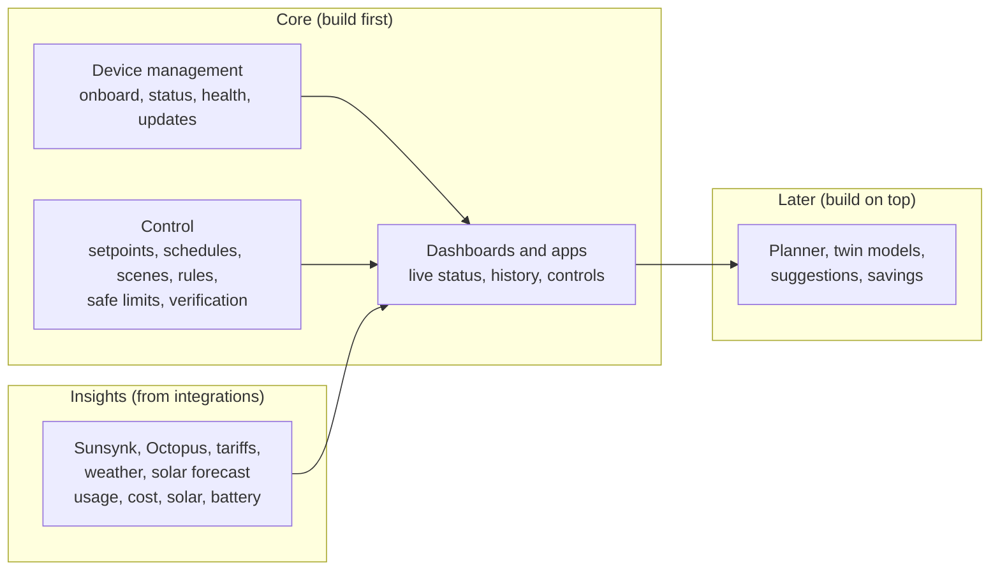
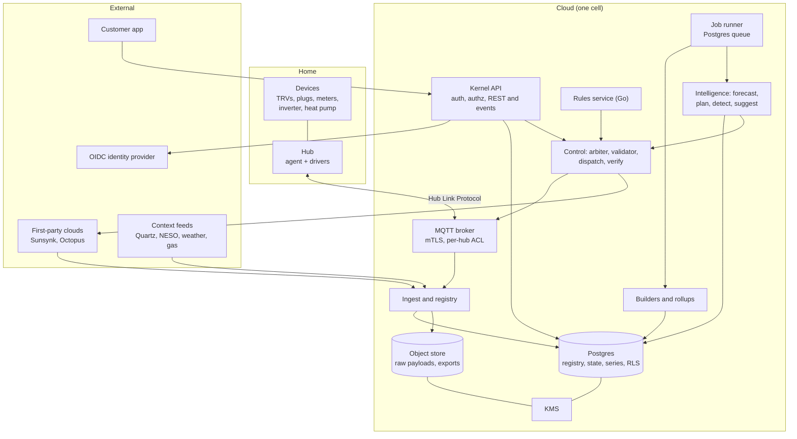
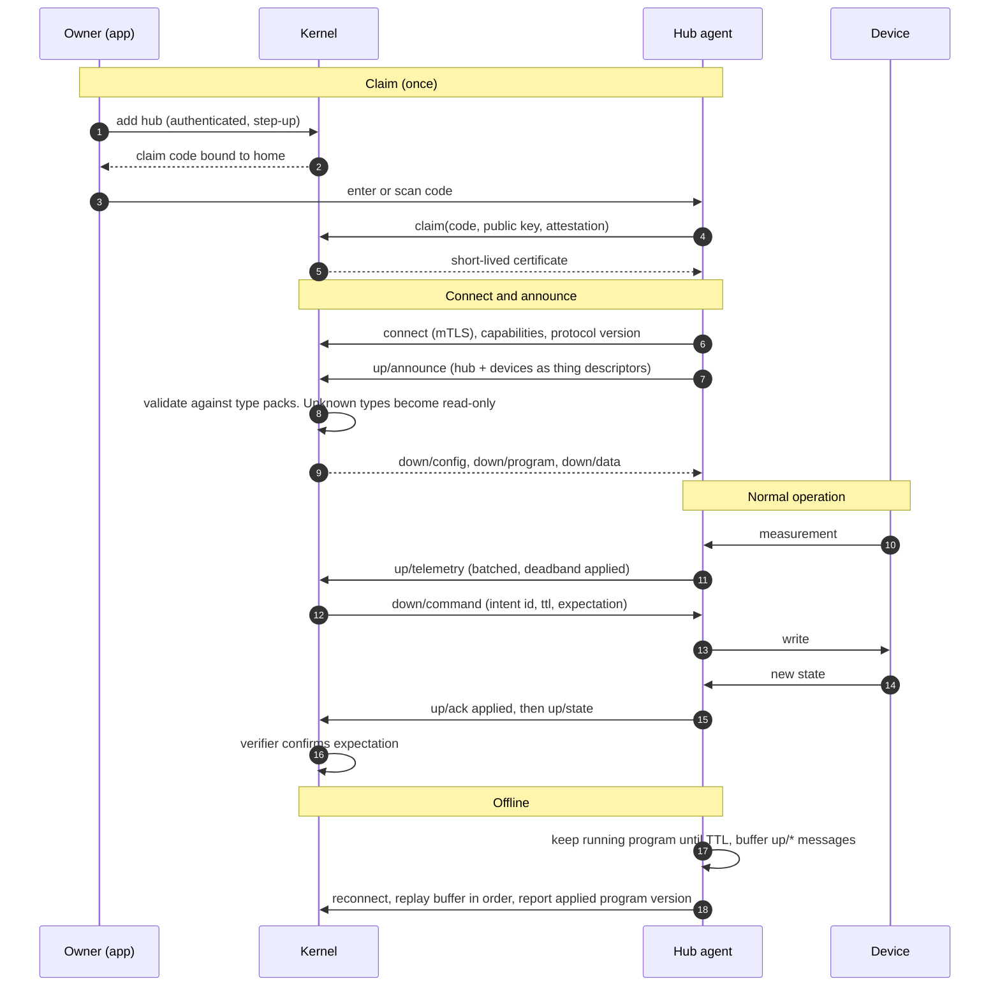
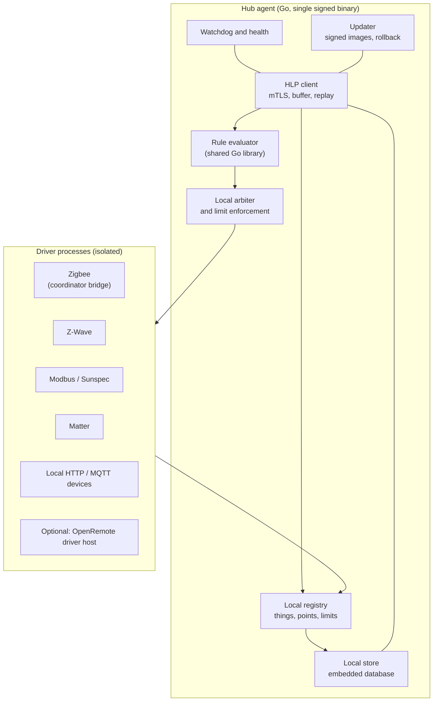
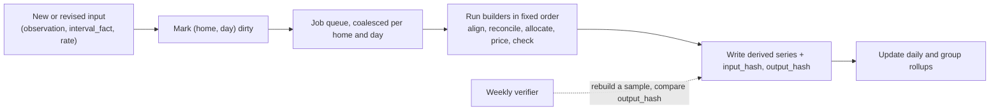
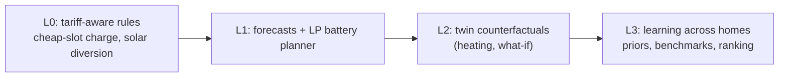
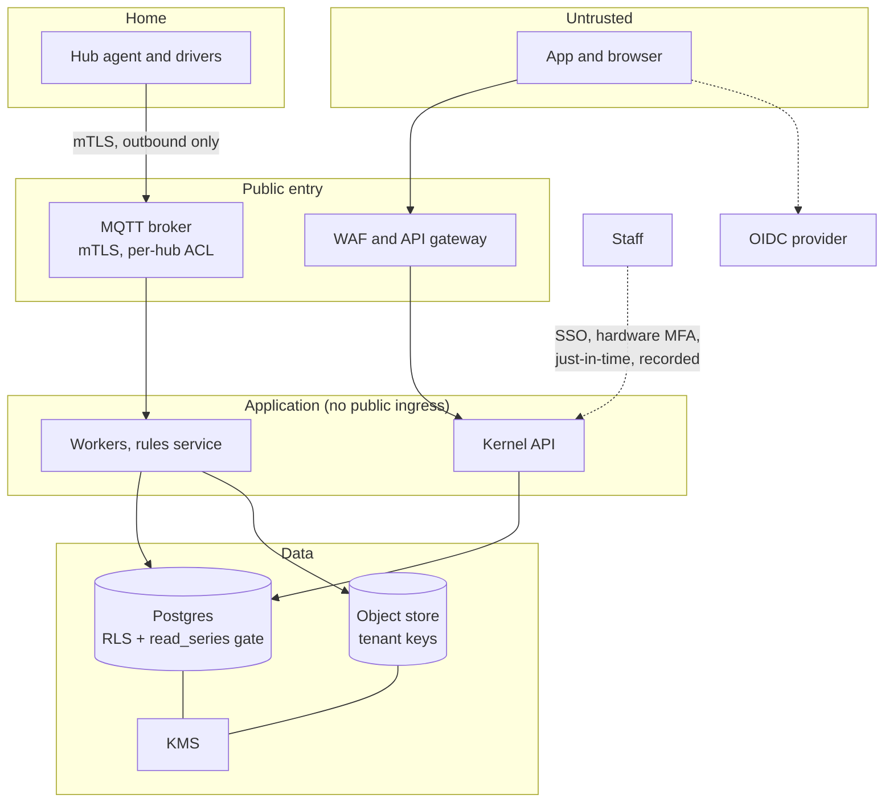
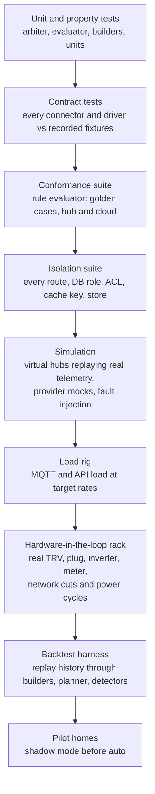
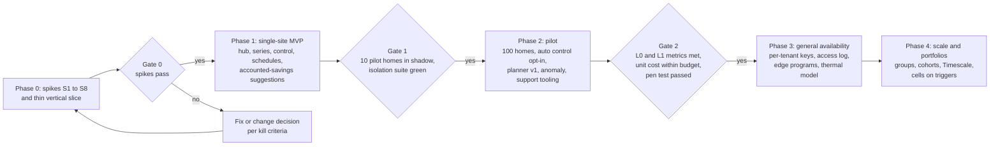

# EnergieBee architecture v3: de-risked, simplified, build plan

Status: proposal · Date: 22 October 2026 · Supersedes parts of [architecture-v2.md](architecture-v2.md)

v2 is the target-state reference: schemas, algorithms and the full feature set. v3 is the decision record and build plan. It fixes the riskiest parts of v2 with evidence, removes what is not needed yet, fills the gaps, and says what to build first. Where v3 and v2 differ, v3 wins (section 2 lists exactly where).

Numbers marked **projection** are arithmetic on stated assumptions. Items marked **spike** must be measured before they are relied on. Items marked **counsel** need legal confirmation.

## Contents

1. [What changed and why](#1-what-changed-and-why)
2. [Evidence that changed the design](#2-evidence-that-changed-the-design)
3. [Architecture decisions](#3-architecture-decisions)
4. [System overview](#4-system-overview)
5. [Hub Link Protocol and hub agent](#5-hub-link-protocol-and-hub-agent)
6. [Data layer for the first phases](#6-data-layer-for-the-first-phases)
7. [Build engine, rules and intelligence, simplified](#7-build-engine-rules-and-intelligence-simplified)
8. [Security model, revised](#8-security-model-revised)
9. [Scope tiers: what is built now, next, later, or cut](#9-scope-tiers-what-is-built-now-next-later-or-cut)
10. [Gaps filled](#10-gaps-filled)
11. [Risk spikes and kill criteria](#11-risk-spikes-and-kill-criteria)
12. [Roadmap with gates](#12-roadmap-with-gates)
13. [Risk register](#13-risk-register)
14. [Decisions needed from you](#14-decisions-needed-from-you)

---

## Product scope (clarified 23 October 2026)

The platform's core job is to **manage and control devices and show their status** in dashboards and apps. **Energy insights come from integrations** (Sunsynk, Octopus and similar), which are read and shown, not recomputed. Smarter planning, twin models and savings suggestions are later layers.



Consequences:

- The tier table (section 9) puts device onboarding, status, control and dashboards in **Now**, and integration data displayed with source labels and honest data states in **Now**.
- The planner, PV and load models, and savings suggestions move to **Next**. The full reconcile-and-allocate energy build moves to **Next**; **Now** keeps only alignment, pricing and data-state labels.
- Platforms that are good at device management, status and control are a closer fit for the core than I assumed in the energy-brain framing. The scale and lock-in evidence in section 2 still applies to them.

## 1. What changed and why

| Area | v2 | v3 | Reason |
|---|---|---|---|
| Device platform | OpenRemote central Manager, realm per home | **Own hub agent and Hub Link Protocol.** OpenRemote is an optional hub driver host, not the foundation | A single OpenRemote Manager does not scale horizontally and is sized for thousands to tens of thousands of assets; realm per home hits Keycloak limits; the edge stack is heavy; broker bridging is unproven (section 2) |
| Customer identity | Keycloak realms | One OIDC identity provider, tenancy by `tenant_id` and row-level security | Realm per user does not scale (section 2) |
| Series store | Timescale with compression from day one | **Plain partitioned Postgres first**, reads only through a checked query function; Timescale when volume demands | Row-level security is unsupported on compressed chunks (section 2) |
| Build engine | Range-level incremental DAG with content-hash short-circuit | **Dirty-day rebuild jobs**, deterministic, hash-checked | Simpler, and wrong numbers are the worst failure |
| Plugins | Manifest, WASM, out-of-process third-party sandbox | **Internal modules with a manifest and contract tests** | No third parties yet |
| Infra | Cells, Kafka, Temporal, ClickHouse | **One cell, Postgres queue, jobs table.** Others have written triggers | No scale to justify them |
| Rules evaluator | Native hub plus WebAssembly in the cloud | **One Go library**, used by the hub agent and a cloud rules service | No WebAssembly toolchain |
| Intelligence | Twin, planner, anomaly, suggestions, fleet learning together | **Ladder with exit metrics.** Savings split into accounted and modelled | Claims must be defensible |
| Gaps | Regulation, economics, operations, testing, product, team not covered | Section 10 | |

---

## 2. Evidence that changed the design

> [!CAUTION]
> <span style="color:#d00000">**EVIDENCE RECORD: OpenRemote as the central platform for a consumer product at massive scale**</span>
>
> <span style="color:#d00000">Checked 22 to 23 October 2026 from documentation, forum threads and vendor pages. **No load test was run.** Quotes are verbatim; links are the sources.</span>
>
> 1. <span style="color:#d00000">**Horizontal scaling is not supported.**</span> OpenRemote staff, 2 March 2026: "OR does not scale well horizontally and there is no real provision at this stage." They are "pretty sure" several Manager instances, even with sticky sessions, would not work, and their best results come from one node scaled vertically (not tested by them). Horizontal scaling of the whole stack "is on the roadmap", with no promise or timeline. [Forum](https://forum.openremote.io/t/best-practices-for-horizontal-scaling-of-openremote-manager-and-keycloak-on-kubernetes/4171)
> 2. <span style="color:#d00000">**The Manager is stateful.**</span> The asker states "Manager is stateful and keeps asset states in RAM." The staff reply did not confirm or deny it. Treat as likely, unconfirmed.
> 3. <span style="color:#d00000">**High availability is self-built.**</span> 2022 reply: Docker Swarm and Kubernetes HA setups were "discontinued", "HA you should configure yourself". [Forum](https://forum.openremote.io/t/on-prem-high-availability-setup-options/1381)
> 4. <span style="color:#d00000">**Stated capacity is thousands to tens of thousands of assets.**</span> Vendor: "thousands, if not ten thousands of assets as well as users". Marketing claim, no benchmark. At about 20 assets per home that is roughly 500 to 2,500 homes per deployment (projection), so 100,000 homes would need 40 to 200 deployments. [Vendor page](https://openremote.io/asset-management/)
> 5. <span style="color:#d00000">**Event rate matters more than device count.**</span> Maintainer, 18 November 2024: "Total number of events / sec is more impactful than total number of devices." A question about 70,000+ devices received no capacity answer from staff. [Forum](https://forum.openremote.io/t/scalability-for-vehicle-tracking-system/3499)
> 6. <span style="color:#d00000">**Multi-tenancy guidance is "one instance with several realms, or several instances".**</span> Staff, 2 March 2026, depending on sizing and isolation needs.
> 7. <span style="color:#d00000">**Realm per home does not scale in Keycloak.**</span> A 2026 vendor measurement recommends a few hundred realms per cluster; a 2000-realm cluster took 7.5 minutes to restart; older reports show slowdowns at 240 to 500 realms. [Measurement](https://skycloak.io/blog/keycloak-realm-scaling-how-many-realms-per-cluster/), [forum](https://forum.keycloak.org/t/performance-with-500-realms/13127)
> 8. <span style="color:#d00000">**The standard stack is heavy.**</span> Reverse proxy, Manager, PostgreSQL and Keycloak; the Manager depends on PostgreSQL and Keycloak by default. No memory or CPU figures are published. [Docs](https://docs.openremote.io/docs/developer-guide/docker-compose-profiles)
> 9. <span style="color:#d00000">**Bridging to an external MQTT broker is unproven.**</span> The MQTT agent is described as the way to reach foreign servers; one user reports a publish topic sending only when triggered from the Manager UI. [Docs](https://docs.openremote.io/docs/user-guide/agents-protocols/mqtt), [forum](https://forum.openremote.io/t/publishing-mqtt-to-external-broker/1065)
> 10. <span style="color:#d00000">**Edge sync gaps.**</span> Sync is one-way from edge to central for assets and selected attributes. Rules distribution and outage catch-up are not documented. [Docs](https://docs.openremote.io/docs/user-guide/gateways-and-devices/edge-gateway)
>
> <span style="color:#d00000">**Correction on record:** an earlier draft said a central realm accepts only one gateway. That was a misreading. The documented limit is one outbound connection per **edge** realm. The number of gateways per central realm is undocumented and untested (spike S1c).</span>
>
> <span style="color:#d00000">**Related, not OpenRemote:** TimescaleDB does not support row-level security on compressed chunks. [Docs](https://docs.timescale.com/api/latest/compression)</span>
>
> <span style="color:#d00000">**Conclusion: OpenRemote is not a suitable central platform for a consumer product that must grow to massive scale.** It fits business and industrial deployments with tens to hundreds of customers and many devices each, fast prototyping, and small deployments. For consumer scale, the platform core (registry, series, control, rules, isolation) is owned by us, and device connectivity sits behind the Hub Link Protocol, where OpenRemote is an optional hub component.</span>
>
> <span style="color:#d00000">**Limits of this evidence:** one staff reply on scaling, a vendor marketing figure for capacity, forum reports of varying age, and a single vendor measurement of Keycloak. Spike S1c and S1b exist to replace these with measurements. If measurements contradict this record, update the record and the decision.</span>

| Finding | Source | Consequence |
|---|---|---|
| Keycloak has no hard realm limit, but a recent vendor measurement recommends a few hundred realms per cluster. A 2000-realm cluster restarted in 7.5 minutes, the realm cache must be tuned, and older reports show degradation at 240 to 500 realms | [Skycloak measurement](https://skycloak.io/blog/keycloak-realm-scaling-how-many-realms-per-cluster/), [Keycloak forum](https://forum.keycloak.org/t/performance-with-500-realms/13127) | Realm per home would need roughly one OpenRemote and Keycloak deployment per few hundred homes: about 300 deployments for 100,000 homes. **Rejected.** |
| OpenRemote's standard stack is a reverse proxy, the Manager, PostgreSQL and Keycloak. The Manager depends on PostgreSQL and Keycloak by default. No memory or CPU figures are published | [OpenRemote docker profiles](https://docs.openremote.io/docs/developer-guide/docker-compose-profiles), [Quick Start](https://docs.openremote.io/docs/quick-start) | An OpenRemote edge instance on every home hub is likely heavy (several JVM and database processes). **Spike S1b** measures it. Not assumed. |
| OpenRemote's MQTT agent reaches external brokers, but the docs and forum say the agent is for reaching foreign servers, and one user reports publishing only when triggered from the Manager UI | [MQTT agent docs](https://docs.openremote.io/docs/user-guide/agents-protocols/mqtt), [forum thread](https://forum.openremote.io/t/publishing-mqtt-to-external-broker/1065) | Bridging an edge OpenRemote to our broker is not a proven, clean path. |
| Gateway sync is one-way from edge to central and covers assets and selected attributes. Rules distribution and outage catch-up are undocumented. The documented limit is **one outbound connection per edge realm** (an edge instance connects to one central manager); the docs and the maintainers' forum replies say nothing about how many gateways a central realm can hold | [Edge gateway docs](https://docs.openremote.io/docs/user-guide/gateways-and-devices/edge-gateway), [forum thread](https://forum.openremote.io/t/one-realm-with-more-than-one-outbound-master-gateway-connection/1379) | We cannot rely on OpenRemote for rules distribution or outage recovery. **Correction:** an earlier draft read this as one gateway per central realm. That reading was wrong, so the gateway count is not the blocker. Whether thousands of gateways per realm work is untested (spike S1c). |
| OpenRemote staff (March 2026): "OR does not scale well horizontally and there is no real provision at this stage." They are "pretty sure" several Manager instances behind sticky sessions would not work, and get their best results from one node scaled vertically. The asker's understanding is that the Manager keeps asset states in RAM. Multi-tenancy can be one instance with many realms or several instances, depending on sizing and isolation. Horizontal scaling of the whole stack is on the roadmap with no timeline. A 2022 reply says high availability setups with Docker Swarm and Kubernetes were discontinued. Vendor marketing claims "thousands, if not ten thousands of assets" | [Forum: horizontal scaling](https://forum.openremote.io/t/best-practices-for-horizontal-scaling-of-openremote-manager-and-keycloak-on-kubernetes/4171), [forum: HA options](https://forum.openremote.io/t/on-prem-high-availability-setup-options/1381), [OpenRemote asset management](https://openremote.io/asset-management/) | **This is the main reason against a central OpenRemote.** One Manager instance is a single stateful process. At roughly 20 assets per home and the vendor's claim of tens of thousands of assets, one deployment serves on the order of 500 to 2,500 homes (projection from a marketing claim, not a measurement). 100,000 homes would need 40 to 200 deployments. Events per second matter more than device count (maintainer reply), so spike S1c measures it. |
| TimescaleDB does not support row-level security on compressed chunks | [Timescale compression docs](https://docs.timescale.com/api/latest/compression) | Series reads go through a checked function. Compression is a later optimisation behind that function. |
| OpenRemote's When-Then rules document value, sunrise and sunset timers, duration, recurrence, AND and OR. Reset, wait and the operator list are undocumented | [When-Then docs](https://docs.openremote.io/docs/user-guide/rules-and-forecasting/when-then-rules) | OpenRemote rules are not our automation engine (unchanged from v2). |

What OpenRemote still offers: a mature protocol agent library and a device asset model. v3 keeps that option open behind the hub protocol (section 5.6) instead of building the platform on it.

---

## 3. Architecture decisions

Each decision has the reason and the condition that would reverse it.

### ADR-1: The hub speaks one protocol, and the hub software is replaceable

The platform defines the **Hub Link Protocol (HLP)**, a versioned MQTT contract between a hub and the kernel (section 5). Whatever runs on the hub (our agent with protocol drivers, or OpenRemote as a driver host) must speak HLP. The kernel never depends on a hub implementation.
*Reverse if:* spike S1b shows OpenRemote's edge stack fits the hub hardware budget and bridges reliably, and its protocol coverage saves meaningful build effort. Then OpenRemote becomes the primary driver host, still behind HLP.

### ADR-2: The kernel is the only central brain; OpenRemote does not run centrally

No central OpenRemote Manager, no Keycloak realms for tenants, no per-realm gateways. Registry, state, rules, control and analytics are in the kernel. The deciding reason is Manager scale: one stateful Manager that its maintainers say does not scale horizontally, sized for thousands to tens of thousands of assets, would force a deployment per few thousand homes at best. Realm per home would add Keycloak's practical limit of a few hundred realms per cluster, and a single shared realm would weaken isolation. Not having a central Manager also removes the double copy of data and a second identity system.

The number of gateways per central realm is **not** a reason: the documented limit is one outbound connection per edge realm, and the docs do not state a cap on gateways per central realm.
*Reverse if:* a commercial or B2B channel needs OpenRemote for sites that already run it. Those sites connect through an OpenRemote-bridge hub type, one deployment per customer, within the few-hundred-realm limit.

### ADR-3: Plain Postgres first, with a checked read path

Series live in declaratively partitioned Postgres. Application roles have no direct access to series tables. Reads go through a security-definer function that validates the caller's site claim. Timescale (with compression) is adopted when the measured triggers in section 6.4 are hit, without changing the function's contract.
*Reverse if:* spike S3 shows plain Postgres misses the ingest or query targets at expected volume.

### ADR-4: Simple, deterministic build engine

Derived series are produced by pure builders per home per day, run when inputs change. Each run records an input hash and an output hash. A scheduled check rebuilds a sample and compares hashes. Range-level lineage and content-hash propagation are deferred.
*Reverse if:* measured rebuild cost or latency becomes a problem.

### ADR-5: Modular monolith, with internal module contracts

One deployable kernel with clear modules: registry, ingest, series, builders, rules, control, intelligence, API. Connectors, builders, forecasters, detectors and opportunities are internal modules with a manifest and contract tests. Third-party sandboxing is not built until a real third party exists.
*Reverse if:* external developers or partners need to ship plugins.

### ADR-6: Postgres queue and jobs table, one cell

Jobs, timers and workflows use Postgres (a queue library using `SKIP LOCKED` and a `jobs` table with explicit state machines). One cell. Kafka, Temporal, ClickHouse and multi-cell sharding are adopted only on the written triggers in section 6.4.

### ADR-7: Structured rules, one evaluator in Go

Rules are the typed, structured model from v2 section 10.5. One Go library evaluates them in the hub agent and in a cloud rules service (called from the kernel over gRPC). There is no WebAssembly build and no second implementation. A conformance suite defines behaviour. A CEL `expr` leaf is deferred.

### ADR-8: Simple authorisation first

Authorisation is role grants on (principal, scope: organisation or site) plus ownership, evaluated in SQL, with row-level security on every relational table. A relationship-graph engine (for example OpenFGA) is introduced when sharing becomes complex enough to need it.

### ADR-9: Two kinds of savings

- **Accounted savings:** exact, from metered energy and actual prices, with no model. For example, "this charge happened in a cheap slot: 8.2 kWh × (peak price − charged price)". Deterministic and auditable.
- **Modelled savings:** counterfactuals from a model (for example lower setpoint). Always shown as a range with the assumptions, and only when the model's fit passes its threshold.
Marketing and billing claims use accounted savings first.

### ADR-10: Intelligence ladder

L0 tariff-aware rules, L1 forecasts with a linear-programming battery planner, L2 twin counterfactuals, L3 learning across homes. Each level has exit metrics (section 7.4). A level is not started until the one beneath meets its metrics.

### ADR-11: Physical safety never depends on our software alone

At provisioning, the device's own protections are configured and verified (TRV frost protection, boiler or heat-pump frost settings, inverter limits set by the installer). Our limits are an additional layer. This replaces v2's OpenRemote protection rules.

---

## 4. System overview



Compared with v2: no central OpenRemote or Keycloak, one broker, one database, one job runner, one rules service. Everything else in v2 is still the target.

---

## 5. Hub Link Protocol and hub agent

### 5.1 Why a protocol, not a product, is the integration point

A hub could run our agent, OpenRemote, Home Assistant or something else. If the kernel depends on the protocol and not on the software, the hub software is a replaceable component. This turns the OpenRemote risk into a measurable choice (spike S1b) instead of a foundation.

### 5.2 Transport and identity

- MQTT 5 over TLS 1.3 with mutual TLS. The client id is the hub id. The certificate encodes the hub id and is short-lived with automatic rotation.
- Topic root `h/{hub_id}`. The broker allows a hub to publish only to `h/{self}/up/#` and subscribe only to `h/{self}/down/#`. A hub cannot see another hub's topics.
- The hub never accepts inbound connections.
- QoS 1 (at least once), with deduplication at ingest by `(hub_id, seq)`.

### 5.3 Message types

| Direction | Topic | Purpose |
|---|---|---|
| Hub to cloud | `up/announce` | Hub and device descriptors (the thing schema), on connect and on change |
| | `up/telemetry` | Batched `{thing, point, ts, value, q}` samples |
| | `up/event` | Discrete events (fault, button, alarm) |
| | `up/state` | Reported state changes of setpoint pairs |
| | `up/ack` | Command and program acknowledgements: `received`, `applied`, `rejected` with reason |
| | `up/health` | Agent version, uptime, resource use, clock skew, buffer depth, driver status, applied program version |
| | `up/log` | Bounded, scrubbed diagnostic logs on request |
| Cloud to hub | `down/command` | An intent: thing, point, value, `intent_id`, idempotency key, TTL, expectation |
| | `down/program` | Signed edge program (compiled rules, schedules, scenes) with version and hash |
| | `down/data` | Cached cloud data with an expiry (today's price slots, planner schedule) |
| | `down/config` | Driver and reporting configuration |
| | `down/ctl` | Reboot, update, identify, pairing mode |

Envelope for every message:

```json
{
  "v": 1,
  "id": "0192f3a1-7c2e-7a10-9b0e-2d5f7e1c0a01",
  "hub": "0192f3a1-7c2e-7a10-9b0e-2d5f7e1c0000",
  "seq": 48211,
  "ts": "2026-10-22T09:35:48.120Z",
  "type": "telemetry",
  "payload": {
    "samples": [
      { "thing": "0192f3a1-…0007", "point": "temperature", "ts": "2026-10-22T09:35:30Z", "value": 19.4, "q": 0 },
      { "thing": "0192f3a1-…0009", "point": "power",       "ts": "2026-10-22T09:35:40Z", "value": 812,  "q": 0 }
    ]
  }
}
```

### 5.4 Flows



### 5.5 Hub agent design



Design points:

- **Drivers are separate processes** speaking a small local driver interface (`discover`, `read`, `write`, `subscribe`, `describe`). A crashed driver does not take down the agent, and drivers can be written or replaced independently. Reusing existing open-source bridges for Zigbee, Z-Wave, Modbus and Matter is the default. Licences must be checked before bundling.
- **Local limits.** The agent enforces each point's limits from the type pack before writing, in addition to the cloud validator.
- **Store and forward.** A bounded local buffer holds outgoing messages. Priority is events and acks first, then telemetry. When the buffer fills, old telemetry is decimated before it is dropped, and the loss is reported in `up/health`.
- **Offline behaviour.** Programs run until their TTL, then each controlled point reverts to its declared safe default.
- **Time.** The agent keeps NTP time and reports skew. Samples carry device time, and the kernel records receive time as well.
- **Updates.** Signed images with A/B partitions and automatic rollback, delivered through a managed update service (bought, not built; see 10.3).
- **Footprint target** (proposed, to be measured): agent under 100 MB resident memory, under 5% CPU at idle, on a small ARM computer module.
- **Local user interface:** none in the first phases. Setup and troubleshooting are through the app and the kernel.

### 5.6 OpenRemote's remaining role

| Use | Status |
|---|---|
| Central platform, Keycloak realms, realm per home | **Cut** |
| Driver host on a hub, behind HLP | **Option**, decided by spike S1b |
| Bridge hub type for customers who already run OpenRemote (B2B), one deployment per customer | **Later**, on demand |
| Development tool for exploring protocols and simulating devices | **Allowed**, not in production |

### 5.7 Hub hardware strategy

- Start with off-the-shelf, pre-certified compute modules and pre-certified radio dongles in a simple enclosure. Do not design custom RF hardware early: radio certification (and the regulatory work around it) is slow and expensive (counsel and a test house).
- Keep the choice of hub hardware independent of the software through HLP.
- Plan for spares and replacement (section 10.3) from the first pilot.

---

## 6. Data layer for the first phases

### 6.1 What stays from v2

The thing and point schema, `series`, `thing_attr_version`, `interval_fact`, `forecast_fact`, `thing_event`, the intent and arbiter model, automations and groups, as defined in v2 sections 5, 6 and 10. They are designed for per-home locality and do not depend on Timescale or Kafka.

### 6.2 What changes

| Item | v3 |
|---|---|
| `obs` | Declaratively partitioned by month (`pg_partman` or equivalent), primary key `(series_id, ts)`, retention by dropping partitions |
| Rollups | Scheduled jobs per home per day write `obs_30m` and `obs_day`. No continuous aggregates yet |
| Read path | Application roles have no `SELECT` on `obs*`. All reads use `read_series(site_id, series_ids, from, to, resolution)` (security definer), which checks the caller's site claim |
| Row-level security | On every relational table (registry, state, intents, automations, insights, grants). Not relied on for series |
| Writes to series | By the ingest role only, in batches via `COPY` or multi-row insert |
| Compression | Deferred. If adopted later (Timescale), reads already go through `read_series`, so row-level security's compression limit does not matter |
| Group rollups | Daily and half-hourly sums over `org → site` only. Cohorts and overlapping groups later |

### 6.3 Volume, with realistic assumptions

Projection. Assume the hub reports at a default of one minute for plugs and TRVs, five minutes for inverter and meters, with deadband, giving an average of about 20 points per minute per home (v2 assumed 100, which was high for a first phase).

| Quantity | Value |
|---|---|
| Rows per home per day | 20 × 1440 = 28,800 |
| Rows per home per month | ~864,000 |
| Raw size per home per month (≈ 40 bytes per row with index) | ~35 MB |
| 1,000 homes, raw per month | ~35 GB |
| 1,000 homes, 90 days of raw | ~105 GB |
| 1,000 homes, sustained ingest | ~330 rows per second |
| 10,000 homes, sustained ingest | ~3,300 rows per second |

This fits a single well-sized Postgres instance for the first thousands of homes. The ingest and query targets in spike S3 verify it.

### 6.4 Scale ladder: written triggers

Nothing below is built until its trigger is met. Each step keeps the previous contracts, so the move is a migration, not a redesign.

```mermaid
flowchart LR
  T0["Tier 0: one Postgres, partitioned obs,<br/>Postgres queue, one broker"]
  T1["Tier 1: add read replica for analytics,<br/>pgbouncer, partition tuning"]
  T2["Tier 2: Timescale compression behind read_series,<br/>object-store export of old partitions"]
  T3["Tier 3: split by home into cells,<br/>global directory"]
  T4["Tier 4: Kafka or Redpanda,<br/>Temporal, ClickHouse"]
  T0 -- "p95 dashboard query > 300 ms,<br/>or replica lag issues" --> T1
  T1 -- "hot series storage > 1 TB<br/>or ingest > 10k rows/s sustained" --> T2
  T2 -- "single primary > 60% CPU at peak<br/>or > 20k homes" --> T3
  T3 -- "need replay across many consumers,<br/>or durable multi-step workflows get complex" --> T4
```



The thresholds are proposed starting points, to be tuned by measurement.

### 6.5 Design rules that keep the later steps possible

- Every table that holds home data carries `tenant_id` and `site_id`, so cells can be split by home.
- No foreign keys between homes. Cross-home data (groups, cohorts) goes through explicit rollups.
- Ids are UUIDv7 (things) and bigint (series), generated so that moves between databases do not collide.
- All time is UTC, with the site timezone applied at the edge of the system.

---

## 7. Build engine, rules and intelligence, simplified

### 7.1 Build engine v1



- A builder is a pure function of `(home, day, inputs, builder_version)`. It is rerun for any day whose inputs changed. Late data marks the day dirty again.
- `input_hash` and `output_hash` are stored per run. The weekly verifier rebuilds a sample of days and alerts on any mismatch.
- "As known at" comes from `recorded_at` and superseded versions on revisable inputs, as in v2.
- Reconciliation uses the weighted least-squares approach from v2 section 8.1. It is a builder, not a framework feature.

### 7.2 Rules and automations scope

| Now | Next | Later |
|---|---|---|
| Schedules (weekly grid), scenes, modes | Dry-run replay on history | `expr` leaf (restricted CEL subset) |
| Rules: thresholds with hold, time and sunrise/sunset, price slots, mode | Templates gallery and accept-a-suggestion | Visual block view |
| Arbiter with fixed precedence, overrides with expiry, decision trace | Edge programs with hub agent and conformance suite | Group (portfolio) automations |
| Run log and "why did this run?" | Conflict preview timeline | Window and forecast-quantile conditions |
| Static checks: scope, cycles, units, required holds | Circuit breakers and approvals tuning | Automation marketplace |
| Cloud rules service in Go, same library as the hub | | |

Edge programs move to "Next" because schedules and the arbiter fallback already give offline safety through device-native settings (ADR-11) and the agent's last-known schedule. Rules that need the edge are added once the conformance suite exists.

### 7.3 Digital twin and planner scope

| Now | Next | Later |
|---|---|---|
| PV expected-output model (physical baseline, Quartz prior, per-home bias correction) | 1R1C thermal model with fit quality | 2R2C, COP curves, DHW tank |
| Load model (profile by time and weekday, temperature term) | EV charging requirement model | Battery degradation, hierarchical priors across homes |
| Battery and tariff planner as a linear program (no binaries), p10/p90 margins, change penalty | Heat-pump scheduling (MILP), EV smart charging | Scenario trees, coupled group optimisation |
| Rule-based fallback plan | Comfort constraints from schedules | |

### 7.4 Intelligence ladder with exit metrics



| Level | Exit metrics (proposed) |
|---|---|
| L0 | At least 99% of rule-triggered intents verified. Accounted savings reconcile to the bill within a stated tolerance for every pilot home |
| L1 | Solar and load forecast error beat a naive baseline (same hour yesterday) over a rolling 30 days. Backtested planner cost is lower than the no-planner baseline with an interval that excludes zero. Zero safety-limit breaches in shadow and live |
| L2 | Thermal fit quality above threshold for the homes shown suggestions. Modelled savings intervals contain the measured result in most adopted cases (calibration check) |
| L3 | A new home reaches useful forecasts faster than cold start, measured. Benchmarks honour the minimum cohort size |

### 7.5 Anomaly and suggestion scope

- **Now:** invariants (stale, flat-line, range, balance residual), hub or device offline with root-cause grouping, command-not-followed. Suggestions limited to three deterministic types with accounted savings: cheap-slot charging, solar surplus diversion, and "schedule says heating on while nobody is home" only if presence is available by consent.
- **Next:** residual monitoring against twin expectations, and modelled suggestions with ranges.
- **Later:** change-point detection, ML detectors, bandit ranking.

---

## 8. Security model, revised

The requirements R1 to R8 and the threat table in v2 section 12 still apply. What changes is the mechanism.



| Topic | v3 mechanism |
|---|---|
| End-user identity | One OIDC provider, passkeys or TOTP, short-lived tokens, refresh rotation. Tenancy is data (`tenant_id`), not provider structure |
| Authorisation | Role grants plus ownership, checked in the API, enforced again by row-level security on relational tables |
| Series isolation | Reads only through `read_series`, which validates the site claim. Writes only by the ingest role. No application role can select from series tables |
| Hub isolation | Per-hub certificate, topic ACLs, one home per hub. Compromise exposes that home only |
| Customers and OpenRemote | No customer access to any device platform. The kernel API is the only door |
| Programs to hubs | Signed by the kernel, verified by the agent, bounded by type-pack limits |
| Secrets | Provider tokens and hub private material in KMS envelope encryption, per-tenant keys added in "Next", crypto-shredding for deletion |
| Staff | No standing production access. Break-glass with approval, time limit and recording. Customer-visible access log in "Next" |
| Verification | Cross-tenant test suite in CI from phase 1 (routes, database roles, broker ACLs, cache keys, object store). Honeytoken records in production |

Per-tenant keys, customer-visible access logs and external penetration testing are scheduled before general availability, and before the first paying customer for penetration testing.

---

## 9. Scope tiers: what is built now, next, later, or cut

| Component | Tier | Trigger or note |
|---|---|---|
| Thing schema, points, registry, invariants | **Now** | Freeze `thing/1` only after spike S4 (five real device families) |
| Hub Link Protocol and hub agent (Go) | **Now** | |
| Connectors: Sunsynk, Octopus, context feeds, as internal modules | **Now** | |
| Series store: partitioned Postgres, `read_series`, rollup jobs | **Now** | |
| Device onboarding, status, health and control dashboards (apps) | **Now** | Core job |
| Integration data shown in dashboards (Sunsynk, Octopus, tariffs, weather, forecast) with source labels and data states | **Now** | Insights come from providers |
| Build engine, minimal: align, price, label final or provisional or missing; dirty-day jobs with hash verification | **Now** | |
| Build engine, full: reconciliation, flow allocation, battery stock value | Next | After dashboards are trusted |
| Schedules, scenes, modes, basic rules, arbiter, run log | **Now** | |
| OIDC, RBAC plus RLS, per-hub certificates, KMS secrets, audit, isolation tests | **Now** | |
| PV and load models, LP battery planner, accounted-savings suggestions | Next | Planning layer, after the core job works |
| Invariant and offline anomaly detection | **Now** | |
| Basic observability: freshness, plan latency, verify rate, job queue age | **Now** | |
| Managed OTA update for hubs | **Now** (bought) | |
| Internal plugin interface with manifest and contract tests | **Now** | |
| Edge programs with conformance suite | Next | After schedules and arbiter are stable |
| Thermal model, heat-pump planning, EV smart charging | Next | Needs real heating data |
| Residual anomaly monitoring, modelled suggestions | Next | |
| Dry-run replay, templates, suggestion-to-automation | Next | |
| Timescale compression | Next | Tier 2 trigger |
| Per-tenant keys, customer access log | Next | Before general availability |
| Group rollups beyond `org → site` sums | Next | |
| OpenRemote as driver host or bridge | Option | Spike S1b, or B2B demand |
| Plugin loader with semantic versioning | Later | When a second team ships modules |
| Out-of-process or WebAssembly third-party plugins | Later | First external developer |
| `expr` leaf (CEL subset), visual block view | Later | After structured editor usability is proven |
| Cohorts, benchmarks, fleet learning, hierarchical priors | Later | Hundreds of homes with data |
| Group (portfolio) automations, coupled group optimisation | Later | First portfolio customer |
| Cells, Kafka or Redpanda, Temporal, ClickHouse | Later | Written triggers in 6.4 |
| Relationship-graph authorisation engine | Later | Complex sharing needs |
| Range-level incremental DAG with content-hash propagation | Later | Measured rebuild cost |
| Central OpenRemote Manager, Keycloak realm per home | **Cut** | Section 2 |
| Custom RF hardware | **Cut** (for now) | Certification cost |

---

## 10. Gaps filled

### 10.1 Regulation and safety (confirm each with counsel)

| Area | What to check | Design consequence |
|---|---|---|
| Product security, UK | The Product Security and Telecommunications Infrastructure regime for connected consumer products (no default passwords, a vulnerability disclosure channel, a declared minimum support period) | Unique per-device credentials from the claim flow, a published disclosure policy, a defined support period for hubs |
| Product security, EU | Radio Equipment Directive cybersecurity requirements and the Cyber Resilience Act timelines if selling in the EU | Security design record, vulnerability handling process, SBOM, update capability |
| Radio and electrical | Pre-certified modules reduce testing. Any change to radio hardware means re-certification | Use pre-certified modules (5.7) |
| Personal data | UK GDPR basis and consent per grant, data protection impact assessment, data subject requests, retention | v2 sections 12.11; DPIA before pilots |
| Smart meter data | Use customer-granted access (for example the customer's own provider API key) and each provider's terms. Do not assume entitlement to bulk or unconsented access | Consent captured per connection and revocable. Revocation stops ingestion and starts retention rules |
| Heating | Boilers and heat pumps are regulated products. Control only through manufacturer-sanctioned interfaces (thermostat call for heat, modulation interfaces). Never bypass boiler safety controls | `safety_class` on type packs. No setpoint beyond device limits. Frost settings verified at provisioning (ADR-11) |
| Solar and battery | Grid connection settings and protection are set by the installer and the distribution network rules | The platform changes operating modes, charge windows and power targets inside installer-set limits. It does not alter grid protection or export-limit settings |
| Unattended loads | Smart plugs on heaters, ovens and other high-risk loads | Type-pack `safety_class: critical` blocks automated switching-on without a documented exception and confirmation |
| Liability | A control mistake can cost money or comfort, or cause harm | Terms of service, autonomy ladder, verification, rate limits, kill switch, insurance advice from counsel |

### 10.2 Economics

Define the unit economics before the pilot, and measure them during it. The model below needs your prices and targets. It deliberately holds no invented prices.

```
cost_per_home_per_month =
    cloud_compute(ingest, builders, rules, planner)       -- measured CPU-seconds per home per day × price
  + database(storage_GB × price + IOPS)                   -- section 6.3: ~35 MB per home per month raw
  + broker(connections, messages)
  + object_store(raw payloads, exports)
  + observability(logs, traces, metrics per home)
  + third_party(forecast API, identity provider, update service, SMS/push)
  + support(tickets per home per month × cost per ticket)
  + hub_amortisation(BOM + enclosure + radios + shipping + returns, over expected life)
  + warranty_and_replacement_allowance
  + payment_and_compliance_overhead
```

- Measure CPU-seconds, rows, messages and storage per home during spike S8, and extrapolate with ranges.
- Set a **target gross margin** and a **maximum cloud cost per home**, then design to the budget. If the budget is exceeded, the first levers are telemetry cadence and deadband, retention, and planner frequency.
- Hub hardware is likely the largest per-home cost in the first phases. Decide hardware-as-a-product or subscription before building the logistics.

### 10.3 Operations

| Area | Plan |
|---|---|
| Hub fleet and OTA | Use a managed update service (for example Mender, RAUC with a hosted server, or a vendor service). Signed images, staged rollouts (canary, then 10%, then all), automatic rollback, per-hub version reporting |
| Device replacement and moves | Flows for replacing a failed device, replacing a hub (re-claim, retain history), and ownership transfer on a house move |
| Support | A support console showing metadata (status, freshness, errors, last commands) by default. Reading customer energy data needs a ticket and consent or a legal basis and is logged |
| Incidents | On-call rota, severity definitions, runbooks for: provider API down, broker down, database failover, hub fleet update problem, suspected tenant data exposure (with notification obligations), mass device misbehaviour (kill switch) |
| SLOs | Ingest freshness, control dispatch-to-verify time, API availability, plan latency, rule run latency. Status page for customers |
| Backups and recovery | Defined RPO and RTO, tested restores, restore drills, documented deletion lag for backups |
| Change management | Feature flags per tenant, staged rollout, expand/contract migrations, rollback plans |
| Cost monitoring | Per-tenant usage metering from day one, so unit economics are visible |
| Provider dependency | Circuit breakers, degraded modes (cached tariffs, last forecast), alerts when a provider changes format or terms |

### 10.4 Testing strategy



- **Virtual hubs** speak HLP and replay anonymised real data, so the whole cloud can be tested at scale without hardware.
- **Provider fixtures** are recorded real responses (scrubbed) used in contract tests. A canary job compares live responses to fixtures to detect provider changes.
- **Fault injection:** drop the uplink, delay messages, duplicate messages, reorder them, skew the clock, fill the buffer, kill a driver, restart the broker.
- **Conformance and isolation suites** gate every release.
- **Golden datasets** from consenting pilot homes, with identifiers removed, for forecasting and planner backtests.

### 10.5 Product and UX research

- Interview households and installers about what they actually want automated, before building the editor beyond schedules.
- Prototype the rule editor and schedule grid, and run moderated usability tests in rounds with small groups, fixing the top issues between rounds.
- Measure: time to first working automation, task completion without help, suggestion acceptance, opt-out and disable rates, support tickets per feature, comprehension of "why did this run?".
- Test accessibility and low-vision, one-handed mobile and older-adult use.
- Define success before the pilot (for example a target for acceptance of suggestions and for retention of automations after 30 days).

### 10.6 Team and skills

Roles that must be covered (as skills, not a headcount claim):

| Skill | Why |
|---|---|
| Backend and platform | Kernel, API, ingest, jobs |
| Data and optimisation | Builders, forecasting, planner, savings accounting |
| Embedded and edge | Hub agent, drivers, OTA, hardware |
| Frontend, mobile and UX design | App, rule editor, schedule grid, research |
| Security and operations | Identity, keys, isolation tests, on-call, incident response |
| Product and QA | Scope, pilots, test strategy, support loop |

If a skill is missing, the section 9 tiers shrink further rather than the quality bar dropping. Hub and embedded work is the usual hidden cost.

### 10.7 Commercial and partner dependencies

| Dependency | Action |
|---|---|
| Sunsynk | The consumer app terms forbid automated scraping. Obtain a partner or API agreement before production use |
| Octopus | Confirm API terms for commercial use and the customer-consent flow |
| Quartz and other forecast sources | Confirm licence and terms for commercial use and rate limits. Keep a second source or a fallback model |
| Open-source components in the hub (drivers, bridges) | Licence review before bundling into a distributed device |
| Identity, update service, push notifications | Choose vendors with exit paths. Keep their contracts behind interfaces |

---

## 11. Risk spikes and kill criteria

Run these in one time-boxed phase before further build. Thresholds are proposed starting points. Agree them before running, so the result decides.

| # | Question | Method | Pass | If it fails |
|---|---|---|---|---|
| S1 | Does the hub agent plus drivers fit and survive? | Agent plus Zigbee bridge on the target module with 20 simulated and 5 real devices. 72-hour soak. 24-hour uplink cut | Resident memory under 100 MB. No crash. After reconnect, buffer replays in order, no loss or duplicates (beyond declared decimation) | Reduce driver set, change module, or revisit language choice |
| S1c | Does a central OpenRemote hold up if we kept it? | One Manager with simulated gateways: connect thousands of gateways to one realm, 20 assets and 5 attributes each, 1 event per minute per attribute plus bursts. Measure memory, CPU, events per second, restart time, Postgres load | Thousands of gateways connect in one realm. Restart recovers in an agreed time. Headroom at target homes per deployment | Central OpenRemote stays cut. Deployment per few hundred homes is not viable |
| S1b | Can OpenRemote's edge stack serve as a driver host behind HLP? | Install the standard stack on the target module. Measure memory, CPU and boot time. Bridge a device through the MQTT agent. Test publish-on-change, rules offline, restart behaviour | Fits the hardware budget, publishes reliably on change, survives restarts and outages | Stay with own agent. OpenRemote only for B2B bridge |
| S2 | Is tenant and hub isolation real? | Two tenants, two hubs. Automated attacks: foreign ids on every route, direct database roles, MQTT topic access, cache keys, object paths | Zero cross-tenant reads or writes. Hub A cannot see or command hub B | Fix before any further feature. Block releases |
| S3 | Does plain Postgres meet series needs through `read_series`? | Load 1,000 simulated homes at the volumes in 6.3 | Sustained 1,000 rows per second with batch commit p95 under 100 ms. Day view for one home under 100 ms. Month at 30-minute resolution under 200 ms | Tune, move rollups, or bring forward Timescale behind `read_series` |
| S4 | Does the thing schema fit real devices? | Model Sunsynk plant, Octopus meters, a TRV via a Zigbee bridge, a smart plug, a heat pump | All five fit without schema changes beyond additive fields. Setpoint-to-state pairs resolved | Revise `thing/1` before freezing |
| S5 | Does the control loop work end to end? | Battery setpoint through arbiter, validator, dispatch, hub, device, verify, with failure injection | At least 99% verified. Every failure surfaced. No limit breach | Fix before adding automations |
| S6 | Is the rule evaluator identical on hub and cloud, and can people use the editor? | Conformance suite on both. Usability test of the sentence editor with households | 100% conformance. Most participants complete a standard rule unaided | Simplify the rule model or editor before building more |
| S7 | Can we legally and commercially use the providers? | Written confirmation for Sunsynk, Octopus, forecast sources | Written yes | Pause the provider, or use a different integration route |
| S8 | What does a home cost to run? | Measure CPU, rows, messages, storage per simulated and pilot home | Under the agreed per-home budget with a margin | Lower cadence, retention, planner frequency, or change pricing |

**Phase gate:** the build continues past the spike phase only if S1 (or S1b), S2, S3, S4, S5 and S7 pass. S6 and S8 may continue with a plan if they miss.

---

## 12. Roadmap with gates



| Phase | Scope | Exit gate |
|---|---|---|
| 0 | Spikes S1 to S8 and a thin vertical slice: one site, Sunsynk and Octopus connected, a real hub with a TRV and a plug, series, one control path, one schedule, one rule, two-tenant isolation test | Gate 0: pass criteria in section 11 met |
| 1 | Hub agent and HLP, registry, device onboarding, status and health, series, minimal build engine, connectors (Sunsynk, Octopus, context feeds) with insights shown in the dashboards and app, schedules, scenes, modes, basic rules, arbiter, run log, OIDC, RBAC and RLS, KMS, audit, managed OTA | Gate 1: ten pilot homes running in shadow for a defined period, isolation suite green, control verification at target |
| 2 | 100 homes, opt-in automatic control, PV and load models, LP battery planner, accounted-savings suggestions, anomaly invariants, support console, incident runbooks, DPIA and regulatory review done | Gate 2: L0 and L1 exit metrics, unit cost within budget, external penetration test passed, legal sign-off |
| 3 | General availability: per-tenant keys, customer access log, edge programs with conformance, thermal model and heating suggestions, templates, dry run | Metrics reviewed monthly |
| 4 | Portfolios, cohorts and benchmarks, group automations, Timescale, cells, other infrastructure on triggers | Triggers in 6.4 |

---

## 13. Risk register

| Risk | v2 status | v3 status | Mitigation |
|---|---|---|---|
| Realm per home does not scale | Open | **Removed by design** | No central OpenRemote or Keycloak realms |
| OpenRemote edge footprint and bridging unproven | Open | **Contained**: optional behind HLP | Spike S1b decides |
| Row-level security unsupported on compressed series | Open | **Removed by design** | `read_series` gate |
| Incremental DAG bugs produce wrong numbers | Open | **Reduced** | Dirty-day builders, hash verification |
| Thing schema leaks against real devices | Open | **Tested before freeze** | Spike S4 |
| Savings claims not credible | Open | **Reduced** | Accounted vs modelled savings, ranges, calibration check |
| Scope too large for the team | Open | **Reduced** | Tiers, gates, kill criteria |
| Regulation and liability | Not covered | **Covered** | Section 10.1, counsel |
| Unit economics unknown | Not covered | **Covered** | Section 10.2, spike S8 |
| Operations and support unprepared | Not covered | **Covered** | Section 10.3 |
| Untestable at scale | Not covered | **Covered** | Section 10.4 |
| Users cannot use the editor | Not covered | **Covered** | Section 10.5, spike S6 |
| Hub hardware cost, logistics, certification | Not covered | **Reduced** | Pre-certified modules, hardware decision in section 14 |
| Provider terms | Noted | **Gated** | Spike S7 |
| Evaluator drift between hub and cloud | Mitigated by WASM | **Mitigated by one Go library** | Conformance suite |
| Hub compromise | Mitigated | **Mitigated** | Per-hub certificates, ACLs, revocation, ADR-11 |
| Plain Postgres hits limits sooner than expected | n/a | **Open** | Spike S3, scale ladder with triggers |
| Go agent skills missing from team | n/a | **Open** | Section 10.6. Alternative is Rust or another language for the agent. Decide in Phase 0 |
| Unverified assumption about licences of bundled drivers | n/a | **Open** | Review before bundling |

---

## 14. Decisions needed from you

1. **Confirm the OpenRemote change.** v3 reverses the earlier choice to use OpenRemote for devices and hubs as the foundation. The evidence is in section 2. OpenRemote stays as an optional driver host behind HLP, decided by spike S1b. If you want OpenRemote at the centre regardless, say so, and the scale consequences must be accepted in writing: one deployment per roughly 500 to 2,500 homes (projection), run as separate cells, with a single realm per deployment (weaker isolation, enforced by the kernel because customers never use OpenRemote) or realms per organisation. Spike S1c tests this.
2. **Hub hardware route:** off-the-shelf pre-certified modules (recommended), partner hardware, or bring-your-own.
3. **Business model:** consumer homes, installers, landlords or portfolios first. This decides whether groups and OpenRemote bridging come early.
4. **Identity provider:** managed service or self-hosted, in one realm.
5. **Hub language:** Go (assumed) or another, given your team.
6. **Target region and regulation:** UK only, or EU as well, for the product security and radio work.
7. **Per-home cost budget and margin target**, to turn section 10.2 into numbers.
8. **Pilot scale and duration** for the gates.
9. **Team shape**, so the tiers can be scoped to real capacity.
