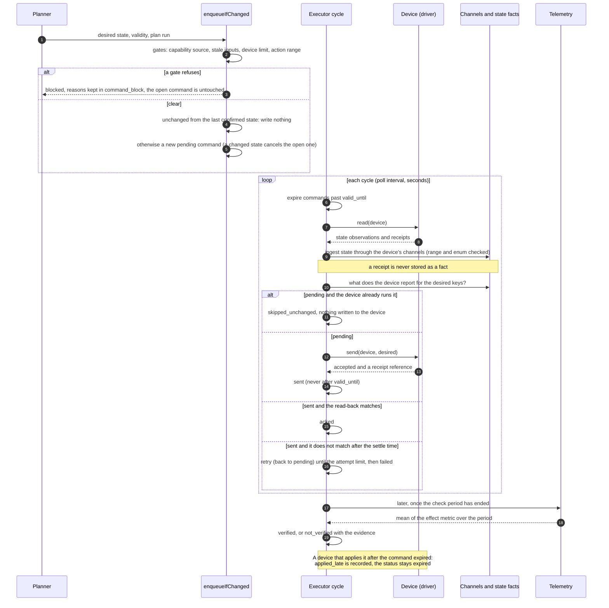

# Control read-back: how a command reaches a device and is proved

Stage 4 of the slot engine (`docs/slot-engine-solution.md`). The command tables (deltas 030 to 033) already held *what should be done*. This stage adds what the **device says it did**, so the core never assumes a write worked.

The rule that runs through it: **the device's own read-back decides, never the database's belief.** A command is acked only when the device reports the desired state; a command that expired but was in fact applied is recorded as such; and a command is only called effective if the telemetry shows its effect.

Written for: engineers working on the control path.

## 1. One command, end to end

## 2. The pieces

| Piece | Where | What it does |
|---|---|---|
| `state` observation | `src/core/channels.js` | What a device says its own setting is (mode code, target level, window start as minute of day). Checked against the channel's range and enum, stored as a reading, held until it changes, and it queues no rebuild (a setting changes no built slot). |
| `ack` observation | `src/core/channels.js` | A receipt that a write was applied. Returned to the executor, **never stored as a fact**. |
| `channel.access` | delta 067 | `read`, `write` or `readwrite`. A state on a write-only point is rejected. |
| `channel.enum_values` | delta 067 | The device's mode codes as words; a state outside it is rejected (`not_in_enum`). |
| `control_limit` | delta 067, `control.js` | An installer's limit on one parameter of one device, with its source and dates. Superseded, never deleted. |
| `command_block` | delta 067 | Every command refused at enqueue, with the gate and the reason. |
| `device_action.effect_check` | delta 067 | Data, not code: `{ metric, min, afterS, windowS }`. Seeded for charge (battery charge power) and export (grid export power). |
| `command.verify_status`, `verified_at` | delta 067 | `verified` or `not_verified` after the effect check. |
| `command.applied_late_at` | delta 067 | The device ran a command that had already expired. |
| `command.ack_ref` | delta 067 | The vendor's receipt reference (a reference, not proof). |
| State metrics | delta 067 | `ctl_work_mode`, `ctl_charge_target_soc_pct`, `ctl_reserve_pct`, `ctl_export_floor_pct`, `ctl_charge_window_start_min`, `ctl_charge_window_end_min`, `ctl_charge_rate_w`, `ctl_discharge_rate_w`, `ctl_setpoint_c`. |
| Executor | `src/core/executor.js` | `runControlCycle(siteId, { driver, now, maxAttempts, settleS, devices })`. |
| Simulated device | `src/core/executor.js` | `createSimulatedDriver`: a device in memory that can ignore writes, apply late, or refuse. |
| Gates, read-back map, effect check | `src/core/control.js` | `checkGates`, `readReported`, `checkEffect`, `ensureControlChannels`, `setControlLimit`. |

A **driver** is `{ source, read(device, { now }), send(device, desired, { now }), handles?(device) }`. `read` returns state and ack observations (the same shape every processor produces), so a vendor's control read-back goes through the same channel path as its telemetry. The core has no vendor driver yet.

## 3. Gates at enqueue

All are checked before anything is changed, so a refused command never cancels the command already open for the device. Each refusal is kept in `command_block`.

| Gate | Refuses when | Does not apply to |
|---|---|---|
| `placeholder_capability` | the device's capability row for the action has source `placeholder` (stated, never confirmed) | confirmed sources: adapter, vendor_doc, probe, installer, user |
| `stale_inputs` | the plan run it comes from has status `stale_inputs`, or (when asked with `freshnessLimits`) the home's live inputs are stale now | actions whose side effect class is `none`, i.e. plain demand, which is the safe fallback of a stale plan |
| `limit` | a value is outside the device's `control_limit` for that parameter | parameters with no limit |
| `params` | a value is outside the range the action itself allows (`device_action.params_schema`) | parameters the schema does not bound |

The older check, that a device must be known to deliver the action (`device_capability.supported = 1`), still throws as before.

## 4. Statuses

| Status | Meaning | Final |
|---|---|---|
| `pending` | queued, not yet written to the device | no |
| `sent` | written; waiting for the device to report it | no |
| `acked` | the device reports the desired state | yes |
| `skipped_unchanged` | the device already ran it when read, nothing was written | yes |
| `failed` | refused or never matched, attempts used up; or the device has no point that can report it | yes |
| `expired` | past `valid_until` before it was acked | yes |
| `cancelled` | superseded by a newer desired state | yes |

Alongside the status: `verify_status` (the effect check, only for `acked`), and `applied_late_at` (only for `expired` commands that had been sent).

`command_log.event` has a CHECK that cannot be widened without rebuilding the table, so the new facts are logged as event `observed` with `detail.state`: `applied_late`, `ack_received`, `verified`, `not_verified`, `unverifiable_fields`.

## 5. What "matches" means

The executor compares only the keys of the desired state that the device has a state point for (`control.js stateMetricFor`). Keys with no point, such as a free-text `mode` label, are listed as `unverifiable_fields` in the log. They are not counted as mismatches, and they are not claimed as confirmed. If **none** of a command's keys can be read back, the command is failed before sending: a write that can never be proved is not sent.

Window times are reported by devices as minute of day; the executor places them on the day of the desired window before comparing.

## 6. Late acknowledgement

A command that was sent, then passed `valid_until` before the device reported it, becomes `expired` (final). If the device later runs it, the next cycles notice (the state matches) and set `applied_late_at`. The status does not change, because an expired command was by definition not confirmed in time; the truth that the device did run it is kept beside it, so the plan's view and the device's state are not left disagreeing. A late receipt is logged with `after_expiry`. This is checked for 24 hours after expiry.

## 7. Effect verification

Some time into the window the executor asks: did the effect show? For a charge, the mean battery charge power over `[window start + afterS, + windowS]` must reach `min`. The metric is read through the planner read layer, so it uses the sources bound to the home. The result is `verified` or `not_verified` with the evidence (metric, minimum, mean, period) in the log. If the period has not ended, or its telemetry has not arrived yet (10 minutes of grace), the check waits; after the grace with no telemetry it is `not_verified` with the reason.

A caution that the check does not remove: a battery already at its target draws nothing, so a correct charge command can read as `not_verified`. The evidence says so; it is for review, not an automatic failure of the command.

## 8. What is tested

`test/control-channels.test.js` and `test/control-readback.test.js`, on a copy of the frozen real GB home with a simulated device: the full path to `verified`; a device already in state (nothing written); a late acknowledgement; no send after `valid_until` and the database refusing it; a read-back mismatch, retry, then `failed`; a slow device waited for within the settle time; a refused write retried; an effect not seen (`not_verified`); the four gates, including that a refused command leaves the open one alone; and the existing database rules (fixed desired state, final statuses, one open command, append-only log).

## 9. Not built

| Not built | Why it matters |
|---|---|
| A vendor driver | The executor and the simulated device are proven; a real inverter driver (Sunsynk write API, Modbus, MQTT) is the first real test of the point mapping. |
| A scheduler | `runControlCycle` is called by hand. Nothing runs it every few seconds or reacts to a push of state. |
| The priority ingest lane | Control needs seconds. State and acks still use the same path as telemetry; a separate lane with a latency target is not built. |
| The command in force in slot lineage | A slot does not yet record which command was running. This needs a change to the builder. |
| Structured schedules | A charge window is one start and one end. A vendor with several windows needs one point per register. |
| Multi-device coordination | Two batteries with one plan are two commands; nothing splits a plan between them. |
| Rate-limit and write-count rules | Predbat's write counter is logged (`registerWrites`), but there is no policy that stops a device being written too often. |
| Automatic review of `not_verified` | The result is recorded; nothing acts on it. |
