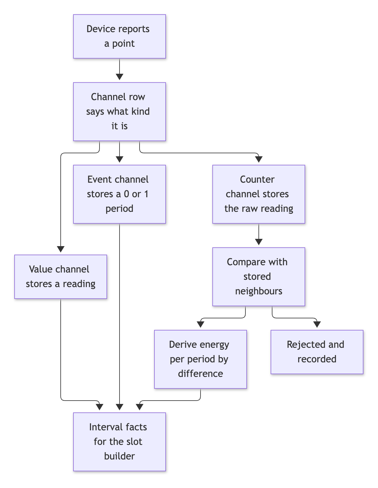
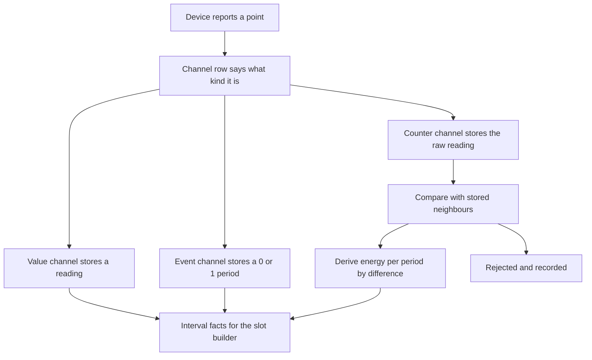

# Counters, events and IoT roles

This page describes three additions to the provider-agnostic core: a **counter** kind (a cumulative meter reading turned into energy per period), an **event** kind (a discrete happening), and **roles and default channels for IoT devices** (heat pump, EV charger, smart plug). It also covers three optional checks at ingest: future timestamps, stuck samples and clock offset.

Everything here is data on channels (delta 072) and a small pure module (`src/core/counters.js`). No vendor is named anywhere in the code.

## The flow

Mermaid source of diagram 1

## 1. Counters

A counter is a cumulative reading: a smart plug's energy total, a heat pump's electricity counter, a daily counter that restarts at midnight. A channel of kind `counter` stores the **raw reading** (under a `*_counter_*` metric, so nothing is lost) and the **energy of each period** under an interval metric, derived by difference from the stored readings.

| Between two consecutive readings | What it means | What is stored |
|---|---|---|
| New is the same or higher | Normal use | A period with the difference |
| New is lower, and the old reading was within 10 percent of the channel's `counter_wrap` | The meter rolled over | A period with `wrap - old + new` |
| New is lower and at most `counter_reset_below` (default a tenth of the old reading) | A reset: a daily counter at local midnight, or a device restart | A period with only the new reading, flagged **partial** |
| New is lower in any other way | The counter went backwards | The new sample is **rejected** (`counter_backwards`) and recorded, never stored |
| The time between readings is longer than `max_gap_s` | A gap | The exact counter difference over the whole gap, flagged **estimated** |

**Decisions**

- **Reset.** After a reset the counter restarted at some unknown moment inside the period. The period carries only what the counter shows after the reset. The energy between the last reading and the reset is unknown and is not invented, hence the partial flag. If a device sends a final reading just before the reset (a last-second-of-the-day sample), at most that one second is lost. This was tested on a 23-hour, a 24-hour and a 25-hour day: the day's energy is conserved to within one second of use.
- **Gaps.** The counter difference across a gap is a real total, so it is kept exactly as one long period and flagged estimated. The slot builder then shares it across the slots by overlap, as it does for any period. The alternative, marking the gap missing, would throw away a true total. Nothing is invented: only the timing inside the gap is unknown, and the flag says so.
- **Duplicates and late samples.** The same reading twice stores nothing new. A late reading splits the period it falls in: the periods in the affected span are derived again from all stored readings, the old periods are superseded (kept, never deleted) and the correction is logged in `fact_correction`. Nothing is counted twice, and the total across the span is unchanged.
- **A late sample that would make the counter go backwards** is checked against its stored neighbours on both sides and rejected the same way.
- **Provider-agnostic.** How a counter behaves (`counter_wrap`, `counter_reset_below`, `max_gap_s`) is on the channel. Nothing depends on a vendor.

## 2. Events

An event is a discrete happening: a grid signal, a door open, a car plugged in, a defrost cycle. A channel of kind `event` stores a **0/1 period** in an interval series, the same way the existing `vpp_export_event` and `vpp_import_event` are modelled. The metric is the event's type (`event_defrost`, `event_ev_plugged_in`, `event_door_open`, `event_grid_signal`).

| Observation | Stored as |
|---|---|
| `{ ts }` (an instant) | A one-second period `[ts, ts + 1)` with value 1 |
| `{ start, end }` | That period with value 1 |
| `value` of 0 or false | Nothing: an explicit "no event" is not an event |
| An event sent to a value channel, or a counter to an event channel | Rejected (`kind_mismatch`) |

Events are never integrated, averaged or turned into energy. They carry no energy figure. The metric declares aggregation `mean` only because the metric table has no other value that fits a 0/1 period (the vpp events do the same). Nothing in the slot builder reads events yet.

I chose an interval series over a new table because the pattern already exists, queries and the explorer already understand interval facts, and an event is a period of something being true.

## 3. Optional checks at ingest

All three are columns on the channel, off when empty, so existing channels behave as before.

| Check | Channel column | Behaviour |
|---|---|---|
| Future timestamps | `future_tolerance_s` | A timestamp further ahead than the tolerance is rejected (`future_timestamp`). The device-kind defaults for counters, events and plug and charger power use 300 seconds |
| Stuck samples | `max_stuck_samples` | From the Nth identical value in a row, the sample is stored with the **suspect** flag and counted in the result (`stuck`). It looks back at stored readings, so a run across two batches is found. The sample is flagged, not dropped |
| Clock offset | `clock_offset_s` | Added to every timestamp of the channel before anything else, for a device whose clock is wrong |

The future check uses the real clock unless `ingestObservations` is given `{ now }`.

## 4. Roles for IoT devices

Five roles were added to `ROLES` in `src/core/inputs.js`. **None has a default source**, so a home that binds none behaves exactly as before.

| Role | Meaning | Consumer today |
|---|---|---|
| `heat_pump_energy` | Electricity into a heat pump (`heatpump_elec_kwh`) | `heat.js` |
| `heat_output_energy` | Heat delivered into the heating circuit (`heat_output_kwh`) | `heat.js` |
| `heat_telemetry` | Heating temperatures, set-points, on/off and COP | `heat.js` |
| `ev_charger_energy` | Energy a charger delivered to a car (`ev_delivered_kwh`) | None yet |
| `plug_energy` | A smart plug's energy (`plug_kwh`), one binding per device | None yet |

**How `heat.js` uses them.** It already read heating series from any source. Now, when a home has bound sources to a heating role, only those sources are read for that role's metrics, and a binding that names a device reads only that device. A binding counts when its period overlaps the window being built. A role that has bindings but none in force in the window reads nothing (the home removed that provider). With no bindings at all, any source is read, as before. Heating still picks one series per metric, so it does not switch source in the middle of a day.

The two roles with no consumer are defined and bindable, with the usual reason rule for changes to built slots. Nothing reads them yet, and the guide says so rather than implying otherwise.

## 5. Channel defaults per device kind

A device kind now brings its standard channels, whatever source feeds it. When a processor ingests for a device, the missing standard channels are created. The vendor's processor maps its own readings to these canonical point names.

| Device kind | Point | Kind | Becomes |
|---|---|---|---|
| Smart plug | `energy_total` | counter | `plug_counter_kwh`, derived `plug_kwh` |
| Smart plug | `power` | value | `plug_w` |
| EV charger | `energy_total` | counter | `ev_delivered_counter_kwh`, derived `ev_delivered_kwh` |
| EV charger | `power` | value | `ev_w` |
| EV charger | `connected` | value | `ev_connected` |
| EV charger | `plugged_in` | event | `event_ev_plugged_in` |
| Heat pump | `elec_total` | counter | `heatpump_elec_counter_kwh`, derived `heatpump_elec_kwh` |
| Heat pump | `heat_total` | counter | `heat_output_counter_kwh`, derived `heat_output_kwh` |
| Heat pump | `flow_temp`, `return_temp` | value | `heatpump_flow_temp_c`, `heatpump_return_temp_c` |
| Heat pump | `defrost` | event | `event_defrost` |
| Heat meter | `heat_total` | counter | `heat_output_counter_kwh`, derived `heat_output_kwh` |

The defaults live in `DEVICE_KIND_CHANNELS` in `src/db/registry.js`. A home can change any of them: an existing channel is never overwritten.

## 6. What changed in the schema

Delta 072 adds eight columns to `channel`: `kind`, `derived_metric_id`, `counter_wrap`, `counter_reset_below`, `max_gap_s`, `max_stuck_samples`, `clock_offset_s` and `future_tolerance_s`. No existing CHECK needed widening, so no table rebuild. New metrics are registry rows: raw counters, derived energies, `plug_w` and four event types.

## 7. Tests

| File | What it covers |
|---|---|
| `test/counter-derive.test.js` | The pure steps; a daily counter that resets at local midnight on a 23-, 24- and 25-hour day (energy conserved); a restart mid-day; a wrap; a backwards step rejected and recorded; out-of-range; a gap; duplicates and late samples; a late sample rejected against its neighbours |
| `test/event-kind.test.js` | Events (instant, period, value 0, same event again), kind mismatch, future timestamps (and that the check is optional), stuck samples across batches, clock offset |
| `test/iot-roles-heat.test.js` | The new roles exist and have no default; a heat pump device brings its standard channels; `heat.js` unbound, bound, bound to another device, unbound; bind and unbind in an empty home |
| `test/iot-roles-reason.test.js` | A past change to a new role on the real-home fixture needs a reason; a change from now on does not |

The heat pump and plug data in these tests is **synthetic**, and labelled so. The real-home golden is unchanged because the fixture has no such devices.

## 8. Not covered

- **Nothing reads events yet.** They are stored correctly but no slot column, check or plan uses them.
- **No consumer for `ev_charger_energy` or `plug_energy`.** They are defined and bindable only.
- **The heating build still picks one series per metric.** A vendor switch in the middle of a day is not merged for heating, unlike the inverter.
- **Daily counters lose the energy between the last reading and the reset** unless the device sends a final reading just before it. This is flagged partial and not invented.
- **A counter's reset threshold is a heuristic** (a tenth of the old reading by default). A channel can set `counter_reset_below`, but there is no automatic learning of it.
- **Counter derivation re-reads the stored readings around a changed sample.** It is exact, but it has not been timed on a counter with years of samples.
- **No real vendor feeds these.** The processors for a real plug, charger or heat pump are not written. Only the channels, roles and tests exist.
- **Two versions of one reading written in the same millisecond collide** on the unique key (`recorded_at` in milliseconds). Only an immediate correction of the same timestamp triggers it. The shared fact writer is unchanged; the tests wait a few milliseconds.
- **Stuck detection applies to value channels only,** not counters (a counter that does not move is normal) and not events.
