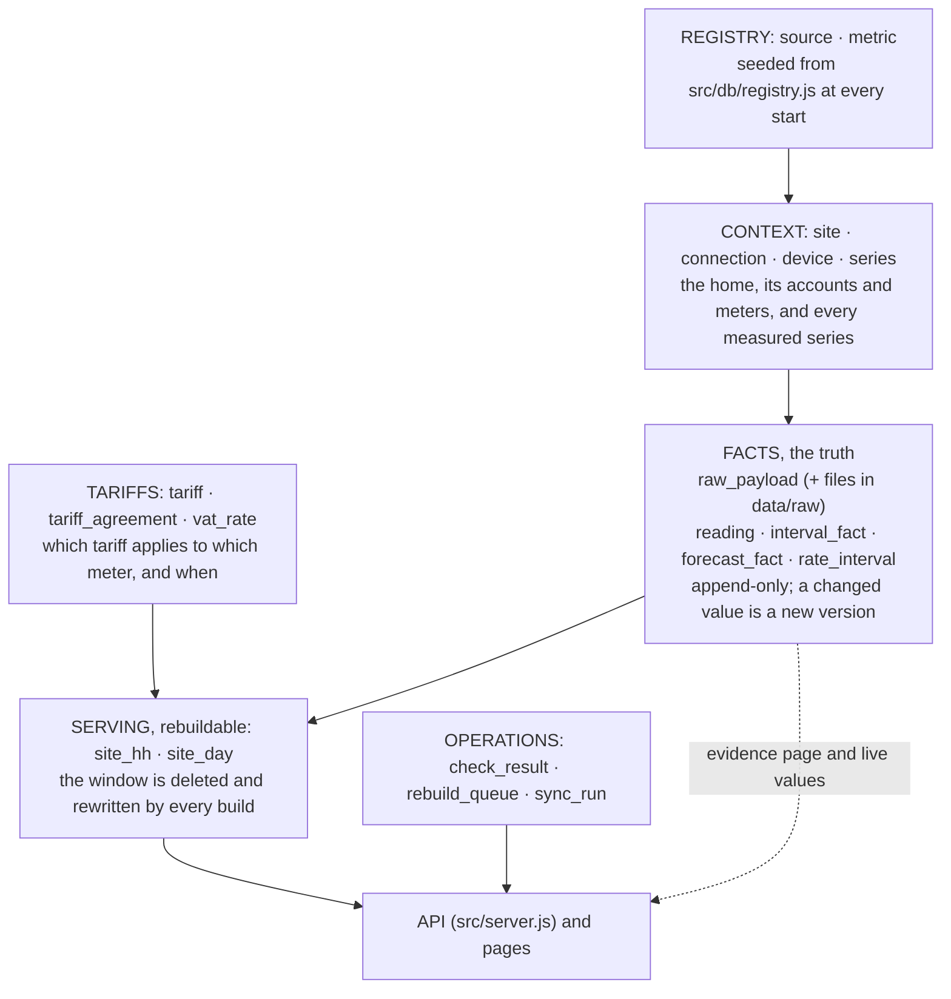
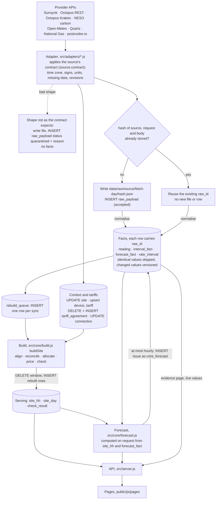
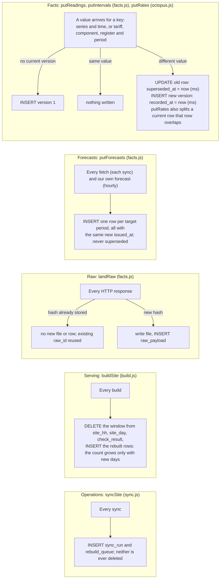
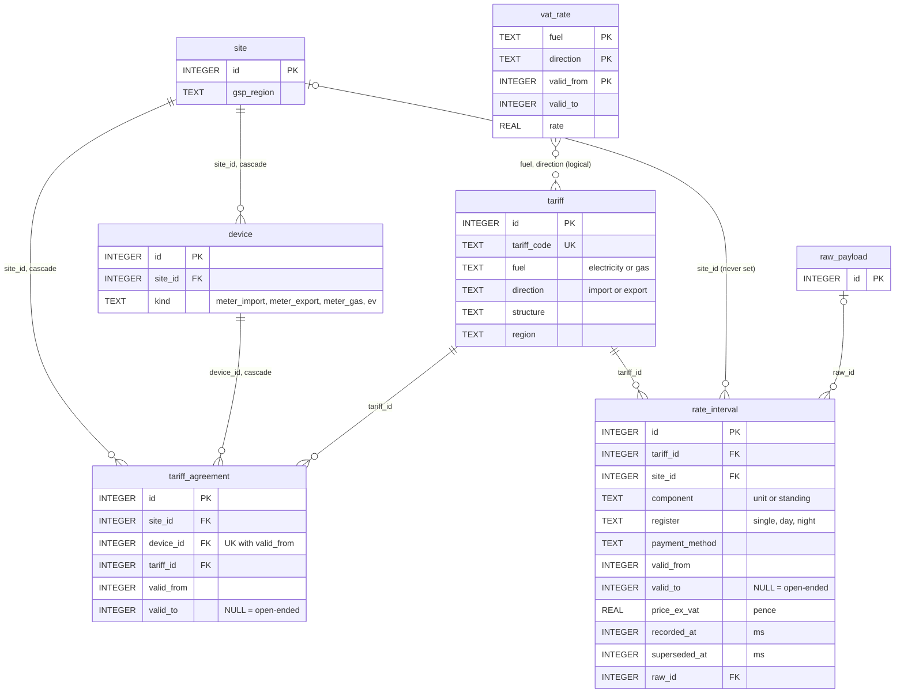
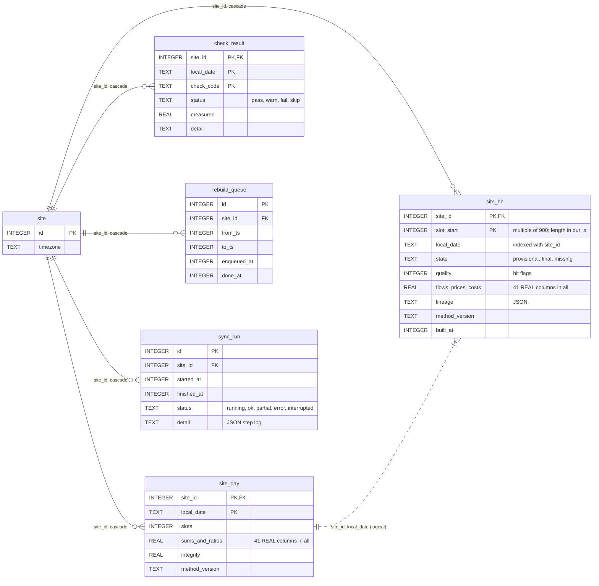
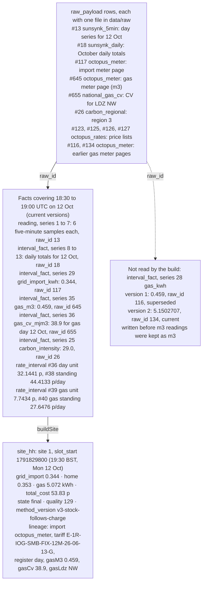

# EnergieBee core: the database

Prototype `energiebee-core-prototype` · SQLite through Node's built-in `node:sqlite` · Build method `v3-stock-follows-charge` · Prepared by Technext · 16 October 2026

This document explains how the prototype stores its data:

1. **Purpose and layers:** what each group of tables is for, why facts are append-only and versioned, and why the serving tables can be thrown away.
2. **System flow:** how data enters, what each step inserts or updates, and what makes the database grow.
3. **Entity–relationship diagrams:** keys and relationships, including the ones the database does not enforce.
4. **Table catalogue:** every table, its keys and constraints, who writes and reads it, its size now and how it grows.
5. **How the tables relate in practice:** one real half-hour traced from raw payload to `site_hh`, and one price traced to a cost.
6. **Growth and storage, measured,** with projections for 1, 1,000 and 100,000 homes.
7. **Scaling path,** grounded in the design as it stands.
8. **Retention and recovery:** what can be deleted, and what cannot.
9. **Appendix:** the queries and commands behind every measured number.
10. **Hardening, 26 October 2026:** how the database is opened, the integrity triggers, indexes and bounded reads, retention, and the security status (Phase A of `docs/hardening-and-planning-plan.md`).

How the half-hour build works, what `final`, `provisional` and `missing` mean, and how the forecast is made are in [Timeline, forecast, data states and data provenance](timeline-forecast-and-data-states.md). This document does not repeat them.

**How the numbers here were obtained.** Every count, size and time below was measured on this prototype's own database and files. The live file changes every 10 minutes, so all queries ran on one consistent copy, taken at **09:35:48 UTC on 16 October 2026** with `sqlite3 -readonly data/core.db ".backup …"` (appendix A1). Each query is in the appendix with an id (Q1, Q2, …) that the text refers to. A figure marked **projection** is arithmetic on measured inputs, and its inputs and formula are given next to it. No outside benchmarks are used.

**What the data covers.** One home: site 1, *10 Acresbrook*. The database was created at 06:10:45 UTC on 16 October (`site.created_at`). The first sync loaded 14 days of history, so the database holds 2–15 October in full and 16 October up to the copy. Octopus meter data arrives about a day late, so 2–14 October are the complete days for every source; "per day" figures use those 13 days. Figures that depend on the sync (raw payloads, forecast issues, logs) use the sync runs since then. Local time in this window is BST (UTC + 1).

**The code changed during the day.** During 16 October the National Gas calorific value source, the `gas_m3` and `gas_cv_mjm3` metrics, and this home's panel angles (which switch on Quartz and sunlight-on-panel data) were all added. The figures describe the code, schema and registry as they were at the copy.

> **Update: fixes made after these measurements (16 October, afternoon).** Sections 6–8 below describe the copy taken at 09:35:48 UTC, before these fixes. Measured afterwards on the live database:
>
> | Change | Before (this document's copy) | After (one sync, measured) |
> |---|---|---|
> | Forecasts stored only when a value changes since the latest version (`putForecasts`) | 539.4 `forecast_fact` rows per sync | **84** rows in one sync |
> | Raw payloads identified by source and body, not by a request URL that carries the current time (`landRaw`) | 22 raw payloads per sync | **7** in one sync |
> | Rebuild starts at the earliest half-hour whose facts changed in this sync, continuing from the battery stock saved on the previous day (`site_day.battery_stock`) | full rebuild from the first day on every sync, about 175 ms for 15 days and growing | **1 day, 13–18 ms**. A full rebuild gives byte-identical `site_hh` and `site_day` (same fingerprint over all 696 half-hours). |
> | Battery efficiency per day from the inverter's daily counters over the 30 days to that day (`site_day.battery_eff`), so a day's value does not depend on how far back a rebuild starts | one value for the whole rebuild window | 94.0% on 16 Oct (118.4 kWh out ÷ (129.1 in − 3.2 stored change)) |
> | Tariff agreements replaced only when the account's history changes | deleted and re-inserted every sync | unchanged rows kept; ids stable |
> | Learning the IOG off-peak window no longer depends on the old `.env` fallback: when no time-stamped IOG prices are held, the sync fetches them for the home's earlier IOG tariffs | could stay unknown on a fresh database | tested by deleting them: re-fetched (29 rows of E-1R-INTELLI-FIX-12M-26-06-13-G), window 23:30–05:30, 0 unpriced half-hours |
> | Rebuilds never start before the home's first inverter or meter data | — | a price list starting in June no longer creates empty half-hours |
> | `reading_current` index dropped (never used; 42.5% of `reading`'s bytes) | present | dropped |
> | Processed `rebuild_queue` rows deleted | kept for ever | deleted after each rebuild |
> | Raw payload row written before its file, removed if the file cannot be written; raw files live next to `DB_FILE` | file first, row second | no orphan files from failed writes |
>
> **Projection** with the new per-sync figures, for one home: forecast rows 84 × 144 syncs = 12,096 a day (was 77,674 from 539.4 × 144). Raw payloads 7 × 144 = 1,008 a day (was 3,169). These come from a single sync, and real values vary with how often providers change their forecasts. Still open: the old `gas_kwh` facts for the m³ meter (kept as history, unused); columns never set (`rate_interval.site_id`, `tariff.name`, `site.is_demo`); `vat_rate` has no overlap check; regional carbon and shared rate pages are still fetched per home (since 23 October, once per region or tariff within one sync cycle: *Market provider registry*, section 4); facts have no `site_id` column.

---

## 1. Purpose and layers

| Layer | Tables | What it holds | Can it be rebuilt? |
|---|---|---|---|
| **Registry** | `source`, `metric` | Every provider feed, with its data contract as JSON, and every canonical metric with its unit, time role and aggregation. | Yes. Seeded from `src/db/registry.js` at every start. |
| **Context** | `site`, `connection`, `device`, `series` | The home; its provider connections and their status; its meters and EV; and one series per subject, metric and source. | Partly. Site fields and devices come back from `.env` and the providers. `series` ids must be kept, because every fact refers to them. |
| **Tariffs** | `tariff`, `tariff_agreement`, `vat_rate` | Tariff codes; which tariff applied to which meter and when; dated VAT (seeded from `registry.js`). | `tariff_agreement` is rewritten from the Octopus account on every sync. |
| **Facts (the truth)** | `raw_payload` (+ files in `data/raw`), `reading`, `interval_fact`, `forecast_fact`, `rate_interval` | Every provider response as received, and every value taken from it, with all versions. | No. Upstream history is limited (section 8), so this is the only copy. |
| **Serving (rebuildable)** | `site_hh`, `site_day` | One row per home per half-hour, and one per home per local day, built from facts. | Yes, by the build engine. |
| **Operations** | `check_result`, `rebuild_queue`, `sync_run` | Daily checks (written by the build), the queue of ranges to rebuild, and a log of every sync. | `check_result` yes; the other two are logs. |

`schema.sql` lists `rate_interval` in its Tariffs group. It is described here with the facts because it is versioned the same way.


<details><summary>Mermaid source</summary>



</details>

### 1.1 Why facts are append-only and versioned

Providers change data they have already sent. The source contracts in `registry.js` record this:
- Octopus meter readings "may be revised for a few days";
- Sunsynk's daily totals for today "keep growing until the day closes";
- Open-Meteo's past hours change with new model runs;
- NESO revises its regional forecasts.

The core also changes its own decisions. On 16 October the gas meter's readings were first converted with a fixed factor, then kept in m³ and converted with National Gas's daily calorific value (section 5.1).

So a fact is never updated in place. `putReadings` and `putIntervals` (`src/core/facts.js`) and `putRates` (`src/adapters/octopus.js`) all follow one rule:
- **No current row for the key:** insert version 1.
- **Same value as the current row:** write nothing.
- **Different value:** set `superseded_at` on the current row and insert a new row. Both use the same timestamp in milliseconds (`recorded_at` on the new row).

Each fact therefore has two times:
- the time it describes: `ts`, `start_ts`/`end_ts` or `valid_from`/`valid_to`;
- the time the core knew it: from `recorded_at` until `superseded_at`.

"Current" means `superseded_at IS NULL`. "What the core knew at time T" means `recorded_at ≤ T AND (superseded_at IS NULL OR superseded_at > T)`. At the copy, 40 of 29,158 readings and 250 of 4,012 interval facts were superseded versions, and none of the 3,117 rate rows were (Q5b).

Forecasts are kept differently. An issue is stored with its `issued_at` and is never superseded, but only for the periods whose value changed since the latest stored issue of that period (`putForecasts`, change-only, `INSERT OR IGNORE`; corrected 26 Oct 2026: this said "stored whole", which stopped being true on 16 October). The forecast used for a past half-hour is the latest issue made before it (`readForecastOfRecord`; the build's `solar_forecast`). Retention thins the issues of periods older than 14 days to the ones a read can pick (section 10.5).

This gives:
- the same facts always build the same half-hours;
- the evidence page can show every version and the raw payload it came from;
- a correction is visible instead of silent: the build marks a final half-hour whose numbers changed as revised (quality bit 128, see [section 2 of the timeline document](timeline-forecast-and-data-states.md#2-what-the-data-states-mean)).

One group of tables does not follow the rule:
- registry rows (`source`, `metric`, `vat_rate`) are brought in line with `registry.js` in place, written only where they differ (section 10.2).

(Corrected 26 Oct 2026: this list also said that `tariff_agreement` is deleted and re-inserted on every sync with no history. It has been versioned like facts since 16 October: `devices.js` `supersedeAgreements` stamps `superseded_at` on the old rows and inserts the new ones, and an "as known at" read uses `recorded_at` / `superseded_at`.)

### 1.2 Why the serving tables are disposable

`site_hh`, `site_day` and `check_result` are written only by `buildSite` (`src/core/build.js`). Each build deletes every row in its window and inserts the rebuilt rows in one transaction. The result depends only on the facts and `METHOD_VERSION`.

Measured: five consecutive full rebuilds through `POST /api/sites/1/rebuild` returned identical totals before and after each run: 693 rows, `SUM(total_cost)` 5218.894836 p, `SUM(home)` 318.894133 kWh (appendix A3).

So:
- a column can be added without migrating data (`db.js` `addColumns` adds the four loss columns this way);
- a change of method is applied by rebuilding;
- a damaged serving table is repaired by rebuilding.

One thing in the serving rows is not derived from facts: the "revised" mark (quality bit 128). The build sets it by comparing the new row with the previous `site_hh` row (`build.js`, `previous` map). If `site_hh` is emptied and rebuilt, those marks are lost (section 8).

---

## 2. System flow: data entry and growth

### 2.1 From provider to page


<details><summary>Mermaid source</summary>



</details>

1. **Adapter** (`src/adapters/*.js`) calls the provider through `fetchJson` (`src/core/http.js`) and applies that source's contract: time zone, signs, units, how missing data looks.
   - If the response does not have the shape the contract expects, it is stored with `quarantine()`: `raw_payload.status = 'quarantined'` and a `reason`, and no facts are written.
   - At the copy, no payload was quarantined (Q12).
2. **Raw landing** (`landRaw`, `facts.js`). The key is the SHA-256 of source, request and body.
   - A known hash reuses the existing `raw_id`.
   - A new hash writes the body to `data/raw/<source>/<UTC fetch day>/<first 16 hex of hash>.json`, then inserts the `raw_payload` row.
   - The file is written before the row, and not in the same transaction (section 8).
3. **Normalise.** The adapter turns provider values into canonical metrics.
   - `seriesId(subject_kind, subject_id, metric, source)` finds or creates the `series` row.
   - `putReadings`, `putIntervals`, `putForecasts` or `putRates` write the facts, each carrying the `raw_id` it came from.
4. **Context.** Adapters also update the home's context:
   - `site`: time zone, coordinates, postcode, regions;
   - `device`: meters, EV, gas unit and zone;
   - `tariff` and `tariff_agreement`;
   - `connection`: status, plant id, meta.
5. **Queue and build.** `syncSite` inserts one `rebuild_queue` row. `processQueue` then runs `buildSite` from the earliest built day to today, and that writes `site_hh`, `site_day` and `check_result`.
6. **Forecast.** `forecastSite` (`src/core/forecast.js`) is computed when an endpoint asks for it and is not stored, except for the hourly record described in 2.2.
7. **API** (`src/server.js`). The endpoints read the tables below. No endpoint calls a provider.

| Endpoint | Tables read | Pages (`public/js/pages`) |
|---|---|---|
| `GET /api/sites` | `site`, `connection`, `sync_run` (latest), `site_day` | every page (`layout.js`) |
| `POST /api/sites/:id/sync` | starts `syncSite` | `layout.js` |
| `POST /api/sites/:id/rebuild` | `site_day`, `site_hh`, then `buildSite` | data |
| `GET …/now` | `reading` (live, then 5-minute), `forecast_fact` (carbon), `site_day`, pricing tables | home, battery, my |
| `GET …/timeline` | `site_hh` (half-hours) or `site_day` (days) | battery, data, my, solar |
| `GET …/summary` | `site_hh` | home, battery, ev, grid, my, solar |
| `GET …/breakdown` | `site_hh`, `site_day` | breakdown |
| `GET …/tariffs` | `tariff_agreement`, `device`, `tariff`, pricing tables | grid |
| `GET …/compare` | `site_hh`, `connection.meta`, `tariff`, `rate_interval`, `interval_fact` (dispatch count), pricing tables | my, tariffs |
| `GET …/forecast` | via `forecastSite`: `site_hh`, `forecast_fact`, `reading`, `interval_fact`, pricing tables | home, battery, grid, my, solar |
| `GET …/solar-expected` | `site`, `site_hh`, `interval_fact` (Open-Meteo sunlight) | solar |
| `GET …/everything` | `site_hh`, `forecastSite`, `sync_run`, `series` + `device` + `interval_fact` (meter arrival times), `tariff_agreement`, `raw_payload` (quarantined), `forecast_fact` (Quartz issues), `check_result`, `connection`, `device` | everything |
| `GET …/ev` | `device`, `site_hh`, `forecastSite` | ev, my |
| `GET …/insights` | `site`, `site_day`, `site_hh`, `check_result` | home, my |
| `GET …/evidence?slot=` | `site_hh`, `reading`, `interval_fact`, `series`, `metric`, `source`, `device`, `rate_interval`, `tariff`, `tariff_agreement`, `vat_rate`, `raw_payload` | data |
| `GET /api/raw/:rawId` | `raw_payload` and its file | data |
| `GET …/health` | `site`, `connection`, `sync_run`, `site_day`, `check_result`, `raw_payload`, counts of `site_hh`, `reading`, `interval_fact`, `forecast_fact`, `rate_interval`, file size | data, grid |
| `GET …/devices` | `device` | my |
| `GET /api/catalog` | `source`, `metric`, `vat_rate` | data |
| `GET /api/connectors` | `market_provider` (every market), `site`, `connection`, `sync_run` (latest with a log, per home), plan per home via `providers.js` `plan`; status hooks: `provider_state` (Tariffscanner, tounify), `tariff_agreement` + `tariff` (typed-in prices) | connectors |
| `GET /api/tounify/allowance` | `provider_state` (row `tounify`: the allowance counters and the cooldown; never the token) | (none yet) |

"Pricing tables" means `loadPricing` (`src/core/pricing.js`), which reads `tariff_agreement`, `device`, `tariff`, `rate_interval`, `vat_rate`, Kraken dispatches in `interval_fact` and `site`.

### 2.2 The 10-minute sync loop and the hourly forecast record

`startScheduler` (`src/jobs/sync.js`) runs `syncSite` for every site, one after another, every `SYNC_EVERY_MINUTES` (default 10). Since 23 October each home runs the plan the market provider registry gives it (`market_provider`, section 4), in one cycle for all homes so that shared steps run once per region, zone or tariff; for the GB home the steps and their order below are unchanged. At the copy, consecutive scheduled runs started exactly 600 s apart (Q26). A sync took 21–40 s, 23.5 s on average, over the 30 syncs since the initial loads (Q29). Most of that time is provider calls: in sync 44, Octopus took 11.5 s and carbon 4.5 s, and the build took 0.2 s.


<details><summary>Mermaid source</summary>



</details>

```mermaid
flowchart TB
  T["Scheduler tick, every 10 minutes (SYNC_EVERY_MINUTES)<br/>syncSite for each site; a site already syncing is skipped"]
  R0["INSERT sync_run (status running)"]
  S1["Sunsynk: plant, 5-minute series for yesterday and today, month totals, live flow<br/>raw_payload · reading · interval_fact · UPDATE site, connection"]
  S1b["measureBatteryCapacity: UPDATE connection.meta (sunsynk);<br/>site.battery_kwh only when BATTERY_KWH is not configured"]
  S2["Location, only when a key is missing: postcodes.io, Octopus GSP, NESO region<br/>raw_payload · UPDATE site"]
  S3["Weather, Open-Meteo: past hours as reading and interval_fact<br/>next 3 days as one forecast_fact issue"]
  S4["Carbon, NESO: past slots as interval_fact (region series)<br/>next 48 h as one forecast_fact issue"]
  S5["Octopus: account, gas units and LDZ, meter readings (4-day look-back),<br/>rates for tariffs in force, Kraken dispatches and devices<br/>device · tariff · tariff_agreement · interval_fact · rate_interval · forecast_fact"]
  S6["Gas calorific value, National Gas: one interval_fact per gas day (LDZ series)"]
  S7["Tariffs from .env, only without an Octopus account"]
  S8["Comparison tariffs: products list, Agile import and export rates<br/>tariff · rate_interval · connection.meta"]
  S9["Quartz solar forecast, only with panel size, tilt and direction"]
  S10["INSERT rebuild_queue, then processQueue:<br/>buildSite from the earliest built day to today<br/>DELETE + INSERT site_hh, site_day, check_result; UPDATE rebuild_queue.done_at"]
  S11["recordForecast, at most once an hour:<br/>INSERT forecast_fact issue (core_forecast: house use, grid import, solar)"]
  R1["UPDATE sync_run: finished_at, status, detail (JSON step log)"]
  T --> R0 --> S1 --> S1b --> S2 --> S3 --> S4 --> S5 --> S6 --> S7 --> S8 --> S9 --> S10 --> S11 --> R1
  NOTE["Every provider step also UPDATEs its connection row:<br/>status, last_success_at, last_error"]
  S5 -.- NOTE
```

What one scheduled sync wrote, measured on sync 44 (09:35:19 UTC; Q28, Q13 and its step log):

| Table | Rows written | Where they came from |
|---|---|---|
| `sync_run` | 1 inserted, then updated | start, then finish with the JSON step log |
| `raw_payload` + files | 22 | Octopus rates 10, Octopus meters 3, carbon 2, Sunsynk live 2, and 1 each from Sunsynk 5-minute, Sunsynk daily, Open-Meteo, Quartz and National Gas |
| `reading` | 22 | 2 new 5-minute samples × 7 metrics, plus 8 live values |
| `interval_fact` | 5 inserted, 3 superseded | 3 new versions of today's Sunsynk daily totals, 1 carbon half-hour, 1 gas-day calorific value |
| `forecast_fact` | 532 | one Open-Meteo issue (248 rows over 4 series), one carbon issue (92), one Quartz issue (192) |
| `rate_interval` | 0 | prices unchanged, so nothing written |
| `rebuild_queue` | 1 inserted, then `done_at` set | |
| `site_hh`, `site_day`, `check_result` | 693, 15 and 91 rows deleted and inserted again | full rebuild from 2 October, 215 ms |
| `connection` | 8 rows updated | status and `last_success_at` per step |
| `tariff_agreement` | 16 rows deleted and inserted again | account re-read |

**Hourly forecast record.** After the build, `recordForecast` stores the core's own 48-hour forecast as a new issue of the `core_forecast` source, if the last issue is at least an hour old. One issue is 96 half-hours each for house use, grid import and solar (288 rows; Q6). It is stored like any provider's forecast so that it can be scored later against what the home did.

### 2.3 What makes the database grow


<details><summary>Mermaid source</summary>



</details>

| Trigger | Table | Effect | Measured rate (section 6) |
|---|---|---|---|
| New 5-minute samples (Sunsynk) | `reading` | +7 rows per 5 minutes | 1,949.2 rows per day |
| Live flow, each sync | `reading` | +8 rows | 8 per sync |
| New weather hour | `reading` (temperature, cloud), `interval_fact` (sunlight) | +2 readings, +1 or +2 intervals per hour | 48 readings and 24 ghi rows per day |
| New meter half-hour (a day late) | `interval_fact` | +3 rows per half-hour (import, export, gas) | 48 per meter per day |
| Changed value (revision) | `reading`, `interval_fact`, `rate_interval` | old row gets `superseded_at`, +1 row | today's daily totals: 59 rows for 6 totals after 42 syncs |
| Forecast fetched | `forecast_fact` | +1 issue: one row per target period | 539.4 rows per sync |
| Own forecast recorded | `forecast_fact` | +288 rows | once an hour |
| New provider response | `raw_payload`, `data/raw` | +1 row, +1 file | 22 per sync |
| Sync | `sync_run`, `rebuild_queue` | +1 row each, never deleted | 1 per sync each |
| Build | `site_hh`, `site_day`, `check_result` | window replaced; grows only with new days | +48, +1 and +6 per day |
| Account re-read | `tariff_agreement` | rows replaced; ids keep rising | 16 rows, ids 515–530 at the copy (Q22) |

---

## 3. Entity–relationship diagrams

The schema is shown in three parts to keep each diagram readable. Solid lines are foreign keys declared with `REFERENCES`. The database enforces them because `db.js` (and `schema.sql`) run `PRAGMA foreign_keys = ON` on the app's connection. Dashed lines are logical relationships that the database does not check. "cascade" marks `ON DELETE CASCADE`; every other declared key has no delete action, so deleting a referenced row fails.

**Registry, context and facts**


<details><summary>Mermaid source</summary>


</details>

**Tariffs and prices**


<details><summary>Mermaid source</summary>



</details>

**Serving and operations**


<details><summary>Mermaid source</summary>



</details>

**Relationships the database does not enforce**

| Column | Points to | How it is matched |
|---|---|---|
| `series.subject_id` (TEXT) | `site.id` when `subject_kind = 'site'`, `device.id` when `'device'`, or a region key when `'region'` | stored as text (`'1'`, `'5'`). Region keys have no table: `'carbon:<NESO region>'` (from `site.carbon_region`) and `'ldz:<gas zone>'` (from `device.attrs.ldz`). At the copy: 30 site series, 4 device series, 2 region series (Q25). |
| `raw_payload.site_id` | `site.id` | no `REFERENCES` clause |
| `site_hh.lineage` (JSON) | source codes, tariff code, register, gas m³ and calorific value used | text, for the evidence page |
| `connection.meta` (JSON) | e.g. `batteryCapacity.rawId` → `raw_payload.id`; Comparison product codes; gas zone and data item id | text |
| `connection.provider` | adapter families (`sunsynk`, `octopus`, `weather`, `gas_cv`, …) | not the same values as `source.code` |
| `market_provider.market_code` | `market.code`, or `'*'` for every market | no foreign key, because of `'*'`; a row for a code no home has is simply never matched (since delta 008) |
| `market_provider.adapter` | the implementation registered under that code (`providers.js` `registerAdapter`, called in `src/jobs/steps.js`), and through it the `connection.provider` its steps update | in code; a row with no implementation is skipped as "adapter not built" |
| `site.gsp_region` | `tariff.region` | used by `learnIogWindow` and the Comparison tariff codes |
| `vat_rate (fuel, direction)` | `tariff (fuel, direction)` | matched by value and date in `vatAt` |
| `site_day (site_id, local_date)` | `site_hh (site_id, local_date)` | both built together by `buildSite` |

`raw_id` (on `reading`, `interval_fact`, `forecast_fact` and `rate_interval`) is a declared foreign key, so it is enforced. A `raw_payload` row that any fact refers to cannot be deleted through the app's connection. The `sqlite3` command-line shell does not enforce foreign keys unless `PRAGMA foreign_keys = ON` is run in that session.

Facts have no `site_id` column. Their home is found through `series`: directly for site series, and through `device.site_id` for device series. Region series (carbon, gas calorific value) are shared by every home in the region. Deleting a `site` cascades to its connections, devices, agreements, serving rows and logs, but not to its `series`, facts or raw payloads.

---

## 4. Table catalogue

Row counts are from the copy (Q1). Growth is per home unless the table is shared. Section 6 has the per-day figures and how they were measured.

### Registry

#### `source`

| | |
|---|---|
| Purpose | One row per provider feed, with its data contract as JSON: time zone rule, time role, signs, units, missing data, revisions, upstream history. The contract documents what the adapter does; no code reads it at run time except `/api/catalog`. |
| Keys and constraints | `id` INTEGER PRIMARY KEY; `code` UNIQUE |
| Written by | `db.js` `seedRegistry()`: upsert on `code` at every start |
| Read by | `db.js` `sourceId()` (cached map used by `facts.js`); joins in `pricing.js`, `compare.js`, `server.js` (`/evidence`, `/everything`, `/health`, `/now`, `/api/catalog`) |
| Rows now | 12 (ids 1–10, 12, 13; id 11 is not used) |
| Growth | One row per new provider feed. Rows are never deleted by the code. |

#### `metric`

| | |
|---|---|
| Purpose | Canonical measurements: `code`, `label`, `unit`, `time_role` (instant or interval), `aggregation` (sum, mean, last, integrate), `domain`. |
| Keys and constraints | `id` PRIMARY KEY; `code` UNIQUE; CHECK on `time_role` and `aggregation` |
| Written by | `db.js` `seedRegistry()` |
| Read by | `db.js` `metricId()`; joins in `pricing.js`, `compare.js`, `sync.js`, `server.js`. `time_role`, `aggregation` and `domain` are read only by `/api/catalog`; the build decides how to aggregate in code. |
| Rows now | 23 (including `gas_m3` and `gas_cv_mjm3`, added on 16 October); 53 from 26 October: the 29 planning metrics (*Planning data* below) and `battery_soc_kwh` (*Plans and commands*) |
| Growth | One row per new metric. |

### Context

#### `site`

| | |
|---|---|
| Purpose | One home: name, postcode and outcode, coordinates, time zone, Octopus price region (`gsp_region`), NESO carbon region (`carbon_region`), panel size, tilt and direction, battery size, `is_demo` (1 = a demo home whose readings, tariffs and prices are generated: its energy data is `synthetic`, it is never synced, and every page shows a "Demo data" banner), `env_key`, `created_at`. Since 23 Oct 2026 also the contracted capacity (delta 007, below). |
| Keys and constraints | `id` PRIMARY KEY; `env_key` UNIQUE (the home configured in `.env` has `env_key = 'env'`) |
| Written by | `sync.js` `ensureEnvSite` (insert, and update from `.env`); `sunsynk.js` `syncSunsynk` (time zone, coordinates, kWp, battery from the Ah × V reading when unset); `geo.js` `resolveSiteGeo` (postcode, coordinates, outcode, regions); `octopus.js` `syncOctopusAccount` (postcode); `derive.js` `measureBatteryCapacity` (battery size, only when `BATTERY_KWH` is not configured) |
| Read by | `build.js`, `pricing.js`, `forecast.js`, `compare.js`, `insights.js`, `derive.js`, `sync.js`, every `server.js` endpoint |
| Rows now | 1 |
| Growth | One row per home; updated in place. |

#### `connection`

| | |
|---|---|
| Purpose | One row per home per provider integration (`sunsynk`, `octopus`, `tariff`, `weather`, `carbon`, `solar_forecast`, `compare`, `gas_cv`, `tariffscanner` on the GB home whose sync ran the catalogue step), with `status` (`new`, `ok`, `error`, or `skipped` when the plan skipped the step, for example for want of credentials), `last_success_at`, `last_error`, `external_ref` (Sunsynk plant id, Octopus account number) and `meta` JSON. **No secret is ever stored here**: the core has no secret store, so keys and passwords stay in `.env` and are read for the `.env` home only. |
| Keys and constraints | `id` PRIMARY KEY; UNIQUE (`site_id`, `provider`); `site_id` → `site` ON DELETE CASCADE |
| Written by | `sync.js` `ensureConnection`, `setConnection` (after every step), `markSkipped`; `providers.js` `connectProvider` (`POST /api/sites/:id/connections`: a per-home provider the registry allows in the home's market, with its non-secret reference only); `sunsynk.js` (plant id, battery reading in `meta`); `derive.js` (measured battery capacity in `meta`); `compare.js` (product codes in `meta`; a home whose comparison step was shared in the cycle gets the first home's copy); `nationalgas.js` (gas zone and data item id in `meta`) |
| Read by | `providers.js` `plan` (which per-home roles the home has), `steps.js` (whether a provider has run before, `resumeDate`), `build.js` (an Octopus connection means meter data is expected), `compare.js`, `nationalgas.js`, `derive.js`, `server.js` (`/api/sites`, `/everything`, `/health`), `connectors.js` (`/api/connectors`: `status`, `last_success_at`, `last_error`; never `external_ref`) |
| Rows now | 8 |
| Growth | One row per provider per home. Updated on every step of every sync; earlier states are not kept, but each step's result is in `sync_run.detail`. |

#### `device`

| | |
|---|---|
| Purpose | Meters (`meter_import`, `meter_export`, `meter_gas`), EV and stand-in meters for `.env` tariffs. `external_ref` is the MPAN, MPRN or device id. `attrs` JSON holds meter serials, profile class, annual estimate, the gas unit decision with its source, the gas zone (`ldz`) and EV status. |
| Versioning (16 Oct 2026) | `recorded_at` (ms): when the core first knew the device; `retired_at` (ms): when it stopped being used. A retired device is kept, not deleted. Every change to `attrs` is also written to `device_attr_version` (`devices.js` `setDeviceAttrs`). Reads of devices in use filter `retired_at IS NULL`; `devicesAt(site, where, T)` gives the devices and details as known at T. |
| Keys and constraints | `id` PRIMARY KEY; UNIQUE (`site_id`, `provider`, `external_ref`); `site_id` → `site` ON DELETE CASCADE |
| Written by | `octopus.js` `upsertDevice` (account), `syncGasUnits` (unit and zone from Kraken), `syncOctopusConsumption` (unit fallback), `syncKraken` (EV); `sync.js` `syncEnvTariffs` (inserts `.env` stand-ins, deletes them once Octopus meters exist) |
| Read by | `build.js` (meters), `pricing.js`, `octopus.js`, `nationalgas.js`, `compare.js`, `sync.js`, `server.js` (`/everything`, `/evidence`, `/ev`, `/devices`, `/tariffs`) |
| Rows now | 4 (ids 3–6; ids 1 and 2 are gone: before versioning, the `.env` stand-ins were deleted once the Octopus meters arrived; they are now retired instead) |
| Growth | One row per meter or device per home. |

#### `series`

| | |
|---|---|
| Purpose | Names one stream of facts: subject (site, device or region), metric and source. Every fact row points at a series. |
| Keys and constraints | `id` PRIMARY KEY; UNIQUE (`subject_kind`, `subject_id`, `metric_id`, `source_id`); `metric_id` → `metric`; `source_id` → `source`; CHECK `subject_kind IN ('site','device','region')`. `subject_id` is not a foreign key (section 3). |
| Written by | `facts.js` `seriesId()`: find, or insert on first use; cached per process |
| Read by | `facts.js`; joins in `pricing.js`, `compare.js`, `sync.js`, `server.js` (`/now`, `/everything`, `/evidence`, `/health`) |
| Rows now | 36: 30 site, 4 device, 2 region (Q25) |
| Growth | About 30 per home plus a few per device, created once. Region series are shared. |

### Tariffs

#### `tariff`

| | |
|---|---|
| Purpose | One row per tariff code: provider, product, fuel, direction, structure (parsed from the code by `parseTariffCode`), region, name. |
| Keys and constraints | `id` PRIMARY KEY; `tariff_code` UNIQUE; CHECK on `fuel` and `direction` |
| Written by | `octopus.js` `upsertTariff`, called for account agreements, `.env` codes and Comparison codes; `tariffscanner.js` `storeMapped` (the Tariffscanner catalogue, `TS-` codes, provider `tariffscanner`; see *Market provider registry*, delta 009); `tounify.js` (`TOUNIFY-<country>-<tariff id>`, provider `tounify`, `taxes_in_price` 1 when the answer carries its levies in `fees` and states its VAT; delta 011, off by default) |
| Read by | `pricing.js`, `compare.js`, `sync.js` (tariffs whose rates to fetch), `server.js` (`/tariffs`, `/everything`, `/evidence`, `/api/catalog?tariffs=<provider>`) |
| Rows now | 8,511 on the 26 October copy (14 Octopus tariffs, the rest the Tariffscanner catalogue; corrected from 14). Index `tariff_structure_region` (`structure`, `region`) since delta 013. |
| Growth | One row per distinct tariff code, shared by every home on it. |

#### `tariff_agreement`

| | |
|---|---|
| Purpose | Which tariff applied to which meter, and when. Versioned (16 Oct 2026): `recorded_at` and `superseded_at` (ms); a changed history supersedes the old rows (`devices.js` `supersedeAgreements`), so prices can be read as known at an earlier moment. Readers of the current history filter `superseded_at IS NULL`; `loadPricing` uses `inForce('a')`. |
| Keys and constraints (versioned) | `id` PRIMARY KEY; partial UNIQUE index **`agreement_current`** (`device_id`, `valid_from`) WHERE `superseded_at IS NULL`; trigger **`agreement_no_overlap_current`** (current rows only). The old table, with UNIQUE (`device_id`, `valid_from`), is rebuilt once on open (`db.js`, foreign-key checks off for the copy). |
| Keys and constraints (before) | `id` PRIMARY KEY; UNIQUE (`device_id`, `valid_from`); CHECK `valid_to IS NULL OR valid_to > valid_from`; trigger **`agreement_no_overlap`**: before insert, abort if another agreement for the same meter overlaps (an open end counts as 9000000000); `site_id` and `device_id` cascade on delete |
| Written by | `octopus.js` `replaceAgreements`: clip upstream overlaps; if the history differs from the current rows, supersede them and insert the new ones (`supersedeAgreements`); `sync.js` `syncEnvTariffs` (`.env` stand-ins, retired once Octopus meters exist) |
| Read by | `pricing.js` `loadPricing`; `sync.js` (which tariffs were in force in the window); `server.js` (`/tariffs`, `/everything`, `/evidence`) |
| Rows now | 16, with ids 515–530 (Q22) |
| Growth | One row per agreement in the account's history, plus a superseded copy each time Octopus changes that history (rare). Unchanged history is never rewritten. |

#### `vat_rate`

| | |
|---|---|
| Purpose | VAT rate by fuel and direction, with validity dates. |
| Keys and constraints | PRIMARY KEY (`fuel`, `direction`, `valid_from`); no overlap check |
| Written by | `db.js` `seedRegistry()`: `INSERT OR REPLACE` from `VAT_RATES` in `registry.js` |
| Read by | `pricing.js` `loadPricing` (all rows), `server.js` (`/evidence`, `/api/catalog`) |
| Rows now | 4 |
| Growth | One row per VAT change. |

### Facts

#### `raw_payload`

| | |
|---|---|
| Purpose | One row per distinct provider response: source, home, request (JSON), `fetched_at`, SHA-256 `hash` of source, request and body, `file` path under `data/`, `status` (accepted or quarantined), `reason`. The body itself is the file. |
| Keys and constraints | `id` PRIMARY KEY; `hash` UNIQUE (the deduplication key); `source_id` → `source`; CHECK on `status`. `site_id` is not a foreign key. |
| Written by | `facts.js` `landRaw` and `quarantine`, called by every adapter and by `compare.js` |
| Read by | `facts.js` (hash lookup); `server.js` (`/evidence`, `/api/raw/:rawId`, quarantined payloads in `/everything` and `/health`, counts in `/health`) |
| Rows now | 754, none quarantined; 755 files on disk (section 8) |
| Growth | 22 rows and files per sync. Most requests include the current time (`period_to`, minute ranges), so the hash is new on every sync even when the body has not changed. |

#### `reading`

| | |
|---|---|
| Purpose | Instant values: Sunsynk 5-minute power and charge level, live flow, hourly temperature and cloud. |
| Keys and constraints | PRIMARY KEY (`series_id`, `ts`, `recorded_at`), `WITHOUT ROWID` (the partial index `reading_current` was dropped: it was never used); `series_id` → `series`; `raw_id` → `raw_payload` |
| Written by | `facts.js` `putReadings`, called by `sunsynk.js` `normaliseDay` and `normaliseFlow` and by `openmeteo.js` `syncWeather` |
| Read by | `facts.js` `readReadings` (build, forecast, Quartz's live generation, `/now`); `derive.js` `measureBatteryCapacity`; `server.js` (`/evidence`, `/health`) |
| Rows now | 29,158, of which 40 are superseded versions |
| Growth | 1,949.2 five-minute rows and 48 weather rows per day, plus 8 live rows per sync. |

#### `interval_fact`

| | |
|---|---|
| Purpose | Values over a period: meter half-hours, Sunsynk daily totals, regional carbon half-hours, hourly sunlight, gas calorific value per gas day, EV smart-charge dispatches. |
| Keys and constraints | PRIMARY KEY (`series_id`, `start_ts`, `end_ts`, `recorded_at`), `WITHOUT ROWID`; CHECK `end_ts > start_ts`; partial index **`interval_current`** (`series_id`, `start_ts`) WHERE `superseded_at IS NULL`; `series_id` → `series`; `raw_id` → `raw_payload` |
| Written by | `facts.js` `putIntervals`, called by `sunsynk.js` `normaliseMonth`, `octopus.js` `normaliseConsumption` and `normaliseDispatches`, `carbon.js`, `openmeteo.js`, `nationalgas.js` |
| Read by | `facts.js` `readIntervals` (build, forecast); `pricing.js` (dispatches); `sync.js` (sunlight coverage, whether `gas_m3` exists); `compare.js` (dispatch count); `server.js` (meter arrival times and EV slots in `/everything`, `/evidence`, `/health`) |
| Rows now | 4,012, of which 250 are superseded versions |
| Growth | Per home: 198 current rows per day plus revisions. Shared: 48 carbon rows per day per NESO region, 1 calorific value per gas day per zone. |

#### `forecast_fact`

| | |
|---|---|
| Purpose | Forecasts: one row per target period per issue. Sources: Open-Meteo (temperature, cloud, sunlight), NESO carbon, Quartz solar, Kraken planned dispatches, and the core's own forecast (`core_forecast`). |
| Keys and constraints | PRIMARY KEY (`series_id`, `start_ts`, `end_ts`, `issued_at`) since delta 040 (before: without `end_ts`, so a period of another length from the same start was dropped by `INSERT OR IGNORE`), `WITHOUT ROWID`; `recorded_at` (ms, NOT NULL, when the core stored the issue; rows from before 040 have `issued_at` × 1000) with index **`forecast_recorded`** (`series_id`, `recorded_at`) (delta 040, *Planning data* below); CHECK `end_ts > start_ts`; indexes `forecast_issued` (`series_id`, `issued_at`) and `forecast_fact_raw` (`raw_id`) since delta 013 (section 10.4; corrected from "no other index"); `series_id` → `series`; `raw_id` → `raw_payload` (NULL for `core_forecast`) |
| Written by | `facts.js` `putForecasts` (`INSERT OR IGNORE`; change-only per period, a period being its start and end), called by `openmeteo.js`, `carbon.js`, `quartz.js`, `octopus.js` `normalisePlanned`, `sync.js` `recordForecast` and `solar-cases.js` `deriveSolarCases` |
| Read by | `facts.js` `readForecastOfRecord` (forecast) and `readForecastAsOf` (what was recorded by a moment; no caller in the build); `build.js` (solar forecast of record); `solar-cases.js`; `forecast.js` `scoreAccuracy`; `sync.js` (time of the last own issue); `server.js` (`/now` carbon, Quartz issues in `/everything`) |
| Rows now | 11,992 |
| Growth | 539.4 rows per sync, plus 288 per hourly own issue. This is the fastest-growing table (section 6). |

#### `rate_interval`

| | |
|---|---|
| Purpose | Unit and standing prices per tariff, excluding VAT, with validity periods; versioned like facts. (Since 23 Oct 2026 also fixed and capacity charges with a charge period, and any register name: see *Markets, money and tax* below.) |
| Keys and constraints | `id` PRIMARY KEY; partial index **`rate_current`** (`tariff_id`, `component`, `register`, `valid_from`) WHERE `superseded_at IS NULL`; CHECK `valid_to IS NULL OR valid_to > valid_from`; CHECK on `component` and `register`; trigger **`rate_no_overlap`**: before inserting a current row, abort if a current row for the same tariff, home, component, register and payment method overlaps it (the schema calls it a stand-in for a PostgreSQL exclusion constraint); `tariff_id` → `tariff`, `site_id` → `site`, `raw_id` → `raw_payload` |
| Written by | `octopus.js` `putRates` via `syncTariffRates`, from `sync.js` (tariffs in force), `syncEnvTariffs` and `compare.js` `syncComparison`. A changed price supersedes the old row. A current row that now overlaps the new one is superseded too, and its parts outside the new period are re-inserted, so no time is left without a price. `tariffscanner.js` `putCatalogueRates` writes the Tariffscanner catalogue's rows the same way (one per payment method; the part of an old row before the new start is kept at the old price). |
| Read by | `pricing.js` `loadPricing` and `learnIogWindow`; `compare.js`; `server.js` (`/evidence`, `/health`) |
| Rows now | 3,117; no superseded rows; `site_id` set on none (Q5b, column check A4) |
| Growth | Per tariff, shared by all homes on it: 48 unit rows per day for each half-hourly (Agile) tariff (Q21); a row per price change for other tariffs. |

### Serving

#### `site_hh`

| | |
|---|---|
| Purpose | One row per home per UTC half-hour: energy per node, the seven flows and losses, prices, VAT, costs, carbon, temperature, the solar forecast of record, checks (`state`, `quality`, `meter_vs_ct`, `rate_found`), `lineage` JSON, `method_version`, `built_at`. 50 columns, 41 of them REAL (Q23). |
| Keys and constraints | PRIMARY KEY (`site_id`, `slot_start`), `WITHOUT ROWID`; CHECK **`slot_start % 1800 = 0`**; CHECK `state IN ('provisional','final','missing')`; index **`site_hh_day`** (`site_id`, `local_date`); `site_id` → `site` ON DELETE CASCADE |
| Written by | `build.js` `buildSite` only: delete the window, insert the rebuilt rows |
| Read by | `server.js` (`/timeline`, `/summary`, `/breakdown`, `/everything`, `/ev`, `/evidence`, `/health`, `/rebuild`); `forecast.js` (14 days of history, accuracy); `compare.js`; `insights.js`; `derive.js`; `build.js` (the previous rows, for the revised mark) |
| Rows now | 693 (14 days × 48 + 21 half-hours of 16 October) |
| Growth | 48 rows per day (46 or 50 on clock-change days). Every sync rewrites all of them. |

#### `site_day`

| | |
|---|---|
| Purpose | One row per home per local day: sums of the half-hour columns; self-consumption, self-sufficiency and blended cost; peak import, base load, charge range, cycles, integrity; counts of final, provisional and missing half-hours. 49 columns, 41 REAL (Q23). |
| Keys and constraints | PRIMARY KEY (`site_id`, `local_date`), `WITHOUT ROWID`; `site_id` → `site` ON DELETE CASCADE |
| Written by | `build.js` `buildSite` |
| Read by | `server.js` (`/api/sites`, `/now`, `/timeline` by day, `/breakdown` ledger, `/health`, `/rebuild`); `insights.js`; `sync.js` (has the home been built, and up to when); `build.js` `processQueue` (earliest built day) |
| Rows now | 15 |
| Growth | 1 row per day. |

### Operations

#### `check_result`

| | |
|---|---|
| Purpose | Checks per completed local day: `completeness`, `rate_coverage`, `energy_balance` (against the home's own 30-day median), `meter_vs_ct` and `meter_vs_ct_export`, `counter_fit_solar`, `_load`, `_import`, `_export`, `_charge`, `_discharge`, `gas_calorific_value`. Two checks for the whole window, `battery_efficiency` and `battery_stock`, are stored on its first day. |
| Keys and constraints | PRIMARY KEY (`site_id`, `local_date`, `check_code`), `WITHOUT ROWID`; CHECK `status IN ('pass','warn','fail','skip')`; `site_id` → `site` ON DELETE CASCADE |
| Written by | `build.js` `buildSite`: delete the window, `INSERT OR REPLACE` |
| Read by | `server.js` (`/everything`, `/health`); `insights.js` |
| Rows now | 91 (Q24) |
| Growth | 6 per complete day (Q8); `meter_vs_ct` starts once the meter data for that day has arrived. |

#### `rebuild_queue`

| | |
|---|---|
| Purpose | Ranges of a home that need rebuilding. |
| Keys and constraints | `id` PRIMARY KEY; `site_id` → `site` ON DELETE CASCADE; index `rebuild_queue_site` (`site_id`) since delta 013 |
| Written by | `facts.js` `markDirty` (called once per sync by `syncSite`, to now; by `sites.js` `setSlotLength` and `setContractedCapacity`, to the end of the home's last built or data day); `build.js` `processQueue` sets `done_at` |
| Read by | `build.js` `processQueue` only: rows with `done_at IS NULL`, `MIN(from_ts)` and `MAX(to_ts)` per home. The rebuild runs from the earliest day asked (never before the home's first energy data) to the latest day asked (never after today), so a slot-length change of a home with three days of data rebuilds those three days, not every day up to today (`test/slot-rebuild-range.test.js`). |
| Rows now | 44, all done |
| Growth | 1 row per sync; never deleted. |

#### `sync_run`

| | |
|---|---|
| Purpose | One row per sync: start, finish, `status` (`running`, `ok`, `partial`, `error`, or `interrupted` when a crash or restart cut it short; set at the next start), and `detail`, a JSON list of each step's result (time taken, counts, errors). |
| Keys and constraints | `id` PRIMARY KEY; `site_id` → `site` ON DELETE CASCADE |
| Written by | `sync.js` `syncSite`: insert at start, update at the end |
| Read by | `server.js` (`/api/sites` latest run, `/health` last 8, `/everything` events in the period), `providers.js` `providerStatus` and `connectors.js` (`/api/connectors`: each home's latest run with a log) |
| Rows now | 44 |
| Growth | 1 row per sync, about 1.1 KB each (Q17); never deleted. |

---

### Trust (added 16 Oct 2026)

Three tables keep history that the serving tables do not. The Data & trust page and `/api/sites/:id/trust`, `/revisions` and `/asof` read them.

#### `site_attribute`

| | |
|---|---|
| Purpose | Panel size, tilt, direction and battery size, one current value per source (`installer`, `measured`, `provider`, `estimated`), versioned like facts. The value in use is the highest-ranked source in force and is cached on `site`. |
| Keys and constraints | PRIMARY KEY (`site_id`, `attr`, `source`, `recorded_at`), `WITHOUT ROWID`; CHECK on `attr` and `source`; `recorded_at`/`superseded_at` in ms |
| Written by | `attributes.js` `setAttribute`, called from `.env` (`ensureEnvSite`), the Sunsynk adapter, `measureBatteryCapacity`; first versions seeded from `site` by `maintenance.js` |
| Read by | `attributeAt` (current, or as known at a moment) in `build.js` as-of rebuilds, `/system`, `/trust` |
| Growth | A row only when a source's value changes (a few per home per year) |

#### `site_day_revision`

| | |
|---|---|
| Purpose | One row each time a completed day's figures, state or checks change in a rebuild: when, why, what changed (from → to), method version, inputs (battery size and source; half-hours from meter and clamp). Each day's first row marks where its history starts. |
| Keys and constraints | `id` PRIMARY KEY; index (`site_id`, `local_date`, `revised_at`) |
| Written by | `build.js` `buildSite`, inside the same transaction as the serving rows; an unchanged rebuild writes nothing |
| Read by | `/trust`, `/revisions`; the "as known at" picker offers its times |
| Growth | About 2–3 rows per day per home (first record, provisional → final, occasional restatement), plus one per day on a method change |
| `kind` | `recorded` (a live rebuild) or `reconstructed` (`history.js`: the day rebuilt as known at each earlier sync, for the time before the live log; one-off, `npm run history:reconstruct`) |

#### `device_attr_version`

| | |
|---|---|
| Purpose | Every version of a device's details (`attrs` JSON: gas unit, gas zone, EV status …), with `recorded_at` and `superseded_at` (ms) |
| Keys and constraints | PRIMARY KEY (`device_id`, `recorded_at`), `WITHOUT ROWID`; `device_id` → `device` ON DELETE CASCADE |
| Written by | `devices.js` `setDeviceAttrs`, only when the details change; first versions seeded by `seedDeviceHistory` |
| Read by | `devicesAt` / `deviceAttrsAt` in as-of rebuilds; before the first version the earliest one is used and reported as an approximation |
| Growth | A row only when a device's details change (a few per device per year) |

#### `fact_correction`

| | |
|---|---|
| Purpose | Facts withdrawn by EnergieBee itself (not by a provider): series, how many, when and why |
| Written by | `maintenance.js` at start-up (idempotent); 16 Oct 2026: 626 derived `gas_kwh` rows |
| Read by | `/trust` |

**As known at.** `facts.js` `withKnownAt(ms, fn)` makes every fact read (readings, intervals, prices, dispatches, the learned IOG window, battery counters) return the version in force at that moment: `recorded_at ≤ T AND (superseded_at IS NULL OR superseded_at > T)`. `buildSite(..., { asOf, dryRun })` uses it to rebuild without writing. Agreements are read with `inForce('a')`, meters with `devicesAt(…, T)` (in use at T, details as known at T), system details with `attributeAt(…, T)`. Where no version existed at T, the earliest recorded one is used and returned in `approximations`.

---

### Markets, money and tax (added 23 Oct 2026)

These tables make the database ready for more than one country, currency, region scheme, tariff shape and slot length. They come from delta files in `src/db/deltas/` that `db.js` applies once each (since 26 October; before that, on every open), after `schema.sql` and after `vat_rate` is seeded: `002-money-tax.sql`, `003-market-region.sql`, `004-tariff-ledger.sql`, and (same day) `005-provenance.sql`, `006-register-window.sql`, `007-capacity.sql`, described in *Provenance, register windows and capacity* below, and `008-market-provider.sql`, `009-provider-state.sql`, `010-provider-owner.sql` and `011-tounify.sql`, described in *Market provider registry* below. The rules are stated at the top of each delta: statements end with `;` at the end of a line, a trigger ends with `END;`, an `ADD COLUMN` whose column exists is skipped (SQLite has no `ADD COLUMN IF NOT EXISTS`), and everything else can run again. Backfills are guarded by `schema_delta`, so homes and tariffs that exist the first time a delta runs become country GB, currency GBP, market GB once; later rows are written with their own values. After the deltas, `db.js` upserts the reference rows (markets, one bidding-zone region per market, the 14 GB distribution regions and their aliases, and the providers of each market's roles).

Row counts below are from a copy of the live database opened by the new code on 23 October (one home, 14 tariffs, 3,786 rate rows).

#### `schema_delta`

| | |
|---|---|
| Purpose | Which deltas have been applied, and when. Guards the first-time backfills. |
| Keys and constraints | `name` PRIMARY KEY, `WITHOUT ROWID`; `applied_at` in ms |
| Written by | The last statement of each delta (`INSERT OR IGNORE`) |
| Read by | The deltas' backfill statements; `db.js` `deltaPending` (since 26 October a recorded delta is skipped unless an object it creates is missing, section 10.1) |
| Rows now | 6 on the 23 October copy (002–007); 10 once deltas 008 to 011 are applied (one per delta file, 002–011) |
| Growth | One row per delta file. |

#### `currency`

| | |
|---|---|
| Purpose | ISO 4217 code, number of minor-unit digits, symbol. Every amount in the database is in minor units (pence, cents) of one of these. There is no FX: amounts in two currencies are never added, compared or converted. |
| Keys and constraints | `code` PRIMARY KEY, `WITHOUT ROWID`; CHECK three upper-case letters; CHECK `minor_exponent` 0–3 |
| Written by | Delta 002 (`INSERT OR IGNORE` GBP, EUR); must match `CURRENCIES` in `src/core/money.js` (test `deltas.test.js`) |
| Read by | Foreign keys from `site`, `tariff`, `tax_rule`, `market`, `site_day`; `/api/catalog` |
| Rows now | 2 |
| Growth | One row per currency added. |

#### `tax_rule`

| | |
|---|---|
| Purpose | Taxes and levies as dated, ordered rules per country, fuel, direction and customer class. `kind`: `percent` (a fraction, no currency), `per_kwh` (minor units per kWh, on the unit charge), `per_period` (minor units per `charge_period` day, month or year, on the fixed charge; may be negative, such as the Dutch yearly credit). Applied in `seq` order by `src/core/tax.js` `applyTaxes`: a percentage applies to the price plus every tax with a lower `seq`, so VAT is charged on an energy tax. `unverified = 1` marks a placeholder value. Versioned like facts (`recorded_at`, `superseded_at` in ms), so an "as known at" rebuild reads the rules of that moment. Takes over from `vat_rate`. |
| Keys and constraints | `id` PRIMARY KEY; index **`tax_rule_lookup`** (`country`, `fuel`, `direction`, `valid_from`) WHERE current; CHECKs: currency only and always for amounts, `charge_period` only and always for `per_period`, a percent between 0 and 1, `per_kwh` on unit only, `per_period` on fixed only, `valid_to > valid_from`; trigger **`tax_rule_no_overlap`**: the same tax may not apply twice to the same charge at the same moment (`all` overlaps `unit` and `fixed`) |
| Written by | Delta 002: GB VAT copied from `vat_rate`, row for row (same rates and dates, `seq` 100, `applies_to = 'all'`, `recorded_at` 0), only while there is no GB VAT rule. `db.js` `syncGbVat()` on every open (a read; it writes only when something changed): if `VAT_RATES` in `registry.js` has changed since, the current GB VAT rules are superseded (kept) and the new set recorded, labelled `origin = 'sourced'`. The FR and NL placeholder rules in `tax.js` are **not** written by the deltas; the demo and tests write them into their throwaway databases with `origin = 'placeholder'` and their `source` text as `origin_note`. Since delta 005 every rule has `origin` / `origin_note` (below). |
| Read by | `pricing.js` `loadPricing` (the home's country, as known at the moment built) and `taxesAt`; `server.js` (`/evidence`, `/api/catalog`) |
| Rows now | 4 (GB VAT: electricity import 5 % to 1 Oct 2026 then 0 %, export 0 %, gas 5 %) |
| Growth | One row per rate change per country. |

How pricing uses it: every unit tax is linear in the price, so the price paid per kWh is always `(supplier price + per-kWh levies) × (1 + percentage)`. `site_hh.import_rate_ex` stores the bracket and `import_vat` the percentage, so `import_rate_ex × (1 + import_vat)` stays the price paid. With one percentage rule (every GB tariff) this is exactly the old arithmetic; a GB home with no rule falls back to `vat_rate`. Fixed charges with a per-period tax go through `applyTaxes` with the real length of the local day, month or year.

#### `market`

| | |
|---|---|
| Purpose | One row per market: country, its own clock (IANA zone), currency, price interval, usual meter interval, default slot length for a new home, ENTSO-E bidding zone. |
| Keys and constraints | `code` PRIMARY KEY, `WITHOUT ROWID`; `currency` → `currency`; CHECK intervals divide an hour and are multiples of 5 minutes; CHECK `default_slot_s IN (900, 1800, 3600)` |
| Written by | Delta 003 inserts GB (needed by the backfill); `db.js` inserts the rows of `src/db/seed/markets.js` that are missing (since 26 October; it used to upsert every column on every open, so an operator's correction reverted), with `origin`: GB `sourced` (half-hourly settlement, Elexon BSC), FR, NL, DE, BE and ES `placeholder` (written from memory; DE, BE and ES also marked unverified in the seed). |
| Read by | `sites.js` `createSite` (defaults for a new home), trigger `site_currency_matches_market_*`, `/api/catalog` |
| Rows now | 6 (GB, FR, NL, DE, BE, ES) |
| Growth | One row per market. |

#### `region`

| | |
|---|---|
| Purpose | Every way a country is divided, as (`scheme`, `code`): `gb_dno` (the 14 GB distribution regions, code = MPAN distributor id 10–23), `bzn` (one bidding zone per market: the whole-country region of FR, NL, GB), and later others (`gb_carbon`, …). Each scheme is its own partition of the map. |
| Keys and constraints | `id` PRIMARY KEY; UNIQUE (`scheme`, `code`); CHECK `country`; trigger **`region_scheme_not_an_alias`** |
| Written by | `db.js` on open: `seedRegionsGb` (`src/db/seed/regions-gb.js`; `origin = 'sourced'`; the note names the sources: the MPAN distributor ids, the Octopus GSP letters, and the Tariffscanner region ids and names as captured in the saved live samples `test/fixtures/tariffscanner/`) and `seedBiddingZones` (`seed/markets.js`; each zone carries its market row's origin, the note says it is derived from it) |
| Read by | `region_alias` and `site_region` (foreign keys), `sites.js` `assignRegion`, `regionsOf`, `/api/sites` |
| Rows now | 20 (14 `gb_dno`, 6 `bzn`) |
| Growth | Rows per scheme added. |

#### `region_alias`

| | |
|---|---|
| Purpose | Other numberings of the same region: for `gb_dno` `16` the Octopus letter (`octopus_gsp` `G`), the Tariffscanner id (`tariffscan_id` `7`) and name (`tariffscan_name` `Norweb`). An alias resolves to exactly one region. Partitions are never aliased to each other (NESO carbon regions and DNO regions divide GB differently). |
| Keys and constraints | PRIMARY KEY (`alias_scheme`, `alias_code`), `WITHOUT ROWID`; (`scheme`, `code`) → `region` ON DELETE CASCADE; CHECK `alias_scheme <> scheme`; triggers **`region_alias_not_a_partition`** (insert and update) |
| Written by | `db.js` on open (`seedRegionsGb`) |
| Read by | `src/core/regions.js` keeps the same index in memory (`resolveRegion`, `aliasesOf`); SQL joins as in `deltas.test.js` |
| Rows now | 42 (3 per GB region) |
| Growth | Rows per numbering added. The Tariffscanner ids (1–14, in alphabetical order of the names) are not documented upstream. The saved live samples in `test/fixtures/tariffscanner/` show 10 of the 14 id/name pairs, and `test/regions-gb.test.js` checks each against these aliases; 2 East Midlands, 3 London, 8 Scottish Hydro and 10 Seeboard are not in a sample. The adapter skips a record whose region name and id disagree. |

#### `site_region`

| | |
|---|---|
| Purpose | The region a home is in, one current row per scheme, versioned like facts: a correction supersedes the old row (kept). |
| Keys and constraints | PRIMARY KEY (`site_id`, `scheme`, `recorded_at`), `WITHOUT ROWID`; partial UNIQUE index **`site_region_current`** (`site_id`, `scheme`) WHERE current; (`scheme`, `code`) → `region`; CHECK `superseded_at >= recorded_at` |
| Written by | `sites.js` `assignRegion` (by code or by any alias); `db.js` on open: a home with an Octopus GSP letter on `site.gsp_region` and no current `gb_dno` row gets one (`source = 'postcode_lookup'`; an existing row is never overwritten) |
| Read by | `sites.js` `regionsOf`, `/api/sites` (`regions`) |
| Rows now | 1 (the live home: `gb_dno` 16, North West England, from letter G) |
| Growth | One row per home per scheme, plus one per correction. |

#### Columns and constraints added to existing tables

| Table | Added | Notes |
|---|---|---|
| `site` | `currency` → `currency`, `country`, `market_code` → `market` | Deltas 002/003; backfilled GB / GBP / GB once. New homes are written by `sites.js` `createSite`, which defaults to market GB, GBP, Europe/London and 1800 s (the `.env` home) and takes the market's own defaults otherwise (NL: EUR, Europe/Amsterdam, 900 s). Triggers: **`site_currency_matches_agreements`** (delta 002) and **`site_currency_matches_market_insert` / `_update`** (delta 004): a home is billed in its market's currency. `slot_s` (900/1800/3600) is changed by `sites.js` `setSlotLength` or `POST /api/sites/:id/slot`, which queues a rebuild of the built days (first built day to last built or data day, not to today). Delta 007 adds `contracted_kva`, `contracted_kva_origin`, `contracted_kva_note` (below). |
| `tariff` | `currency`, `country`, `native_period_s`, `kind` | Deltas 002/003/004. `kind` is the adapter contract's (`flat`, `tou`, `calendar_tou`, `dynamic`, `spot_indexed`, `dispatch`, `market`), backfilled from the Octopus `structure` once. `structure` stays the pricing method; the new value `windows` means the unit rows were expanded from register windows (`tariff-expand.js` `expandWindows`, written by `tariffs.js` `storeWindows`), so the row covering an instant gives its register. Trigger **`tariff_currency_matches_agreements`**. `octopus.js` `upsertTariff` sets `currency = 'GBP'`, `country = 'GB'`, `kind` from the structure (flat/export → `flat`, tou/e7 → `tou`, agile/agile_export/tracker → `dynamic`, iog → `dispatch`), `native_period_s` (Agile 1800, tracker 86400, others NULL) and `origin = 'provider'`, and fills them in on a row stored before they existed without overwriting set values. Delta 005 adds `origin` / `origin_note`, delta 006 `default_register` (below), delta 011 `taxes_in_price` (0/1, default 0: below). |
| `tariff_agreement` | (triggers only) | **`agreement_same_currency_insert` / `_update`** (delta 002): a tariff in another currency than the home's cannot be agreed. `pricing.js` `loadPricing` checks again and refuses to price a mixed pair. |
| `rate_interval` | `component` now `unit`, `standing`, `fixed`, `capacity`; `charge_period` (`day`, `month`, `year`); `register` any non-empty text | The old CHECKs (unit/standing; single/day/night) cannot be altered, so `db.js` `upgradeRates()` rebuilds the table once: in one transaction with foreign-key checks off, renamed, recreated from `schema.sql`, every row copied with its id, the old table dropped; then `schema.sql` puts back **`rate_current`** and **`rate_no_overlap`** (now also keyed on `charge_period`). CHECK: `unit` has no period, `standing` is per day, `fixed` and `capacity` need one. `standing` stays the GB per-day charge; `fixed` rows (per day, month or year) are spread by real seconds (`tariff-expand.js` `fixedChargePerSlot`); `capacity` rows are priced per kW (kVA) of the home's `site.contracted_kva` per period, the same way (delta 007, below). Prices are minor units of the tariff's currency, ex tax. Delta 005 adds `origin` / `origin_note`, delta 006 `estimated`. |
| `site_day` | `currency` → `currency` | Delta 004; backfilled from the home once, then written by `build.js`. The currency of the day's money and of its `site_hh` rows (both in minor units). The API adds `currency` and `slot_s` to every response with money or slots, without changing existing keys. |
| `site_hh` | (no new column) | Money is in the day's `site_day.currency`. `standing_cost` is now every fixed charge of the slot including tax (a credit makes it negative). `export_rate` is the price received after any tax (GB export has no VAT, so unchanged). `lineage` adds `tax` (`tax_rule`, `vat_rate` or `none`), `taxUnverified` and `levy`; and since delta 005 `origin`, `placeholder_inputs`, `data_origin`, `estimated` and `capacity_unknown` (below). A slot priced from an estimated rate row also gets quality bit 8 (estimated). |

The GB numbers do not move: `test/golden-gb.test.js` rebuilds the live home as known at a fixed moment and matches its stored fingerprint row for row after all of the above. `vat_rate` is left in place as the fallback and for `/evidence`.

### Provenance, register windows and capacity (added 23 Oct 2026)

Three more deltas, applied by `db.js` after 004 with the same rules.

**Delta 005, provenance.** Every reference and price row says where its value came from, in one vocabulary (`src/core/provenance.js` `ORIGINS`, strongest first): `sourced` (a named, checkable source; `origin_note` names it), `provider` (live data fetched from a provider for a real home), `user` (typed in by the user or installer), `derived` (computed by the core; a computed figure carries its weakest input's label instead), `placeholder` (a stand-in from memory or an assumption, not verified against an official source), `synthetic` (generated test or demo data). A NULL origin means "not recorded" and is read as a placeholder.

| Table | Added | Notes |
|---|---|---|
| `tax_rule`, `tariff`, `rate_interval`, `market`, `region` | `origin` TEXT CHECK in the vocabulary (or NULL), `origin_note` TEXT | Backfill: GB VAT `sourced` (note: `registry.js VAT_RATES`, HMRC's 5 % domestic rate, and the 0 % electricity rate from 1 Oct 2026 as observed in Octopus published prices), any rule with `unverified = 1` `placeholder` (note = its `source`); on the first application only, tariffs held then `provider` (Octopus) except generated `SYN-`/`TEST-` codes (`synthetic`), and rate rows take their tariff's origin; GB market `sourced`, GB distribution regions `sourced`. The seeds label every row they write (FR/NL/DE/BE/ES markets `placeholder`). Writers must label new rows: `tariffs.js` `createTariff` refuses a tariff without a valid origin, `putRateRows` defaults to the tariff's, `octopus.js` writes `provider`, `syncGbVat` `sourced`. |
| `site` | (none) | `is_demo` stays the flag of a generated home. `/api/sites` adds `origin` (`synthetic` for a demo home, `provider` for one fed by providers, else `user`), `origin_note` and `market_origin`. |
| `site_hh` | (no column; `lineage` keys) | `origin`: the weakest origin of the tariff, rate rows, tax rules and contracted capacity that priced the slot (import, export and gas); `placeholder_inputs`: every placeholder or synthetic input, named (`"tax_rule FR/accise [placeholder]"`, `"tariff SYN-GB-FLAT [synthetic]"`); `data_origin`: `synthetic` for a demo home, else `provider`; `estimated` and `capacity_unknown` when they apply. Lineage only: no number changes (the golden test does not hash lineage). |

The API adds, without changing existing keys: `origin` on `/api/sites`, the tariff's `origin` / `origin_note`, `rate_origin`, `tax_origin`, `taxes[]` (each with its origin) and a `provenance` block on `/api/sites/:id/tariffs`; a `provenance` block (`worst`, `placeholders`, `demo`, `data_origin`, `estimated_slots`, `unlabelled_slots`, `verified`) on `/summary`, `/timeline`, `/breakdown` and `/everything`; on `/compare` an `origin` and `placeholder_inputs` per scenario and a `provenance` block (`worst`, `placeholders`); `origin` on `/now` prices and on `/evidence` rate, tax and VAT rows. Slots built before lineage carried an origin are labelled from the tariffs, rates and tax rules in force over the period (`unlabelled_slots` says how many).

**Delta 006, register windows.** A windows tariff's "when each register applies" is stored as data, and its unit rows are expanded from the stored rows (`tariffs.js` `storeWindows`, `expandStored`; `tariff-expand.js` `expandWindows`).

#### `register_window`

| | |
|---|---|
| Purpose | When each register of a tariff applies: wall-clock `start_min` 0–1439 and `end_min` 1–1440 (end ≤ start wraps past midnight), `weekdays` bit mask (bit 0 = Monday, read on the day the window starts), optional `calendar` + `day_type` (a Tempo colour), `clock` `local` or `utc`, optional validity, the hours as the bill prints them (`source_text`), `origin`. A window with `device_id` is that meter's own and replaces the tariff's for that meter (French HP/HC hours per Linky meter). Versioned (`recorded_at`, `superseded_at` in ms). |
| Keys and constraints | `id` PRIMARY KEY; `tariff_id` → `tariff`, `device_id` → `device` ON DELETE CASCADE, `calendar` → `calendar`; CHECKs on the minutes, weekdays 1–127, clock, validity order, `day_type` only with a calendar; index **`register_window_tariff`** (`tariff_id`, `device_id`) WHERE current |
| Written by | `tariffs.js` `putWindows` (via `storeWindows`): a window equal to a current row is not stored twice; `tariffscanner.js` (the stated night hours of a day/night catalogue tariff: a different set supersedes the current one) |
| Read by | `tariffs.js` `expandStored` |
| Growth | A few rows per windows tariff, plus one set per meter with its own hours. |

#### `calendar` and `calendar_day`

| | |
|---|---|
| Purpose | A calendar (`fr_tempo`, bank holidays) with the local minute its day starts (`day_start_min`: Tempo 06:00), and the type of each day (`calendar_day`: a Tempo colour), versioned like facts. A day with no current row is unknown. |
| Keys and constraints | `calendar.code` PRIMARY KEY; `calendar_day` PRIMARY KEY (`calendar`, `local_date`, `recorded_at`), partial UNIQUE index **`calendar_day_current`** (`calendar`, `local_date`) WHERE current; CHECK date format; `origin` CHECK on both |
| Written by | `tariffs.js` `putCalendar` (via `storeWindows`): a changed day type supersedes the old row (kept). The new row is always recorded after the one it supersedes: `recorded_at` defaults to `time.js` `recordedNow()`, which never gives the same millisecond twice in a process, and a stamp that is not later than the current row's is moved to 1 ms after it, so two corrections in one millisecond cannot clash on the primary key |
| Read by | `tariffs.js` `expandStored` |

| Table | Added | Notes |
|---|---|---|
| `tariff` | `default_register` | The register for time no window covers (HP outside the HC hours). |
| `rate_interval` | `estimated` INTEGER 0/1 | A unit row priced with the caller's cautious default because its day type was not known yet (a Tempo colour beyond tomorrow). The build flags slots priced from it (quality bit 8, `lineage.estimated`, check `price_estimated` warn); the provenance block counts them. Storing the range again replaces rows that differ (superseded, kept), so the real colour replaces the estimate. |

**Delta 007, contracted capacity.**

| Table | Added | Notes |
|---|---|---|
| `site` | `contracted_kva` REAL CHECK > 0, `contracted_kva_origin` (vocabulary), `contracted_kva_note` | Written by `sites.js` `setContractedCapacity` (origin required; queues a rebuild of the built days). `pricing.js` prices each current `capacity` rate row as `price × contracted_kva` per its `charge_period` (`day`: per local day over the day's real slots; `month`/`year`: by real seconds, `fixedChargePerSlot`), taxed with the other fixed charges. Without a contracted capacity the charge is left out, every slot says `capacity_unknown` and the day gets a `capacity_charge` warn: never guessed. Not versioned: an "as known at" rebuild uses today's value. |

### Market provider registry (added 23 Oct 2026)

**Delta 008, market provider registry.** Which provider fills each role a home needs, per market: providers are chosen by data, not by code. Before it, `sync.js` called a fixed list of providers; now it runs each home's plan, built by `src/core/providers.js` `plan` from these rows and from the implementation registered for each adapter code (`registerAdapter`; the steps, wrapping the adapters exactly as the sync job called them before, are in `src/jobs/steps.js`). The delta creates one table and one index and changes no existing table. A home's own choices are its `connection` rows (above); credentials are not stored anywhere in the database.

#### `market_provider`

| | |
|---|---|
| Purpose | One row per market, role and adapter. Roles: `location`, `inverter`, `meter`, `weather`, `carbon`, `solar_forecast`, `gas_cv`, `tariff_catalogue`, `tariff_prices`, `compare` (checked in code, `providers.js` `ROLES`, not by a CHECK, so a new role is a row, never a table rebuild). `scope`: `shared` (runs for every home of the market from public data; work the same for several homes is done once per sync cycle) or `home` (runs only for a home with its own connection row, when the adapter needs one). `priority` (column default 100; seeded rows 10, except the FR and NL price fallbacks below; lower first; the first usable provider of a role is used, the others are fallbacks), `enabled` (0 = listed but never called), `owner` (`core` or `external`: only the owner may call the provider, `contract.js` `assertOwner`; `external` means another process owns the provider's rate budget, so the core must not call it; every seeded row is `core`), `needs_credentials` (1 = the home's credentials are checked before the step runs), `licence_confirmed` (0 = the right to store and serve the data is unconfirmed: skipped even when enabled), `origin` (the provenance vocabulary of what the provider gives: `provider` for a built adapter, `user` for typed-in prices, `placeholder` for an adapter that does not exist) and an honest `note` (it begins "adapter not built" where that is so). |
| Keys and constraints | PRIMARY KEY (`market_code`, `role`, `adapter`), WITHOUT ROWID; CHECKs: `market_code` is `'*'` (any market: inverter clouds) or two upper-case letters, `scope` in (`shared`, `home`), `enabled`, `needs_credentials`, `licence_confirmed` 0/1, `owner` in (`core`, `external`) (since delta 010, below), `origin` NOT NULL in the vocabulary; index **`market_provider_role`** (`role`, `market_code`, `priority`). No foreign key to `market`, because of `'*'`. Defaults: `enabled` 1, `owner` `core`, `needs_credentials` 0, `licence_confirmed` 1. |
| Written by | `src/db/seed/providers.js` `seedProviders`, called by `db.js` when something is missing or out of date: inserts missing rows and brings `owner`, `scope`, `needs_credentials`, `origin` and `note` of the rows it lists in line with the adapter code, written only where they differ. It never changes `priority`, `enabled` or `licence_confirmed` on a row that exists, so an operator's order of fallbacks and switches stay (`test/providers.test.js`, `test/db-open.test.js`; `priority` was refreshed on every open until 26 October). No API or page writes the table; a switch is an SQL `UPDATE`. |
| Read by | `providers.js` (`providersFor`: the market's rows and the `'*'` rows of a role, by `priority`, then the market's own before `'*'`, then adapter; `plan`; `providerStatus` for `/api/sites`; `connectProvider` for `POST /api/sites/:id/connections`), `sync.js` (`ensureEnvSite`: which connections the `.env` home gets in its market), `connectors.js` (`/api/connectors`: every row of every market, merged per adapter) |
| Rows now | 26 (the seed): GB 10, any market (`*`) 1, FR 6, NL 6, DE, BE and ES 1 each |
| Growth | A few rows per market; changes only when a provider is added. |

What the seed lists:

| Market | Role → adapter | Switches | Origin, note |
|---|---|---|---|
| `*` | `inverter` → `sunsynk` (home) | enabled, needs credentials | `provider`; the owner's own login from `.env` |
| GB | `location` → `geo`, `weather` → `open_meteo`, `carbon` → `neso`, `gas_cv` → `national_gas`, `tariff_prices` → `octopus`, `tariff_catalogue` → `octopus`, `compare` → `compare`, `solar_forecast` → `quartz` (shared); `meter` → `octopus` (home, needs credentials) | all enabled | `provider`: exactly the providers the sync called before the registry |
| GB | `tariff_catalogue` → `tariffscanner` (shared, priority 20) | enabled, needs credentials (the core's own, `TARIFFSCAN_USERNAME`, `TARIFFSCAN_PASSWORD`) | `provider`; the UK domestic catalogue, run as well as Octopus's (`tariff_catalogue` is additive: every usable provider runs) |
| FR, NL | `weather` → `open_meteo` | enabled | `provider` |
| FR, NL | `meter` → `linky` (FR) / `p1` (NL) | `enabled = 0` | `placeholder`; "adapter not built" |
| FR, NL | `tariff_prices` → `tounify` (priority 10, home) and `tariff_catalogue` → `tounify` (priority 10, shared) | `enabled = 1`, `licence_confirmed = 0`, needs credentials (the core's own `TOUNIFY_API_KEY`) | `provider`; "tounify v3 (preview API): per-connection billing; storage and reuse licence not confirmed in writing; free test token has tiny limits". An EU tariff source (not UK): no GB row. No DE, BE or ES row either, because their service was not checked. Skipped as unlicensed unless `TOUNIFY_DEV=1` with a test token (below) |
| FR, NL | `tariff_prices` → `entsoe` (priority 20) | `enabled = 0`, needs credentials | `placeholder`; adapter not built, needs a registered token |
| FR, NL | `tariff_prices` → `manual` (priority 90, home) | enabled | `user`; prices typed in, nothing to fetch |
| DE, BE, ES | `weather` → `open_meteo` | enabled | `provider` |

FR and NL have no location, carbon, gas calorific value, comparison or solar-forecast provider (their catalogue is tounify's, unlicensed), and DE, BE and ES have only weather (and Sunsynk through `'*'`). An empty role is valid: it gets no step in the plan, and the API reports it as `none` ("no provider for this market"). Typed-in tariffs (`tariffs.js` `createTariff`, `putRateRows` with origin `user`) work in every market whether or not a row lists `manual`; there is no API endpoint for them yet.

**How the sync uses it.** For each home, `plan` walks the roles in run order and, for each, the providers `providersFor` lists, using the first one that passes every check below; the checks run in this order, and the first that fails gives the reason.

| Check | Reason recorded | In the sync log | Status word |
|---|---|---|---|
| `enabled = 0` | `disabled: <note>` | yes | `disabled` |
| `licence_confirmed = 0`, unless the implementation's `licenceOverride` applies (only tounify: `TOUNIFY_DEV=1` and a token with the test prefix; the plan entry then carries `dev_override`) | `unlicensed: <note>` | yes | `disabled` |
| owner is not `core` (the row's, or the implementation's, so a row cannot override the code) | `<adapter> is owned by another process: the core must not call it (one rate budget, one caller)` (`assertOwner`) | yes | `skipped` |
| no implementation registered | `adapter not built: no implementation registered for <adapter>` | yes | `disabled` |
| `scope = 'home'`, the adapter needs a connection and the home has none | `not connected for this home` | no | `skipped` |
| `needs_credentials = 1` and they are missing | `no credentials: <VARIABLES> not set (start the server with --env-file=.env)`; for any home but the `.env` one, `no credentials: secrets are read from .env for the .env home only (the core has no secret store yet)` | yes | `skipped` |
| an earlier provider of the role is used | `fallback: <adapter> is used` | no | listed in `alternatives` |

A logged skip is written to the run's step log as `{ "step": …, "ok": true, "ms": 0, "skipped": "<reason>" }`, never as an error, and the step's connection row (if it has one) gets `status = 'skipped'`. The reasons name variables, never values. A chosen provider with nothing to run (typed-in prices, the catalogue read by the comparison step) is not logged either.

The GB home's plan is the step list of before, in the same order: `sunsynk`, `geo`, `weather`, `carbon`, `octopus`, `gas_cv` (once a gas meter is known), `tariff` (with tariff codes in `.env`), `compare`, `solar_forecast`, with the Octopus account read first only when the home has no postcode; nothing extra is logged for it (`test/providers.test.js`, without the Tariffscanner credential). One step is added: `tariffscanner`, between `tariff` and `compare`, when `TARIFFSCAN_USERNAME` and `TARIFFSCAN_PASSWORD` are set and a sweep is due (once per sync cycle, at most once a day; below). Without the credential, or when no sweep is due, it is left out and not logged, because Octopus already serves the role. Each step runs on its own (`sync.js` `runEntry`, `step`): an error is recorded on that step and its connection row, and the home's other steps and the other homes still run. The fallback is chosen when the plan is built: a provider that fails during the sync is recorded as an error and the next one by priority is not tried in that sync.

The homes of one scheduler tick share a cycle (`syncAll`, `providers.js` `newCycle`): carbon is fetched once per carbon region, the calorific value once per gas zone, a tariff's rates once per tariff when an earlier home's window covers them, the comparison once per market and Octopus region. A later home's log entry says `shared: "fetched for home N earlier in this cycle (carbon:3)"`, and its rebuild range still covers what the first home fetched. Weather and solar forecast facts are stored per home, so each home's step runs, but an identical request in the cycle (method, URL and body; never one with an authorization header) is answered from the first reply (`http.js` `shareResponses`). A failed shared step is not reused: the next home asks again. A home synced on its own (`POST /api/sites/:id/sync`) gets a cycle of its own (`test/sync-plan.test.js`).

**API.** `/api/sites` adds `providers` to each home: per role `{ role, label, adapter, status, origin, note, scope, reason, alternatives }` with status `ok`, `error`, `skipped`, `disabled` or `none`. The status comes from the last sync run (the role's own steps, then the steps of other roles that also serve it: the Octopus meter step prices the tariffs, the comparison step reads the catalogue); else, for typed-in prices, from whether the home has a current agreement with a tariff of origin `user` (`ok` "tariff typed in", else `skipped` "no tariff typed in yet"); else from the connection row. A demo home shows every chosen provider as `skipped` ("demo home: its data is generated, nothing is synced"). No credential appears in the response. The Data & trust page shows the list in words, one row per role, with "no provider for this market" for an empty role.

`POST /api/sites/:id/connections` `{ provider, role?, credentials? }` stores a per-home connection only when the registry allows that provider for the home's market: 201 when created, 200 when it existed (a call without a reference keeps the stored one). It answers 400 with a readable reason when the provider is not listed for the market (the message lists the connections allowed there), serves a shared role, is disabled, unlicensed, owned by another process, not built or needs no connection, or the home is a demo home; 404 for an unknown home. It keeps only the non-secret reference (`accountNumber`, `plantId`) as `external_ref`, and its reply (`secrets_stored: false`, `not_stored`, `credentials_note`) names the credential fields it did not store, never their values.

**Connectors (`GET /api/connectors`, the Connectors page).** One entry per adapter code: the codes of every `market_provider` row, in every market, plus any implementation registered without a row (`providers.js` `adapterCodes`). Computed at request time by `src/core/connectors.js`; nothing is stored, no home is needed, and no existing endpoint changed. Reply: `{ generated_at, summary: { error, needs_credentials, connected, available, disabled, not_built, total }, homes: { total, demo }, statuses, connectors }`. Each connector has `adapter`, `label` (a name kept in `connectors.js`: the registry records codes only), `roles`, `markets` (per market: `enabled`, `licence_confirmed`, lowest `priority`, and each role row with its switches, scope, owner, origin and note), `scope` (`home` if any usable row is per home, else `shared`) and `scopes`, `owner`, `auth` (`credentials` when any row has `needs_credentials = 1`, else `none`; there is no `auth_note`, because the registry records no auth text), `built` (an implementation is registered), `enabled` (any row on), `licence_confirmed` (every row confirmed), `origin` and `note` (of its first usable row, else its first row), `status`, `reason`, `warning`, `homes_connected`, `homes_error`, `homes_total_in_markets` (real homes only), `homes_demo`, `last_success_at`, `last_error`, `last_error_at`, `steps` (its step names), `last_run` (`{ site_id, at, steps: [{ step, ok, skipped?, shared?, error? }] }`, the most recent run holding its steps), and `homes` (`{ site_id, name, market_code, is_demo, status, reason, last_success_at, next }`). The status is the first that applies: `not_built` (no implementation; the reason is the row's note), `disabled` (no row enabled, licensed and owned by the core, worded as the plan's gate words it, or listed in no market), `error` (for at least one real home the latest outcome failed), `connected` (for at least one real home the latest outcome is ok), `needs_credentials` (a usable row needs credentials and no home's plan has them), `available` (nothing has run yet). A home's latest outcome for a connector is read in this order: its steps in the home's latest sync log (a failure, then a success), the adapter's status hook (`sweepStatus` for Tariffscanner; typed-in tariffs for `manual`), its connection rows (`error`, then `ok`), a skip in the log, then the home's plan (no credentials, not connected, not synced yet, nothing to fetch). Demo homes (`is_demo`) are listed as `demo` and counted only in `homes_demo`. `warning` and a home's `next` say when a connector connected by its last run would be skipped by the next sync for want of credentials in this process. No credential is returned: `external_ref` is never read into the reply, the plan's credentials are never touched, and the value of every secret variable in the environment (names with PASSWORD, SECRET, TOKEN, API_KEY, USERNAME or ACCOUNT_NUMBER, 6 characters or more) is replaced by `[redacted]` in every text (`test/connectors.test.js`).

**What the registry does not do yet:** no licensed FR or NL meter or price adapter exists (the Linky, P1 and ENTSO-E rows are placeholders; tounify is built but unlicensed); there is no secret store, so only the `.env` home has credentials; there is no API or page to change the rows; and there is no endpoint for typed-in tariffs.

**Delta 009, provider state.** What a rate-limited provider must remember across restarts, one row per provider. Used by the Tariffscanner adapter (`src/adapters/tariffscanner.js`, provider `tariffscanner`), which the core calls itself with its own credential. The delta creates one table and changes no existing table.

#### `provider_state`

| | |
|---|---|
| Purpose | Per provider: `next_allowed_at` (ms: no request before this moment), `cooldown_reason` (why it lies beyond the normal gap, for example `HTTP 429 at …`), `state` (JSON: the provider's own progress) and `updated_at` (ms). For `tariffscanner`, `state` holds the sweep cursors (`full`: region batch and offset of the first sweep; `inc`: the `since` date and offset of an incremental one), `last_run_at` (the once-a-day gate), `last_complete_at`, `last_ok_at`, `last_summary`, `last_error` and `last_error_at`. Never a credential or a token. |
| Keys and constraints | `provider` PRIMARY KEY, `WITHOUT ROWID`; CHECK `state IS NULL OR json_valid(state)` |
| Written by | `tariffscanner.js`: `dbStore().setNextAllowedAt` before and after every request (start + 3 s, end + 3 s) and on an HTTP 429 (its `Retry-After`, at least 60 s), and `next_allowed_at` only ever moves later; the sweep writes `state` when it starts, after each page (in the same transaction as that page's rows), after each region batch and when it ends or fails |
| Read by | `tariffscanner.js` (`sweepDue`, `sweepCatalogue`, `sweepStatus` for `/api/sites` providers and `/api/connectors`, the client before every request); `tounify.js` (below) |
| Rows now | 0 until the first Tariffscanner sweep starts; then 1 (`tariffscanner`); a second (`tounify`) once tounify is first called |
| Growth | One row per rate-limited provider, updated in place. |

**What the Tariffscanner sweep writes.** Each page is landed raw first (`raw_payload`, source `tariffscanner`, no home). Then, in one transaction with the cursor: one `tariff` per product × service type × rate type × part × region, coded `TS-<product_id>-<service>-<rate_type>-<part>-<gb_dno>` (part `E` electricity import, `G` gas, `X` electricity export; `region` is the `gb_dno` code resolved from Tariffscanner's region name and id, and a record whose two disagree is skipped), country GB, GBP, origin `provider`; `rate_interval` unit (p/kWh) and standing (p/day) rows, one per payment method as given, from Europe/London midnight of the later of `available_from` and the day the rate was added, to the midnight after `available_to` (NULL while offered); for a day/night tariff (structure `e7`) the stated night hours as `register_window` rows, not used for pricing. Only rate types `constant`, `day_night` and `export` are mapped; the others are skipped and counted. A row the current one already states (same price and end) changes nothing; a changed one supersedes it (kept). Nothing is deleted, and a withdrawn tariff is not detected. A sweep runs at most once per 24 hours (by the first GB home whose sync finds it due, or by hand with `forceTariffscannerSweep()`, a function with no endpoint), at least 3 s between requests, at most 60 requests per run (it then stops at the saved cursor), and an HTTP 429 aborts the run. The first sweep reads every active tariff, region (id 1–14) by region; later ones only what changed since the day before the last complete sweep started. `GET /api/catalog?tariffs=tariffscanner[&region=&limit=&offset=]` lists the tariffs held with the rate rows in force now.

Not verified: the prices are stored as published in `price_ex_vat`, assumed to exclude VAT, because the API does not state the basis (some values in `test/fixtures/tariffscanner/` look like a VAT-inclusive price divided by 1.05, for example product 329260's standing charge 69.49295238095237 = 72.9676 / 1.05); and the size of the first full sweep is unknown (no full sweep has been measured: the saved samples are three pages of 5 records), so neither its row counts nor the number of runs it takes are given here.

**Delta 010, provider owner.** `market_provider.owner` takes `core` or `external` (another process owns the provider's rate budget; the core must not call it). A table created by an older delta 008 allowed `core` and one other process's name; a CHECK cannot be altered, so the delta rebuilds the table with SQLite's procedure, in its one transaction: rows copied to a temporary table, the table dropped and created again, rows copied back with every owner other than `core` turned into `external`, the temporary table dropped, index `market_provider_role` created again. Columns, defaults, the other CHECKs, the primary key and `WITHOUT ROWID` are as in delta 008, which now creates the table with the new CHECK itself, so on a new database the rebuild changes nothing. SQLite cannot run DDL conditionally, so `db.js` decides: since 26 October the rebuild runs only while the table still has an older owner CHECK, and a table that is already current (every database created by today's delta 008) only has the delta recorded (`test/db-open.test.js`). Until then it ran on every open, which is why each open changed the schema version (database review H1); the result was the same each time (`test/deltas.test.js`). No trigger, view or foreign key refers to the table.

**Delta 011, tounify v3.** Adds `tariff.taxes_in_price` (INTEGER NOT NULL DEFAULT 0, CHECK 0/1). `1` means the tariff's own prices and fixed charges already hold the per-kWh levies and the per-period credits: tounify's `fees` and its `credit` components. `pricing.js` `taxesAt` then applies only the percent rules (VAT) of `tax_rule` and leaves out the per_kwh and per_period rules, so nothing is counted twice. Every existing tariff is `0` and priced exactly as before (`test/golden-gb.test.js` and every price test unchanged). The delta also switches on (`enabled = 1`) the tounify rows an older seed inserted disabled. It does this once, guarded by `schema_delta`, and only while those rows still carry the old "adapter not built" note, so an operator's later switch-off is kept. `licence_confirmed` stays 0.

**What tounify writes** (`src/adapters/tounify.js`; only while the licence is confirmed or on the `TOUNIFY_DEV` override):

- **`connection`.** One row per registered home: provider `tounify`, `external_ref` = `eb-site-<site id>` (the upstream reference; no personal data, postal code only), `meta` = the non-secret applied info (country, tariffs, the grid operator's id and name, `location_mapped`, `assumed`, the latest version, resolution, `settlement_interval`, `taxes_in_price`, `defaults_used`).
- **`tariff`.** `TOUNIFY-<country>-<tariff id>`, shared by the homes on it.
- **`rate_interval`.**
  - Home-specific (`site_id`) `unit` rows, one per price point (merged up to the settlement interval when the answer repeats it), at (energy + grid + fees) × 100 minor units per kWh ex VAT.
  - `fixed` rows, register `<group>:<kind>`, `charge_period` from the component, the resolved amount × 100 (credits negative), open-ended from the component's `valid_from`, else the capture day.
  - A charge missing from a later answer is ended at that day.
  - All rows have origin `provider` and the note `tounify v3 (test token): storage licence unconfirmed` for a test token, plus `TOUNIFY_DEV=1: development override …` when the override is used.
- **`device` and `tariff_agreement`.** A device (`meter_import`, provider `tounify`, `external_ref` = the reference) and its agreement, unless another meter already prices the home. A changed tariff ends the old agreement at the capture day.
- **`raw_payload`.** Every answer, source `tounify`. An answer missing an expected field is landed `quarantined` with `unexpected shape: …`.

Writes are idempotent (the same answer twice writes nothing), a change supersedes (kept), nothing is deleted.

**`provider_state` row `tounify`.** `next_allowed_at` / `cooldown_reason` hold the 1 s gap and a 429's cooldown (`Retry-After`, `rateLimit.resetAt`, or midnight UTC for a daily limit). `state` holds three keys:

- `allowance`: `day` (UTC), `requests` that day, `scopes` (the new things asked per endpoint that day), `companies` and `tariffs` (every distinct id ever named, since a test token's totals never reset), `upstream` (the `X-Testing-*-Remaining` and `X-RateLimit-Remaining` last seen), `exhausted` (a 403 `testingLimit`: kind, limit, used, blocked ids).
- `connections`, per reference: `last_price_day` (UTC; at most one price read a day), `next_at` (the answer's `next`: no read before it), the prices and components `etag` and `raw` id (a 304 is mapped again from that stored copy), `settlement_interval`, `company`, `pending_from`, `last_read_at`, `last_error`, `conn_etag` (sent back in `If-Match`).
- `catalogue`, per country: `refreshed_at` (at most once per 7 days), `properties`, `companies`, `tariffs` per company, their `etags` and `raw` ids, and `last_error`.

Never a token: the counters are read by `tounifyAllowance(db)` (`GET /api/tounify/allowance`).

### Planner configuration and "as known at" settings (added 26 Oct 2026)

Phase B1, B2, the device kinds of B3, and review finding H5 of `docs/hardening-and-planning-plan.md`. Deltas `020-attribute-registry.sql`, `021-site-setting.sql`, `024-site-tariff-columns.sql` (run before 022: the site and tariff columns 022 copies, for databases from an early schema), `022-site-version.sql` and `023-registry-refs.sql`. Registry rows: `src/db/seed/attributes.js` and `src/db/seed/settings.js` (inserted only when missing). Code: `src/core/value-check.js` (one set of value rules), `src/core/attributes.js`, `src/core/settings.js`, `src/core/versions.js`, `src/core/devices.js` (`deviceKind`, `checkDeviceKind`), and small edits in `build.js` and `pricing.js` (as-of builds only). Tests: `test/planner-config.test.js`, `test/registry-upgrade.test.js`, `test/site-version-gb.test.js`.

**What it is for.** Everything a Predbat-style battery planner and a PredHeat-style heating planner need as configuration has a standard name, unit and range, and is versioned like facts: the installation's figures (`attribute_def` / `attribute_value`, per home or per device), the planner's tunables per home (`setting_def` / `site_setting`), and what kinds of device exist (`device_kind`). Each registry row names the requirement it covers in `refs`: the ids of `docs/predbat-predheat-requirements.md` (202 of its catalogue ids; the configuration items it does not take are listed under *Left to other tables* below). **A new key, tunable or kind is one registry row**: no migration and no code (`test/planner-config.test.js` "extension").

**Validation.** `value-check.js` `checkValue(def, value)` applies a row's rules: `value_type` (`number`, `integer`, `boolean`, `string`, `enum`, `json`), `min_value` / `max_value` (inclusive), `step` (a whole multiple), `allowed_values` and `json_shape` (a named structure check: `soc_curve`, `temp_curve`, `crate_curve`, `wc_curve`, `delta_t_curve`, `efficiency_curve`, `cop_curve`, `cop_grid`, `pv_arrays`, `zones`, `schedule`, `days_list`, `weights`, `export_triggers`, `time_hhmm`, `code`). A key with no row, a key that does not apply to the subject, a value outside the rules, or a label outside the provenance vocabulary is refused with a `RangeError` naming the key, the rule and the value ("attribute heat_loss_w_per_k: must be at most 2000 W/K (got 5000)").

**H5: settings that change results now have versions.** The home and tariff columns that build and pricing read were overwritten in place (a Sunsynk sync rewrites `site.timezone`; slot length and contracted capacity are plain UPDATEs; a catalogue sweep rewrites a tariff's structure, kind, currency or default register), so a day rebuilt "as known at" an earlier moment used today's values. Triggers on `site` and `tariff` now keep every version (`site_version`, `tariff_version`), whoever writes. `buildSite(..., { asOf })` reads the home with `versions.js` `siteAt(siteId, asOf × 1000)` and passes it to `loadPricing`, which reads each agreement's tariff columns with `tariffFlagsAt` inside `withKnownAt`. Builds without `asOf` are unchanged (same query, same code path). `{ asOf, currentSettings: true }` keeps today's settings with the facts of then (a what-if; `test/slot-build.test.js` uses it to cut the golden facts into 15- and 60-minute slots). **The GB timeline is identical:** on a copy of `data/core.db` the as-of build with versioned settings equals, row for row with lineage, the build with today's settings, its hash is the golden one, and changing the slot length and zone afterwards does not move it (`test/site-version-gb.test.js`; `test/golden-gb.test.js` unchanged). Before a row's first version (a moment earlier than the home's creation, or than when a tariff was first known) the first version is used and the build lists "home settings as first recorded at …" in `approximations`.

#### `attribute_def`

| | |
|---|---|
| Purpose | One row per attribute key a home or device may have: `label`, `unit` (kW, kWh, %, degC, W/K, minor/kWh = minor units of the home's currency, fraction), `value_type`, `min_value`, `max_value`, `step`, `allowed_values` (JSON list), `json_shape`, `applies_to` (JSON list of `site` and `device:<kind>`; `device:*` = any device), `origins` (JSON list: the provenance labels a value may carry; all six by default), `storage` (`site_attribute` for the four details the build reads, `attribute_value` for every other key), `site_column` (the `site` column the resolved value is cached on: `pv_kwp`, `pv_tilt`, `pv_orientation`, `battery_kwh`, `lat`, `lon`), `alias_of` (a key written and read as another: `pv_kwp_total` = `pv_kwp`), `unverified` (1 = not backed by the catalogue), `description` (names the Predbat or PredHeat setting; keeps the catalogue's docs-versus-code conflicts), `refs` (delta 023: JSON list of catalogue ids) |
| Keys and constraints | `key` PRIMARY KEY, `WITHOUT ROWID`; `alias_of` → `attribute_def`; CHECKs on `value_type`, `storage` (`site_attribute` only for the four build keys), `site_column` (the six cacheable columns), `min_value <= max_value`, an `enum` has `allowed_values`, JSON lists valid |
| Rows | 141 since the coverage matrix (21 added, listed under "Coverage matrix: what it added"; 39 unverified, of which 5 carry "unverified: from memory of PredHeat; check against its docs"): battery and inverter (capacity, usable capacity, scaling, reserve and its maximum, charge, discharge and export rate caps, charge and discharge curves and their fallbacks, temperature curves, efficiencies and losses, voltage, depth of discharge, state of health, AC, DC and PV AC limits, export and import limits, G98/G99, number of inverters, the capability profile flags, rate step, read-back delay, write interval and limits, clock offset and skews), solar (`pv_kwp` and its alias `pv_kwp_total`, `arrays` with tilt, azimuth, efficiency and shading, `pv_scaling`, degradation), car and charger (rate, minimum, inside the CT clamp, ready-by time, target level, battery size, loss, shared charger), immersion and diverter (power, tank volume, target temperature), heating (PredHeat's `heat_loss_watts`, `heat_loss_degrees`, `heat_gain_static`, `heat_output`, `heat_volume`, `heat_max_power`, `heat_min_power`, `heat_cop`, `flow_temp`, `flow_difference_target`, `weather_compensation`, `delta_correction`, `gas_efficiency`, `heat_pump_efficiency`, `hysteresis`; plus floor area, volume, insulation class, set-back, comfort band, heating system, emitters, design flow temperature, boiler efficiency and output, a two-dimensional COP grid, defrost penalty, minimum run and off times, hot-water cylinder and target, zones), site (`latitude`, `longitude`, `altitude_m`; the time zone stays on `site`), and a holiday calendar reference |
| Written by | `db.js` seed (`seed/attributes.js` `seedAttributeDefs`): missing rows only; an operator's `INSERT` |
| Read by | `attributes.js` (`attributeDef`, `attributeDefs`, and every writer) |

#### `attribute_value`

| | |
|---|---|
| Purpose | Every value of every key whose `storage` is `attribute_value`, for a home (`site_id`) or a device (`device_id`), one current row per source (`installer`, `measured`, `provider`, `estimated`), resolved by source rank like `site_attribute`. `value` is JSON (a number, true/false, text, object or list); `origin` the provenance label (given by the writer, else the one its source implies: installer → user, measured → derived, provider → provider, estimated → placeholder); `note`; `recorded_at`, `superseded_at` (ms) |
| Keys and constraints | `id` PRIMARY KEY; `site_id` → `site`, `device_id` → `device` (both ON DELETE CASCADE), exactly one set (CHECK); `key` → `attribute_def`; CHECK `json_valid(value)`, `origin` in the vocabulary, `superseded_at >= recorded_at`; unique **`attribute_value_current`** (subject, `key`, `source`) WHERE current; indexes **`attribute_value_site`**, **`attribute_value_device`** (subject, `key`, `recorded_at`) |
| Written by | `attributes.js` `setAttribute(siteId, key, value, source, note, { origin })` (any registry key; the four build keys still go to `site_attribute`), `setDeviceAttribute(deviceId, key, value, source, { origin, note })`. Unchanged value and origin: nothing written; null withdraws (supersedes, no new row). A key with a `site_column` also updates that column (latitude → `site.lat`), which `site_version` then versions |
| Read by | `attributeAt(siteId, key, atMs)`, `deviceAttributeAt(deviceId, key, atMs)`, `attributesAt({ siteId } or { deviceId }, atMs)`, `attributeValueHistory` |
| Growth | One row per change per key per source; nothing is deleted |

#### `device_kind`

| | |
|---|---|
| Purpose | The kinds a device may have: `label`, `class` (`passive`: measured only; `controllable`: the planner may send it commands), `attribute_keys` (JSON list: the attribute keys of the kind; a key listed here applies to the kind even when its `applies_to` does not say so), `action_codes` (JSON list of action names; `device_action`, delta 030, is the authority on what each does, and `devices.js` `deviceKind` adds any action it defines that the row does not list) |
| Keys and constraints | `kind` PRIMARY KEY, `WITHOUT ROWID`; triggers **`device_kind_known_insert`** and **`device_kind_known_update`** on `device`: a device of a kind with no row is refused (an empty registry refuses nothing). Existing devices are not judged |
| Rows | 18: `battery`, `inverter`, `meter_import`, `meter_export`, `meter_gas`, `meter_heat`, `ev`, `ev_charger`, `immersion`, `iboost`, `heat_pump`, `boiler`, `thermostat`, `trv`, `temperature_sensor`, `hot_water_tank`, `hot_water` (the hot-water service the `heat_water` action plans), `smart_plug` |
| Written by | `db.js` seed (`seed/attributes.js`), missing rows only; delta 023 replaced the first seed's rows once |
| Read by | `devices.js` `deviceKind`, `deviceKinds`, `checkDeviceKind`; `attributes.js` (which keys apply to a device) |

#### `setting_def` and `site_setting`

| | |
|---|---|
| Purpose | `setting_def`: one row per planner tunable: `label`, `unit`, `value_type`, `default_value` (JSON; `null` = none), `min_value`, `max_value`, `step`, `allowed_values`, `json_shape`, `planner` (`predbat`, `predheat`), `applies_to` (the part of the plan it tunes: planner, battery, control, tariff, solar, load, car, iboost, saving_session, grid, heating, hot_water), `unverified`, `description`, `refs`. `site_setting`: a home's own values, versioned: `value` (JSON), `origin` (required from the writer), `note`, `recorded_at`, `superseded_at` (ms) |
| Keys and constraints | `setting_def.key` PRIMARY KEY; `site_setting` PRIMARY KEY (`site_id`, `key`, `recorded_at`), `WITHOUT ROWID`, `key` → `setting_def`, `site_id` → `site` ON DELETE CASCADE; unique **`site_setting_current`** (`site_id`, `key`) WHERE current |
| Rows | `setting_def`: 185 since the coverage matrix (22 added, listed under "Coverage matrix: what it added"; 170 Predbat, 15 PredHeat; 13 unverified: names the user asked for that the catalogue does not have, such as `set_charge_window`, `set_soc_enable`, `calculate_best_charge`, `rate_low_match_export`, `charge_rate_override`, `saving_session_enable`, and the heating planning design `heating_schedule`, `heat_pump_cycle_penalty`, `comfort_penalty_per_degree_hour`, `price_vs_comfort_weight`, `hot_water_schedule`). Defaults and ranges are the catalogue's (for example `plan_interval_min` 30 in steps of 5, `load_scaling` 1.05, `battery_rate_max_scaling_discharge` 1.05, `iboost_rate_threshold` 100, `combine_charge_slots` off). `mode` defaults to `monitor` although Predbat's code default is "Control charge & discharge" (catalogue 1.4) |
| Written by | Seed (`seed/settings.js`); `settings.js` `setSetting(siteId, key, value, { origin, note })`, `clearSetting` (the default applies again; the old value is kept) |
| Read by | `settingAt(siteId, key, atMs)` and `settingsAt(siteId, atMs, { planner })`: the home's value in force at the moment, else the registry default (`isDefault`; origin `sourced` when the catalogue backs it, else `placeholder`); `settingHistory` |
| Note | A default should not be changed in place: a home that never set the key would read the new default "as known at" an earlier moment. Record explicit values first, or add a new key |

#### `site_version` and `tariff_version`

| | |
|---|---|
| Purpose | Every version of the `site` columns the build and pricing read (`timezone`, `slot_s`, `currency`, `market_code`, `country`, `gsp_region`, `carbon_region`, `lat`, `lon`, `pv_kwp`, `pv_tilt`, `pv_orientation`, `battery_kwh`, `contracted_kva`, its origin and note, `is_demo`) and of the `tariff` columns that change a price (`structure`, `region`, `kind`, `currency`, `country`, `native_period_s`, `taxes_in_price`, `default_register`, `fuel`, `direction`, `origin`), with `recorded_at`, `superseded_at` (ms). `site` and `tariff` keep the current values, so everyday reads are unchanged |
| Keys and constraints | PRIMARY KEY (`site_id` or `tariff_id`, `recorded_at`), `WITHOUT ROWID`, ON DELETE CASCADE; unique **`site_version_current`**, **`tariff_version_current`** WHERE current |
| Written by | Triggers **`site_version_on_insert`** (first version at `created_at`), **`site_version_on_update`**, **`tariff_version_on_insert`**, **`tariff_version_on_update`**: an UPDATE that really changes one of the columns closes the current version and opens one; the same values again write nothing; versions move forward (+1 ms at least). Backfill (022, first application): one version per home at its creation and per tariff when first known (its first rate row or agreement), with today's values: earlier values were not kept |
| Read by | `versions.js` `siteAt`, `tariffAt`, `tariffFlagsAt`, `siteVersions`, `tariffVersions`; `build.js` (as-of builds), `pricing.js` (inside `withKnownAt`) |
| Rows now | One per home and per tariff (about 8,500 tariff rows on the GB copy), then one per change |
| Not versioned yet | `pricing.js` `learnIogWindow` reads the current `tariff.structure` and `region` of the Octopus IOG price lists; `metric` and `market` rows (the rest of H5) |

#### Columns and triggers added to existing tables

- `site_attribute.origin` (020): the provenance label of each version; existing rows got the label their source implies.
- `device`: the two `device_kind_known_*` triggers (020).
- `site`, `tariff` (024, early schemas only): the columns 022 copies, where missing.
- `attribute_def.refs`, `setting_def.refs` (023). On its first application 023 also removed the rows of the registries' first seed that nothing used (that seed was written from memory before the catalogue existed), so the current seed replaced them; a row with values keeps its first text.

**Left to other tables (catalogue configuration items not in these registries).** Vendor wiring and credentials (PB-INV-42 to 47, PB-RATE-06, 13, 33, 37, PB-PV-03, 05, 07, PB-LOAD-04, 37, PB-CAR-24, PB-OTH-21, 37) to `connection` (`meta` keys named by the adapter; secret values never stored), `market_provider` and the adapters; the inverter serial (PB-INV-04) is `device.external_ref` and the number of cars (PB-CAR-01) the count of `ev` devices; tariff data (PB-RATE-02, 08 to 14, 39) to `currency`, `site_region`, `rate_interval`, `register_window` and `compare.js`; time zone (PB-OTH-83, PH-CFG-08) stays on `site` (versioned in `site_version`); PredHeat's weather entity and links to Predbat (PH-WX-01, PH-LINK-01, 02) are the Open-Meteo source, forecast issues and the `heatpump_elec_kwh` and `extra_load_kwh` metrics. Since the coverage matrix (below) the vendor protocol flags of the capability profile, manual per-slot overrides, rate overrides and dispatch pricing rules are registry rows, and a typed-in car charge level (PB-CAR-12) is a reading from source `manual_entry`. Not data: PB-LOAD-12 (Home Assistant retention), PB-OTH-67 (UI gating), PH-CFG-07 (entity prefix), PH-MOD-17 (code constants), PH-RATE-02 (archived); the full list with reasons is `docs/predbat-predheat-coverage.md`.

### Plans and commands (added 26 Oct 2026): tables only, no planner yet

Phase B6, B7 and the plan side of B8 of `docs/hardening-and-planning-plan.md`. Deltas `030-plan.sql`, `031-command.sql` and `032-plan-requirements.sql` (032 adds what the requirements catalogue `docs/predbat-predheat-requirements.md` needs that 030 and 031 had no place for; `033-device-kind-actions.sql` adds 032's `auto` and `release` to `device_kind.action_codes` rows seeded before it). Helpers: `src/core/plans.js` and `src/core/commands.js`. **No planner and no executor exist.** Nothing in the core writes these tables on its own, and the build engine never reads them, so `site_hh` and `site_day` cannot change (`test/golden-gb.test.js`, and a dry-run fingerprint in `test/plan-tables.test.js`). Units: `*_at` columns in ms; `plan_start`, `slot_start`, `valid_from`, `valid_until` and the windows in epoch seconds; money in minor units of `plan_run.currency`. Tests: `test/plan-tables.test.js` and `test/commands.test.js`.

**Slot grids (B8, plan side).** A plan has its own grid: `plan_run.slot_s` is any multiple of 300 s up to 3600, whatever the home's ledger slot is. The CHECKs on the ledger grid are left as they are and are the only intentional limit: `site.slot_s IN (900, 1800, 3600)` and `site_hh.slot_start % 900 = 0`. A plan finer than the ledger is compared with it by summing its slots inside each ledger slot (`v_plan_vs_actual`). Only grids that divide the hour (5, 10, 15, 20, 30 or 60 minutes) line up with prices.

#### `device_action`

| | |
|---|---|
| Purpose | What a device kind can be told to do, as data. `params_schema` (JSON `{name: {type, unit, min, max, enum, required}}`) declares the parameters: a name that is a typed `plan_slot` column (`charge_limit_pct`, `export_limit_pct`, `target_soc_kwh`, `power_w`, `power_fraction`, `setpoint_c`, `start_offset_min`) is read from it, others from `plan_slot.params`. `side_effect_class`: `none` (the device follows its own mode), `energy`, `grid_export`, `comfort`, `safety` (can switch heating off; frost protection must be verified). `is_default`: the action of a slot with no row. |
| Keys and constraints | PRIMARY KEY (`device_kind`, `action`), `WITHOUT ROWID`; unique index **`device_action_default`**: one default per kind; CHECK `json_valid(params_schema)` |
| Rows | battery and inverter: `demand` (default), `charge`, `freeze_charge`, `export`, `freeze_export`, `hold`, `pause`, `force_discharge`, `release` (hand back); ev_charger: `auto` (default), `charge`, `stop`, `set_current`; immersion, iboost: `auto`, `on`, `off`; heat_pump, boiler: `auto`, `set_flow_temp`, `set_target_temp`, `heat_on`, `heat_off`, `boost`, `setback`; thermostat, trv: `auto`, `set_target_temp`; hot_water: `auto`, `heat_water`. 48 rows. |
| Written by | Deltas 030 and 032 (`INSERT OR IGNORE`). A new action or kind is one more row; nothing else changes (test "extension by a registry row only"). |
| Read by | `plan_slot` and `device_capability` triggers; `plans.js` `checkParams`, `defaultAction`; `v_plan_window` |

#### `device_capability`

| | |
|---|---|
| Purpose | What one device can deliver, so "never plan an action a device cannot deliver" is data. `supported = 0`: plans refuse the action. `supported = 1`: the only state a command accepts. No row: unknown (a shadow plan may still use it, a command may not). `source`: `adapter`, `vendor_doc`, `probe`, `installer`, `user`, `placeholder`. |
| Keys and constraints | PRIMARY KEY (`device_id`, `action`), `WITHOUT ROWID`; triggers **`device_capability_known_action`** (and `_update`): the action must exist in `device_action` for the device's kind |
| Written by | `plans.js` `setCapability` (an adapter or installer would call it) |

#### `plan_run`

| | |
|---|---|
| Purpose | One saved plan. `scenario`: `live` (the executor follows it), `shadow` (planned, never sent: scored), `baseline` (do nothing new), `twin`, `what_if`; `variant` separates parallel runs of one scenario. `plan_start` (s) on the home's local slot grid (`plans.js` `planFrame`); `slot_s`, `horizon_h`, `step_s` (300); `facts_as_of` (ms, the "as known at" cut, replayed with `facts.js` `withKnownAt`); `method_version`; `plan_hash` (decisions only, not predictions or `plan_start`); `inputs_hash`; `settings_snapshot` (JSON); `soc_start_kwh`; `currency`; `metric_base`, `metric_best`, `metric_best10`, `cost_pv50`, `cost_pv10`; `duration_ms`; `status`; `error` (the failure, or the stale input); `superseded_at`; `parent_run_id`. Delta 032: `record_end` (end of the part of the horizon the metric counts), `soc_max_kwh`, `reserve_kwh`, `control_mode` (`monitor`, `soc_only`, `charge_only`, `charge_export`, `read_only`), `metric_base10`, `summary` (JSON totals and checkpoints: lowest charge and when, charge at +1, +8, +12 h, hours left, throughput, clipped, car, diverter, carbon, import into battery vs house, marginal costs), `carry_state` (JSON, what the next run starts from), `debug_raw_id` (a debug dump landed as a raw payload). Series per scenario are runs: base = `baseline`, best = `live`, the pessimistic case of either = variant `pv10` with `parent_run_id`. |
| Keys and constraints | `id` PRIMARY KEY; **`plan_run_current`** unique (`site_id`, `scenario`, `variant`) WHERE status IN (`ok`, `stale_inputs`): one current plan per scenario; index `plan_run_site`; CHECKs: `slot_s % 300 = 0` and 300–3600, `plan_start % 300 = 0`, `horizon_h` 1–168, `step_s` divides `slot_s`, `facts_as_of <= created_at`, `superseded` if and only if `superseded_at`, an `error` or `stale_inputs` run states why. Triggers: **`plan_run_unchanged`** (the same `plan_hash` and status as the current run is refused: the "UNIQUE (site, scenario, plan_hash)" rule, against the current run only, so a plan that changes and changes back is a new run), **`plan_run_append_only`** and `_032` (only `status` and `superseded_at` change), **`plan_run_status_flow`** (only `ok` or `stale_inputs` become `superseded`). |
| Written by | `plans.js` `savePlan`: in one transaction, the current run is superseded and the new run, its devices, slots and input references written; nothing when the decisions are unchanged (`{ written: false }`). A `stale_inputs` run (the demand-only fallback) and an `error` run (no slots) also supersede the current run, so an old plan never runs on. |
| Read by | `v_current_plan`; `plans.js` `currentPlan` |

#### `plan_run_device`

| | |
|---|---|
| Purpose | Which devices a run planned: `controlled` (it decides their actions), `aggregate` (planned as one with others, for example two inverters as one battery), `observed` (modelled for predictions only, never given an action). |
| Keys and constraints | PRIMARY KEY (`plan_run_id`, `device_id`), `WITHOUT ROWID`; trigger `plan_run_device_same_site` |

#### `plan_slot`

| | |
|---|---|
| Purpose | Device-generic and sparse: one row per run, device and slot that says something (a non-default action, a parameter, a prediction or a note). No row = the kind's default action (battery `demand`, other kinds `auto`: no instruction). Decisions: `action`, `params` (JSON), `start_offset_min` (a multiple of 5, less than the slot), `charge_limit_pct` (0 = no charge), `export_limit_pct` (100 = no export), `target_soc_kwh`, `power_w` (NULL = the maximum), `power_fraction` (032), `setpoint_c`. Predictions: `soc_end_kwh`; for the home `import_kwh`, `export_kwh`, `pv_kwh`, `load_kwh`, `cost_minor`, and (032) `pv10_kwh`, `load10_kwh`, `extra_load_kwh`, `car_kwh`, `iboost_kwh`, `carbon_g`, `cost_running_minor` (each carried by one device row per slot); for heating `heat_kwh` (delivered), `indoor_temp_c_end`, `outdoor_temp_c`, and (032) `heat_input_kwh`, `heat_cost_minor`, `setpoint_used_c`, `heating_frac`, `water_temp_c_end`; extras in `predicted` (JSON). How it was decided (032): `state` (the status label, derived ones such as Hold charging included), `decision_source` (`optimiser`, `manual`, `rule`, `fallback`), `reason_code`, `reason_params` (JSON), `reason`. |
| Keys and constraints | PRIMARY KEY (`plan_run_id`, `device_id`, `slot_start`), `WITHOUT ROWID`; CHECKs: `slot_start % 300 = 0`, limits 0–100, offsets a multiple of 5, energies ≥ 0. Trigger **`plan_slot_checks`**: `slot_start` exactly on the run's grid from `plan_start` and inside its horizon, the offset less than the slot, the device planned by the run (`controlled` or `aggregate`), the action defined for the device's kind, and not known to be unsupported. Trigger `plan_slot_append_only`: rows are never updated (a changed plan is a new run), only deleted by retention. |
| Predicted vs actual | Joined to the ledger on (`site_id`, `slot_start`) = `site_hh` (`site_id`, `slot_start`), `plan_run` giving `site_id`. |
| Growth and retention | A Predbat-style plan every 5 minutes would be 288 runs × 96 slots a day; storing only changed plans and sparse slots cuts that to the runs whose decisions changed. `plans.js` `prunePlanSlots` (dry run by default): slots a run was in force for (the run was current for part of the slot: what ran, or for a shadow run what would have) are kept forever; the other slots of runs older than 7 days are deleted. Runs, devices, inputs and scores are kept. |

#### `plan_input_ref`

| | |
|---|---|
| Purpose | What a run read, for replay: `kind` (`rates`, `pv`, `load`, `soc`, `settings`, `attributes`, `weather`, `other`), `ref_table`, `ref_key` (a series, tariff or forecast issue), `ref_hash` (sha256 of the canonical rows read), `as_of` (ms), `from_ts`, `to_ts`, `row_count`. Re-reading the same key with `withKnownAt(as_of)` gives the same hash however the facts changed since (`plans.js` `inputRef`, `verifyInput`). |
| Keys and constraints | PRIMARY KEY (`plan_run_id`, `kind`, `ref_table`, `ref_key`), `WITHOUT ROWID` |

#### `plan_score`

| | |
|---|---|
| Purpose | Predicted against actual per run, ledger slot, device row and metric (`import_kwh`, `export_kwh`, `pv_kwh`, `load_kwh`, `cost_minor`, `soc_end_pct`); `error` = predicted − actual; `actual_source` `site_hh` (heating figures will come from `site_heat_slot`). |
| Keys and constraints | `id` PRIMARY KEY; unique **`plan_score_key`** (`plan_run_id`, `slot_start`, IFNULL(`device_id`, 0), `metric`) |
| Written by | `plans.js` `scorePlan` from `v_plan_vs_actual` (final ledger slots by default); scoring again replaces, never duplicates |

Predictions can also be stored as forecast issues under source **`core_plan`** (`registry.js`; `savePlan` with `predictionsTo: 'forecast'` or `'both'`): home import, export, solar and use, the pessimistic solar case (`solar_kwh_p10`), car charging, and per device the energy stored (new metric **`battery_soc_kwh`**), heat delivered (`heat_output_kwh`) and indoor temperature (`indoor_temp_c`). The build reads only the `quartz` and `core_forecast` solar issues, so these change nothing.

#### Views

| View | What it gives |
|---|---|
| `v_current_plan` | The current run of each site, scenario and variant. |
| `v_plan_vs_actual` | Each run's predictions against `site_hh`, per device row and LEDGER slot: import, export, solar, use, cost (the slot's electricity bill: `total_cost` without standing charges and gas) and charge level (% of `site.battery_kwh`), each with its error, the ledger `state`, and `in_force`. A finer plan is summed over the ledger slot and a figure is given only when every plan slot inside it has one; a coarser plan is not compared. |
| `v_plan_in_force` (032) | The slots each run was in force for: what ran (Predbat's History view). |
| `v_plan_window` (032) | Contiguous slots of one device with the same action and parameters merged into windows (default actions left out); `window_start` includes the first slot's start offset. |

#### `command` and `command_log`

| | |
|---|---|
| Purpose | The control path as data. `command`: one device's desired state for a period, vendor-neutral: `desired` (canonical JSON) and its hash, with typed copies `action`, `window_start` / `window_end` (the charge window, or the action's one window), `target_soc_pct`, `limit_pct`, `rate_w`, `setpoint_c`, `mode`, and (032) `reserve_pct`, `charge_rate_w`, `discharge_rate_w`, `current_a`, `export_start` / `export_end`; `requested_at`; `valid_from` / `valid_until` (never sent after); `status` (`pending`, `sent`, `acked`, `failed`, `expired`, `cancelled`, `skipped_unchanged`); `attempts`, `last_error`, `sent_at`, `acked_at` (when the device was confirmed to run it); `readback_raw_id` (FK `raw_payload`), `reported` (what the device says it runs), `diff` (desired minus reported); `idempotency_key`; `supersedes_command_id`; `plan_run_id`. `command_log`: every step (`enqueued`, `sent`, `readback`, `acked`, `retry`, `failed`, `expired`, `cancelled`, `skipped_unchanged`, `observed`), with JSON detail. `observed` holds what the executor sees but never plans: Predbat's derived states (hold charging, hold for car), control conflicts and failures, calibration, clock skew. |
| Keys and constraints | `command.id` PRIMARY KEY; `idempotency_key` UNIQUE; **`command_open`** unique (`device_id`) WHERE status IN (`pending`, `sent`): one open command per device; indexes for the last confirmed state, expiry, plan run and supersedes. Triggers: **`command_checks`** (a known `supported = 1` capability, a plan run of the same home, starts `pending`, not already expired), **`command_desired_fixed`** and `_032` (the desired state never changes), **`command_status_flow`** (`pending` → `sent`, `failed`, `expired`, `cancelled`, `skipped_unchanged`; `sent` → `acked`, `failed`, `expired`, `cancelled`, back to `pending` for a retry; the rest are final), **`command_never_late`** (never `sent` after `valid_until`), `command_export_window`; `command_log` append-only (no UPDATE, no DELETE). |
| Written by | `commands.js`: `enqueueIfChanged` (nothing when the desired state equals the last state the device confirmed, or the open command already wants it; an open command that wants something else is cancelled and superseded), `markSent`, `markAcked` (acked only when the read-back matches; otherwise `reported` and `diff` are kept and it stays `sent`), `markSkipped` (the device already runs it: nothing written to it), `markFailed` (optionally back to `pending` for a retry), `cancelCommand`, `expireStale`, `logObserved`; read with `lastAcked`. |

**What a planner and an executor would still have to build:** the simulator, optimiser and window choice (a pure function of the facts known at `facts_as_of`), load and pessimistic-case prediction, the freshness gate that turns stale inputs into a `stale_inputs` run, a scheduler that runs it every 5 minutes, the vendor adapters that translate a desired state into writes and read it back, the mode gate (monitor and read-only write nothing), and per-device write limits.

### Planning data: metrics, bitemporal forecasts, solar cases and heating slots (added 26 Oct 2026)

Phase B3 (metrics), B4, B5 and B9 of `docs/hardening-and-planning-plan.md`: the data side of the heating planner (PredHeat) and the forecast inputs a battery planner (Predbat) reads. Deltas `040-forecast-bitemporal.sql` and `041-heat-slot.sql`; metric and source rows in `src/db/registry.js` (registry rows, no migration). Code: `src/core/facts.js` (`putForecasts`, `readForecastAsOf`), `src/adapters/openmeteo.js`, `src/core/solar-cases.js`, `src/core/heat.js`, and two lines in `build.js` `processQueue`. **The battery timeline does not move:** `site_hh` and `site_day` gain no column; on a copy of `data/core.db` the golden dry-run build (rows and lineage), `forecastSite` (its accuracy score and solar path) and every forecast read give the same output before and after (`test/forecast-bitemporal-live.test.js`, `test/golden-gb.test.js`, `test/heat-gb.test.js`).

**Metrics added (29).** Each has a one-line `description` in `registry.js` (code only: the `metric` table has no column for it). A 0/1 flag is an instant aggregated by mean, so a slot's value is the share of it the flag was 1. The ids in the last column are those of `docs/predbat-predheat-requirements.md` that the metric holds (live value, history, or a forecast of it).

| Code | Unit | Time role, aggregation | Domain | What it is | Catalogue ids |
|---|---|---|---|---|---|
| `indoor_temp_c` | degC | instant, mean | heating | Air temperature indoors (one series per sensor) | PH-SEN-02, PH-OUT-01 |
| `indoor_temp_setpoint_c` | degC | instant, mean | heating | Temperature the heating control is set to hold | PH-SEN-03, PH-OUT-03 |
| `heating_demand_kwh` | kWh | interval, sum | heating | Heat the home needed to hold its set-point (a device or model estimate, never a meter) | — |
| `heat_output_kwh` | kWh | interval, sum | heating | Heat delivered into the heating circuit (heat meter or device report) | — |
| `heatpump_elec_kwh` | kWh | interval, sum | heating | Electricity the heat pump used (already inside grid import) | PH-SEN-04 (pump), PH-OUT-06, PH-LINK-02, PB-LOAD-22 |
| `heatpump_flow_temp_c`, `heatpump_return_temp_c` | degC | instant, mean | heating | Water leaving and coming back to the heat pump | — |
| `heatpump_cop` | ratio | interval, mean | heating | COP a device reports for a period (`site_heat_slot` recomputes it from the energies) | — (PredHeat's `heat_cop`, PH-MOD-09, is configuration) |
| `heating_on` | 0/1 | instant, mean | heating | Heating calling for heat | PH-SEN-05, PH-OUT-04 |
| `valve_position_pct` | % | instant, mean | heating | Radiator or zone valve opening | — |
| `boiler_gas_kwh` | kWh | interval, sum | heating | Gas the boiler burnt (already inside the gas meter reading) | PH-SEN-04 (gas), PH-OUT-06 |
| `boiler_flow_temp_c`, `boiler_return_temp_c` | degC | instant, mean | heating | Boiler flow and return water; a condensing boiler's efficiency depends on the return | input of PH-MOD-15 |
| `flow_temp_setpoint_c` | degC | instant, mean | heating | Flow temperature the heat source is asked for | PH-SEN-06 |
| `radiator_temp_c` | degC | instant, mean | heating | Radiator water temperature | PH-SEN-07, PH-STATE-01, PH-OUT-08 |
| `hot_water_temp_c` | degC | instant, mean | hot_water | Cylinder temperature | — (PredHeat does not model hot water) |
| `immersion_on` | 0/1 | instant, mean | hot_water | Immersion heater switched on | PB-OTH-19 |
| `immersion_kwh` | kWh | interval, sum | hot_water | Immersion or solar diverter electricity (already inside home use) | PB-OTH-17, PB-LOAD-22 |
| `humidity_pct`, `dew_point_c` | %, degC | instant, mean | weather | Outdoor air at 2 m (Open-Meteo); heat-pump defrost | — |
| `wind_speed_ms` | m/s | instant, mean | weather | Wind at 10 m (Open-Meteo); raises heat loss | — |
| `solar_kwh_p10`, `solar_kwh_p50`, `solar_kwh_p90` | kWh | interval, sum | solar | Pessimistic, median and optimistic solar per period: a provider's own percentiles (Solcast `pv_estimate10/90`) or `core_solar_cases` | PB-PV-02, PB-PV-10 |
| `battery_calibrating` | 0/1 | instant, mean | battery | Battery running a calibration cycle | PB-INV-57 |
| `battery_temperature_c` | degC | instant, mean | battery | Cell or pack temperature | PB-INV-55, PB-INV-56 |
| `ev_soc_pct` | % | instant, last | ev | The car's charge level | PB-CAR-09 |
| `ev_charge_limit_pct` | % | instant, last | ev | Level the car or charger stops at (own limit or a supplier's smart-charge target) | PB-CAR-08, PB-CAR-20 |
| `ev_connected` | 0/1 | instant, mean | ev | Car plugged in | PB-CAR-04 (PB-CAR-03 with the Kraken planned dispatches) |

Live and history items the existing metrics already hold: `battery_soc_pct` (PB-INV-50; PB-INV-49 is `battery_soc_kwh`, added with the plan tables), `battery_charge_w` / `battery_discharge_w` (PB-INV-51), `solar_w` (PB-INV-52), `load_w` (PB-INV-53), `grid_import_w` / `grid_export_w` (PB-INV-54), `solar_kwh` (PB-PV-01; PB-PV-17 as Quartz's issues, PB-PV-18 as `core_forecast`'s), `load_kwh`, `grid_import_kwh`, `grid_export_kwh` (PB-LOAD-01 to 03), `ev_charge_kwh` (PB-LOAD-22), `ev_w` (PB-CAR-05, PB-CAR-06), `carbon_intensity` (PB-OTH-37), `outdoor_temp_c` (PH-SEN-01, PH-WX-01, PH-OUT-02, PB-LOAD-37). **Not added because an existing code holds them:** an outdoor temperature, cloud or sunlight forecast (the `forecast_fact` rows of `outdoor_temp_c`, `cloud_pct`, `ghi_wm2` / `open_meteo`, written by every weather sync since before this change), a house-use forecast (`load_kwh` / `core_forecast`), a price forecast (rate rows flagged `estimated`, delta 006). **Left to other tables:** every configuration item (PB-INV-01 to 48, the PB-PV, PB-LOAD, PB-CAR and PB-OTH switches, weights and sizes, PH-CFG, PH-WX-02, PH-MOD) to the attribute and setting registries; the inverter's own settings read back (PB-INV-58 to 71) to `command` / `command_log`; plan outputs (PB-INV-73 to 75, PB-PV-19 to 23, PB-LOAD-30 to 42, PB-CAR-25 to 29, PB-OTH-18, 20, 75, PH-OUT-01 to 09 as predictions) to the plan tables, or to forecast issues of these metrics under the model's source; weather alerts (PB-OTH-73) and an external load forecast feed (PB-LOAD-27) are the metrics `weather_alert_keep_pct` and `extra_load_kwh` since the coverage matrix (below).

**Sources added (3).** `core_solar_cases` (the derived solar cases, origin derived), `core_heat_model` (the derived figures of `site_heat_slot`; a heating model's predictions would be its forecast issues), `heating_telemetry` (generic thermostat, heat pump and boiler readings: no vendor adapter exists, only synthetic test and demo data use it; a vendor adapter gets its own source code and contract).

**Forecasts are bitemporal (delta 040, review M11).** `forecast_fact.recorded_at` (ms) is when the core stored an issue; `issued_at` stays the provider's issue time. `facts.js` `readForecastAsOf(seriesIds, from, to, asOfMs)` returns, per series and period overlapping [from, to), the latest issue recorded by `asOfMs`, so a replay never sees an issue fetched later (Quartz's `issued_at` is its own timestamp, not when it was fetched); a period overlapped by a later-issued period of another length is left out. The key gained `end_ts`, and `putForecasts` compares a period (start and end) with its own latest issue, so a period of another length is stored, never dropped. The delta rebuilds the table with SQLite's procedure in one transaction (rows copied to a temporary table and back, unchanged; `recorded_at` = `issued_at` × 1000 for the old rows); `db.js` `keepTableObjects` creates again every index and trigger other deltas had put on the table (013's `forecast_issued`, `forecast_fact_raw`, `forecast_fact_span_insert` and `_update`). On the copy of 26 Oct (56,550 rows) the open that applied it (with 012 and 013) took 0.2 s, and the next open wrote nothing. `readForecastOfRecord`, the build's solar forecast of record, `scoreAccuracy` and Quartz's history are unchanged (they select on issue time); scoring per period rather than per issue (the rest of M11) is not done.

**Weather for heating (B4).** The Open-Meteo request (still one per sync) also asks for `relative_humidity_2m`, `dew_point_2m` and `wind_speed_10m` (`wind_speed_unit=ms`), stored like temperature: past hours as readings, future hours as one change-only forecast issue per sync. Tested against a hand-made fixture (`test/fixtures/openmeteo/forecast-hourly.synthetic.json`, the documented response shape with invented values), never a live call.

**Solar cases (B5, `src/core/solar-cases.js` `deriveSolarCases(siteId, nowSec)`).** For the next 48 hours: the central forecast of record (`solar_kwh` / `core_forecast` by default, or Quartz) × the 10th, 50th and 90th percentile of this home's own actual ÷ forecast-of-record ratios at the same local time of day (slots of the home's length, last 30 days, ratios only where the forecast was at least 0.05 kWh per half-hour), capped at the most the home made in one slot. A time of day with fewer than 10 ratios gets no row; with none anywhere nothing is stored and `reason` says "insufficient history". Stored as change-only issues of `solar_kwh_p10/_p50/_p90` / `core_solar_cases`. Not wired into the sync yet: the place is right after `recordForecast` in `sync.js` `syncSite` (it needs our own forecast, written after the provider steps); a provider step would need a `market_provider` role and row for something that fetches nothing.

#### `site_heat_slot`

| | |
|---|---|
| Purpose | Heating per slot of the home's own length, for a home with heating series: `indoor_temp_c`, `setpoint_c` (time-weighted means; a reading holds until the next, 3 h at most), `outdoor_temp_c` (a sensor at the home, else Open-Meteo), `flow_temp_c`, `return_temp_c`, `radiator_temp_c` (context), `heating_demand_kwh` and `heat_output_kwh` (as reported, never estimated), `heating_energy_kwh` (heat pump electricity + boiler gas) and `heating_fuel` (`electricity`, `gas`, `electricity+gas`), `cop` (heat ÷ electricity in the slot, else a reported COP), `degree_hours` (max(0, 15.5 °C − outdoor) × hours; base in lineage), `heating_on_fraction`, `cost_minor` and `currency` (energy × the unit price including tax from the home's import or gas agreement, `pricing.js` `priceOver`; no standing charge; electricity priced as if all from the grid), `state`, `quality`, `lineage` (series and sources used, outdoor source, tariffs, weakest price origin, `data_origin`, `incomplete` series), `method_version` (`heat-v1`), `built_at` |
| Keys and constraints | PRIMARY KEY (`site_id`, `slot_start`), `WITHOUT ROWID`; CHECK `slot_start % 300 = 0`, `dur_s > 0 AND dur_s % 300 = 0` (ready for a 5-minute grid, B8); CHECK `state IN ('provisional','final','missing')` and on `heating_fuel`; index **`site_heat_slot_day`** (`site_id`, `local_date`); `site_id` → `site` ON DELETE CASCADE |
| Written by | `heat.js` `buildHeat(siteId, fromDate, toDate, { asOf, dryRun })`: delete the window, insert the rebuilt rows; never before the home's first heating fact. Called by `build.js` `processQueue` after `buildSite`, only when `hasHeatingSeries` finds a series of a `heating` metric on the home or one of its devices (one indexed query, 0.02 ms on the GB home, which has none) |
| Read by | Nothing yet (a heating planner; no endpoint serves it) |
| States | `missing`: no heating series has data in the slot; `provisional`: today, or a series the home has does not cover the slot (`QUALITY.PARTIAL`); `final` otherwise. `QUALITY.CHECK_FAILED` when energy is known and an agreement exists without a unit price for the slot |
| Rows now | 0: no home has heating series |
| Growth | Per heating home, one row per slot: 96, 48 or 24 a day (100 / 50 / 25 and 92 / 46 / 23 on clock-change days) |

**PredHeat.** The requirements catalogue (`docs/predbat-predheat-requirements.md`, sourced) replaces the earlier description from memory for what PredHeat reads: outside, inside and set-point temperature, heating energy, heating on, flow set-point and radiator water temperature (PH-SEN-01 to 07) are metrics here, and the price it uses (PH-RATE-01) is the tariff the heating cost is priced with. Still **unverified (from memory)**: that a heating planner would read `site_heat_slot` per slot as laid out here (PredHeat itself reads 5-minute sensor history), and the 15.5 °C degree-hour base (a UK convention; PredHeat has no degree days). `degree_hours`, `cop`, `heat_output_kwh` and the flow and return columns are ours, not PredHeat inputs.

### Coverage matrix: what it added (plan item B11, 26 Oct 2026)

`docs/coverage-matrix.json` maps every item of the requirements catalogue to where it is kept (built by `scripts/build-coverage-matrix.js` from the hand review in `scripts/coverage-review.js`; checked by `test/coverage-matrix.test.js`; report in `docs/predbat-predheat-coverage.md`). The items that had no home got one, registry rows first:

- **`attribute_def` (+21):** the rest of the capability profile and write path (`control_interfaces`, `control_immediate`, `current_decimal_places`, `opposite_rate_zero_required`, `charge_schedule_enable_supported`, `export_schedule_enable_supported`, `target_soc_sets_export_floor`, `schedule_commit_required`, `work_modes`, `idle_window_supported`, `window_time_format`, `clock_time_format`, `write_retry_max`, `write_backoff_s`, `api_delay_s`, `schedule_step_min`, `apply_delay_s`); `manual_soc_entry` (a car whose charge level is typed in); `pv_calibration`; the planning design's `deployment_mode` and `service_active` (Appendix A, our own design).
- **`setting_def` (+22):** manual overrides (`manual_charge`, `manual_export`, `manual_demand`, `manual_freeze_charge`, `manual_freeze_export`, `manual_soc_min`, `manual_soc_max`, `manual_import_rates`, `manual_export_rates`, `manual_load_adjust`), `rates_import_override`, `rates_export_override`, `future_rate_estimate`, `compare_list`, `octopus_slot_low_rate`, `octopus_slot_max`, `intelligent_dispatch_billing`, `saving_session_rate`, `axle_reward_per_kwh`, `axle_control`, `solar_forecast_sources`, `replan_triggers`.
- **`metric` (+7):** `saving_session_reward`, `saving_session_joined`, `free_session`, `vpp_export_event`, `vpp_import_event` (domain `flex`), `weather_alert_keep_pct`, `extra_load_kwh`. An announced event is a forecast issue, a past one an interval fact; its id and text stay in the raw payload. **`source` (+3):** `axle_vpp`, `weather_alerts` (no adapter yet), `manual_entry` (values typed in by a person).
- **Delta 060:** `plan_slot.import_rate_minor`, `export_rate_minor`, `import_rate_adjusted_minor`, `export_rate_adjusted_minor` (the prices a plan used, minor units per kWh incl. tax, PB-RATE-40, 41), `import_rate_adjust`, `export_rate_adjust` (`future_offset`, `future_estimate`, `override`, `increment`, `event`, `previous_day`), `clipped_kwh` (PB-PV-23); tables `tenant` (`id`, `code`, `name`, `plan_tier`, `created_at`) and `tenant_site` (`site_id` PRIMARY KEY, `tenant_id`, `recorded_at`; index `tenant_site_tenant`): the planning design's owner record (PD-01), no authentication or access rules.

**Documented JSON keys** (the coverage test checks every `json_key` target against these lists):

- JSON keys of `plan_run.summary`: `total_cost_minor`, `total_pv_kwh`, `total_load_kwh`, `total_clipped_kwh`, `total_extra_load_kwh`, `total_car_kwh`, `total_iboost_kwh`, `total_carbon_g`, `end_soc_pct`, `soc_kwh_h1`, `soc_kwh_h8`, `soc_kwh_h12`, `soc_min_kwh`, `soc_min_at`, `battery_hours_left`, `battery_cycle_kwh`, `import_battery_kwh`, `import_house_kwh`, `marginal_costs`, `marginal_flags`, `import_cost_threshold`, `export_cost_threshold`, `export_triggers`
- JSON keys of `plan_run.carry_state`: `water_temp_c`, `baseline_soc_kwh`, `inday_adjustment`, `car_soc_tracked`, `dispatch_cancelled`, `iboost_today_kwh`
- JSON keys of `command_log.detail`: `attempt`, `register_writes`

## 5. How the tables relate in practice

### 5.1 One half-hour, from raw payload to `site_hh`

The half-hour is 19:30–20:00 BST on Monday 12 October: `slot_start = 1791829800` (18:30 UTC). The `/evidence` endpoint returns the same chain for any half-hour: `GET /api/sites/1/evidence?slot=1791829800`.


<details><summary>Mermaid source</summary>



</details>

| Fact | Series | Value | `raw_id` → file | Becomes in `site_hh` |
|---|---|---|---|---|
| 6 five-minute samples each of solar, load, grid in and out, battery in and out, charge level (`reading`, 42 rows) | 1–7 (site 1, `sunsynk_5min`) | — | 13 → `raw/sunsynk_5min/2026-10-16/aca4a6f222979f15.json` (70,642 bytes) | `solar`, `home`, `battery_*`, `soc_end` after alignment |
| Daily totals for 12 October (`interval_fact`) | 8–13 (`sunsynk_daily`) | e.g. solar 2.9 kWh | 18 → `raw/sunsynk_daily/2026-10-16/f49c3517dd4de810.json` | the day's fit factors in `lineage.fit` |
| Import meter half-hour | 29 (device 3, `octopus_meter`) | 0.344 kWh | 117 → `raw/octopus_meter/2026-10-16/7131a374170b2254.json` | `grid_import = 0.344`; `lineage.import = "octopus_meter"` |
| Gas meter half-hour, in m³ | 35 (device 5, `gas_m3`) | 0.459 m³ | 645 → `raw/octopus_meter/2026-10-16/dbbadcca9d2a584d.json` | `lineage.gasM3 = 0.459` |
| Calorific value, gas day 12 October (05:00 to 05:00 local) | 36 (region `ldz:NW`, `national_gas_cv`) | 38.9 MJ/m³ | 655 → `raw/national_gas_cv/2026-10-16/21dfac5f62c16f99.json` | `lineage.gasCv = 38.9`; gas = 0.459 × 1.02264 × 38.9 ÷ 3.6 = **5.0720 kWh** |
| Regional carbon intensity | 25 (region `carbon:3`) | 29.0 g/kWh, quality 8 (estimated) | 26 | `carbon_intensity = 29.0`; `carbon_g = 0.344 × 29.0 = 9.976` |

The resulting row (Q-example in the appendix): `state = 'final'`, `quality = 129` (measured + revised), `grid_import = 0.344`, `home = 0.352644`, `gas = 5.072039`, `total_cost = 53.8262`, `method_version = 'v3-stock-follows-charge'`. The `lineage` JSON is:

```json
{"import":"octopus_meter","export":"octopus_meter","solar":"sunsynk_5min",
 "fit":{"solar":1.0223567084814478,"load":1.0550664432223191,"imp":1.0289983670243306,"exp":1,"chg":1.027240209116757,"dis":1.0851037292645407},
 "tariff":"E-1R-IOG-SMB-FIX-12M-26-06-13-G","register":"day","carbon":"carbon_regional","coverage":1,
 "gasM3":0.459,"gasCv":38.9,"gasLdz":"NW","gasCvSource":"national_gas_cv"}
```

**Versions of the same half-hour.** Series 28 (device 5, `gas_kwh`) holds two versions for this half-hour. Neither is read by the build now, because the meter is in m³ and the build reads series 35.

| `recorded_at` (ms) | `superseded_at` (ms) | Value | `raw_id` |
|---|---|---|---|
| 1792133343305 (06:49:03.305 UTC) | 1792133386022 (06:49:46.022 UTC) | 0.459 | 116 |
| 1792133386022 | — | 5.1502707 | 134 |

The first version is the meter's number stored as kWh. In the next sync, 42.7 seconds later, the meter's unit was recorded as m³, the history was re-read, and the value was converted with the fixed factor then held in the gas meter's `device.attrs` (0.459 × 11.2206 = 5.1503). From 09:12 UTC the m³ value has been kept as m³ (series 35), and the build converts it with that gas day's calorific value. Both earlier versions are still there, with the raw payloads they came from. The half-hour's `quality` includes 128 (revised): its numbers changed after it was first built as final.

### 5.2 One price, from `rate_interval` to a cost

The same half-hour, priced by `loadPricing` and `priceAt` (`src/core/pricing.js`). How the day/night band is chosen is in [section 5.4 of the timeline document](timeline-forecast-and-data-states.md#54-intelligent-octopus-go-off-peak-window).

1. **Agreement.** The `tariff_agreement` row for device 3 (import meter) covering the half-hour: tariff 8, `E-1R-IOG-SMB-FIX-12M-26-06-13-G`, from 31 Aug 2026 23:00 to 15 Aug 2027 23:00 UTC. At the copy its id was 521; ids change on every sync, because agreements are re-inserted.
2. **Band.** 19:30 BST is outside the learned off-peak window, so `register = 'day'`.
3. **Unit rate.** `rate_interval` id 36: tariff 8, `unit`, `day`, `ANY` payment method, from 5 Jul 2026 23:00 UTC, open-ended, 32.1441 p/kWh excluding VAT, `raw_id` 123.
4. **VAT.** `vat_rate` (electricity, import) from 1790809200 (30 Sep 2026 23:00 UTC) is 0.0. So `import_rate_ex = 32.1441` and `import_vat = 0`.
5. **Energy cost.** `grid_to_home_cost` = 0.344 kWh × 32.1441 × (1 + 0) = **11.0576 p**.
6. **Standing charges** (per day, divided over the 48 half-hours of 12 October):
   - electricity: `rate_interval` 38 gives 44.4133 × (1 + 0) ÷ 48 = 0.92528 p;
   - gas: `rate_interval` 39 and 40 (tariff 14, `G-1R-OE-FIX-18M-26-09-11-G`) give 27.6476 × 1.05 ÷ 48 = 0.60479 p;
   - `standing_cost` = **1.53007 p**.
7. **Gas.** `gas_cost` = 5.072039 kWh × 7.7434 × 1.05 = **41.2386 p** (`gas_rate_ex` 7.7434, `gas_vat` 0.05).
8. **Total.** `total_cost` = 11.0576 + 0 (grid to battery) + 0 (loss) + 1.53007 + 41.2386 − 0 (export) = **53.8262 p**. As a check, `grid_only_cost` = 0.352644 × 32.1441 + 1.53007 + 41.2386 = 54.1041 p, and `saving` = 0.2779 p.

---

## 6. Growth and storage, measured

### 6.1 Rows per home per day

"Measured" figures come from the 13 complete days (2–14 October) or from sync runs. Figures that need a number of syncs per day use **144 syncs per day**: 24 h × 60 min ÷ 10 min, from the measured 600 s between scheduled runs (Q26). Those figures are projections.

| Table | Rows per home per day | Basis |
|---|---|---|
| `reading` | **3,149** | 1,949.2 five-minute rows (measured, Q19: 7 metrics, 1,946–1,953 a day) + 48 weather rows (measured, Q19) + **projection** 8 live rows per sync × 144 = 1,152. The 8 per sync is measured: 224 current live rows at 28 distinct times (Q20). |
| `interval_fact` | **380** | 144 meter half-hours (3 meters × 48, measured, Q18) + 24 horizontal sunlight (measured) + 24 sunlight on panels (**projection**: the same hourly array as horizontal sunlight, stored only while panel angles are set) + 6 daily totals (measured) + **projection** 182 extra versions of today's daily totals: (59 rows − 6 current) ÷ 42 Sunsynk syncs today (Q16) = 1.262 per sync × 144. The most it could be is 6 per sync × 144 = 864. |
| `forecast_fact` | **84,586** | **Projection.** Rows per issue (measured, Q6): carbon 95.5, temperature 63.7, cloud 63.7, horizontal sunlight 62.5, sunlight on panels 62.0, Quartz 192.0. Sum: 539.4 per sync (sync 44 wrote 532). × 144 = 77,674. Plus the own forecast: 288 rows per issue × 24 issues = 6,912. |
| `raw_payload` | **3,169** | **Projection.** Files per sync by source, over the 8 syncs that ran on the 10-minute schedule (Q27): Octopus rates 11.25, Octopus meters 3.0, Sunsynk live 2.0, carbon 1.63, Sunsynk 5-minute 1.0, Sunsynk daily 1.0, Open-Meteo 1.0, Quartz 1.0 (one call per sync while panel angles are set; measured 1.0 since it was switched on, Q14b), National Gas 0.13. Sum: 22.0 per sync × 144 = 3,168, plus 1 complete Sunsynk day file for the previous day. |
| `site_hh` | **48** | measured (Q8); 46 or 50 on clock-change days |
| `site_day` | **1** | measured |
| `check_result` | **6** | measured (Q8) |
| `rebuild_queue` | **144** | **projection**: 1 per sync (measured: 44 rows for 44 syncs) × 144 |
| `sync_run` | **144** | **projection**: 1 per sync × 144 |
| **Total** | **91,627** | |

Tables that do not grow with time for a home: `site`, `connection`, `device`, `series` and `tariff_agreement`, a fixed number of rows per home.

Tables shared by all homes:
- `source`, `metric` and `vat_rate`;
- `tariff`;
- `rate_interval`: 48 rows per day for each half-hourly tariff, so 96 for the Agile import and export pair of one region (Q21);
- the region series in `interval_fact`: 48 carbon rows per day per NESO region, 1 calorific value per gas day per zone (Q18).

### 6.2 Bytes per row

Measured with SQLite's `dbstat` virtual table (Q17). "Allocated" is the pages of the table and all its indexes divided by its rows, including free space inside the pages. "Payload" is the stored record bytes only. Allocated is used for tables of 10 pages or more. For tables of 1–3 pages the page size dominates the allocated figure, so payload is used and the table says so.

| Table | Rows | Allocated bytes (table + indexes) | Allocated per row | Payload per row | Used below |
|---|---|---|---|---|---|
| `reading` | 29,158 | 1,368,064 | 46.9 | 35.7 | 46.9 |
| `forecast_fact` | 11,992 | 360,448 | 30.1 | 24.4 | 30.1 |
| `raw_payload` | 754 | 327,680 | 434.6 | 389.9 | 434.6 |
| `rate_interval` | 3,117 | 274,432 | 88.0 | 73.9 | 88.0 |
| `interval_fact` | 4,012 | 249,856 | 62.3 | 48.0 | 62.3 |
| `site_hh` | 693 | 544,768 | 786.1 | 684.7 | 786.1 |
| `sync_run` | 44 | 49,152 | 1,117.1 | 885.8 | 1,117.1 |
| `site_day` | 15 | 12,288 | 819.2 | 366.7 | 366.7 (payload) |
| `check_result` | 91 | 12,288 | 135.0 | 85.6 | 85.6 (payload) |
| `rebuild_queue` | 44 | 4,096 | 93.1 | 28.2 | 28.2 (payload) |

Two things stand out:
- **`reading_current` takes 581,632 of the 1,368,064 bytes allocated to `reading` (42.5%; Q3b).** In the query plans checked, SQLite used the primary key for every `reading` lookup, not this index (section 7.3).
- **`raw_payload` rows average 435 bytes before the file itself.** On average `request` (the full URL) is 181.6 characters, `hash` 64 and `file` 49.5 (Q17b), and the UNIQUE index on `hash` takes 65,536 of the table's 327,680 bytes.

The whole database at the copy: 807 pages × 4,096 bytes = **3,305,472 bytes** (dbstat, Q2–Q3, without the helper table added to the copy for A2). On disk, `data/core.db` was 3,284,992 bytes and the write-ahead log `data/core.db-wal` was 4,688,592 bytes (A2). The WAL holds recent page writes (every sync rewrites all of `site_hh`). It is disk space, not data, and is not counted in the figures below.

### 6.3 Database bytes per home per day

**Projection:** rows per day (6.1) × bytes per row (6.2).

| Table | Rows per day | Bytes per row | Bytes per day | Share |
|---|---|---|---|---|
| `forecast_fact` | 84,586 | 30.1 | 2,546,027 | 59.2% |
| `raw_payload` (rows only) | 3,169 | 434.6 | 1,377,247 | 32.0% |
| `sync_run` | 144 | 1,117.1 | 160,862 | 3.7% |
| `reading` | 3,149 | 46.9 | 147,697 | 3.4% |
| `site_hh` | 48 | 786.1 | 37,733 | 0.9% |
| `interval_fact` | 380 | 62.3 | 23,656 | 0.6% |
| `rebuild_queue` | 144 | 28.2 | 4,061 | 0.1% |
| `check_result` | 6 | 85.6 | 514 | 0.0% |
| `site_day` | 1 | 366.7 | 367 | 0.0% |
| **Total** | **91,627** | | **4,298,164** (about 4.3 MB) | |

Shared tables add, per region and independent of the number of homes:
- Agile import and export prices: 96 rows × 88.0 = 8,448 bytes per day;
- carbon history: 48 rows × 62.3 = 2,990 bytes per day.

### 6.4 Raw payload files

Measured at the copy (Q12, A2):
- 754 `raw_payload` rows;
- their files total 8,547,622 bytes;
- 755 files on disk (one has no row; section 8);
- `du` reports 10,316 KB for `data/raw` because of file-system blocks.

All of them were fetched on 16 October, including the 14-day initial load, so "files per day" can only be measured per sync.

| Source | Files per sync (Q27) | Mean bytes per file | Files per day (**projection**, × 144) | Bytes per day (**projection**) |
|---|---|---|---|---|
| `carbon_regional` | 1.63 | 39,174 | 234 | 9,166,716 |
| `octopus_rates` | 11.25 | 4,807 | 1,620 | 7,787,340 |
| `octopus_meter` | 3.0 | 15,877 | 432 | 6,858,864 |
| `sunsynk_5min` | 1.0 | see note | 145 | 5,183,886 |
| `quartz` | 1.0 | 7,437 | 144 | 1,070,928 |
| `sunsynk_daily` | 1.0 | 6,107 | 144 | 879,408 |
| `open_meteo` | 1.0 | 3,555 | 144 | 511,920 |
| `sunsynk_live` | 2.0 | 1,090 | 288 | 313,920 |
| `national_gas_cv` | 0.13 | 497 | 18 | 8,946 |
| **Total** | **22.0** | | **3,169** | **31,781,928** (about 31.8 MB) |

**Note on `sunsynk_5min`.** Each sync stores today's whole 5-minute series again, so the file grows through the day. Measured:
- the 14 complete-day files average 71,012 bytes (70,642–71,210; Q15);
- today's file grew by 251–256 bytes per 5-minute step (21,904 bytes at 06:10:55 UTC, 31,053 at 09:18:18 UTC; Q15).

Because the growth per step is steady, the average file over a day is half a full-day file. **Projection:** 144 × 71,012 ÷ 2 + 71,012 (the previous day's final file) = 73 × 71,012 = 5,183,886 bytes per day. The Sunsynk monthly file grows over the month in the same way. Its measured size on day 16, 6,107 bytes, is used as it is.

Most of these bytes are the same data stored again:
- the carbon, meter and rate requests cover windows of several days that overlap from one sync to the next;
- their URLs include the current time, so the hash is always new.

For example, raw payloads 116 and 645 hold the same 626 gas half-hours with the same values, 67,166 bytes each (only the row order differs). They were fetched 2 h 23 min apart with different request windows.

### 6.5 Projections: 1, 1,000 and 100,000 homes for one year

All **projections**. Formula: per-home-per-day figures from 6.1, 6.3 and 6.4 × 365 days × number of homes.

They assume:
- every home is like this one (one inverter and battery, three meters, Quartz on);
- the 10-minute schedule;
- the code and retention as they are now (nothing is deleted).

Shared tariff and region rows are left out. They are not small: on the 26 October copy the tariff catalogue (`tariff`, `rate_interval`, `register_window` and their indexes) took 10.1 MB of the 16.9 MB file, 60% (`dbstat`; 8,511 tariffs and 30,677 rate rows, mostly the Tariffscanner catalogue). (Corrected 26 Oct 2026: this said "a few kilobytes per region per day".)

| | 1 home × 1 year | 1,000 homes × 1 year | 100,000 homes × 1 year |
|---|---|---|---|
| Database rows (91,627 × 365 × homes) | 33.4 million | 33.4 billion | 3.34 trillion |
| … of which `forecast_fact` (84,586 × 365 × homes) | 30.9 million | 30.9 billion | 3.09 trillion |
| … of which `reading` (3,149 × 365 × homes) | 1.15 million | 1.15 billion | 115 billion |
| … of which `site_hh` (48 × 365 × homes) | 17,520 | 17.5 million | 1.75 billion |
| Database bytes (4,298,164 × 365 × homes) | 1.57 GB | 1.57 TB | 157 TB |
| Raw files (3,169 × 365 × homes) | 1.16 million | 1.16 billion | 116 billion |
| Raw bytes (31,781,928 × 365 × homes) | 11.6 GB | 11.6 TB | 1.16 PB |

Read with the measurements:
- **Forecast issues are 92% of the rows and 59% of the database bytes.** Every sync stores every forecast whole, 539 rows, whether or not it changed.
- **Raw files are about 7 times the database** (31.8 MB against 4.3 MB per home per day), largely because overlapping request windows are stored again on every sync (6.4).
- The serving tables, which every page reads, are under 1% of the growth.

---

## 7. Scaling path

### 7.1 What is per home, and how it partitions

| Per home | Partition key available |
|---|---|
| `site_hh`, `site_day`, `check_result`, `rebuild_queue`, `sync_run`, `connection`, `device`, `tariff_agreement` | `site_id` column; time (`slot_start`, `local_date`, `started_at`) |
| `raw_payload` | `site_id` column (not a foreign key); `fetched_at`; files are already split by source and fetch day in `data/raw` |
| `reading`, `interval_fact`, `forecast_fact` for site and device series | **no `site_id` column.** The home is reached through `series.subject_id` (site series) or `series.subject_id` → `device.site_id` (device series). Time: `ts`, `start_ts`, `issued_at`. Partitioning facts by home would need a `site_id` (or a home-owned series id range) on the fact rows. |

Every read path in `server.js`, `build.js`, `forecast.js` and `pricing.js` is limited to one home and a time window. No read path reads several homes' facts at once, except one: the reading query in `/evidence` matches every device series of every home (`se.subject_kind = 'device'`) and drops them in JavaScript.

### 7.2 What is shared

| Shared data | Where | Stored once? |
|---|---|---|
| Registry, VAT | `source`, `metric`, `vat_rate` | yes |
| Tariffs and prices | `tariff`, `rate_interval` (`site_id` is never set) | prices yes: an unchanged price is not written again. The raw rate pages, however, were fetched and stored by every home on every sync at the copy (11.25 files per sync, about 7.8 MB per home per day; 6.4). Since delta 008, a later home in the same sync cycle whose window is already covered does not fetch them again. |
| Comparison tariffs (Agile) | `tariff`, `rate_interval` | prices yes; raw pages per home at the copy, as above; since delta 008 once per market and Octopus region per sync cycle |
| Carbon history | `interval_fact`, series `carbon:<region>` | yes: an unchanged value is not written again |
| Carbon forecast | `forecast_fact`, series `carbon:<region>` | **no** at the copy: each home's sync inserted a new issue of the region's series (95.5 rows), because `issued_at` is the time of that home's fetch. Since delta 008 the homes of one sync cycle in the same carbon region fetch it once (again only for a later home whose window starts earlier, such as a first sync), so normally one issue per region per cycle. |
| Gas calorific value | `interval_fact`, series `ldz:<zone>` | yes |

The shared data is small (6.3). The cost is in fetching and storing it per home: rate pages, carbon payloads and carbon forecast issues. Since the provider registry (delta 008), the homes of one sync cycle fetch a carbon region, a gas zone, a tariff's rate pages and a comparison region once, and identical weather and solar forecast requests once; each home still stores its own weather and solar facts.

### 7.3 Indexes the read paths rely on

From `EXPLAIN QUERY PLAN` on the 16 October copy (A5). (Corrected 26 Oct 2026: this said there was no `sqlite_stat1` table. The 26 October copy has one with 5 stale rows from a manual `ANALYZE`; since then `db.js` `optimizeDb()` runs `PRAGMA optimize` after every rebuild and when the connection closes, and the reads whose result order depended on the plan state their order (section 10.4). The plans after the delta 013 indexes are in section 10.4 and in `docs/database-review.md`, *Fixed in Phase A*.)

| Read path | Index used |
|---|---|
| `readReadings`, `curReading` (`facts.js`) | `reading` primary key (`series_id`, `ts`); **`reading_current` is not used** |
| `readIntervals` (`facts.js`) | `interval_fact` primary key (`series_id`, `start_ts`) |
| `curInterval` (`putIntervals`) | `interval_current` |
| `readForecastOfRecord`, last own issue (`sync.js`) | `forecast_fact` primary key (`series_id`, `start_ts`), plus a temporary index on the grouped sub-query |
| `loadPricing` rates, `curRate`, `rate_no_overlap` trigger | `rate_current` |
| `learnIogWindow` (`pricing.js`) | full scan of `rate_current` (filters on the tariff's structure and region) |
| `landRaw` hash check | `raw_payload` UNIQUE (`hash`) |
| `seriesId` | `series` UNIQUE (`subject_kind`, `subject_id`, `metric_id`, `source_id`) |
| timeline, summary, breakdown by date (`server.js`) | `site_hh_day` (`site_id`, `local_date`) |
| build window delete, previous rows, `/everything` | `site_hh` primary key (`site_id`, `slot_start`) |
| `processQueue` pending rows | **full scan** of `rebuild_queue` (no index; one row per sync, never deleted) |
| quarantined payloads for a home (`/everything`, `/health`) | **full scan** of `raw_payload` (no index on `site_id` or `status`) |

Two of these scan whole tables that grow with every sync, `rebuild_queue` and `raw_payload`. The other read paths use an index bounded by home or series and time.

### 7.4 Rebuild cost

**Through the API.** Five calls of `POST /api/sites/1/rebuild` on the running server at http://localhost:4100. The handler times `buildSite` with `Date.now()` and returns it as `ms` (A3). All five were full rebuilds of 15 days and 693 half-hours.

| Call | `ms` (server) | curl `time_total` |
|---|---|---|
| 1 | 174 | 0.176 s |
| 2 | 174 | 0.175 s |
| 3 | 173 | 0.173 s |
| 4 | 177 | 0.178 s |
| 5 | 182 | 0.183 s |

The sync log shows the same work inside the scheduled syncs: 193–238 ms for 690–693 half-hours in syncs 27–44 (Q11).

**By window length.** `buildSite` timed with `process.hrtime` on a copy of the database, for windows ending today. Five runs each after one warm-up run (A6):

| Window | Half-hours | Median ms | ms per half-hour |
|---|---|---|---|
| 1 day | 21 | 2.6 | 0.124 |
| 2 days | 69 | 5.2 | 0.075 |
| 4 days | 165 | 12.1 | 0.073 |
| 8 days | 357 | 40.0 | 0.112 |
| 15 days | 693 | 176.1 | 0.254 |

From 8 to 15 days, the half-hours grow 1.94 times and the time 4.40 times, so the cost grows faster than the window. The code shows a likely reason. For every half-hour, `slotSum` (`build.js`) loops over all the window's interval facts for that input (meters, carbon, EV), and the solar forecast list is filtered again. The work therefore grows with half-hours × facts in the window.

**A sync rebuilds from the earliest changed day, not the whole history** (corrected 26 Oct 2026: this said every sync rebuilt the whole history, which was true only before 16 October). `processQueue` (`build.js`) starts at the local day of the earliest queued `from_ts`, continuing from the battery stock saved on the day before (`site_day.battery_stock`). It falls back to the first built day only when that saved stock is missing, or when rows of another slot length exist (a slot length change rebuilds everything). It never starts before the home's first energy data.

**Projection, as a lower bound:** 0.2511 ms per half-hour (174 ms ÷ 693) × 17,520 half-hours (one year) = **4.4 s per rebuild per home after one year**. The measurements above show the cost per half-hour rising with the window, so the real figure would be higher unless the per-half-hour scans change. At 144 syncs a day that is 633 s of build per home per day. For 1,000 homes it is 1,000 × 4.4 s = 4,399 s of build in every 10-minute (600 s) cycle.

**The sync loop itself.** `startScheduler` syncs homes one after another in one process. At the measured mean of 23.5 s per sync (Q29), one 10-minute cycle covers 600 ÷ 23.5 = 25.5, so **about 25 homes** (projection).

What the design already allows:
- **Rebuild from a checkpoint.** The queue records the dirty range. If the battery stock at the end of each day were stored (for example in `site_day`), a build could start from the first dirty day instead of the first day.
- **Sync homes in parallel.** Each home's facts and serving rows are separate, except the shared rows listed in 7.2.
- **Fetch shared data once per tariff or region per cycle,** instead of once per home.

### 7.5 Moving from SQLite to a server database

The design relies on these features:

| Relied on | Where | Replacement in a server database |
|---|---|---|
| Partial indexes (`WHERE superseded_at IS NULL`) | `interval_current`, `rate_current` | PostgreSQL supports partial indexes directly. A database without them needs a full index, or the current rows in a separate table. |
| Triggers as an overlap check | `rate_no_overlap`, `agreement_no_overlap_current` | PostgreSQL exclusion constraints on a time range (`EXCLUDE USING gist`), as the comment in `schema.sql` says. Elsewhere, triggers or a check in the writing code inside the same transaction. |
| Append-only versions with `recorded_at` and `superseded_at` in milliseconds | all fact tables | Works as is. A timestamp type with time zone can replace the epoch integers. Two versions written in the same millisecond would collide on the key, as now. |
| `WITHOUT ROWID` tables (rows stored in primary-key order) | `reading`, `interval_fact`, `forecast_fact`, `site_hh`, `site_day`, `check_result` | Ordinary tables with a primary-key index. Range partitioning by time, and by home once facts carry one (7.1), keeps one home's recent data together. |
| `INSERT OR IGNORE`, `INSERT OR REPLACE`, `ON CONFLICT … DO UPDATE` | `putForecasts`, `vat_rate`, `check_result`, registry, `upsertTariff`, `upsertDevice` | `ON CONFLICT DO NOTHING` / `DO UPDATE` in PostgreSQL. `INSERT OR REPLACE` must become an explicit upsert. |
| Foreign keys switched on per connection | `db.js` | always on in PostgreSQL; the `raw_id` foreign keys then also block deletes from administrative sessions |
| JSON in text columns | `source.contract`, `connection.meta`, `device.attrs`, `site_hh.lineage`, `sync_run.detail` | JSON types (the code parses the JSON in JavaScript; only the queries in the appendix use `json_extract`) |
| One writer at a time, synchronous calls in one process (`DatabaseSync`, `tx()` with `BEGIN`/`COMMIT`) | everywhere | a connection pool and asynchronous calls. Today the build's delete-and-insert holds the only write lock while it runs. |
| Raw bodies as local files next to the database | `data/raw`, `raw_payload.file` | object storage keyed by the same path; `/api/raw` reads it there |
| `dbstat` for sizes | this document | each server database has its own size views |

---

## 8. Retention and recovery

### 8.1 What can rebuild what

1. **Raw payloads → facts.** Every fact row keeps the `raw_id` of the payload it came from, and the payload keeps the exact body. The adapters' normalisers take the stored JSON (`normaliseDay`, `normaliseMonth`, `normaliseFlow`, `normaliseConsumption`, `normaliseDispatches`, `normalisePlanned` are exported). However, there is no script yet that replays stored payloads into facts. Re-normalising after a contract change would need one.
2. **Facts → serving tables.** `POST /api/sites/:id/rebuild` rebuilds every `site_hh`, `site_day` and `check_result` row from facts in about 0.2 s for this home (7.4).
3. **Superseded versions → history.** Every earlier value stays with its `recorded_at` and `superseded_at`, so the facts as known at any past moment can be recovered (section 1.1).

### 8.2 What can be deleted safely

| Data | Safe to delete? | Notes |
|---|---|---|
| `site_hh`, `site_day`, `check_result` | Yes; rebuilt by the next sync or `/rebuild` | The "revised" marks (quality bit 128) come from comparing with the previous `site_hh` rows, so they are lost (1.2). |
| `rebuild_queue` rows with `done_at` set | Yes; retention deletes them (section 10.5) | `processQueue` reads only rows with `done_at IS NULL`, and deletes what it processed. |
| Old `sync_run` rows | Thinned by retention to one a day after 90 days (section 10.5) | `/everything` shows syncs in the chosen period as events, and `/health` shows the last 8. |
| Old forecast issues | Thinned by retention to the issues a read can pick (section 10.5) | The build reads, for each half-hour, the latest issue before it starts. Accuracy scoring reads the latest issue at least 12 hours before, over the last 7 days. Thinning keeps those and the latest issue of all, so today's results stay identical; the forecast history between them is removed. |
| Raw files that duplicate another file's body | Possible, not done | Their rows and `raw_id` links stay. The hash includes the request, so duplicates have different rows (6.4). |
| Facts or files made from invented inputs | Done deliberately | Quartz forecasts made with invented panel angles were deleted (timeline document, section 6.3). |

### 8.3 What cannot be deleted

- **Current facts.** The serving tables cannot be rebuilt without them. Several providers do not keep history (source contracts in `registry.js`): Sunsynk deletes 5-minute data after 90 days, Kraken's dispatch history is short, and Open-Meteo's forecast API goes back at most 92 days. After that, the database and `data/raw` hold the only copy.
- **Raw payload rows that facts refer to.** `raw_id` is an enforced foreign key with no delete action, so the delete fails through the app's connection. Removing only the file breaks `/api/raw` and re-normalisation. Retention (section 10.5) deletes only payloads that no fact (any version), no saved state and no quarantine refers to.
- **Superseded versions.** They are the record of what was shown before a correction.
- **`series` rows.** Every fact refers to them by id.
- **Rate rows of tariffs no longer in force.** `learnIogWindow` reads the time-stamped prices of any Intelligent Octopus tariff in the region to learn the off-peak window. Here those are the rows of `E-1R-INTELLI-FIX-12M-25-07-30-G` (tariff 1), which ended on 15 Aug 2026. They were fetched in the first syncs through the `.env` tariff codes. The Octopus path fetches rates only for tariffs in force in its window, so they would not be fetched again.
- **The Octopus account payloads, as far as they are evidence.** (Corrected 26 Oct 2026: this said `tariff_agreement` is replaced on every sync without versions. Agreements have been versioned since 16 October, so the agreements as they were are in the table.) The latest account payload is kept by retention as the newest answer of its endpoint.

### 8.4 Backup and consistency

- A consistent copy of the database is taken with `.backup`, as for this document. Copying `core.db` alone would miss whatever is still in `core.db-wal`.
- The database and `data/raw` must be backed up together. `landRaw` inserts the row first and then writes the file, and deletes the row again if the file cannot be written, so a file never exists without its row (corrected 26 Oct 2026: this said the file was written first, which was the code before 16 October). Raw files live next to `DB_FILE` (`dataDir`). At the 16 October copy there were 755 files and 754 rows: `raw/open_meteo/2026-10-16/a99ebf949d5d0b76.json`, written at 08:21:54 UTC by the earlier code, has no row; retention removes such an orphan file once it is older than the raw window (section 10.5).
- A file without a row is harmless. A row without a file breaks its evidence link.

---

## 9. Appendix: queries and commands

All SQL ran with `sqlite3` 3.51.0 on the copy `final.db` (A1) unless stated. `local_day` uses `date(ts + 3600, 'unixepoch')`; this equals the London date only while BST is in force, as it is for all data here.

**A1. The copy**

```sh
date -u +%FT%TZ                                   # 2026-10-16T09:35:48Z
sqlite3 -readonly data/core.db ".backup '<scratch>/final.db'"
```

**A2. File sizes and the raw-size helper table** (created in the copy only; dbstat totals exclude it)

```sh
sqlite3 -separator $'\t' final.db "SELECT id, file FROM raw_payload" |
  while IFS=$'\t' read rid f; do printf "%s\t%s\n" "$rid" "$(stat -f %z "data/$f")"; done > raw_sizes.tsv
sqlite3 final.db "CREATE TABLE raw_size (id INTEGER PRIMARY KEY, bytes INTEGER);"
sqlite3 -cmd ".mode tabs" final.db ".import raw_sizes.tsv raw_size"
find data/raw -type f | wc -l                     # 755
du -sk data/raw                                   # 10316
ls -l data/core.db data/core.db-wal               # 3284992, 4688592
```

**A3. Rebuild timing through the API** (the handler measures `Date.now()` around `buildSite`)

```sh
for i in 1 2 3 4 5; do
  curl -s -X POST -w '\t%{time_total}\n' http://localhost:4100/api/sites/1/rebuild
done
# {"days":15,"slots":693,"ms":174,"method":"v3-stock-follows-charge",
#  "before":{"c":5218.894836,"h":318.894133,"n":693},"after":{"c":5218.894836,"h":318.894133,"n":693}}  0.175526
```

**A4. Columns never set**

```sql
SELECT COUNT(*) FROM rate_interval WHERE site_id IS NOT NULL;        -- 0
SELECT COUNT(*) FROM rate_interval WHERE superseded_at IS NOT NULL;  -- 0
SELECT COUNT(*) FROM tariff WHERE name IS NOT NULL;                  -- 0
SELECT COUNT(*) FROM site WHERE is_demo <> 0;                        -- 0
```

**A5. Query plans** (one example; the others in 7.3 use the queries from the code with sample values)

```sql
EXPLAIN QUERY PLAN SELECT series_id, ts, value, quality, raw_id FROM reading
 WHERE series_id IN (1,2,3) AND ts >= 0 AND ts < 9 AND superseded_at IS NULL ORDER BY ts;
-- SEARCH reading USING PRIMARY KEY (series_id=? AND ts>? AND ts<?)
EXPLAIN QUERY PLAN SELECT value FROM interval_fact
 WHERE series_id = 1 AND start_ts = 0 AND end_ts = 1 AND superseded_at IS NULL;
-- SEARCH interval_fact USING INDEX interval_current (series_id=? AND start_ts=? AND end_ts=?)
EXPLAIN QUERY PLAN SELECT site_id, MIN(from_ts) FROM rebuild_queue WHERE done_at IS NULL GROUP BY site_id;
-- SCAN rebuild_queue
EXPLAIN QUERY PLAN SELECT p.id FROM raw_payload p WHERE p.site_id = 1 AND p.status = 'quarantined' ORDER BY p.id DESC LIMIT 20;
-- SCAN p
```

**A6. Build time by window length** (run with `DB_FILE` pointing at a copy of `final.db`, never the live file)

```js
const { buildSite } = await import('./src/core/build.js');
buildSite(1, first, last);                             // warm-up
for (const days of [1, 2, 4, 8, 15]) for (let i = 0; i < 5; i++) {
  const t0 = process.hrtime.bigint();
  const r = buildSite(1, addDays(last, -(days - 1)), last);
  console.log(r.days, r.slots, Number(process.hrtime.bigint() - t0) / 1e6);
}
```

**Q1. Rows per table**

```sql
SELECT 'reading' AS t, COUNT(*) FROM reading UNION ALL SELECT 'interval_fact', COUNT(*) FROM interval_fact
UNION ALL SELECT 'forecast_fact', COUNT(*) FROM forecast_fact  -- … and so on for all 19 tables
```

**Q2. Page size and count**

```sql
PRAGMA page_size; PRAGMA page_count; PRAGMA freelist_count;    -- 4096, 810 (807 without raw_size), 0
SELECT SUM(pgsize), COUNT(*) FROM dbstat WHERE name <> 'raw_size';  -- 3305472, 807
```

**Q3. Bytes per table (table + indexes); Q3b per index**

```sql
SELECT m.tbl_name, COUNT(*) AS pages, SUM(d.pgsize) AS bytes, SUM(d.payload) AS payload_bytes
FROM dbstat d JOIN sqlite_master m ON m.name = d.name GROUP BY m.tbl_name ORDER BY bytes DESC;
SELECT d.name, m.tbl_name, SUM(d.pgsize) AS bytes
FROM dbstat d JOIN sqlite_master m ON m.name = d.name WHERE m.type = 'index' GROUP BY d.name;
```

**Q5b. Superseded versions**

```sql
SELECT 'reading', COUNT(*), SUM(superseded_at IS NOT NULL) FROM reading
UNION ALL SELECT 'interval_fact', COUNT(*), SUM(superseded_at IS NOT NULL) FROM interval_fact
UNION ALL SELECT 'rate_interval', COUNT(*), SUM(superseded_at IS NOT NULL) FROM rate_interval;
```

**Q6. Forecast rows per issue, by series**

```sql
SELECT src.code, m.code, COUNT(*), COUNT(DISTINCT f.issued_at),
       ROUND(1.0 * COUNT(*) / COUNT(DISTINCT f.issued_at), 1) AS rows_per_issue
FROM forecast_fact f JOIN series se ON se.id = f.series_id
JOIN source src ON src.id = se.source_id JOIN metric m ON m.id = se.metric_id GROUP BY se.id;
```

**Q8. Serving and check rows per local day**

```sql
SELECT local_date, COUNT(*) FROM site_hh GROUP BY local_date;
SELECT local_date, COUNT(*) FROM check_result GROUP BY local_date;
```

**Q11. Build time per sync, from the step log**

```sql
SELECT r.id, (SELECT json_extract(j.value, '$.ms') FROM json_each(r.detail) j
              WHERE json_extract(j.value, '$.step') = 'build') AS build_ms
FROM sync_run r ORDER BY r.id;
```

**Q12. Raw rows, bytes and quarantines by source; Q13 per sync**

```sql
SELECT src.code, COUNT(*) AS files, SUM(s.bytes) AS bytes, SUM(p.status = 'quarantined') AS quarantined
FROM raw_payload p JOIN source src ON src.id = p.source_id JOIN raw_size s ON s.id = p.id GROUP BY 1;
SELECT r.id, COUNT(p.id), SUM(s.bytes) FROM sync_run r
LEFT JOIN raw_payload p ON p.fetched_at BETWEEN r.started_at AND r.finished_at
LEFT JOIN raw_size s ON s.id = p.id GROUP BY r.id;
```

**Q14b. Raw files per sync since Quartz was switched on** (first Quartz payload after sync 30)

```sql
WITH first_q AS (SELECT MIN(r.id) AS id FROM sync_run r JOIN raw_payload p ON p.fetched_at BETWEEN r.started_at AND r.finished_at
                 JOIN source src ON src.id = p.source_id WHERE src.code = 'quartz' AND r.id > 30),
     recent AS (SELECT * FROM sync_run WHERE id >= (SELECT id FROM first_q) AND status = 'ok')
SELECT src.code, ROUND(1.0 * COUNT(p.id) / (SELECT COUNT(*) FROM recent), 2) AS files_per_sync
FROM recent r JOIN raw_payload p ON p.fetched_at BETWEEN r.started_at AND r.finished_at
JOIN source src ON src.id = p.source_id GROUP BY 1;    -- quartz 1.0 over syncs 39–44
```

**Q15. Sunsynk day-series files**

```sql
SELECT p.id, datetime(p.fetched_at, 'unixepoch'), s.bytes FROM raw_payload p JOIN raw_size s ON s.id = p.id
WHERE p.source_id = (SELECT id FROM source WHERE code = 'sunsynk_5min') ORDER BY p.id;
```

**Q16. Versions of today's Sunsynk daily totals** (16 Oct 00:00 BST = 1792105200)

```sql
SELECT COUNT(*), SUM(superseded_at IS NULL) FROM interval_fact f JOIN series se ON se.id = f.series_id
WHERE se.source_id = (SELECT id FROM source WHERE code = 'sunsynk_daily') AND f.start_ts = 1792105200;   -- 59, 6
SELECT COUNT(*) FROM sync_run r, json_each(r.detail) j
WHERE json_extract(j.value, '$.step') = 'sunsynk' AND json_extract(j.value, '$.ok') = 1
  AND r.started_at >= 1792105200;                                                                   -- 42
```

**Q17. Bytes per row**

```sql
WITH b AS (SELECT m.tbl_name AS tbl, SUM(d.pgsize) AS bytes, SUM(d.payload) AS payload
           FROM dbstat d JOIN sqlite_master m ON m.name = d.name GROUP BY m.tbl_name)
SELECT 'reading', (SELECT COUNT(*) FROM reading) AS n, bytes, payload,
       ROUND(1.0 * bytes / (SELECT COUNT(*) FROM reading), 1), ROUND(1.0 * payload / (SELECT COUNT(*) FROM reading), 1)
FROM b WHERE tbl = 'reading';   -- the same for each table in 6.2
```

**Q17b. Column lengths in `raw_payload`**

```sql
SELECT AVG(length(request)), AVG(length(hash)), AVG(length(file)) FROM raw_payload;   -- 181.6, 64.0, 49.5
```

**Q18. Interval facts per complete day (2–14 October)**

```sql
SELECT src.code, m.code, COUNT(*), SUM(f.superseded_at IS NULL), ROUND(SUM(f.superseded_at IS NULL) / 13.0, 1)
FROM interval_fact f JOIN series se ON se.id = f.series_id JOIN source src ON src.id = se.source_id
JOIN metric m ON m.id = se.metric_id
WHERE date(f.start_ts + 3600, 'unixepoch') BETWEEN '2026-10-02' AND '2026-10-14' GROUP BY se.id;
```

**Q19. Readings per complete day**

```sql
SELECT src.code, SUM(x.c), ROUND(SUM(x.c) / 13.0, 1), MIN(x.c), MAX(x.c)
FROM (SELECT se.source_id, date(r.ts + 3600, 'unixepoch') AS d, COUNT(*) AS c
      FROM reading r JOIN series se ON se.id = r.series_id
      WHERE date(r.ts + 3600, 'unixepoch') BETWEEN '2026-10-02' AND '2026-10-14' GROUP BY 1, 2) x
JOIN source src ON src.id = x.source_id GROUP BY 1;
```

**Q20. Live readings per sync**

```sql
SELECT COUNT(*), COUNT(DISTINCT ts), SUM(superseded_at IS NOT NULL) FROM reading r JOIN series se ON se.id = r.series_id
WHERE se.source_id = (SELECT id FROM source WHERE code = 'sunsynk_live');   -- 233, 28, 9 → 224 current ÷ 28 = 8
```

**Q21. Agile rate rows per complete day**

```sql
SELECT t.tariff_code, date(r.valid_from + 3600, 'unixepoch'), COUNT(*) FROM rate_interval r JOIN tariff t ON t.id = r.tariff_id
WHERE t.structure IN ('agile', 'agile_export') AND r.component = 'unit'
  AND date(r.valid_from + 3600, 'unixepoch') BETWEEN '2026-10-02' AND '2026-10-14' GROUP BY 1, 2;
```

**Q22. `tariff_agreement` ids**

```sql
SELECT COUNT(*), MIN(id), MAX(id) FROM tariff_agreement;   -- 16, 515, 530
```

**Q23. Columns of the serving tables**

```sql
SELECT COUNT(*), SUM(type = 'REAL') FROM pragma_table_info('site_hh');    -- 50, 41
SELECT COUNT(*), SUM(type = 'REAL') FROM pragma_table_info('site_day');   -- 49, 41
```

**Q24. Checks by code; Q25. Series by subject kind**

```sql
SELECT check_code, COUNT(*), MIN(local_date), MAX(local_date) FROM check_result GROUP BY 1;
SELECT subject_kind, COUNT(*) FROM series GROUP BY 1;
```

**Q26. Syncs that ran on the 10-minute schedule** (ok, after the initial loads, ≥ 540 s after the previous sync)

```sql
WITH s AS (SELECT id, started_at, finished_at, status,
                  started_at - LAG(started_at) OVER (ORDER BY id) AS gap FROM sync_run)
SELECT id, datetime(started_at, 'unixepoch'), gap FROM s WHERE id >= 15 AND status = 'ok' AND gap >= 540;
-- syncs 15, 18, 19, 20, 26, 36, 38, 44; every gap 600 s
```

**Q27. Raw files and bytes per scheduled sync, by source**

```sql
WITH s AS (SELECT id, started_at, finished_at, status,
                  started_at - LAG(started_at) OVER (ORDER BY id) AS gap FROM sync_run),
     steady AS (SELECT * FROM s WHERE id >= 15 AND status = 'ok' AND gap >= 540)
SELECT src.code, COUNT(p.id), ROUND(1.0 * COUNT(p.id) / (SELECT COUNT(*) FROM steady), 2) AS files_per_sync,
       ROUND(AVG(z.bytes)) AS avg_bytes
FROM steady r JOIN raw_payload p ON p.fetched_at BETWEEN r.started_at AND r.finished_at
JOIN source src ON src.id = p.source_id JOIN raw_size z ON z.id = p.id GROUP BY 1;
```

**Q28. Rows written by each scheduled sync** (`recorded_at` is in milliseconds)

```sql
WITH s AS (…as Q27…), steady AS (…as Q27…)
SELECT r.id,
  (SELECT COUNT(*) FROM raw_payload p WHERE p.fetched_at BETWEEN r.started_at AND r.finished_at),
  (SELECT COUNT(*) FROM reading x WHERE x.recorded_at / 1000 BETWEEN r.started_at AND r.finished_at),
  (SELECT COUNT(*) FROM interval_fact x WHERE x.recorded_at / 1000 BETWEEN r.started_at AND r.finished_at),
  (SELECT COUNT(*) FROM interval_fact x WHERE x.superseded_at / 1000 BETWEEN r.started_at AND r.finished_at),
  (SELECT COUNT(*) FROM forecast_fact x WHERE x.issued_at BETWEEN r.started_at AND r.finished_at),
  (SELECT COUNT(*) FROM rate_interval x WHERE x.recorded_at / 1000 BETWEEN r.started_at AND r.finished_at)
FROM steady r;   -- sync 44: 22, 22, 5, 3, 532, 0
```

**Q29. Sync duration**

```sql
SELECT COUNT(*), MIN(finished_at - started_at), MAX(finished_at - started_at), ROUND(AVG(finished_at - started_at), 1)
FROM sync_run WHERE finished_at IS NOT NULL AND id >= 15;   -- 30, 21, 40, 23.5
```

**Q-example. The worked half-hour (section 5)**

```sql
SELECT * FROM site_hh WHERE site_id = 1 AND slot_start = 1791829800;
SELECT series_id, value, recorded_at, superseded_at, raw_id FROM interval_fact
WHERE series_id IN (28, 29, 35, 36) AND start_ts <= 1791829800 AND end_ts > 1791829800 ORDER BY series_id, recorded_at;
SELECT COUNT(*) FROM reading WHERE series_id BETWEEN 1 AND 7 AND ts >= 1791829800 AND ts < 1791831600;   -- 42
SELECT r.id, t.tariff_code, r.component, r.register, r.valid_from, r.valid_to, r.price_ex_vat, r.raw_id
FROM rate_interval r JOIN tariff t ON t.id = r.tariff_id
WHERE r.tariff_id IN (8, 14) AND r.valid_from <= 1791829800 AND IFNULL(r.valid_to, 9000000000) > 1791829800;
SELECT * FROM vat_rate WHERE valid_from <= 1791829800 AND IFNULL(valid_to, 9000000000) > 1791829800;
```

---

## 10. Hardening, 26 October 2026 (Phase A)

Phase A of `docs/hardening-and-planning-plan.md`, from the findings of `docs/database-review.md`. Measured on a `VACUUM INTO` copy of `data/core.db` taken at 05:38 UTC on 26 October (one home, 8,511 tariffs, 30,677 rate rows, 56,166 forecast rows, 3,907 raw payloads). Rule throughout: the GB timeline does not change. A dry-run build of every day of the home (now and "as known at" three earlier moments), `loadPricing`, `readIntervals`, `readForecastOfRecord`, `forecastSite` (with its accuracy score) and 35 GET endpoint calls (1,000 outputs) were captured at a fixed clock before any change and after all of them, with and without planner statistics. Every output of this phase's changes is identical; the only differences come from the Phase B work done at the same time (`/api/catalog` source contracts in `registry.js`, and an `origin` field added to `/trust` and `/revisions` attributes). `test/golden-gb.test.js` is unchanged and passes.

### 10.1 Opening the database (review H1)

- `PRAGMA busy_timeout = 5000` is the first statement on the connection (`db.js` `BUSY_TIMEOUT_MS`), and `tx()` begins with `BEGIN IMMEDIATE`: a writer waits up to 5 s for another connection's write instead of failing with "database is locked". A deferred `BEGIN` would read first and fail at once, without waiting, if another connection had committed in between.
- **Each delta runs once.** Every delta records its name in `schema_delta` as its last statement; `applyDeltas` skips a recorded one. A recorded delta runs again only when an object it creates is missing (a table, index or trigger named in a `CREATE … IF NOT EXISTS`, or the column of an `ADD COLUMN`), as after a table rebuild; the deltas stay safe to run again. A schema change is therefore a new delta file, and a later delta never drops an object an earlier one creates.
- **Delta 010 is conditional.** `market_provider` is rebuilt only while it has the old owner CHECK; on a current table the delta is only recorded.
- **An up-to-date open writes nothing.** Every write at open is checked first with a read (the registry, the `recorded_at` backfill, the `reading_current` drop, the seeds), so an up-to-date open takes no write lock. Measured on the 26 October copy: a second open changes 0 rows (`total_changes()`) and leaves `PRAGMA schema_version` as it was (the review measured 163 changes and three schema changes per open). With another connection holding a write, an up-to-date open succeeds at once, and an open that must write waits for the lock and then succeeds (`test/db-open.test.js`).

### 10.2 Seeds: only what is missing

`seed/markets.js`, `seed/regions-gb.js` and `seed/providers.js` insert the rows that are missing and never change a row that exists: a market's intervals and notes, a region's name, the region an alias points to, and a provider's `priority`, `enabled` and `licence_confirmed` stay as an operator set them. A changed seed value reaches an existing database only through a delta. The exceptions are rows the code owns, written only where they differ from the code:

| Rows | Columns kept in line with the code | Why the code relies on it |
|---|---|---|
| `source` | `name`, `contract` | `/api/catalog` serves the contracts from the table; `registry.js` is their definition |
| `metric` | `label`, `unit`, `time_role`, `aggregation`, `domain` | `registry.js` defines each metric (review H5 proposes making them immutable, Phase C) |
| `vat_rate` | every column | `VAT_RATES` is the one source of GB VAT; `syncGbVat` versions `tax_rule` from it (it supersedes, never overwrites) |
| `market_provider` | `owner`, `scope`, `needs_credentials`, `origin`, `note` | the adapter code defines them and the plan reads them (tounify moved from shared to home scope this way; `test/providers.test.js`, `test/tounify.test.js`) |

Delta 005's labelling of unlabelled rows (GB VAT rules, the GB market, the GB regions) used to run on every open; it now runs once. No code relied on running it again: every writer labels its own rows.

### 10.3 Integrity triggers (review M1, M4; delta `012-integrity.sql`)

| Trigger | Refuses |
|---|---|
| `rate_no_overlap_update` | an UPDATE (validity, tariff, home, component, register, charge period, payment method, or `superseded_at` back to NULL) that makes two current rate rows overlap |
| `agreement_no_overlap_update` | the same for a meter's current agreements |
| `tax_rule_no_overlap_update` | the same tax charged twice on one charge at one moment, by UPDATE |
| `register_window_no_overlap_insert`, `…_update` | two current windows of one window set (tariff, the meter's own or the tariff's, calendar, clock) with different registers covering the same wall-clock minute while both are valid; minutes are compared over the week (a window wraps past midnight and from Sunday into Monday). This is the error `tariff-expand.js` throws at expansion; the same register twice, two day types of one calendar, a calendar window over a plain one and a meter's windows over the tariff's are allowed, as the expander allows them |
| `agreement_currency_implied_insert`, `…_update`, `site_currency_implied_matches_agreements`, `tariff_currency_implied_matches_agreements` | an agreement whose tariff and home currencies differ, where a NULL currency is read as the market's (home) or the country's market's (tariff), so a NULL can no longer bypass the check |
| `site_country_matches_market_insert`, `…_update` | a home whose country differs from its market's country (both set) |
| `agreement_device_same_site_insert`, `…_update` | an agreement whose home is not its meter's home |

The INSERT triggers of `schema.sql`, 002 and 004 stay. The columns stay nullable: making `currency`, `country`, `market_code` and `tariff_agreement.recorded_at` NOT NULL needs a table rebuild (Phase C). The writers only set `superseded_at` to a time and then insert, which none of these refuses (`test/integrity.test.js`). All 1,955 current register windows of the 26 October copy pass the new check.

### 10.4 Indexes, bounded reads and planner statistics (review H2, H3, M8, M10; delta `013-indexes.sql`)

| Index | For | Size on the copy |
|---|---|---|
| `forecast_issued` (`forecast_fact` `series_id`, `issued_at`) | the latest own issue (`recordForecast`), issues in a period | 1,168 KB |
| `rate_asof` (`rate_interval` `tariff_id`, `valid_from`, `recorded_at`) | `loadPricing` rates, current and "as known at" (no more full scan); child index of `tariff_id` | 668 KB |
| `agreement_site_asof`, `agreement_device_asof` (`tariff_agreement` `site_id` / `device_id`, `valid_from`, `recorded_at`), `agreement_tariff` | "as known at" agreements; child indexes | 12 KB |
| `tariff_structure_region` (`tariff` `structure`, `region`) | `learnIogWindow` | 128 KB |
| `sync_run_site_started`, `raw_payload_site_status` (`site_id`, `status`, `fetched_at`) | timeline sync events, quarantined payloads | 100 KB |
| `reading_raw`, `interval_fact_raw`, `forecast_fact_raw`, `rate_interval_raw` (`raw_id`) | whether a payload is still referenced (retention), foreign-key checks | 2,856 KB |
| `rate_interval_site` (partial, `site_id` set), `rebuild_queue_site`, `site_region_region`, `site_market` | foreign-key child indexes | 16 KB |

The 16 indexes take 5.1 MB, about 30% of the 16.9 MB file. Left without a child index on purpose: references to code-owned registry rows that are never deleted (`series.source_id` / `metric_id`, `raw_payload.source_id`, every `currency`), `fact_correction`, and `register_window` (`tariff_id`, `device_id`, `calendar`), which the partial `register_window_tariff` serves for every read.

**Bounded reads.** `series.max_span_s` holds the longest `end_ts - start_ts` of any interval or forecast fact of the series (every version), kept by four triggers and never shrinking. A read of facts that overlap `[from, to)` adds `start_ts >= from - max_span_s`: no fact is longer, so no row can be left out, and the primary key is searched as a range instead of the series' whole history. It is used by `readIntervals`, `scoreAccuracy`, the `/now` carbon read and the `loadPricing` dispatches; `readForecastOfRecord` bounds its outer read to the inner one's `[from, to)`. A series without a recorded span is read without the bound.

**Stated order.** The new indexes changed the order of rows the old reads returned without an `ORDER BY` covering them, so the order is now stated: agreements by meter, then start (`loadPricing`); rate rows starting together in the order each mode always returned (current: tariff, component, register, id; "as known at": id; `loadPricing` and `learnIogWindow`); a home's connections by provider (`/everything`). Pricing picks within one tariff, component and register, where both orders are by id, so prices never depended on it; stating it keeps every returned list identical, with or without planner statistics.

**Planner statistics.** `db.js` `optimizeDb()` runs `PRAGMA optimize` after a rebuild (`processQueue`, `POST /rebuild`), and `closeDb()` runs it before closing (the server's shutdown).

Plans and timings, before (16.9 MB copy, old SQL) and after (same copy, new code; the same with statistics):

| Read | Before | After |
|---|---|---|
| `readForecastOfRecord` (Quartz, 1 day) | outer `SEARCH f USING PRIMARY KEY (series_id=?)`, 1.03 ms | `(series_id=? AND start_ts>? AND start_ts<?)`, 0.21 ms |
| `/now` carbon | `PRIMARY KEY (series_id=? AND start_ts<?)`, 0.26 ms | `(series_id=? AND start_ts>? AND start_ts<?)`, 0.004 ms |
| `loadPricing` rates "as known at" | `SCAN rate_interval`, 1.66 ms | `INDEX rate_asof (tariff_id=? AND valid_from<?)`, 0.27 ms |
| `learnIogWindow` | `SCAN r USING INDEX rate_current`, 2.96 ms | `INDEX tariff_structure_region`, then `rate_current (tariff_id=? AND component=? AND register=?)`, 0.017 ms |
| timeline quarantined payloads | `SCAN p`, 0.16 ms | `INDEX raw_payload_site_status`, 0.001 ms |
| payload still referenced (`reading.raw_id`) | `SCAN reading`, 0.98 ms | `COVERING INDEX reading_raw`, 0.001 ms |

The full list is in `docs/database-review.md`, *Fixed in Phase A*. Tests: `test/bounded-reads.test.js`.

### 10.5 Retention (review H4, L6)

`src/core/maintenance.js` `runRetention`, run by the start-up hook (`runMaintenance`, `server.js`) and by hand (`npm run retention`, `-- --apply` to delete). A run is a dry run unless asked; its report gives counts and bytes only.

| Setting | Default | Meaning |
|---|---|---|
| `RETENTION` | `report` | what the start-up hook does: `report` (dry run, one log line), `apply`, or `off` |
| `RAW_RETENTION_DAYS` | 14 | raw payloads fetched longer ago than this, and orphan raw files older than this, may go |
| `SYNC_RUN_RETENTION_DAYS` | 90 | older sync runs are thinned to the last run of each UTC day per home |
| `FORECAST_RETENTION_DAYS` | 14 (at least 8) | issues of forecast periods that ended longer ago than this are thinned |

- **Raw payloads.** Deleted (row, then file) only when older than the window, `accepted` (never a quarantined one), referred to by no fact of any version (every foreign key into `raw_payload`, read from the schema), named in no saved state (a key containing `raw` in `connection.meta` or `provider_state.state`, such as tounify's `prices_raw`), and not the newest payload of its endpoint (source, home, URL host and path; `/system` reads the newest Sunsynk plant record). The delete checks the references again inside its transaction. A file left behind by a crash has no row and goes as an orphan.
- **`sync_run`.** Thinned, not summarised: the kept row of a day is that day's last run with its own status and step log; a `running` row is never touched. The timeline shows one sync a day for those days and history reconstruction has one moment a day there.
- **`forecast_fact`.** Per old period, per start and per (start, end), kept: the latest issue made at or before the period started (the build's and Quartz calibration's forecast of record), the latest made 12 hours before it (the scoring lead), and the latest of all (the final forecast; change-only storage compares with it). Scoring reads only the last 7 days, inside the window, so its result is identical by construction. Lost: an "as known at" view of an old period between its kept issues, and the timeline's per-issue totals for those periods.
- **`rebuild_queue`.** Rows with `done_at` set (left by older code) are deleted.

On the 26 October copy the default windows find only the 55 finished queue rows (the data is 12 days old). With windows of 3, 5 and 8 days, the dry run found 1,827 unreferenced payloads (18.0 MB of files; 1,501 kept as evidence of facts, 1 kept as saved state, 71 as the newest of their endpoint, 1 quarantined), 1 orphan file, 309 sync runs and 18,798 forecast rows. Applied to that copy: every build (now and as known at three moments), the forecast and its accuracy score, pricing and interval reads were identical before and after; what changed was `/health` storage counts, the 30-day timeline's sync and forecast events, and "as known at" forecast reads at moments before a thinned period. A second run found nothing (`test/retention.test.js`).

### 10.6 Security status

Not changed in Phase A, by the owner's decision (prototype): the server still listens on every interface (`app.listen(port)`), `GET /api/raw/:rawId` still returns any raw body without authentication, and raw payloads are stored and served unredacted (email, phone, address, MPAN/MPRN, account number, coordinates; review C1). Retention now bounds how long payloads that feed no fact are kept, which is the only change here that touches them.
