# EnergieBee core: the database

Prototype `energiebee-core-prototype` · SQLite through Node's built-in `node:sqlite` · Build method `v3-stock-follows-charge` · Prepared by Technext · 16 October 2026

This document explains how the prototype stores its data:

1. **Purpose and layers:** what each group of tables is for, why facts are append-only and versioned, and why the serving tables can be thrown away.
2. **System flow:** how data enters, what each step inserts or updates, and what makes the database grow.
3. **Entity–relationship diagrams:** keys and relationships, including the ones the database does not enforce.
4. **Table catalogue:** every table, its keys and constraints, who writes and reads it, its size now and how it grows.
5. **How the tables relate in practice:** one real half-hour traced from raw payload to `site_hh`, and one price traced to a cost.
6. **Growth and storage, measured,** with projections for 1, 1,000 and 100,000 homes.
7. **Scaling path,** grounded in the design as it stands.
8. **Retention and recovery:** what can be deleted, and what cannot.
9. **Appendix:** the queries and commands behind every measured number.

How the half-hour build works, what `final`, `provisional` and `missing` mean, and how the forecast is made are in [Timeline, forecast, data states and data provenance](timeline-forecast-and-data-states.md). This document does not repeat them.

**How the numbers here were obtained.** Every count, size and time below was measured on this prototype's own database and files. The live file changes every 10 minutes, so all queries ran on one consistent copy, taken at **09:35:48 UTC on 16 October 2026** with `sqlite3 -readonly data/core.db ".backup …"` (appendix A1). Each query is in the appendix with an id (Q1, Q2, …) that the text refers to. A figure marked **projection** is arithmetic on measured inputs, and its inputs and formula are given next to it. No outside benchmarks are used.

**What the data covers.** One home: site 1, *10 Acresbrook*. The database was created at 06:10:45 UTC on 16 October (`site.created_at`). The first sync loaded 14 days of history, so the database holds 2–15 October in full and 16 October up to the copy. Octopus meter data arrives about a day late, so 2–14 October are the complete days for every source; "per day" figures use those 13 days. Figures that depend on the sync (raw payloads, forecast issues, logs) use the sync runs since then. Local time in this window is BST (UTC + 1).

**The code changed during the day.** During 16 October the National Gas calorific value source, the `gas_m3` and `gas_cv_mjm3` metrics, and this home's panel angles (which switch on Quartz and sunlight-on-panel data) were all added. The figures describe the code, schema and registry as they were at the copy.

> **Update: fixes made after these measurements (16 October, afternoon).** Sections 6–8 below describe the copy taken at 09:35:48 UTC, before these fixes. Measured afterwards on the live database:
>
> | Change | Before (this document's copy) | After (one sync, measured) |
> |---|---|---|
> | Forecasts stored only when a value changes since the latest version (`putForecasts`) | 539.4 `forecast_fact` rows per sync | **84** rows in one sync |
> | Raw payloads identified by source and body, not by a request URL that carries the current time (`landRaw`) | 22 raw payloads per sync | **7** in one sync |
> | Rebuild starts at the earliest half-hour whose facts changed in this sync, continuing from the battery stock saved on the previous day (`site_day.battery_stock`) | full rebuild from the first day on every sync, about 175 ms for 15 days and growing | **1 day, 13–18 ms**. A full rebuild gives byte-identical `site_hh` and `site_day` (same fingerprint over all 696 half-hours). |
> | Battery efficiency per day from the inverter's daily counters over the 30 days to that day (`site_day.battery_eff`), so a day's value does not depend on how far back a rebuild starts | one value for the whole rebuild window | 94.0% on 16 Oct (118.4 kWh out ÷ (129.1 in − 3.2 stored change)) |
> | Tariff agreements replaced only when the account's history changes | deleted and re-inserted every sync | unchanged rows kept; ids stable |
> | Learning the IOG off-peak window no longer depends on the old `.env` fallback: when no time-stamped IOG prices are held, the sync fetches them for the home's earlier IOG tariffs | could stay unknown on a fresh database | tested by deleting them: re-fetched (29 rows of E-1R-INTELLI-FIX-12M-26-06-13-G), window 23:30–05:30, 0 unpriced half-hours |
> | Rebuilds never start before the home's first inverter or meter data | — | a price list starting in June no longer creates empty half-hours |
> | `reading_current` index dropped (never used; 42.5% of `reading`'s bytes) | present | dropped |
> | Processed `rebuild_queue` rows deleted | kept for ever | deleted after each rebuild |
> | Raw payload row written before its file, removed if the file cannot be written; raw files live next to `DB_FILE` | file first, row second | no orphan files from failed writes |
>
> **Projection** with the new per-sync figures, for one home: forecast rows 84 × 144 syncs = 12,096 a day (was 77,674 from 539.4 × 144). Raw payloads 7 × 144 = 1,008 a day (was 3,169). These come from a single sync, and real values vary with how often providers change their forecasts. Still open: the old `gas_kwh` facts for the m³ meter (kept as history, unused); columns never set (`rate_interval.site_id`, `tariff.name`, `site.is_demo`); `vat_rate` has no overlap check; regional carbon and shared rate pages are still fetched per home; facts have no `site_id` column.

---

## 1. Purpose and layers

| Layer | Tables | What it holds | Can it be rebuilt? |
|---|---|---|---|
| **Registry** | `source`, `metric` | Every provider feed, with its data contract as JSON, and every canonical metric with its unit, time role and aggregation. | Yes. Seeded from `src/db/registry.js` at every start. |
| **Context** | `site`, `connection`, `device`, `series` | The home; its provider connections and their status; its meters and EV; and one series per subject, metric and source. | Partly. Site fields and devices come back from `.env` and the providers. `series` ids must be kept, because every fact refers to them. |
| **Tariffs** | `tariff`, `tariff_agreement`, `vat_rate` | Tariff codes; which tariff applied to which meter and when; dated VAT (seeded from `registry.js`). | `tariff_agreement` is rewritten from the Octopus account on every sync. |
| **Facts (the truth)** | `raw_payload` (+ files in `data/raw`), `reading`, `interval_fact`, `forecast_fact`, `rate_interval` | Every provider response as received, and every value taken from it, with all versions. | No. Upstream history is limited (section 8), so this is the only copy. |
| **Serving (rebuildable)** | `site_hh`, `site_day` | One row per home per half-hour, and one per home per local day, built from facts. | Yes, by the build engine. |
| **Operations** | `check_result`, `rebuild_queue`, `sync_run` | Daily checks (written by the build), the queue of ranges to rebuild, and a log of every sync. | `check_result` yes; the other two are logs. |

`schema.sql` lists `rate_interval` in its Tariffs group. It is described here with the facts because it is versioned the same way.


<details><summary>Mermaid source</summary>

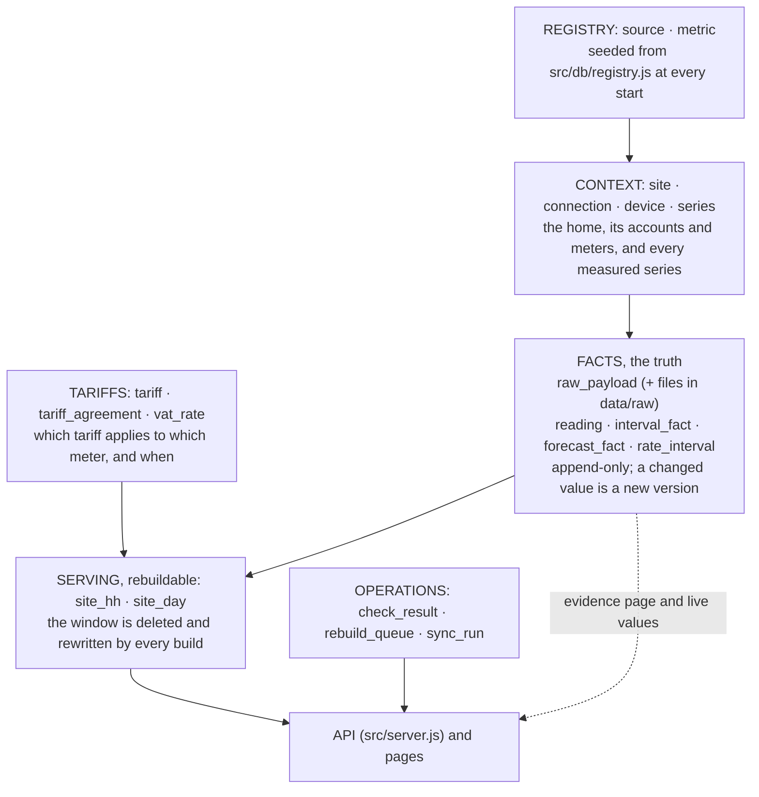

</details>

### 1.1 Why facts are append-only and versioned

Providers change data they have already sent. The source contracts in `registry.js` record this:
- Octopus meter readings "may be revised for a few days";
- Sunsynk's daily totals for today "keep growing until the day closes";
- Open-Meteo's past hours change with new model runs;
- NESO revises its regional forecasts.

The core also changes its own decisions. On 16 October the gas meter's readings were first converted with a fixed factor, then kept in m³ and converted with National Gas's daily calorific value (section 5.1).

So a fact is never updated in place. `putReadings` and `putIntervals` (`src/core/facts.js`) and `putRates` (`src/adapters/octopus.js`) all follow one rule:
- **No current row for the key:** insert version 1.
- **Same value as the current row:** write nothing.
- **Different value:** set `superseded_at` on the current row and insert a new row. Both use the same timestamp in milliseconds (`recorded_at` on the new row).

Each fact therefore has two times:
- the time it describes: `ts`, `start_ts`/`end_ts` or `valid_from`/`valid_to`;
- the time the core knew it: from `recorded_at` until `superseded_at`.

"Current" means `superseded_at IS NULL`. "What the core knew at time T" means `recorded_at ≤ T AND (superseded_at IS NULL OR superseded_at > T)`. At the copy, 40 of 29,158 readings and 250 of 4,012 interval facts were superseded versions, and none of the 3,117 rate rows were (Q5b).

Forecasts are kept differently. Every issue is stored whole with its `issued_at` and is never superseded (`putForecasts`, `INSERT OR IGNORE`). The forecast used for a past half-hour is the latest issue made before it (`readForecastOfRecord`; the build's `solar_forecast`).

This gives:
- the same facts always build the same half-hours;
- the evidence page can show every version and the raw payload it came from;
- a correction is visible instead of silent: the build marks a final half-hour whose numbers changed as revised (quality bit 128, see [section 2 of the timeline document](timeline-forecast-and-data-states.md#2-what-the-data-states-mean)).

Two tables do not follow the rule:
- `tariff_agreement` is deleted and re-inserted from the Octopus account on every sync, so its history is not kept;
- registry rows (`source`, `metric`, `vat_rate`) are updated in place from `registry.js`.

### 1.2 Why the serving tables are disposable

`site_hh`, `site_day` and `check_result` are written only by `buildSite` (`src/core/build.js`). Each build deletes every row in its window and inserts the rebuilt rows in one transaction. The result depends only on the facts and `METHOD_VERSION`.

Measured: five consecutive full rebuilds through `POST /api/sites/1/rebuild` returned identical totals before and after each run: 693 rows, `SUM(total_cost)` 5218.894836 p, `SUM(home)` 318.894133 kWh (appendix A3).

So:
- a column can be added without migrating data (`db.js` `addColumns` adds the four loss columns this way);
- a change of method is applied by rebuilding;
- a damaged serving table is repaired by rebuilding.

One thing in the serving rows is not derived from facts: the "revised" mark (quality bit 128). The build sets it by comparing the new row with the previous `site_hh` row (`build.js`, `previous` map). If `site_hh` is emptied and rebuilt, those marks are lost (section 8).

---

## 2. System flow: data entry and growth

### 2.1 From provider to page


<details><summary>Mermaid source</summary>

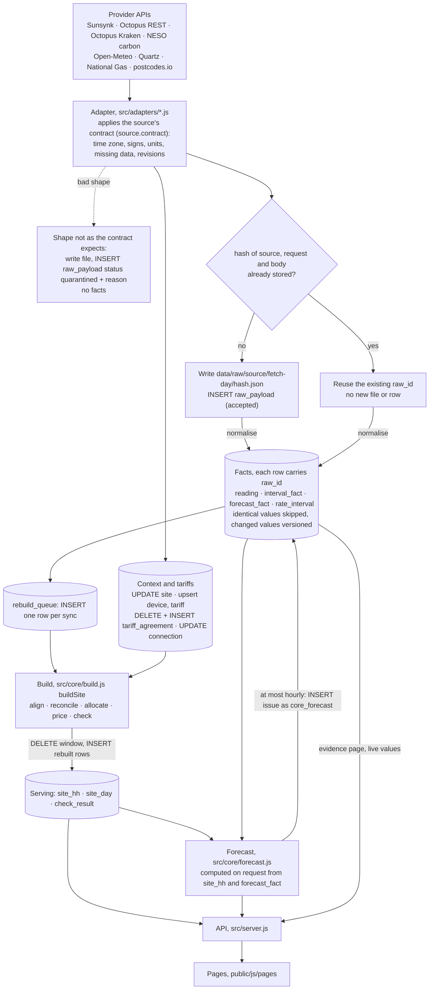

</details>

1. **Adapter** (`src/adapters/*.js`) calls the provider through `fetchJson` (`src/core/http.js`) and applies that source's contract: time zone, signs, units, how missing data looks.
   - If the response does not have the shape the contract expects, it is stored with `quarantine()`: `raw_payload.status = 'quarantined'` and a `reason`, and no facts are written.
   - At the copy, no payload was quarantined (Q12).
2. **Raw landing** (`landRaw`, `facts.js`). The key is the SHA-256 of source, request and body.
   - A known hash reuses the existing `raw_id`.
   - A new hash writes the body to `data/raw/<source>/<UTC fetch day>/<first 16 hex of hash>.json`, then inserts the `raw_payload` row.
   - The file is written before the row, and not in the same transaction (section 8).
3. **Normalise.** The adapter turns provider values into canonical metrics.
   - `seriesId(subject_kind, subject_id, metric, source)` finds or creates the `series` row.
   - `putReadings`, `putIntervals`, `putForecasts` or `putRates` write the facts, each carrying the `raw_id` it came from.
4. **Context.** Adapters also update the home's context:
   - `site`: time zone, coordinates, postcode, regions;
   - `device`: meters, EV, gas unit and zone;
   - `tariff` and `tariff_agreement`;
   - `connection`: status, plant id, meta.
5. **Queue and build.** `syncSite` inserts one `rebuild_queue` row. `processQueue` then runs `buildSite` from the earliest built day to today, and that writes `site_hh`, `site_day` and `check_result`.
6. **Forecast.** `forecastSite` (`src/core/forecast.js`) is computed when an endpoint asks for it and is not stored, except for the hourly record described in 2.2.
7. **API** (`src/server.js`). The endpoints read the tables below. No endpoint calls a provider.

| Endpoint | Tables read | Pages (`public/js/pages`) |
|---|---|---|
| `GET /api/sites` | `site`, `connection`, `sync_run` (latest), `site_day` | every page (`layout.js`) |
| `POST /api/sites/:id/sync` | starts `syncSite` | `layout.js` |
| `POST /api/sites/:id/rebuild` | `site_day`, `site_hh`, then `buildSite` | data |
| `GET …/now` | `reading` (live, then 5-minute), `forecast_fact` (carbon), `site_day`, pricing tables | home, battery, my |
| `GET …/timeline` | `site_hh` (half-hours) or `site_day` (days) | battery, data, my, solar |
| `GET …/summary` | `site_hh` | home, battery, ev, grid, my, solar |
| `GET …/breakdown` | `site_hh`, `site_day` | breakdown |
| `GET …/tariffs` | `tariff_agreement`, `device`, `tariff`, pricing tables | grid |
| `GET …/compare` | `site_hh`, `connection.meta`, `tariff`, `rate_interval`, `interval_fact` (dispatch count), pricing tables | my, tariffs |
| `GET …/forecast` | via `forecastSite`: `site_hh`, `forecast_fact`, `reading`, `interval_fact`, pricing tables | home, battery, grid, my, solar |
| `GET …/solar-expected` | `site`, `site_hh`, `interval_fact` (Open-Meteo sunlight) | solar |
| `GET …/everything` | `site_hh`, `forecastSite`, `sync_run`, `series` + `device` + `interval_fact` (meter arrival times), `tariff_agreement`, `raw_payload` (quarantined), `forecast_fact` (Quartz issues), `check_result`, `connection`, `device` | everything |
| `GET …/ev` | `device`, `site_hh`, `forecastSite` | ev, my |
| `GET …/insights` | `site`, `site_day`, `site_hh`, `check_result` | home, my |
| `GET …/evidence?slot=` | `site_hh`, `reading`, `interval_fact`, `series`, `metric`, `source`, `device`, `rate_interval`, `tariff`, `tariff_agreement`, `vat_rate`, `raw_payload` | data |
| `GET /api/raw/:rawId` | `raw_payload` and its file | data |
| `GET …/health` | `site`, `connection`, `sync_run`, `site_day`, `check_result`, `raw_payload`, counts of `site_hh`, `reading`, `interval_fact`, `forecast_fact`, `rate_interval`, file size | data, grid |
| `GET …/devices` | `device` | my |
| `GET /api/catalog` | `source`, `metric`, `vat_rate` | data |

"Pricing tables" means `loadPricing` (`src/core/pricing.js`), which reads `tariff_agreement`, `device`, `tariff`, `rate_interval`, `vat_rate`, Kraken dispatches in `interval_fact` and `site`.

### 2.2 The 10-minute sync loop and the hourly forecast record

`startScheduler` (`src/jobs/sync.js`) runs `syncSite` for every site, one after another, every `SYNC_EVERY_MINUTES` (default 10). At the copy, consecutive scheduled runs started exactly 600 s apart (Q26). A sync took 21–40 s, 23.5 s on average, over the 30 syncs since the initial loads (Q29). Most of that time is provider calls: in sync 44, Octopus took 11.5 s and carbon 4.5 s, and the build took 0.2 s.


<details><summary>Mermaid source</summary>

```mermaid
flowchart TB
  T["Scheduler tick, every 10 minutes (SYNC_EVERY_MINUTES)<br/>syncSite for each site; a site already syncing is skipped"]
  R0["INSERT sync_run (status running)"]
  S1["Sunsynk: plant, 5-minute series for yesterday and today, month totals, live flow<br/>raw_payload · reading · interval_fact · UPDATE site, connection"]
  S1b["measureBatteryCapacity: UPDATE connection.meta (sunsynk);<br/>site.battery_kwh only when BATTERY_KWH is not configured"]
  S2["Location, only when a key is missing: postcodes.io, Octopus GSP, NESO region<br/>raw_payload · UPDATE site"]
  S3["Weather, Open-Meteo: past hours as reading and interval_fact<br/>next 3 days as one forecast_fact issue"]
  S4["Carbon, NESO: past slots as interval_fact (region series)<br/>next 48 h as one forecast_fact issue"]
  S5["Octopus: account, gas units and LDZ, meter readings (4-day look-back),<br/>rates for tariffs in force, Kraken dispatches and devices<br/>device · tariff · tariff_agreement · interval_fact · rate_interval · forecast_fact"]
  S6["Gas calorific value, National Gas: one interval_fact per gas day (LDZ series)"]
  S7["Tariffs from .env, only without an Octopus account"]
  S8["Comparison tariffs: products list, Agile import and export rates<br/>tariff · rate_interval · connection.meta"]
  S9["Quartz solar forecast, only with panel size, tilt and direction"]
  S10["INSERT rebuild_queue, then processQueue:<br/>buildSite from the earliest built day to today<br/>DELETE + INSERT site_hh, site_day, check_result; UPDATE rebuild_queue.done_at"]
  S11["recordForecast, at most once an hour:<br/>INSERT forecast_fact issue (core_forecast: house use, grid import, solar)"]
  R1["UPDATE sync_run: finished_at, status, detail (JSON step log)"]
  T --> R0 --> S1 --> S1b --> S2 --> S3 --> S4 --> S5 --> S6 --> S7 --> S8 --> S9 --> S10 --> S11 --> R1
  NOTE["Every provider step also UPDATEs its connection row:<br/>status, last_success_at, last_error"]
  S5 -.- NOTE
```

</details>

What one scheduled sync wrote, measured on sync 44 (09:35:19 UTC; Q28, Q13 and its step log):

| Table | Rows written | Where they came from |
|---|---|---|
| `sync_run` | 1 inserted, then updated | start, then finish with the JSON step log |
| `raw_payload` + files | 22 | Octopus rates 10, Octopus meters 3, carbon 2, Sunsynk live 2, and 1 each from Sunsynk 5-minute, Sunsynk daily, Open-Meteo, Quartz and National Gas |
| `reading` | 22 | 2 new 5-minute samples × 7 metrics, plus 8 live values |
| `interval_fact` | 5 inserted, 3 superseded | 3 new versions of today's Sunsynk daily totals, 1 carbon half-hour, 1 gas-day calorific value |
| `forecast_fact` | 532 | one Open-Meteo issue (248 rows over 4 series), one carbon issue (92), one Quartz issue (192) |
| `rate_interval` | 0 | prices unchanged, so nothing written |
| `rebuild_queue` | 1 inserted, then `done_at` set | |
| `site_hh`, `site_day`, `check_result` | 693, 15 and 91 rows deleted and inserted again | full rebuild from 2 October, 215 ms |
| `connection` | 8 rows updated | status and `last_success_at` per step |
| `tariff_agreement` | 16 rows deleted and inserted again | account re-read |

**Hourly forecast record.** After the build, `recordForecast` stores the core's own 48-hour forecast as a new issue of the `core_forecast` source, if the last issue is at least an hour old. One issue is 96 half-hours each for house use, grid import and solar (288 rows; Q6). It is stored like any provider's forecast so that it can be scored later against what the home did.

### 2.3 What makes the database grow


<details><summary>Mermaid source</summary>

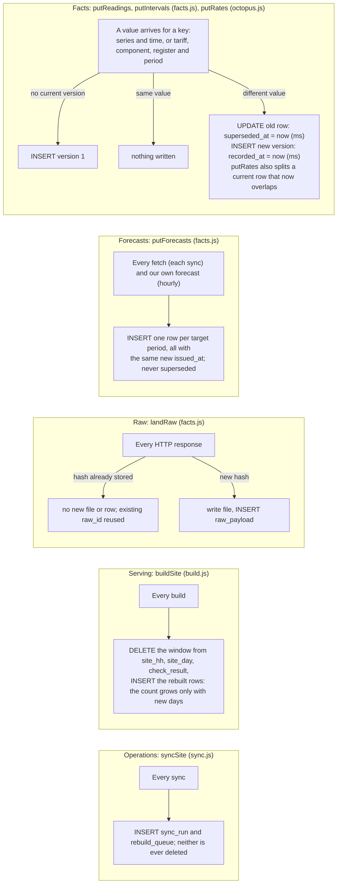

</details>

| Trigger | Table | Effect | Measured rate (section 6) |
|---|---|---|---|
| New 5-minute samples (Sunsynk) | `reading` | +7 rows per 5 minutes | 1,949.2 rows per day |
| Live flow, each sync | `reading` | +8 rows | 8 per sync |
| New weather hour | `reading` (temperature, cloud), `interval_fact` (sunlight) | +2 readings, +1 or +2 intervals per hour | 48 readings and 24 ghi rows per day |
| New meter half-hour (a day late) | `interval_fact` | +3 rows per half-hour (import, export, gas) | 48 per meter per day |
| Changed value (revision) | `reading`, `interval_fact`, `rate_interval` | old row gets `superseded_at`, +1 row | today's daily totals: 59 rows for 6 totals after 42 syncs |
| Forecast fetched | `forecast_fact` | +1 issue: one row per target period | 539.4 rows per sync |
| Own forecast recorded | `forecast_fact` | +288 rows | once an hour |
| New provider response | `raw_payload`, `data/raw` | +1 row, +1 file | 22 per sync |
| Sync | `sync_run`, `rebuild_queue` | +1 row each, never deleted | 1 per sync each |
| Build | `site_hh`, `site_day`, `check_result` | window replaced; grows only with new days | +48, +1 and +6 per day |
| Account re-read | `tariff_agreement` | rows replaced; ids keep rising | 16 rows, ids 515–530 at the copy (Q22) |

---

## 3. Entity–relationship diagrams

The schema is shown in three parts to keep each diagram readable. Solid lines are foreign keys declared with `REFERENCES`. The database enforces them because `db.js` (and `schema.sql`) run `PRAGMA foreign_keys = ON` on the app's connection. Dashed lines are logical relationships that the database does not check. "cascade" marks `ON DELETE CASCADE`; every other declared key has no delete action, so deleting a referenced row fails.

**Registry, context and facts**


<details><summary>Mermaid source</summary>

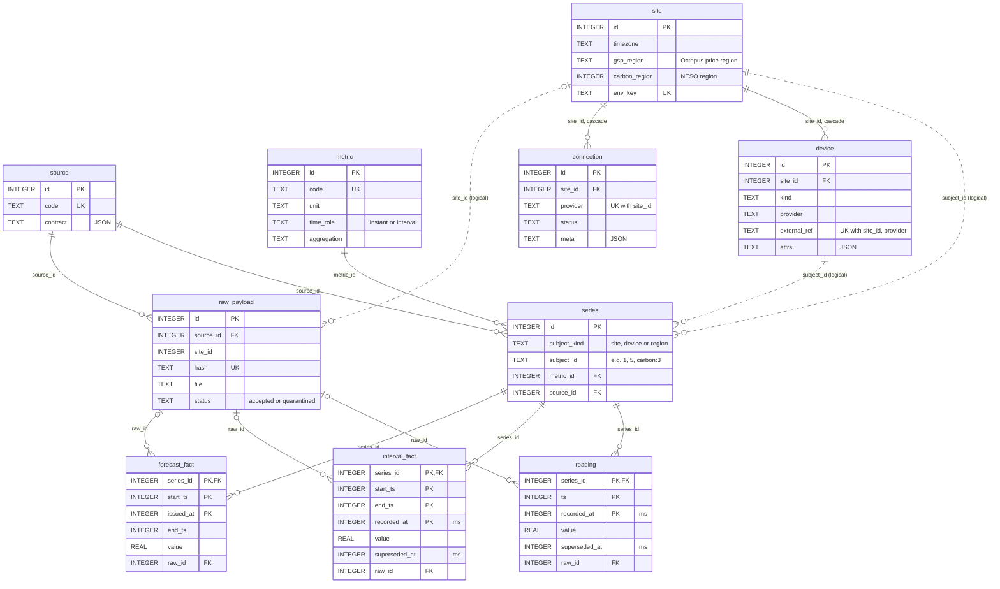

</details>

**Tariffs and prices**


<details><summary>Mermaid source</summary>

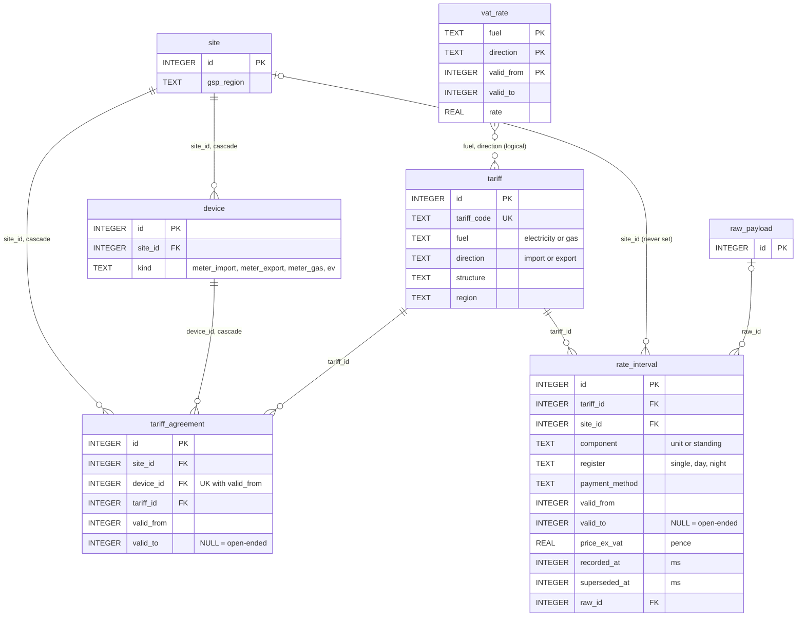

</details>

**Serving and operations**


<details><summary>Mermaid source</summary>

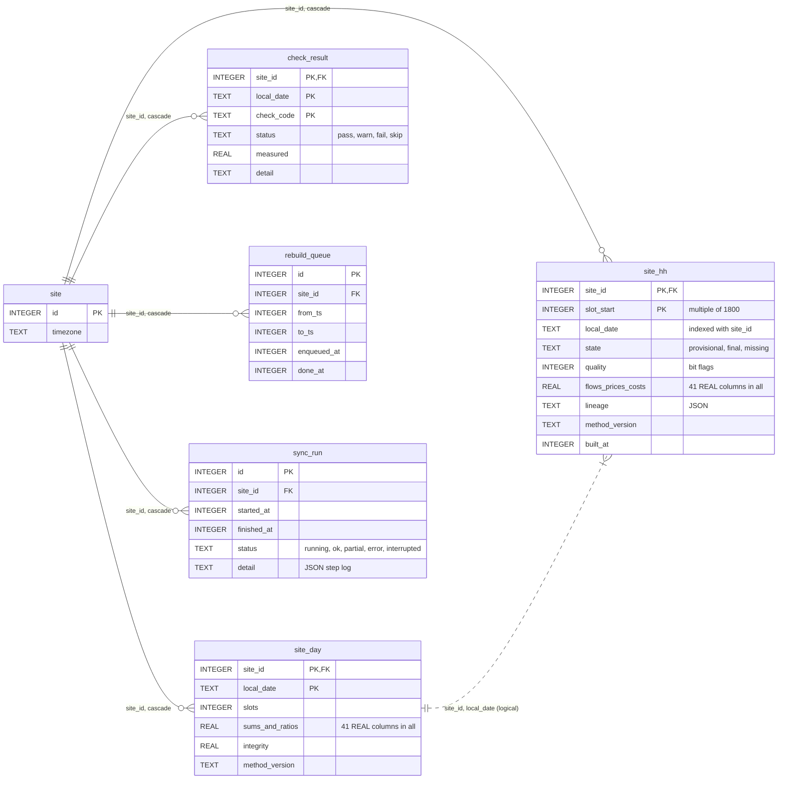

</details>

**Relationships the database does not enforce**

| Column | Points to | How it is matched |
|---|---|---|
| `series.subject_id` (TEXT) | `site.id` when `subject_kind = 'site'`, `device.id` when `'device'`, or a region key when `'region'` | stored as text (`'1'`, `'5'`). Region keys have no table: `'carbon:<NESO region>'` (from `site.carbon_region`) and `'ldz:<gas zone>'` (from `device.attrs.ldz`). At the copy: 30 site series, 4 device series, 2 region series (Q25). |
| `raw_payload.site_id` | `site.id` | no `REFERENCES` clause |
| `site_hh.lineage` (JSON) | source codes, tariff code, register, gas m³ and calorific value used | text, for the evidence page |
| `connection.meta` (JSON) | e.g. `batteryCapacity.rawId` → `raw_payload.id`; Comparison product codes; gas zone and data item id | text |
| `connection.provider` | adapter families (`sunsynk`, `octopus`, `weather`, `gas_cv`, …) | not the same values as `source.code` |
| `site.gsp_region` | `tariff.region` | used by `learnIogWindow` and the Comparison tariff codes |
| `vat_rate (fuel, direction)` | `tariff (fuel, direction)` | matched by value and date in `vatAt` |
| `site_day (site_id, local_date)` | `site_hh (site_id, local_date)` | both built together by `buildSite` |

`raw_id` (on `reading`, `interval_fact`, `forecast_fact` and `rate_interval`) is a declared foreign key, so it is enforced. A `raw_payload` row that any fact refers to cannot be deleted through the app's connection. The `sqlite3` command-line shell does not enforce foreign keys unless `PRAGMA foreign_keys = ON` is run in that session.

Facts have no `site_id` column. Their home is found through `series`: directly for site series, and through `device.site_id` for device series. Region series (carbon, gas calorific value) are shared by every home in the region. Deleting a `site` cascades to its connections, devices, agreements, serving rows and logs, but not to its `series`, facts or raw payloads.

---

## 4. Table catalogue

Row counts are from the copy (Q1). Growth is per home unless the table is shared. Section 6 has the per-day figures and how they were measured.

### Registry

#### `source`

| | |
|---|---|
| Purpose | One row per provider feed, with its data contract as JSON: time zone rule, time role, signs, units, missing data, revisions, upstream history. The contract documents what the adapter does; no code reads it at run time except `/api/catalog`. |
| Keys and constraints | `id` INTEGER PRIMARY KEY; `code` UNIQUE |
| Written by | `db.js` `seedRegistry()`: upsert on `code` at every start |
| Read by | `db.js` `sourceId()` (cached map used by `facts.js`); joins in `pricing.js`, `compare.js`, `server.js` (`/evidence`, `/everything`, `/health`, `/now`, `/api/catalog`) |
| Rows now | 12 (ids 1–10, 12, 13; id 11 is not used) |
| Growth | One row per new provider feed. Rows are never deleted by the code. |

#### `metric`

| | |
|---|---|
| Purpose | Canonical measurements: `code`, `label`, `unit`, `time_role` (instant or interval), `aggregation` (sum, mean, last, integrate), `domain`. |
| Keys and constraints | `id` PRIMARY KEY; `code` UNIQUE; CHECK on `time_role` and `aggregation` |
| Written by | `db.js` `seedRegistry()` |
| Read by | `db.js` `metricId()`; joins in `pricing.js`, `compare.js`, `sync.js`, `server.js`. `time_role`, `aggregation` and `domain` are read only by `/api/catalog`; the build decides how to aggregate in code. |
| Rows now | 23 (including `gas_m3` and `gas_cv_mjm3`, added on 16 October) |
| Growth | One row per new metric. |

### Context

#### `site`

| | |
|---|---|
| Purpose | One home: name, postcode and outcode, coordinates, time zone, Octopus price region (`gsp_region`), NESO carbon region (`carbon_region`), panel size, tilt and direction, battery size, `is_demo`, `env_key`, `created_at`. |
| Keys and constraints | `id` PRIMARY KEY; `env_key` UNIQUE (the home configured in `.env` has `env_key = 'env'`) |
| Written by | `sync.js` `ensureEnvSite` (insert, and update from `.env`); `sunsynk.js` `syncSunsynk` (time zone, coordinates, kWp, battery from the Ah × V reading when unset); `geo.js` `resolveSiteGeo` (postcode, coordinates, outcode, regions); `octopus.js` `syncOctopusAccount` (postcode); `derive.js` `measureBatteryCapacity` (battery size, only when `BATTERY_KWH` is not configured) |
| Read by | `build.js`, `pricing.js`, `forecast.js`, `compare.js`, `insights.js`, `derive.js`, `sync.js`, every `server.js` endpoint |
| Rows now | 1 |
| Growth | One row per home; updated in place. |

#### `connection`

| | |
|---|---|
| Purpose | One row per home per provider integration (`sunsynk`, `octopus`, `tariff`, `weather`, `carbon`, `solar_forecast`, `compare`, `gas_cv`), with `status`, `last_success_at`, `last_error`, `external_ref` (Sunsynk plant id, Octopus account number) and `meta` JSON. |
| Keys and constraints | `id` PRIMARY KEY; UNIQUE (`site_id`, `provider`); `site_id` → `site` ON DELETE CASCADE |
| Written by | `sync.js` `ensureConnection`, `setConnection` (after every step); `sunsynk.js` (plant id, battery reading in `meta`); `derive.js` (measured battery capacity in `meta`); `compare.js` (product codes in `meta`); `nationalgas.js` (gas zone and data item id in `meta`) |
| Read by | `sync.js` (which providers to call; whether a provider has run before), `build.js` (an Octopus connection means meter data is expected), `compare.js`, `nationalgas.js`, `derive.js`, `server.js` (`/api/sites`, `/everything`, `/health`) |
| Rows now | 8 |
| Growth | One row per provider per home. Updated on every step of every sync; earlier states are not kept, but each step's result is in `sync_run.detail`. |

#### `device`

| | |
|---|---|
| Purpose | Meters (`meter_import`, `meter_export`, `meter_gas`), EV and stand-in meters for `.env` tariffs. `external_ref` is the MPAN, MPRN or device id. `attrs` JSON holds meter serials, profile class, annual estimate, the gas unit decision with its source, the gas zone (`ldz`) and EV status. |
| Versioning (16 Oct 2026) | `recorded_at` (ms): when the core first knew the device; `retired_at` (ms): when it stopped being used. A retired device is kept, not deleted. Every change to `attrs` is also written to `device_attr_version` (`devices.js` `setDeviceAttrs`). Reads of devices in use filter `retired_at IS NULL`; `devicesAt(site, where, T)` gives the devices and details as known at T. |
| Keys and constraints | `id` PRIMARY KEY; UNIQUE (`site_id`, `provider`, `external_ref`); `site_id` → `site` ON DELETE CASCADE |
| Written by | `octopus.js` `upsertDevice` (account), `syncGasUnits` (unit and zone from Kraken), `syncOctopusConsumption` (unit fallback), `syncKraken` (EV); `sync.js` `syncEnvTariffs` (inserts `.env` stand-ins, deletes them once Octopus meters exist) |
| Read by | `build.js` (meters), `pricing.js`, `octopus.js`, `nationalgas.js`, `compare.js`, `sync.js`, `server.js` (`/everything`, `/evidence`, `/ev`, `/devices`, `/tariffs`) |
| Rows now | 4 (ids 3–6; ids 1 and 2 are gone: before versioning, the `.env` stand-ins were deleted once the Octopus meters arrived; they are now retired instead) |
| Growth | One row per meter or device per home. |

#### `series`

| | |
|---|---|
| Purpose | Names one stream of facts: subject (site, device or region), metric and source. Every fact row points at a series. |
| Keys and constraints | `id` PRIMARY KEY; UNIQUE (`subject_kind`, `subject_id`, `metric_id`, `source_id`); `metric_id` → `metric`; `source_id` → `source`; CHECK `subject_kind IN ('site','device','region')`. `subject_id` is not a foreign key (section 3). |
| Written by | `facts.js` `seriesId()`: find, or insert on first use; cached per process |
| Read by | `facts.js`; joins in `pricing.js`, `compare.js`, `sync.js`, `server.js` (`/now`, `/everything`, `/evidence`, `/health`) |
| Rows now | 36: 30 site, 4 device, 2 region (Q25) |
| Growth | About 30 per home plus a few per device, created once. Region series are shared. |

### Tariffs

#### `tariff`

| | |
|---|---|
| Purpose | One row per tariff code: provider, product, fuel, direction, structure (parsed from the code by `parseTariffCode`), region, name. |
| Keys and constraints | `id` PRIMARY KEY; `tariff_code` UNIQUE; CHECK on `fuel` and `direction` |
| Written by | `octopus.js` `upsertTariff`, called for account agreements, `.env` codes and Comparison codes |
| Read by | `pricing.js`, `compare.js`, `sync.js` (tariffs whose rates to fetch), `server.js` (`/tariffs`, `/everything`, `/evidence`) |
| Rows now | 14 |
| Growth | One row per distinct tariff code, shared by every home on it. |

#### `tariff_agreement`

| | |
|---|---|
| Purpose | Which tariff applied to which meter, and when. Versioned (16 Oct 2026): `recorded_at` and `superseded_at` (ms); a changed history supersedes the old rows (`devices.js` `supersedeAgreements`), so prices can be read as known at an earlier moment. Readers of the current history filter `superseded_at IS NULL`; `loadPricing` uses `inForce('a')`. |
| Keys and constraints (versioned) | `id` PRIMARY KEY; partial UNIQUE index **`agreement_current`** (`device_id`, `valid_from`) WHERE `superseded_at IS NULL`; trigger **`agreement_no_overlap_current`** (current rows only). The old table, with UNIQUE (`device_id`, `valid_from`), is rebuilt once on open (`db.js`, foreign-key checks off for the copy). |
| Keys and constraints (before) | `id` PRIMARY KEY; UNIQUE (`device_id`, `valid_from`); CHECK `valid_to IS NULL OR valid_to > valid_from`; trigger **`agreement_no_overlap`**: before insert, abort if another agreement for the same meter overlaps (an open end counts as 9000000000); `site_id` and `device_id` cascade on delete |
| Written by | `octopus.js` `replaceAgreements`: clip upstream overlaps; if the history differs from the current rows, supersede them and insert the new ones (`supersedeAgreements`); `sync.js` `syncEnvTariffs` (`.env` stand-ins, retired once Octopus meters exist) |
| Read by | `pricing.js` `loadPricing`; `sync.js` (which tariffs were in force in the window); `server.js` (`/tariffs`, `/everything`, `/evidence`) |
| Rows now | 16, with ids 515–530 (Q22) |
| Growth | One row per agreement in the account's history, plus a superseded copy each time Octopus changes that history (rare). Unchanged history is never rewritten. |

#### `vat_rate`

| | |
|---|---|
| Purpose | VAT rate by fuel and direction, with validity dates. |
| Keys and constraints | PRIMARY KEY (`fuel`, `direction`, `valid_from`); no overlap check |
| Written by | `db.js` `seedRegistry()`: `INSERT OR REPLACE` from `VAT_RATES` in `registry.js` |
| Read by | `pricing.js` `loadPricing` (all rows), `server.js` (`/evidence`, `/api/catalog`) |
| Rows now | 4 |
| Growth | One row per VAT change. |

### Facts

#### `raw_payload`

| | |
|---|---|
| Purpose | One row per distinct provider response: source, home, request (JSON), `fetched_at`, SHA-256 `hash` of source, request and body, `file` path under `data/`, `status` (accepted or quarantined), `reason`. The body itself is the file. |
| Keys and constraints | `id` PRIMARY KEY; `hash` UNIQUE (the deduplication key); `source_id` → `source`; CHECK on `status`. `site_id` is not a foreign key. |
| Written by | `facts.js` `landRaw` and `quarantine`, called by every adapter and by `compare.js` |
| Read by | `facts.js` (hash lookup); `server.js` (`/evidence`, `/api/raw/:rawId`, quarantined payloads in `/everything` and `/health`, counts in `/health`) |
| Rows now | 754, none quarantined; 755 files on disk (section 8) |
| Growth | 22 rows and files per sync. Most requests include the current time (`period_to`, minute ranges), so the hash is new on every sync even when the body has not changed. |

#### `reading`

| | |
|---|---|
| Purpose | Instant values: Sunsynk 5-minute power and charge level, live flow, hourly temperature and cloud. |
| Keys and constraints | PRIMARY KEY (`series_id`, `ts`, `recorded_at`), `WITHOUT ROWID` (the partial index `reading_current` was dropped: it was never used); `series_id` → `series`; `raw_id` → `raw_payload` |
| Written by | `facts.js` `putReadings`, called by `sunsynk.js` `normaliseDay` and `normaliseFlow` and by `openmeteo.js` `syncWeather` |
| Read by | `facts.js` `readReadings` (build, forecast, Quartz's live generation, `/now`); `derive.js` `measureBatteryCapacity`; `server.js` (`/evidence`, `/health`) |
| Rows now | 29,158, of which 40 are superseded versions |
| Growth | 1,949.2 five-minute rows and 48 weather rows per day, plus 8 live rows per sync. |

#### `interval_fact`

| | |
|---|---|
| Purpose | Values over a period: meter half-hours, Sunsynk daily totals, regional carbon half-hours, hourly sunlight, gas calorific value per gas day, EV smart-charge dispatches. |
| Keys and constraints | PRIMARY KEY (`series_id`, `start_ts`, `end_ts`, `recorded_at`), `WITHOUT ROWID`; CHECK `end_ts > start_ts`; partial index **`interval_current`** (`series_id`, `start_ts`) WHERE `superseded_at IS NULL`; `series_id` → `series`; `raw_id` → `raw_payload` |
| Written by | `facts.js` `putIntervals`, called by `sunsynk.js` `normaliseMonth`, `octopus.js` `normaliseConsumption` and `normaliseDispatches`, `carbon.js`, `openmeteo.js`, `nationalgas.js` |
| Read by | `facts.js` `readIntervals` (build, forecast); `pricing.js` (dispatches); `sync.js` (sunlight coverage, whether `gas_m3` exists); `compare.js` (dispatch count); `server.js` (meter arrival times and EV slots in `/everything`, `/evidence`, `/health`) |
| Rows now | 4,012, of which 250 are superseded versions |
| Growth | Per home: 198 current rows per day plus revisions. Shared: 48 carbon rows per day per NESO region, 1 calorific value per gas day per zone. |

#### `forecast_fact`

| | |
|---|---|
| Purpose | Forecasts: one row per target period per issue. Sources: Open-Meteo (temperature, cloud, sunlight), NESO carbon, Quartz solar, Kraken planned dispatches, and the core's own forecast (`core_forecast`). |
| Keys and constraints | PRIMARY KEY (`series_id`, `start_ts`, `issued_at`), `WITHOUT ROWID`; CHECK `end_ts > start_ts`; no other index; `series_id` → `series`; `raw_id` → `raw_payload` (NULL for `core_forecast`) |
| Written by | `facts.js` `putForecasts` (`INSERT OR IGNORE`), called by `openmeteo.js`, `carbon.js`, `quartz.js`, `octopus.js` `normalisePlanned`, and `sync.js` `recordForecast` |
| Read by | `facts.js` `readForecastOfRecord` (forecast); `build.js` (solar forecast of record); `forecast.js` `scoreAccuracy`; `sync.js` (time of the last own issue); `server.js` (`/now` carbon, Quartz issues in `/everything`) |
| Rows now | 11,992 |
| Growth | 539.4 rows per sync, plus 288 per hourly own issue. This is the fastest-growing table (section 6). |

#### `rate_interval`

| | |
|---|---|
| Purpose | Unit and standing prices per tariff, excluding VAT, with validity periods; versioned like facts. |
| Keys and constraints | `id` PRIMARY KEY; partial index **`rate_current`** (`tariff_id`, `component`, `register`, `valid_from`) WHERE `superseded_at IS NULL`; CHECK `valid_to IS NULL OR valid_to > valid_from`; CHECK on `component` and `register`; trigger **`rate_no_overlap`**: before inserting a current row, abort if a current row for the same tariff, home, component, register and payment method overlaps it (the schema calls it a stand-in for a PostgreSQL exclusion constraint); `tariff_id` → `tariff`, `site_id` → `site`, `raw_id` → `raw_payload` |
| Written by | `octopus.js` `putRates` via `syncTariffRates`, from `sync.js` (tariffs in force), `syncEnvTariffs` and `compare.js` `syncComparison`. A changed price supersedes the old row. A current row that now overlaps the new one is superseded too, and its parts outside the new period are re-inserted, so no time is left without a price. |
| Read by | `pricing.js` `loadPricing` and `learnIogWindow`; `compare.js`; `server.js` (`/evidence`, `/health`) |
| Rows now | 3,117; no superseded rows; `site_id` set on none (Q5b, column check A4) |
| Growth | Per tariff, shared by all homes on it: 48 unit rows per day for each half-hourly (Agile) tariff (Q21); a row per price change for other tariffs. |

### Serving

#### `site_hh`

| | |
|---|---|
| Purpose | One row per home per UTC half-hour: energy per node, the seven flows and losses, prices, VAT, costs, carbon, temperature, the solar forecast of record, checks (`state`, `quality`, `meter_vs_ct`, `rate_found`), `lineage` JSON, `method_version`, `built_at`. 50 columns, 41 of them REAL (Q23). |
| Keys and constraints | PRIMARY KEY (`site_id`, `slot_start`), `WITHOUT ROWID`; CHECK **`slot_start % 1800 = 0`**; CHECK `state IN ('provisional','final','missing')`; index **`site_hh_day`** (`site_id`, `local_date`); `site_id` → `site` ON DELETE CASCADE |
| Written by | `build.js` `buildSite` only: delete the window, insert the rebuilt rows |
| Read by | `server.js` (`/timeline`, `/summary`, `/breakdown`, `/everything`, `/ev`, `/evidence`, `/health`, `/rebuild`); `forecast.js` (14 days of history, accuracy); `compare.js`; `insights.js`; `derive.js`; `build.js` (the previous rows, for the revised mark) |
| Rows now | 693 (14 days × 48 + 21 half-hours of 16 October) |
| Growth | 48 rows per day (46 or 50 on clock-change days). Every sync rewrites all of them. |

#### `site_day`

| | |
|---|---|
| Purpose | One row per home per local day: sums of the half-hour columns; self-consumption, self-sufficiency and blended cost; peak import, base load, charge range, cycles, integrity; counts of final, provisional and missing half-hours. 49 columns, 41 REAL (Q23). |
| Keys and constraints | PRIMARY KEY (`site_id`, `local_date`), `WITHOUT ROWID`; `site_id` → `site` ON DELETE CASCADE |
| Written by | `build.js` `buildSite` |
| Read by | `server.js` (`/api/sites`, `/now`, `/timeline` by day, `/breakdown` ledger, `/health`, `/rebuild`); `insights.js`; `sync.js` (has the home been built, and up to when); `build.js` `processQueue` (earliest built day) |
| Rows now | 15 |
| Growth | 1 row per day. |

### Operations

#### `check_result`

| | |
|---|---|
| Purpose | Checks per completed local day: `completeness`, `rate_coverage`, `energy_balance` (against the home's own 30-day median), `meter_vs_ct` and `meter_vs_ct_export`, `counter_fit_solar`, `_load`, `_import`, `_export`, `_charge`, `_discharge`, `gas_calorific_value`. Two checks for the whole window, `battery_efficiency` and `battery_stock`, are stored on its first day. |
| Keys and constraints | PRIMARY KEY (`site_id`, `local_date`, `check_code`), `WITHOUT ROWID`; CHECK `status IN ('pass','warn','fail','skip')`; `site_id` → `site` ON DELETE CASCADE |
| Written by | `build.js` `buildSite`: delete the window, `INSERT OR REPLACE` |
| Read by | `server.js` (`/everything`, `/health`); `insights.js` |
| Rows now | 91 (Q24) |
| Growth | 6 per complete day (Q8); `meter_vs_ct` starts once the meter data for that day has arrived. |

#### `rebuild_queue`

| | |
|---|---|
| Purpose | Ranges of a home that need rebuilding. |
| Keys and constraints | `id` PRIMARY KEY; `site_id` → `site` ON DELETE CASCADE; no other index |
| Written by | `facts.js` `markDirty` (called once per sync by `syncSite`); `build.js` `processQueue` sets `done_at` |
| Read by | `build.js` `processQueue` only: rows with `done_at IS NULL`, `MIN(from_ts)` per home |
| Rows now | 44, all done |
| Growth | 1 row per sync; never deleted. |

#### `sync_run`

| | |
|---|---|
| Purpose | One row per sync: start, finish, `status` (`running`, `ok`, `partial`, `error`, or `interrupted` when a crash or restart cut it short; set at the next start), and `detail`, a JSON list of each step's result (time taken, counts, errors). |
| Keys and constraints | `id` PRIMARY KEY; `site_id` → `site` ON DELETE CASCADE |
| Written by | `sync.js` `syncSite`: insert at start, update at the end |
| Read by | `server.js` (`/api/sites` latest run, `/health` last 8, `/everything` events in the period) |
| Rows now | 44 |
| Growth | 1 row per sync, about 1.1 KB each (Q17); never deleted. |

---

### Trust (added 16 Oct 2026)

Three tables keep history that the serving tables do not. The Data & trust page and `/api/sites/:id/trust`, `/revisions` and `/asof` read them.

#### `site_attribute`

| | |
|---|---|
| Purpose | Panel size, tilt, direction and battery size, one current value per source (`installer`, `measured`, `provider`, `estimated`), versioned like facts. The value in use is the highest-ranked source in force and is cached on `site`. |
| Keys and constraints | PRIMARY KEY (`site_id`, `attr`, `source`, `recorded_at`), `WITHOUT ROWID`; CHECK on `attr` and `source`; `recorded_at`/`superseded_at` in ms |
| Written by | `attributes.js` `setAttribute`, called from `.env` (`ensureEnvSite`), the Sunsynk adapter, `measureBatteryCapacity`; first versions seeded from `site` by `maintenance.js` |
| Read by | `attributeAt` (current, or as known at a moment) in `build.js` as-of rebuilds, `/system`, `/trust` |
| Growth | A row only when a source's value changes (a few per home per year) |

#### `site_day_revision`

| | |
|---|---|
| Purpose | One row each time a completed day's figures, state or checks change in a rebuild: when, why, what changed (from → to), method version, inputs (battery size and source; half-hours from meter and clamp). Each day's first row marks where its history starts. |
| Keys and constraints | `id` PRIMARY KEY; index (`site_id`, `local_date`, `revised_at`) |
| Written by | `build.js` `buildSite`, inside the same transaction as the serving rows; an unchanged rebuild writes nothing |
| Read by | `/trust`, `/revisions`; the "as known at" picker offers its times |
| Growth | About 2–3 rows per day per home (first record, provisional → final, occasional restatement), plus one per day on a method change |
| `kind` | `recorded` (a live rebuild) or `reconstructed` (`history.js`: the day rebuilt as known at each earlier sync, for the time before the live log; one-off, `npm run history:reconstruct`) |

#### `device_attr_version`

| | |
|---|---|
| Purpose | Every version of a device's details (`attrs` JSON: gas unit, gas zone, EV status …), with `recorded_at` and `superseded_at` (ms) |
| Keys and constraints | PRIMARY KEY (`device_id`, `recorded_at`), `WITHOUT ROWID`; `device_id` → `device` ON DELETE CASCADE |
| Written by | `devices.js` `setDeviceAttrs`, only when the details change; first versions seeded by `seedDeviceHistory` |
| Read by | `devicesAt` / `deviceAttrsAt` in as-of rebuilds; before the first version the earliest one is used and reported as an approximation |
| Growth | A row only when a device's details change (a few per device per year) |

#### `fact_correction`

| | |
|---|---|
| Purpose | Facts withdrawn by EnergieBee itself (not by a provider): series, how many, when and why |
| Written by | `maintenance.js` at start-up (idempotent); 16 Oct 2026: 626 derived `gas_kwh` rows |
| Read by | `/trust` |

**As known at.** `facts.js` `withKnownAt(ms, fn)` makes every fact read (readings, intervals, prices, dispatches, the learned IOG window, battery counters) return the version in force at that moment: `recorded_at ≤ T AND (superseded_at IS NULL OR superseded_at > T)`. `buildSite(..., { asOf, dryRun })` uses it to rebuild without writing. Agreements are read with `inForce('a')`, meters with `devicesAt(…, T)` (in use at T, details as known at T), system details with `attributeAt(…, T)`. Where no version existed at T, the earliest recorded one is used and returned in `approximations`.

## 5. How the tables relate in practice

### 5.1 One half-hour, from raw payload to `site_hh`

The half-hour is 19:30–20:00 BST on Monday 12 October: `slot_start = 1791829800` (18:30 UTC). The `/evidence` endpoint returns the same chain for any half-hour: `GET /api/sites/1/evidence?slot=1791829800`.


<details><summary>Mermaid source</summary>

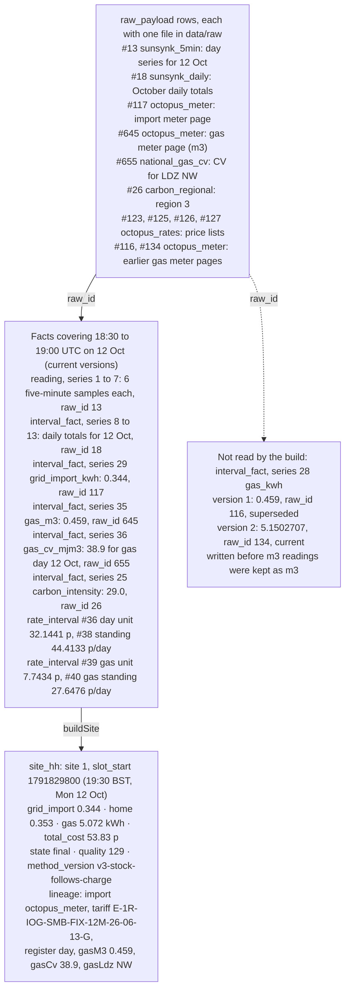

</details>

| Fact | Series | Value | `raw_id` → file | Becomes in `site_hh` |
|---|---|---|---|---|
| 6 five-minute samples each of solar, load, grid in and out, battery in and out, charge level (`reading`, 42 rows) | 1–7 (site 1, `sunsynk_5min`) | — | 13 → `raw/sunsynk_5min/2026-10-16/aca4a6f222979f15.json` (70,642 bytes) | `solar`, `home`, `battery_*`, `soc_end` after alignment |
| Daily totals for 12 October (`interval_fact`) | 8–13 (`sunsynk_daily`) | e.g. solar 2.9 kWh | 18 → `raw/sunsynk_daily/2026-10-16/f49c3517dd4de810.json` | the day's fit factors in `lineage.fit` |
| Import meter half-hour | 29 (device 3, `octopus_meter`) | 0.344 kWh | 117 → `raw/octopus_meter/2026-10-16/7131a374170b2254.json` | `grid_import = 0.344`; `lineage.import = "octopus_meter"` |
| Gas meter half-hour, in m³ | 35 (device 5, `gas_m3`) | 0.459 m³ | 645 → `raw/octopus_meter/2026-10-16/dbbadcca9d2a584d.json` | `lineage.gasM3 = 0.459` |
| Calorific value, gas day 12 October (05:00 to 05:00 local) | 36 (region `ldz:NW`, `national_gas_cv`) | 38.9 MJ/m³ | 655 → `raw/national_gas_cv/2026-10-16/21dfac5f62c16f99.json` | `lineage.gasCv = 38.9`; gas = 0.459 × 1.02264 × 38.9 ÷ 3.6 = **5.0720 kWh** |
| Regional carbon intensity | 25 (region `carbon:3`) | 29.0 g/kWh, quality 8 (estimated) | 26 | `carbon_intensity = 29.0`; `carbon_g = 0.344 × 29.0 = 9.976` |

The resulting row (Q-example in the appendix): `state = 'final'`, `quality = 129` (measured + revised), `grid_import = 0.344`, `home = 0.352644`, `gas = 5.072039`, `total_cost = 53.8262`, `method_version = 'v3-stock-follows-charge'`. The `lineage` JSON is:

```json
{"import":"octopus_meter","export":"octopus_meter","solar":"sunsynk_5min",
 "fit":{"solar":1.0223567084814478,"load":1.0550664432223191,"imp":1.0289983670243306,"exp":1,"chg":1.027240209116757,"dis":1.0851037292645407},
 "tariff":"E-1R-IOG-SMB-FIX-12M-26-06-13-G","register":"day","carbon":"carbon_regional","coverage":1,
 "gasM3":0.459,"gasCv":38.9,"gasLdz":"NW","gasCvSource":"national_gas_cv"}
```

**Versions of the same half-hour.** Series 28 (device 5, `gas_kwh`) holds two versions for this half-hour. Neither is read by the build now, because the meter is in m³ and the build reads series 35.

| `recorded_at` (ms) | `superseded_at` (ms) | Value | `raw_id` |
|---|---|---|---|
| 1792133343305 (06:49:03.305 UTC) | 1792133386022 (06:49:46.022 UTC) | 0.459 | 116 |
| 1792133386022 | — | 5.1502707 | 134 |

The first version is the meter's number stored as kWh. In the next sync, 42.7 seconds later, the meter's unit was recorded as m³, the history was re-read, and the value was converted with the fixed factor then held in the gas meter's `device.attrs` (0.459 × 11.2206 = 5.1503). From 09:12 UTC the m³ value has been kept as m³ (series 35), and the build converts it with that gas day's calorific value. Both earlier versions are still there, with the raw payloads they came from. The half-hour's `quality` includes 128 (revised): its numbers changed after it was first built as final.

### 5.2 One price, from `rate_interval` to a cost

The same half-hour, priced by `loadPricing` and `priceAt` (`src/core/pricing.js`). How the day/night band is chosen is in [section 5.4 of the timeline document](timeline-forecast-and-data-states.md#54-intelligent-octopus-go-off-peak-window).

1. **Agreement.** The `tariff_agreement` row for device 3 (import meter) covering the half-hour: tariff 8, `E-1R-IOG-SMB-FIX-12M-26-06-13-G`, from 31 Aug 2026 23:00 to 15 Aug 2027 23:00 UTC. At the copy its id was 521; ids change on every sync, because agreements are re-inserted.
2. **Band.** 19:30 BST is outside the learned off-peak window, so `register = 'day'`.
3. **Unit rate.** `rate_interval` id 36: tariff 8, `unit`, `day`, `ANY` payment method, from 5 Jul 2026 23:00 UTC, open-ended, 32.1441 p/kWh excluding VAT, `raw_id` 123.
4. **VAT.** `vat_rate` (electricity, import) from 1790809200 (30 Sep 2026 23:00 UTC) is 0.0. So `import_rate_ex = 32.1441` and `import_vat = 0`.
5. **Energy cost.** `grid_to_home_cost` = 0.344 kWh × 32.1441 × (1 + 0) = **11.0576 p**.
6. **Standing charges** (per day, divided over the 48 half-hours of 12 October):
   - electricity: `rate_interval` 38 gives 44.4133 × (1 + 0) ÷ 48 = 0.92528 p;
   - gas: `rate_interval` 39 and 40 (tariff 14, `G-1R-OE-FIX-18M-26-09-11-G`) give 27.6476 × 1.05 ÷ 48 = 0.60479 p;
   - `standing_cost` = **1.53007 p**.
7. **Gas.** `gas_cost` = 5.072039 kWh × 7.7434 × 1.05 = **41.2386 p** (`gas_rate_ex` 7.7434, `gas_vat` 0.05).
8. **Total.** `total_cost` = 11.0576 + 0 (grid to battery) + 0 (loss) + 1.53007 + 41.2386 − 0 (export) = **53.8262 p**. As a check, `grid_only_cost` = 0.352644 × 32.1441 + 1.53007 + 41.2386 = 54.1041 p, and `saving` = 0.2779 p.

---

## 6. Growth and storage, measured

### 6.1 Rows per home per day

"Measured" figures come from the 13 complete days (2–14 October) or from sync runs. Figures that need a number of syncs per day use **144 syncs per day**: 24 h × 60 min ÷ 10 min, from the measured 600 s between scheduled runs (Q26). Those figures are projections.

| Table | Rows per home per day | Basis |
|---|---|---|
| `reading` | **3,149** | 1,949.2 five-minute rows (measured, Q19: 7 metrics, 1,946–1,953 a day) + 48 weather rows (measured, Q19) + **projection** 8 live rows per sync × 144 = 1,152. The 8 per sync is measured: 224 current live rows at 28 distinct times (Q20). |
| `interval_fact` | **380** | 144 meter half-hours (3 meters × 48, measured, Q18) + 24 horizontal sunlight (measured) + 24 sunlight on panels (**projection**: the same hourly array as horizontal sunlight, stored only while panel angles are set) + 6 daily totals (measured) + **projection** 182 extra versions of today's daily totals: (59 rows − 6 current) ÷ 42 Sunsynk syncs today (Q16) = 1.262 per sync × 144. The most it could be is 6 per sync × 144 = 864. |
| `forecast_fact` | **84,586** | **Projection.** Rows per issue (measured, Q6): carbon 95.5, temperature 63.7, cloud 63.7, horizontal sunlight 62.5, sunlight on panels 62.0, Quartz 192.0. Sum: 539.4 per sync (sync 44 wrote 532). × 144 = 77,674. Plus the own forecast: 288 rows per issue × 24 issues = 6,912. |
| `raw_payload` | **3,169** | **Projection.** Files per sync by source, over the 8 syncs that ran on the 10-minute schedule (Q27): Octopus rates 11.25, Octopus meters 3.0, Sunsynk live 2.0, carbon 1.63, Sunsynk 5-minute 1.0, Sunsynk daily 1.0, Open-Meteo 1.0, Quartz 1.0 (one call per sync while panel angles are set; measured 1.0 since it was switched on, Q14b), National Gas 0.13. Sum: 22.0 per sync × 144 = 3,168, plus 1 complete Sunsynk day file for the previous day. |
| `site_hh` | **48** | measured (Q8); 46 or 50 on clock-change days |
| `site_day` | **1** | measured |
| `check_result` | **6** | measured (Q8) |
| `rebuild_queue` | **144** | **projection**: 1 per sync (measured: 44 rows for 44 syncs) × 144 |
| `sync_run` | **144** | **projection**: 1 per sync × 144 |
| **Total** | **91,627** | |

Tables that do not grow with time for a home: `site`, `connection`, `device`, `series` and `tariff_agreement`, a fixed number of rows per home.

Tables shared by all homes:
- `source`, `metric` and `vat_rate`;
- `tariff`;
- `rate_interval`: 48 rows per day for each half-hourly tariff, so 96 for the Agile import and export pair of one region (Q21);
- the region series in `interval_fact`: 48 carbon rows per day per NESO region, 1 calorific value per gas day per zone (Q18).

### 6.2 Bytes per row

Measured with SQLite's `dbstat` virtual table (Q17). "Allocated" is the pages of the table and all its indexes divided by its rows, including free space inside the pages. "Payload" is the stored record bytes only. Allocated is used for tables of 10 pages or more. For tables of 1–3 pages the page size dominates the allocated figure, so payload is used and the table says so.

| Table | Rows | Allocated bytes (table + indexes) | Allocated per row | Payload per row | Used below |
|---|---|---|---|---|---|
| `reading` | 29,158 | 1,368,064 | 46.9 | 35.7 | 46.9 |
| `forecast_fact` | 11,992 | 360,448 | 30.1 | 24.4 | 30.1 |
| `raw_payload` | 754 | 327,680 | 434.6 | 389.9 | 434.6 |
| `rate_interval` | 3,117 | 274,432 | 88.0 | 73.9 | 88.0 |
| `interval_fact` | 4,012 | 249,856 | 62.3 | 48.0 | 62.3 |
| `site_hh` | 693 | 544,768 | 786.1 | 684.7 | 786.1 |
| `sync_run` | 44 | 49,152 | 1,117.1 | 885.8 | 1,117.1 |
| `site_day` | 15 | 12,288 | 819.2 | 366.7 | 366.7 (payload) |
| `check_result` | 91 | 12,288 | 135.0 | 85.6 | 85.6 (payload) |
| `rebuild_queue` | 44 | 4,096 | 93.1 | 28.2 | 28.2 (payload) |

Two things stand out:
- **`reading_current` takes 581,632 of the 1,368,064 bytes allocated to `reading` (42.5%; Q3b).** In the query plans checked, SQLite used the primary key for every `reading` lookup, not this index (section 7.3).
- **`raw_payload` rows average 435 bytes before the file itself.** On average `request` (the full URL) is 181.6 characters, `hash` 64 and `file` 49.5 (Q17b), and the UNIQUE index on `hash` takes 65,536 of the table's 327,680 bytes.

The whole database at the copy: 807 pages × 4,096 bytes = **3,305,472 bytes** (dbstat, Q2–Q3, without the helper table added to the copy for A2). On disk, `data/core.db` was 3,284,992 bytes and the write-ahead log `data/core.db-wal` was 4,688,592 bytes (A2). The WAL holds recent page writes (every sync rewrites all of `site_hh`). It is disk space, not data, and is not counted in the figures below.

### 6.3 Database bytes per home per day

**Projection:** rows per day (6.1) × bytes per row (6.2).

| Table | Rows per day | Bytes per row | Bytes per day | Share |
|---|---|---|---|---|
| `forecast_fact` | 84,586 | 30.1 | 2,546,027 | 59.2% |
| `raw_payload` (rows only) | 3,169 | 434.6 | 1,377,247 | 32.0% |
| `sync_run` | 144 | 1,117.1 | 160,862 | 3.7% |
| `reading` | 3,149 | 46.9 | 147,697 | 3.4% |
| `site_hh` | 48 | 786.1 | 37,733 | 0.9% |
| `interval_fact` | 380 | 62.3 | 23,656 | 0.6% |
| `rebuild_queue` | 144 | 28.2 | 4,061 | 0.1% |
| `check_result` | 6 | 85.6 | 514 | 0.0% |
| `site_day` | 1 | 366.7 | 367 | 0.0% |
| **Total** | **91,627** | | **4,298,164** (about 4.3 MB) | |

Shared tables add, per region and independent of the number of homes:
- Agile import and export prices: 96 rows × 88.0 = 8,448 bytes per day;
- carbon history: 48 rows × 62.3 = 2,990 bytes per day.

### 6.4 Raw payload files

Measured at the copy (Q12, A2):
- 754 `raw_payload` rows;
- their files total 8,547,622 bytes;
- 755 files on disk (one has no row; section 8);
- `du` reports 10,316 KB for `data/raw` because of file-system blocks.

All of them were fetched on 16 October, including the 14-day initial load, so "files per day" can only be measured per sync.

| Source | Files per sync (Q27) | Mean bytes per file | Files per day (**projection**, × 144) | Bytes per day (**projection**) |
|---|---|---|---|---|
| `carbon_regional` | 1.63 | 39,174 | 234 | 9,166,716 |
| `octopus_rates` | 11.25 | 4,807 | 1,620 | 7,787,340 |
| `octopus_meter` | 3.0 | 15,877 | 432 | 6,858,864 |
| `sunsynk_5min` | 1.0 | see note | 145 | 5,183,886 |
| `quartz` | 1.0 | 7,437 | 144 | 1,070,928 |
| `sunsynk_daily` | 1.0 | 6,107 | 144 | 879,408 |
| `open_meteo` | 1.0 | 3,555 | 144 | 511,920 |
| `sunsynk_live` | 2.0 | 1,090 | 288 | 313,920 |
| `national_gas_cv` | 0.13 | 497 | 18 | 8,946 |
| **Total** | **22.0** | | **3,169** | **31,781,928** (about 31.8 MB) |

**Note on `sunsynk_5min`.** Each sync stores today's whole 5-minute series again, so the file grows through the day. Measured:
- the 14 complete-day files average 71,012 bytes (70,642–71,210; Q15);
- today's file grew by 251–256 bytes per 5-minute step (21,904 bytes at 06:10:55 UTC, 31,053 at 09:18:18 UTC; Q15).

Because the growth per step is steady, the average file over a day is half a full-day file. **Projection:** 144 × 71,012 ÷ 2 + 71,012 (the previous day's final file) = 73 × 71,012 = 5,183,886 bytes per day. The Sunsynk monthly file grows over the month in the same way. Its measured size on day 16, 6,107 bytes, is used as it is.

Most of these bytes are the same data stored again:
- the carbon, meter and rate requests cover windows of several days that overlap from one sync to the next;
- their URLs include the current time, so the hash is always new.

For example, raw payloads 116 and 645 hold the same 626 gas half-hours with the same values, 67,166 bytes each (only the row order differs). They were fetched 2 h 23 min apart with different request windows.

### 6.5 Projections: 1, 1,000 and 100,000 homes for one year

All **projections**. Formula: per-home-per-day figures from 6.1, 6.3 and 6.4 × 365 days × number of homes.

They assume:
- every home is like this one (one inverter and battery, three meters, Quartz on);
- the 10-minute schedule;
- the code and retention as they are now (nothing is deleted).

Shared tariff and region rows are left out; they are a few kilobytes per region per day (6.3).

| | 1 home × 1 year | 1,000 homes × 1 year | 100,000 homes × 1 year |
|---|---|---|---|
| Database rows (91,627 × 365 × homes) | 33.4 million | 33.4 billion | 3.34 trillion |
| … of which `forecast_fact` (84,586 × 365 × homes) | 30.9 million | 30.9 billion | 3.09 trillion |
| … of which `reading` (3,149 × 365 × homes) | 1.15 million | 1.15 billion | 115 billion |
| … of which `site_hh` (48 × 365 × homes) | 17,520 | 17.5 million | 1.75 billion |
| Database bytes (4,298,164 × 365 × homes) | 1.57 GB | 1.57 TB | 157 TB |
| Raw files (3,169 × 365 × homes) | 1.16 million | 1.16 billion | 116 billion |
| Raw bytes (31,781,928 × 365 × homes) | 11.6 GB | 11.6 TB | 1.16 PB |

Read with the measurements:
- **Forecast issues are 92% of the rows and 59% of the database bytes.** Every sync stores every forecast whole, 539 rows, whether or not it changed.
- **Raw files are about 7 times the database** (31.8 MB against 4.3 MB per home per day), largely because overlapping request windows are stored again on every sync (6.4).
- The serving tables, which every page reads, are under 1% of the growth.

---

## 7. Scaling path

### 7.1 What is per home, and how it partitions

| Per home | Partition key available |
|---|---|
| `site_hh`, `site_day`, `check_result`, `rebuild_queue`, `sync_run`, `connection`, `device`, `tariff_agreement` | `site_id` column; time (`slot_start`, `local_date`, `started_at`) |
| `raw_payload` | `site_id` column (not a foreign key); `fetched_at`; files are already split by source and fetch day in `data/raw` |
| `reading`, `interval_fact`, `forecast_fact` for site and device series | **no `site_id` column.** The home is reached through `series.subject_id` (site series) or `series.subject_id` → `device.site_id` (device series). Time: `ts`, `start_ts`, `issued_at`. Partitioning facts by home would need a `site_id` (or a home-owned series id range) on the fact rows. |

Every read path in `server.js`, `build.js`, `forecast.js` and `pricing.js` is limited to one home and a time window. No read path reads several homes' facts at once, except one: the reading query in `/evidence` matches every device series of every home (`se.subject_kind = 'device'`) and drops them in JavaScript.

### 7.2 What is shared

| Shared data | Where | Stored once? |
|---|---|---|
| Registry, VAT | `source`, `metric`, `vat_rate` | yes |
| Tariffs and prices | `tariff`, `rate_interval` (`site_id` is never set) | prices yes: an unchanged price is not written again. The raw rate pages, however, are fetched and stored by every home on every sync (11.25 files per sync, about 7.8 MB per home per day; 6.4). |
| Comparison tariffs (Agile) | `tariff`, `rate_interval` | prices yes; raw pages per home, as above |
| Carbon history | `interval_fact`, series `carbon:<region>` | yes: an unchanged value is not written again |
| Carbon forecast | `forecast_fact`, series `carbon:<region>` | **no**: each home's sync inserts a new issue of the region's series (95.5 rows), because `issued_at` is the time of that home's fetch |
| Gas calorific value | `interval_fact`, series `ldz:<zone>` | yes |

The shared data is small (6.3). The cost is in fetching and storing it per home: rate pages, carbon payloads and carbon forecast issues.

### 7.3 Indexes the read paths rely on

From `EXPLAIN QUERY PLAN` on the copy (A5). Statistics have not been gathered (`ANALYZE` has not been run; there is no `sqlite_stat1` table), so the planner's choices could change after it is.

| Read path | Index used |
|---|---|
| `readReadings`, `curReading` (`facts.js`) | `reading` primary key (`series_id`, `ts`); **`reading_current` is not used** |
| `readIntervals` (`facts.js`) | `interval_fact` primary key (`series_id`, `start_ts`) |
| `curInterval` (`putIntervals`) | `interval_current` |
| `readForecastOfRecord`, last own issue (`sync.js`) | `forecast_fact` primary key (`series_id`, `start_ts`), plus a temporary index on the grouped sub-query |
| `loadPricing` rates, `curRate`, `rate_no_overlap` trigger | `rate_current` |
| `learnIogWindow` (`pricing.js`) | full scan of `rate_current` (filters on the tariff's structure and region) |
| `landRaw` hash check | `raw_payload` UNIQUE (`hash`) |
| `seriesId` | `series` UNIQUE (`subject_kind`, `subject_id`, `metric_id`, `source_id`) |
| timeline, summary, breakdown by date (`server.js`) | `site_hh_day` (`site_id`, `local_date`) |
| build window delete, previous rows, `/everything` | `site_hh` primary key (`site_id`, `slot_start`) |
| `processQueue` pending rows | **full scan** of `rebuild_queue` (no index; one row per sync, never deleted) |
| quarantined payloads for a home (`/everything`, `/health`) | **full scan** of `raw_payload` (no index on `site_id` or `status`) |

Two of these scan whole tables that grow with every sync, `rebuild_queue` and `raw_payload`. The other read paths use an index bounded by home or series and time.

### 7.4 Rebuild cost

**Through the API.** Five calls of `POST /api/sites/1/rebuild` on the running server at http://localhost:4100. The handler times `buildSite` with `Date.now()` and returns it as `ms` (A3). All five were full rebuilds of 15 days and 693 half-hours.

| Call | `ms` (server) | curl `time_total` |
|---|---|---|
| 1 | 174 | 0.176 s |
| 2 | 174 | 0.175 s |
| 3 | 173 | 0.173 s |
| 4 | 177 | 0.178 s |
| 5 | 182 | 0.183 s |

The sync log shows the same work inside the scheduled syncs: 193–238 ms for 690–693 half-hours in syncs 27–44 (Q11).

**By window length.** `buildSite` timed with `process.hrtime` on a copy of the database, for windows ending today. Five runs each after one warm-up run (A6):

| Window | Half-hours | Median ms | ms per half-hour |
|---|---|---|---|
| 1 day | 21 | 2.6 | 0.124 |
| 2 days | 69 | 5.2 | 0.075 |
| 4 days | 165 | 12.1 | 0.073 |
| 8 days | 357 | 40.0 | 0.112 |
| 15 days | 693 | 176.1 | 0.254 |

From 8 to 15 days, the half-hours grow 1.94 times and the time 4.40 times, so the cost grows faster than the window. The code shows a likely reason. For every half-hour, `slotSum` (`build.js`) loops over all the window's interval facts for that input (meters, carbon, EV), and the solar forecast list is filtered again. The work therefore grows with half-hours × facts in the window.

**Every sync rebuilds the whole history.** `processQueue` starts from the earliest built day (`MIN(local_date)` in `site_day`), not from the queued `from_ts`, because the battery's first-in, first-out stock is carried forward from the first day.

**Projection, as a lower bound:** 0.2511 ms per half-hour (174 ms ÷ 693) × 17,520 half-hours (one year) = **4.4 s per rebuild per home after one year**. The measurements above show the cost per half-hour rising with the window, so the real figure would be higher unless the per-half-hour scans change. At 144 syncs a day that is 633 s of build per home per day. For 1,000 homes it is 1,000 × 4.4 s = 4,399 s of build in every 10-minute (600 s) cycle.

**The sync loop itself.** `startScheduler` syncs homes one after another in one process. At the measured mean of 23.5 s per sync (Q29), one 10-minute cycle covers 600 ÷ 23.5 = 25.5, so **about 25 homes** (projection).

What the design already allows:
- **Rebuild from a checkpoint.** The queue records the dirty range. If the battery stock at the end of each day were stored (for example in `site_day`), a build could start from the first dirty day instead of the first day.
- **Sync homes in parallel.** Each home's facts and serving rows are separate, except the shared rows listed in 7.2.
- **Fetch shared data once per tariff or region per cycle,** instead of once per home.

### 7.5 Moving from SQLite to a server database

The design relies on these features:

| Relied on | Where | Replacement in a server database |
|---|---|---|
| Partial indexes (`WHERE superseded_at IS NULL`) | `interval_current`, `rate_current` | PostgreSQL supports partial indexes directly. A database without them needs a full index, or the current rows in a separate table. |
| Triggers as an overlap check | `rate_no_overlap`, `agreement_no_overlap_current` | PostgreSQL exclusion constraints on a time range (`EXCLUDE USING gist`), as the comment in `schema.sql` says. Elsewhere, triggers or a check in the writing code inside the same transaction. |
| Append-only versions with `recorded_at` and `superseded_at` in milliseconds | all fact tables | Works as is. A timestamp type with time zone can replace the epoch integers. Two versions written in the same millisecond would collide on the key, as now. |
| `WITHOUT ROWID` tables (rows stored in primary-key order) | `reading`, `interval_fact`, `forecast_fact`, `site_hh`, `site_day`, `check_result` | Ordinary tables with a primary-key index. Range partitioning by time, and by home once facts carry one (7.1), keeps one home's recent data together. |
| `INSERT OR IGNORE`, `INSERT OR REPLACE`, `ON CONFLICT … DO UPDATE` | `putForecasts`, `vat_rate`, `check_result`, registry, `upsertTariff`, `upsertDevice` | `ON CONFLICT DO NOTHING` / `DO UPDATE` in PostgreSQL. `INSERT OR REPLACE` must become an explicit upsert. |
| Foreign keys switched on per connection | `db.js` | always on in PostgreSQL; the `raw_id` foreign keys then also block deletes from administrative sessions |
| JSON in text columns | `source.contract`, `connection.meta`, `device.attrs`, `site_hh.lineage`, `sync_run.detail` | JSON types (the code parses the JSON in JavaScript; only the queries in the appendix use `json_extract`) |
| One writer at a time, synchronous calls in one process (`DatabaseSync`, `tx()` with `BEGIN`/`COMMIT`) | everywhere | a connection pool and asynchronous calls. Today the build's delete-and-insert holds the only write lock while it runs. |
| Raw bodies as local files next to the database | `data/raw`, `raw_payload.file` | object storage keyed by the same path; `/api/raw` reads it there |
| `dbstat` for sizes | this document | each server database has its own size views |

---

## 8. Retention and recovery

### 8.1 What can rebuild what

1. **Raw payloads → facts.** Every fact row keeps the `raw_id` of the payload it came from, and the payload keeps the exact body. The adapters' normalisers take the stored JSON (`normaliseDay`, `normaliseMonth`, `normaliseFlow`, `normaliseConsumption`, `normaliseDispatches`, `normalisePlanned` are exported). However, there is no script yet that replays stored payloads into facts. Re-normalising after a contract change would need one.
2. **Facts → serving tables.** `POST /api/sites/:id/rebuild` rebuilds every `site_hh`, `site_day` and `check_result` row from facts in about 0.2 s for this home (7.4).
3. **Superseded versions → history.** Every earlier value stays with its `recorded_at` and `superseded_at`, so the facts as known at any past moment can be recovered (section 1.1).

### 8.2 What can be deleted safely

| Data | Safe to delete? | Notes |
|---|---|---|
| `site_hh`, `site_day`, `check_result` | Yes; rebuilt by the next sync or `/rebuild` | The "revised" marks (quality bit 128) come from comparing with the previous `site_hh` rows, so they are lost (1.2). |
| `rebuild_queue` rows with `done_at` set | Yes | `processQueue` reads only rows with `done_at IS NULL`. |
| Old `sync_run` rows | Yes, if the history is not needed | `/everything` shows syncs in the chosen period as events, and `/health` shows the last 8. |
| Old forecast issues | Only with care | The build reads, for each half-hour, the latest issue before it starts. Accuracy scoring reads the latest issue at least 12 hours before. Thinning to those issues would keep today's results, but removes the forecast history. |
| Raw files that duplicate another file's body | Possible, not done | Their rows and `raw_id` links stay. The hash includes the request, so duplicates have different rows (6.4). |
| Facts or files made from invented inputs | Done deliberately | Quartz forecasts made with invented panel angles were deleted (timeline document, section 6.3). |

### 8.3 What cannot be deleted

- **Current facts.** The serving tables cannot be rebuilt without them. Several providers do not keep history (source contracts in `registry.js`): Sunsynk deletes 5-minute data after 90 days, Kraken's dispatch history is short, and Open-Meteo's forecast API goes back at most 92 days. After that, the database and `data/raw` hold the only copy.
- **Raw payload rows that facts refer to.** `raw_id` is an enforced foreign key with no delete action, so the delete fails through the app's connection. Removing only the file breaks `/api/raw` and re-normalisation.
- **Superseded versions.** They are the record of what was shown before a correction.
- **`series` rows.** Every fact refers to them by id.
- **Rate rows of tariffs no longer in force.** `learnIogWindow` reads the time-stamped prices of any Intelligent Octopus tariff in the region to learn the off-peak window. Here those are the rows of `E-1R-INTELLI-FIX-12M-25-07-30-G` (tariff 1), which ended on 15 Aug 2026. They were fetched in the first syncs through the `.env` tariff codes. The Octopus path fetches rates only for tariffs in force in its window, so they would not be fetched again.
- **The Octopus account payloads.** `tariff_agreement` is replaced on every sync without versions, so the raw account payloads are the only record of agreements as they were.

### 8.4 Backup and consistency

- A consistent copy of the database is taken with `.backup`, as for this document. Copying `core.db` alone would miss whatever is still in `core.db-wal`.
- The database and `data/raw` must be backed up together. `landRaw` writes the file first and inserts the row afterwards, outside one transaction. At the copy there were 755 files and 754 rows: `raw/open_meteo/2026-10-16/a99ebf949d5d0b76.json`, written at 08:21:54 UTC, has no row. Possible causes are a failure between the two writes, or a process using another `DB_FILE`: `dataDir` is always `<project>/data`, whatever `DB_FILE` is set to.
- A file without a row is harmless. A row without a file breaks its evidence link.

---

## 9. Appendix: queries and commands

All SQL ran with `sqlite3` 3.51.0 on the copy `final.db` (A1) unless stated. `local_day` uses `date(ts + 3600, 'unixepoch')`; this equals the London date only while BST is in force, as it is for all data here.

**A1. The copy**

```sh
date -u +%FT%TZ                                   # 2026-10-16T09:35:48Z
sqlite3 -readonly data/core.db ".backup '<scratch>/final.db'"
```

**A2. File sizes and the raw-size helper table** (created in the copy only; dbstat totals exclude it)

```sh
sqlite3 -separator $'\t' final.db "SELECT id, file FROM raw_payload" |
  while IFS=$'\t' read rid f; do printf "%s\t%s\n" "$rid" "$(stat -f %z "data/$f")"; done > raw_sizes.tsv
sqlite3 final.db "CREATE TABLE raw_size (id INTEGER PRIMARY KEY, bytes INTEGER);"
sqlite3 -cmd ".mode tabs" final.db ".import raw_sizes.tsv raw_size"
find data/raw -type f | wc -l                     # 755
du -sk data/raw                                   # 10316
ls -l data/core.db data/core.db-wal               # 3284992, 4688592
```

**A3. Rebuild timing through the API** (the handler measures `Date.now()` around `buildSite`)

```sh
for i in 1 2 3 4 5; do
  curl -s -X POST -w '\t%{time_total}\n' http://localhost:4100/api/sites/1/rebuild
done
# {"days":15,"slots":693,"ms":174,"method":"v3-stock-follows-charge",
#  "before":{"c":5218.894836,"h":318.894133,"n":693},"after":{"c":5218.894836,"h":318.894133,"n":693}}  0.175526
```

**A4. Columns never set**

```sql
SELECT COUNT(*) FROM rate_interval WHERE site_id IS NOT NULL;        -- 0
SELECT COUNT(*) FROM rate_interval WHERE superseded_at IS NOT NULL;  -- 0
SELECT COUNT(*) FROM tariff WHERE name IS NOT NULL;                  -- 0
SELECT COUNT(*) FROM site WHERE is_demo <> 0;                        -- 0
```

**A5. Query plans** (one example; the others in 7.3 use the queries from the code with sample values)

```sql
EXPLAIN QUERY PLAN SELECT series_id, ts, value, quality, raw_id FROM reading
 WHERE series_id IN (1,2,3) AND ts >= 0 AND ts < 9 AND superseded_at IS NULL ORDER BY ts;
-- SEARCH reading USING PRIMARY KEY (series_id=? AND ts>? AND ts<?)
EXPLAIN QUERY PLAN SELECT value FROM interval_fact
 WHERE series_id = 1 AND start_ts = 0 AND end_ts = 1 AND superseded_at IS NULL;
-- SEARCH interval_fact USING INDEX interval_current (series_id=? AND start_ts=? AND end_ts=?)
EXPLAIN QUERY PLAN SELECT site_id, MIN(from_ts) FROM rebuild_queue WHERE done_at IS NULL GROUP BY site_id;
-- SCAN rebuild_queue
EXPLAIN QUERY PLAN SELECT p.id FROM raw_payload p WHERE p.site_id = 1 AND p.status = 'quarantined' ORDER BY p.id DESC LIMIT 20;
-- SCAN p
```

**A6. Build time by window length** (run with `DB_FILE` pointing at a copy of `final.db`, never the live file)

```js
const { buildSite } = await import('./src/core/build.js');
buildSite(1, first, last);                             // warm-up
for (const days of [1, 2, 4, 8, 15]) for (let i = 0; i < 5; i++) {
  const t0 = process.hrtime.bigint();
  const r = buildSite(1, addDays(last, -(days - 1)), last);
  console.log(r.days, r.slots, Number(process.hrtime.bigint() - t0) / 1e6);
}
```

**Q1. Rows per table**

```sql
SELECT 'reading' AS t, COUNT(*) FROM reading UNION ALL SELECT 'interval_fact', COUNT(*) FROM interval_fact
UNION ALL SELECT 'forecast_fact', COUNT(*) FROM forecast_fact  -- … and so on for all 19 tables
```

**Q2. Page size and count**

```sql
PRAGMA page_size; PRAGMA page_count; PRAGMA freelist_count;    -- 4096, 810 (807 without raw_size), 0
SELECT SUM(pgsize), COUNT(*) FROM dbstat WHERE name <> 'raw_size';  -- 3305472, 807
```

**Q3. Bytes per table (table + indexes); Q3b per index**

```sql
SELECT m.tbl_name, COUNT(*) AS pages, SUM(d.pgsize) AS bytes, SUM(d.payload) AS payload_bytes
FROM dbstat d JOIN sqlite_master m ON m.name = d.name GROUP BY m.tbl_name ORDER BY bytes DESC;
SELECT d.name, m.tbl_name, SUM(d.pgsize) AS bytes
FROM dbstat d JOIN sqlite_master m ON m.name = d.name WHERE m.type = 'index' GROUP BY d.name;
```

**Q5b. Superseded versions**

```sql
SELECT 'reading', COUNT(*), SUM(superseded_at IS NOT NULL) FROM reading
UNION ALL SELECT 'interval_fact', COUNT(*), SUM(superseded_at IS NOT NULL) FROM interval_fact
UNION ALL SELECT 'rate_interval', COUNT(*), SUM(superseded_at IS NOT NULL) FROM rate_interval;
```

**Q6. Forecast rows per issue, by series**

```sql
SELECT src.code, m.code, COUNT(*), COUNT(DISTINCT f.issued_at),
       ROUND(1.0 * COUNT(*) / COUNT(DISTINCT f.issued_at), 1) AS rows_per_issue
FROM forecast_fact f JOIN series se ON se.id = f.series_id
JOIN source src ON src.id = se.source_id JOIN metric m ON m.id = se.metric_id GROUP BY se.id;
```

**Q8. Serving and check rows per local day**

```sql
SELECT local_date, COUNT(*) FROM site_hh GROUP BY local_date;
SELECT local_date, COUNT(*) FROM check_result GROUP BY local_date;
```

**Q11. Build time per sync, from the step log**

```sql
SELECT r.id, (SELECT json_extract(j.value, '$.ms') FROM json_each(r.detail) j
              WHERE json_extract(j.value, '$.step') = 'build') AS build_ms
FROM sync_run r ORDER BY r.id;
```

**Q12. Raw rows, bytes and quarantines by source; Q13 per sync**

```sql
SELECT src.code, COUNT(*) AS files, SUM(s.bytes) AS bytes, SUM(p.status = 'quarantined') AS quarantined
FROM raw_payload p JOIN source src ON src.id = p.source_id JOIN raw_size s ON s.id = p.id GROUP BY 1;
SELECT r.id, COUNT(p.id), SUM(s.bytes) FROM sync_run r
LEFT JOIN raw_payload p ON p.fetched_at BETWEEN r.started_at AND r.finished_at
LEFT JOIN raw_size s ON s.id = p.id GROUP BY r.id;
```

**Q14b. Raw files per sync since Quartz was switched on** (first Quartz payload after sync 30)

```sql
WITH first_q AS (SELECT MIN(r.id) AS id FROM sync_run r JOIN raw_payload p ON p.fetched_at BETWEEN r.started_at AND r.finished_at
                 JOIN source src ON src.id = p.source_id WHERE src.code = 'quartz' AND r.id > 30),
     recent AS (SELECT * FROM sync_run WHERE id >= (SELECT id FROM first_q) AND status = 'ok')
SELECT src.code, ROUND(1.0 * COUNT(p.id) / (SELECT COUNT(*) FROM recent), 2) AS files_per_sync
FROM recent r JOIN raw_payload p ON p.fetched_at BETWEEN r.started_at AND r.finished_at
JOIN source src ON src.id = p.source_id GROUP BY 1;    -- quartz 1.0 over syncs 39–44
```

**Q15. Sunsynk day-series files**

```sql
SELECT p.id, datetime(p.fetched_at, 'unixepoch'), s.bytes FROM raw_payload p JOIN raw_size s ON s.id = p.id
WHERE p.source_id = (SELECT id FROM source WHERE code = 'sunsynk_5min') ORDER BY p.id;
```

**Q16. Versions of today's Sunsynk daily totals** (16 Oct 00:00 BST = 1792105200)

```sql
SELECT COUNT(*), SUM(superseded_at IS NULL) FROM interval_fact f JOIN series se ON se.id = f.series_id
WHERE se.source_id = (SELECT id FROM source WHERE code = 'sunsynk_daily') AND f.start_ts = 1792105200;   -- 59, 6
SELECT COUNT(*) FROM sync_run r, json_each(r.detail) j
WHERE json_extract(j.value, '$.step') = 'sunsynk' AND json_extract(j.value, '$.ok') = 1
  AND r.started_at >= 1792105200;                                                                   -- 42
```

**Q17. Bytes per row**

```sql
WITH b AS (SELECT m.tbl_name AS tbl, SUM(d.pgsize) AS bytes, SUM(d.payload) AS payload
           FROM dbstat d JOIN sqlite_master m ON m.name = d.name GROUP BY m.tbl_name)
SELECT 'reading', (SELECT COUNT(*) FROM reading) AS n, bytes, payload,
       ROUND(1.0 * bytes / (SELECT COUNT(*) FROM reading), 1), ROUND(1.0 * payload / (SELECT COUNT(*) FROM reading), 1)
FROM b WHERE tbl = 'reading';   -- the same for each table in 6.2
```

**Q17b. Column lengths in `raw_payload`**

```sql
SELECT AVG(length(request)), AVG(length(hash)), AVG(length(file)) FROM raw_payload;   -- 181.6, 64.0, 49.5
```

**Q18. Interval facts per complete day (2–14 October)**

```sql
SELECT src.code, m.code, COUNT(*), SUM(f.superseded_at IS NULL), ROUND(SUM(f.superseded_at IS NULL) / 13.0, 1)
FROM interval_fact f JOIN series se ON se.id = f.series_id JOIN source src ON src.id = se.source_id
JOIN metric m ON m.id = se.metric_id
WHERE date(f.start_ts + 3600, 'unixepoch') BETWEEN '2026-10-02' AND '2026-10-14' GROUP BY se.id;
```

**Q19. Readings per complete day**

```sql
SELECT src.code, SUM(x.c), ROUND(SUM(x.c) / 13.0, 1), MIN(x.c), MAX(x.c)
FROM (SELECT se.source_id, date(r.ts + 3600, 'unixepoch') AS d, COUNT(*) AS c
      FROM reading r JOIN series se ON se.id = r.series_id
      WHERE date(r.ts + 3600, 'unixepoch') BETWEEN '2026-10-02' AND '2026-10-14' GROUP BY 1, 2) x
JOIN source src ON src.id = x.source_id GROUP BY 1;
```

**Q20. Live readings per sync**

```sql
SELECT COUNT(*), COUNT(DISTINCT ts), SUM(superseded_at IS NOT NULL) FROM reading r JOIN series se ON se.id = r.series_id
WHERE se.source_id = (SELECT id FROM source WHERE code = 'sunsynk_live');   -- 233, 28, 9 → 224 current ÷ 28 = 8
```

**Q21. Agile rate rows per complete day**

```sql
SELECT t.tariff_code, date(r.valid_from + 3600, 'unixepoch'), COUNT(*) FROM rate_interval r JOIN tariff t ON t.id = r.tariff_id
WHERE t.structure IN ('agile', 'agile_export') AND r.component = 'unit'
  AND date(r.valid_from + 3600, 'unixepoch') BETWEEN '2026-10-02' AND '2026-10-14' GROUP BY 1, 2;
```

**Q22. `tariff_agreement` ids**

```sql
SELECT COUNT(*), MIN(id), MAX(id) FROM tariff_agreement;   -- 16, 515, 530
```

**Q23. Columns of the serving tables**

```sql
SELECT COUNT(*), SUM(type = 'REAL') FROM pragma_table_info('site_hh');    -- 50, 41
SELECT COUNT(*), SUM(type = 'REAL') FROM pragma_table_info('site_day');   -- 49, 41
```

**Q24. Checks by code; Q25. Series by subject kind**

```sql
SELECT check_code, COUNT(*), MIN(local_date), MAX(local_date) FROM check_result GROUP BY 1;
SELECT subject_kind, COUNT(*) FROM series GROUP BY 1;
```

**Q26. Syncs that ran on the 10-minute schedule** (ok, after the initial loads, ≥ 540 s after the previous sync)

```sql
WITH s AS (SELECT id, started_at, finished_at, status,
                  started_at - LAG(started_at) OVER (ORDER BY id) AS gap FROM sync_run)
SELECT id, datetime(started_at, 'unixepoch'), gap FROM s WHERE id >= 15 AND status = 'ok' AND gap >= 540;
-- syncs 15, 18, 19, 20, 26, 36, 38, 44; every gap 600 s
```

**Q27. Raw files and bytes per scheduled sync, by source**

```sql
WITH s AS (SELECT id, started_at, finished_at, status,
                  started_at - LAG(started_at) OVER (ORDER BY id) AS gap FROM sync_run),
     steady AS (SELECT * FROM s WHERE id >= 15 AND status = 'ok' AND gap >= 540)
SELECT src.code, COUNT(p.id), ROUND(1.0 * COUNT(p.id) / (SELECT COUNT(*) FROM steady), 2) AS files_per_sync,
       ROUND(AVG(z.bytes)) AS avg_bytes
FROM steady r JOIN raw_payload p ON p.fetched_at BETWEEN r.started_at AND r.finished_at
JOIN source src ON src.id = p.source_id JOIN raw_size z ON z.id = p.id GROUP BY 1;
```

**Q28. Rows written by each scheduled sync** (`recorded_at` is in milliseconds)

```sql
WITH s AS (…as Q27…), steady AS (…as Q27…)
SELECT r.id,
  (SELECT COUNT(*) FROM raw_payload p WHERE p.fetched_at BETWEEN r.started_at AND r.finished_at),
  (SELECT COUNT(*) FROM reading x WHERE x.recorded_at / 1000 BETWEEN r.started_at AND r.finished_at),
  (SELECT COUNT(*) FROM interval_fact x WHERE x.recorded_at / 1000 BETWEEN r.started_at AND r.finished_at),
  (SELECT COUNT(*) FROM interval_fact x WHERE x.superseded_at / 1000 BETWEEN r.started_at AND r.finished_at),
  (SELECT COUNT(*) FROM forecast_fact x WHERE x.issued_at BETWEEN r.started_at AND r.finished_at),
  (SELECT COUNT(*) FROM rate_interval x WHERE x.recorded_at / 1000 BETWEEN r.started_at AND r.finished_at)
FROM steady r;   -- sync 44: 22, 22, 5, 3, 532, 0
```

**Q29. Sync duration**

```sql
SELECT COUNT(*), MIN(finished_at - started_at), MAX(finished_at - started_at), ROUND(AVG(finished_at - started_at), 1)
FROM sync_run WHERE finished_at IS NOT NULL AND id >= 15;   -- 30, 21, 40, 23.5
```

**Q-example. The worked half-hour (section 5)**

```sql
SELECT * FROM site_hh WHERE site_id = 1 AND slot_start = 1791829800;
SELECT series_id, value, recorded_at, superseded_at, raw_id FROM interval_fact
WHERE series_id IN (28, 29, 35, 36) AND start_ts <= 1791829800 AND end_ts > 1791829800 ORDER BY series_id, recorded_at;
SELECT COUNT(*) FROM reading WHERE series_id BETWEEN 1 AND 7 AND ts >= 1791829800 AND ts < 1791831600;   -- 42
SELECT r.id, t.tariff_code, r.component, r.register, r.valid_from, r.valid_to, r.price_ex_vat, r.raw_id
FROM rate_interval r JOIN tariff t ON t.id = r.tariff_id
WHERE r.tariff_id IN (8, 14) AND r.valid_from <= 1791829800 AND IFNULL(r.valid_to, 9000000000) > 1791829800;
SELECT * FROM vat_rate WHERE valid_from <= 1791829800 AND IFNULL(valid_to, 9000000000) > 1791829800;
```
