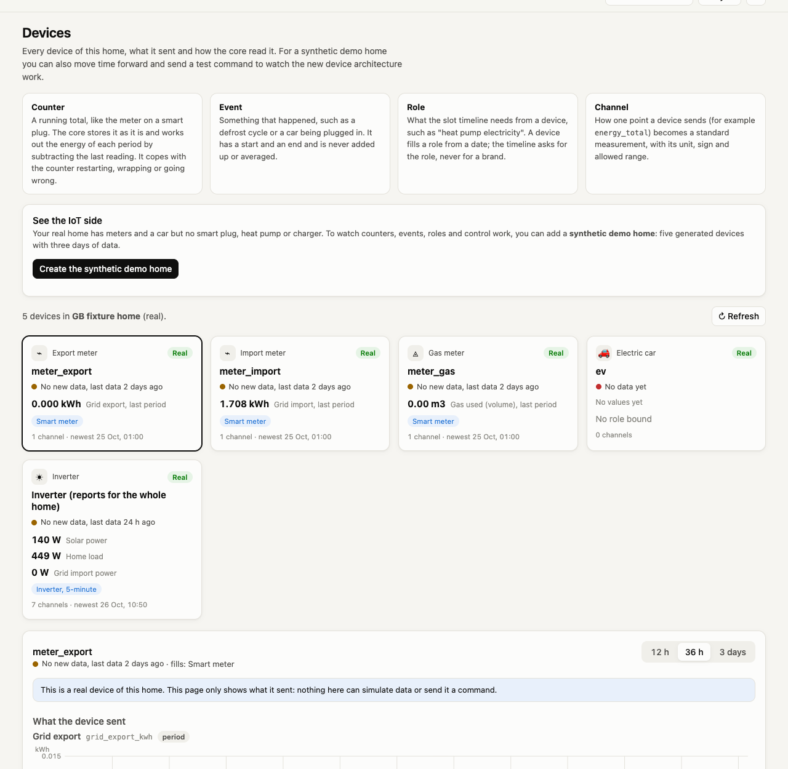
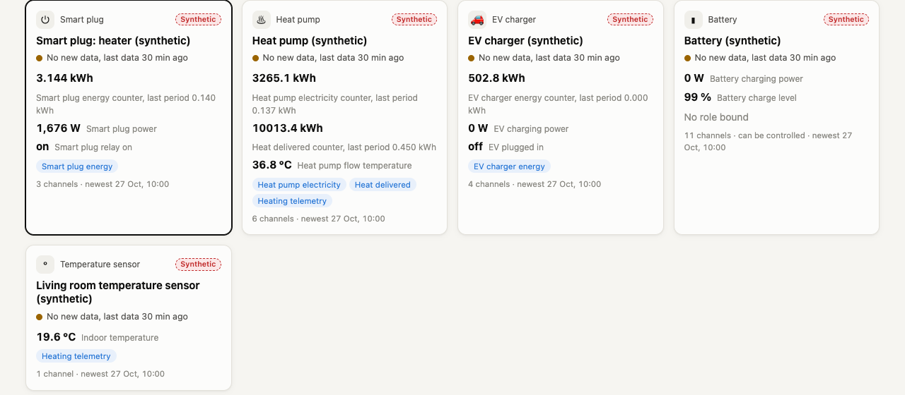
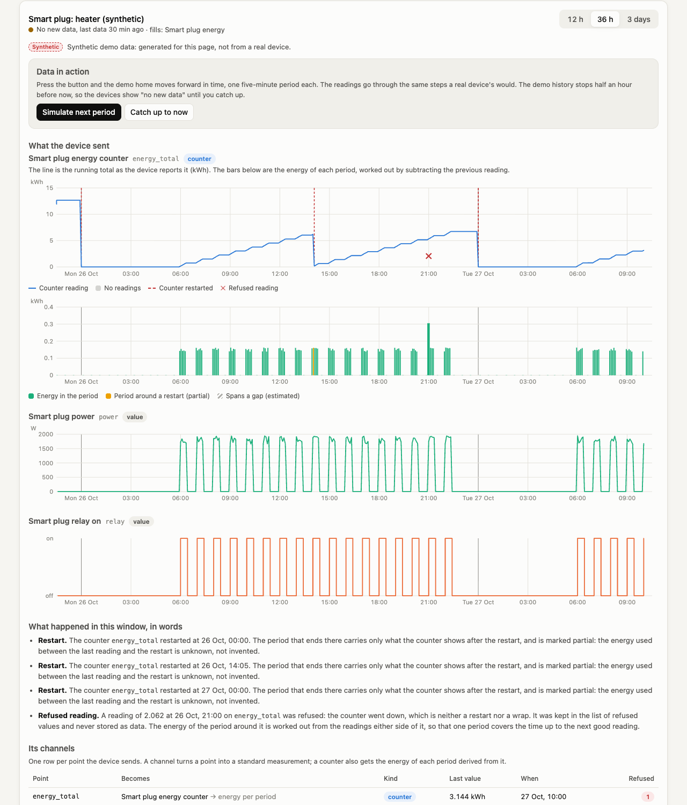
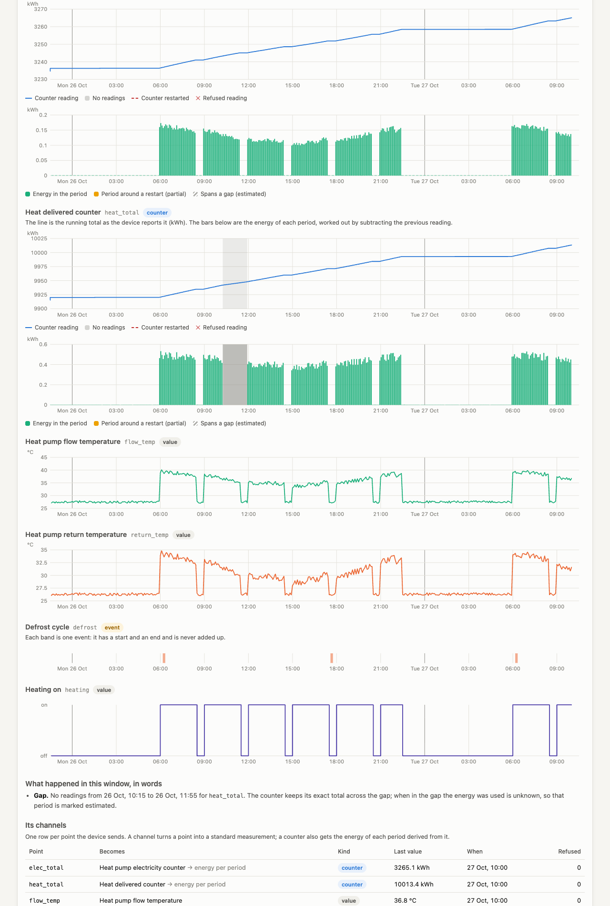
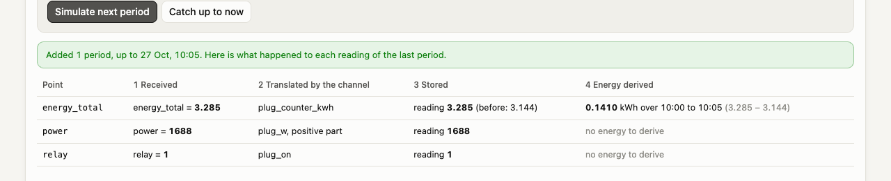
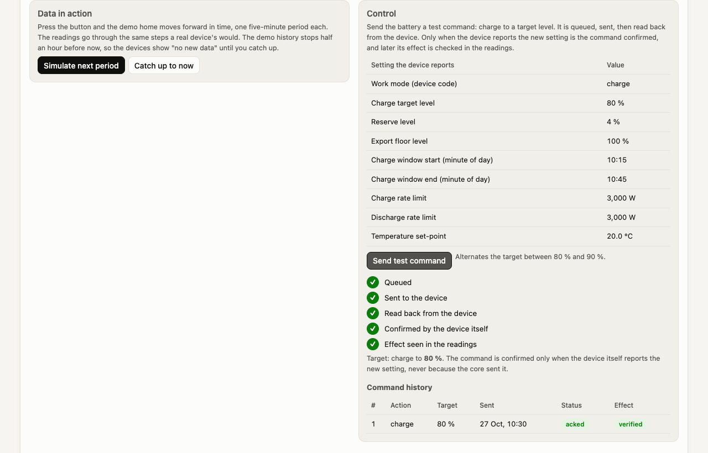
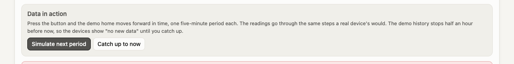
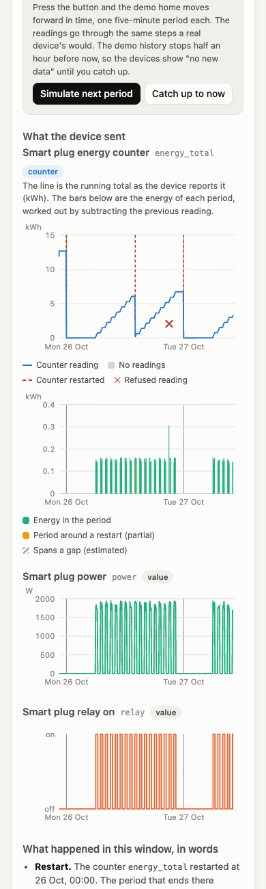
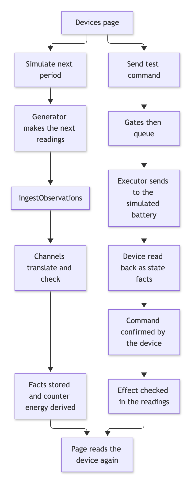
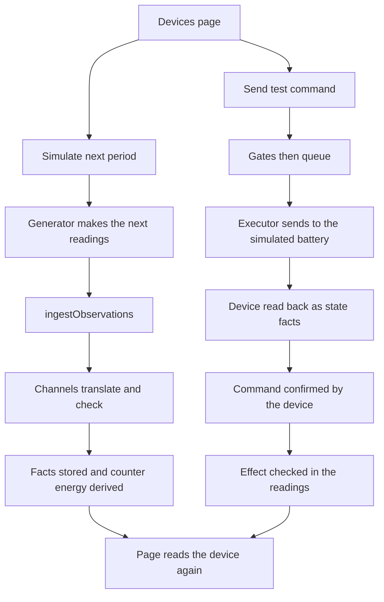

# The Devices page

The Devices page shows every device of a home, what each one sent, and how the core read it. For a **synthetic demo home** it also lets you move time forward and send a test command, to watch the new device architecture work: channels, counters, events, roles and control read-back.

**Status: prototype.** The demo home is generated. No real device is connected. Nothing on the page can send a command to a real device or invent data for one.

## What is on the page

| Part | What it shows | Which part of the architecture it demonstrates |
|---|---|---|
| Four short explanations | Counter, event, role, channel in one sentence each | The vocabulary of the design |
| Device cards | Name, kind, a **Synthetic** or **Real** badge, a status dot in words, the last values with their age, the roles the device fills | One list for meters, a car, an inverter and any IoT device; roles as the link between a device and the slot timeline |
| Detail: charts | A counter's running total with its restarts, gaps and refused readings marked, and the energy of each period below it; instants as lines; events as bands | Counters turned into energy by difference (restart, gap, wrap, backwards step); events never integrated |
| Detail: in words | One sentence for each restart, gap, refused reading and unmapped point | The core's rules, said plainly |
| Detail: channels | One row per point: what it becomes, its kind, the last value, how many readings were refused | Channels as data |
| Detail: refused readings | Value, time and reason | Bad data is refused and recorded, never stored |
| **Data in action** (synthetic only) | A button that adds the next five-minute period, then a table showing what happened to each reading: received, translated by the channel, stored, energy derived | The real ingest path, step by step |
| **Control** (synthetic battery only) | The settings the device reports, a button that sends a test command, the path the command took, and the command history | Gates, executor, read-back by the device, effect check |

### A counter, with its restart marked

The smart plug's counter restarts at local midnight and once in the middle of the day, and one reading in the history is faulty. The page shows the running total with dashed red lines where the counter restarted, a cross where a reading was refused, and the energy of each period below. It then says what each mark means.

### Two counters, a gap, and events

The heat pump has an electricity counter and a heat counter, flow and return temperatures, on and off, and defrost events. Yesterday morning the heat counter has no readings for an hour and a half: the grey band marks it, and the period that spans it is marked estimated, because the counter keeps its exact total across the gap while the timing inside the gap is unknown.

### Data in action

"Simulate next period" moves the whole demo home forward by one five-minute period, as time does, through the same ingest path as the history. The table that appears shows each reading of the last period for the device you are looking at: what was received, which channel translated it and how, what was stored, and for a counter the energy derived (here the difference between the new and the previous reading). The stages appear one after another so they can be followed; people who ask for less motion see them at once.

The demo history stops half an hour before now, so every device shows "No new data" until you catch up. "Catch up to now" adds up to twelve periods and stops at the clock, because a reading dated ahead of the clock would be refused as a future timestamp.

### Control

The battery is the one controllable device. "Send test command" asks it to charge to a target (80 % or 90 %, alternating, so a repeat is a real change). The command is queued, sent, then read back from the device. It is confirmed only when the device itself reports the new setting, and some minutes into the window its effect is checked in the readings.

### Errors and small screens

Every state is handled: loading, empty, an API error shown next to the action that caused it, and success.

The page works on a phone: charts are drawn at the width of the screen and the time labels thin out so they do not overlap.

## How the synthetic home is made and labelled

`src/core/synthetic-iot.js` creates it, once. Calling it again returns the same home and changes nothing.

| What | How it is labelled |
|---|---|
| The home | A demo home (`site.is_demo`), named "Synthetic IoT home (demo data)", marked "(demo, synthetic)" in the home list. The app's own synthetic-data banner appears on every page, and the Devices page adds its own: "Synthetic demo data: generated for this page, not from a real device" |
| Each device | `provider` is `synthetic` and the label says synthetic |
| Each source | The code starts `synthetic_` (plug, heat pump, EV charger, battery, sensor), the name says generated, and the contract says the values are generated and not from a real device |
| Every reading | Written through `ingestObservations`, the real ingest path, never by direct inserts |

The five devices and what they do:

| Device | Kind | What is generated |
|---|---|---|
| Smart plug (a thermostat-cycled heater) | smart plug | An energy counter that restarts at local midnight and once mid-day, power, relay on or off. One faulty counter reading in the history |
| Heat pump | heat pump | Two lifetime counters (electricity, heat delivered), flow and return temperatures, on or off, defrost events. A gap of an hour and a half in the heat counter |
| EV charger | EV charger | A delivered-energy counter, power, plugged in, plugged-in events (a session each night) |
| Battery | battery | Charge level and charging power, and a controllable "charge" action backed by the simulated device from the control work |
| Temperature sensor | temperature sensor | Indoor temperature, with a gap, and one point nobody mapped |

Everything is a deterministic function of the time, so the same history comes out every time and tests are stable. The roles are bound where one fits: plug energy, heat pump electricity, heat delivered, heating telemetry (the heat pump and the sensor) and EV charger energy. The default bindings of the real providers are removed from this home.

## How to create it

- **On the page.** Open Devices on a home that has no demo home. A card offers "Create the synthetic demo home". It asks first, in words, that it adds a separate demo home to this database and does not change the real home or its data. Confirming creates it and opens it.
- **From the command line.** `npm run demo:iot` does the same for the database the app uses (`DB_FILE`, else `data/core.db`), prints the path first, and does nothing if the demo home is already there.

## Routes

| Route | What it does |
|---|---|
| `GET /api/sites/:id/devices` | Every device of the home with its status, channels, last values and roles. It keeps the fields this route has always returned (kind, provider, label, profileClass, annualKwh, gasUnit, state) so My energy still works, and adds id, synthetic, status, channels, roles. The home's inverter is listed as a device with id `site` |
| `GET /api/sites/:id/devices/:deviceId?hours=` | One device over a window of 1 to 168 hours (default 36): its channels with data (counter: raw readings and derived periods; instants; events), the markers (restarts, gaps), the refused readings, the settings it reports, its commands and the command log |
| `GET /api/demo/iot` | Whether the demo home exists, and its id |
| `POST /api/demo/iot` | Creates the demo home if it is not there. Idempotent. Returns the id and whether it was created |
| `POST /api/sites/:id/devices/:deviceId/simulate` | Adds `periods` (1 to 12) five-minute periods to the demo home through the real ingest. **Synthetic devices only.** Returns what was added, whether it caught up with the clock, and the pipeline steps for this device |
| `POST /api/sites/:id/devices/:deviceId/commands` | Queues a charge command for the synthetic battery and runs the control cycle until it is acknowledged and its effect checked. Optional `targetSocPct` (10 to 100). **Synthetic controllable devices only.** Returns the command, the path it took and the log |

Errors are `{ error, code, field? }`: `not_found` and `unknown_device` (404), `not_synthetic`, `not_controllable` and `bad_number` (400). A device of one home is never found through another home.

Mermaid source of diagram 1

## Decisions

- **One list route, extended.** `GET /api/sites/:id/devices` already existed (My energy uses it). Two handlers cannot share a path, so that handler now returns the old fields plus the new ones, rather than a second path.
- **Simulating moves the whole demo home.** The devices share one clock and one set of counters, so pressing the button on any device advances every device by the same period. The response shows the steps of the device you are looking at.
- **Status words.** A device is "receiving data" when its newest reading is recent for its kind (15 minutes for a local device, 6 hours for a car's cloud account, 36 hours for a smart meter, whose data arrives a day late), "no new data" up to 7 days, and "no recent data" beyond. A device with nothing yet says "no data yet". This is each device's own freshness, not the planner's gate for the home's live inputs.
- **The sources and one metric are created with the demo home.** The five `synthetic_` sources and the metric for a plug's relay are added when the home is created, not to `registry.js`, so the demo adds nothing to the core's definitions.
- **The battery's effect is generated too.** After the device acknowledges a command, the demo battery "starts charging" and that telemetry is generated, so the effect check has something to find. It is labelled synthetic like the rest.
- **The simulated device is in memory.** After a restart it is rebuilt from the last settings the battery reported.
- **Charts are drawn as SVG text at the width of the page,** so they are readable at every size, and they are testable without a browser.
- **The heater cycles through the day** (25 minutes on in every hour from 06:00 to 23:00), so "Simulate next period" usually has energy to show.

## Not covered

- **No real device.** Everything on the synthetic home is generated. The real home's meters and inverter are listed read-only, with no simulate or command buttons.
- **No push endpoint.** Devices cannot yet send their own readings to the core. Everything is pulled or generated.
- **The demo home cannot be removed from the page.** There is no delete route.
- **No slots are built for the demo home.** The other pages (My energy, Timeline and the rest) have nothing to show for it, and I did not check how each of them looks for a home with no built days.
- **Only one control action.** The test command is "charge to a target" on the battery. The plug, heat pump and EV charger cannot be commanded.
- **Simulating cannot go past the clock,** by design, and cannot go back.
- **One real home was used for the real-device view.** The fixture's devices have no human names, so their cards show the device kind.
- **No automated check of the animation.** The staged reveal was watched in headless Chrome; the tests check the content, not the timing.
