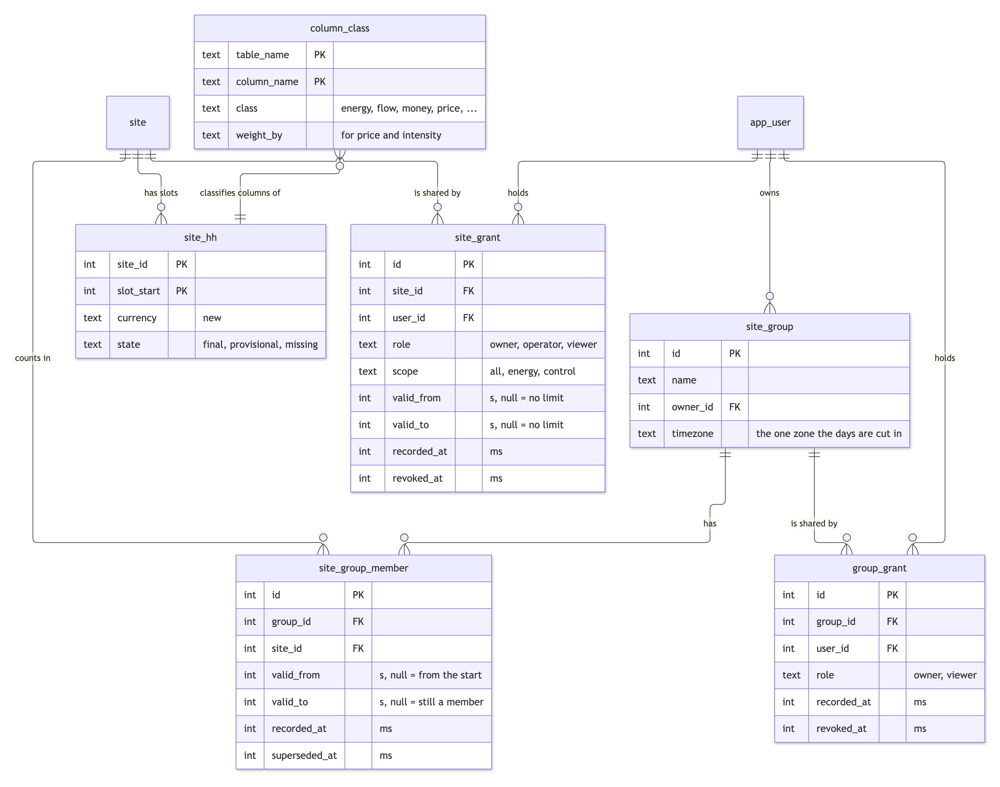
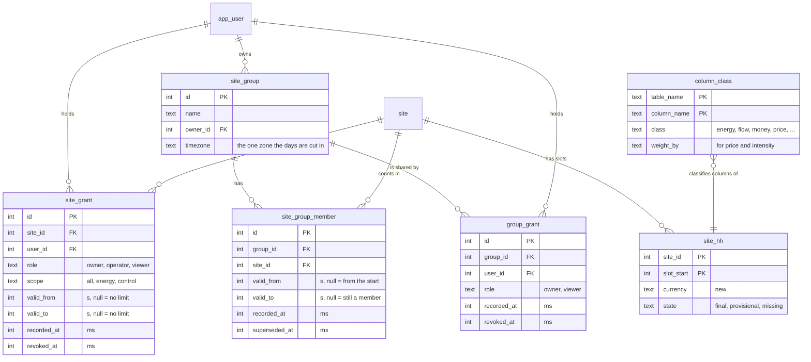

# Groups of homes, sharing, and currency on slots

Written for: engineers working on the slot engine who need to know what a "group" is, what it may and may not add up, and who can see or command a home. Stage 5 of `docs/slot-engine-solution.md`; the design questions it answers are in `docs/slot-engine-stress-test.md` sections 1 and 2.

## What this adds

| Piece | What it is | Where |
|---|---|---|
| Currency on every slot | `site_hh.currency`, written by the builder from the home as known then; stored rows were filled in once from the home's currency | delta 070, `src/core/build.js` |
| Column classes | One row per `site_hh` column saying how it combines across homes (data, not code) | table `column_class`, `loadClasses()` |
| Groups | A named set of homes with one time zone for its days | `site_group`, `src/core/groups.js` |
| Dated membership | A home counts in a group for a period; the membership as recorded earlier can be asked for again | `site_group_member` (valid time `valid_from`/`valid_to`, transaction time `recorded_at`/`superseded_at`) |
| Users and grants | Who may read or command a home, for which period | `app_user`, `site_grant`, `src/core/access.js` |
| Sharing a group | Who may open a group | `group_grant` |

The table is `site_grant` and not `grant` because `GRANT` is an SQL keyword.

Mermaid source of diagram 1

## The rules a group view follows

1. **Slot rows only.** Group views read `site_hh`. They never read `site_day`, which fills a missing slot with zero and stores ratios.
2. **Money is added only within one currency.** A group of GBP and EUR homes has two totals (`money.GBP`, `money.EUR`) and no combined figure. There is no exchange rate in the system.
3. **One time zone for the group's days.** The group's zone cuts its days (`dayBounds`). A slot belongs to the bucket its `slot_start` falls in.
4. **A slot is never split.** The default bucket is the longest slot among the members (one hour for a group with an hourly home). Asking for a shorter bucket than some member's slot is refused with an error, not answered with an invented split. A 30-minute slot is not cut in two for a finer grid.
5. **Missing is not zero.** A slot whose state is `missing` is left out of every sum (its zeros are not measurements). If any member has a missing or absent slot, or a null figure, in a bucket, the bucket's value for that column is `null`; `partial` holds the sum of what is known. A day total is `null` when any of its buckets is.
6. **Final only if all are final.** A group bucket is `final` only if every member slot behind it is final, `provisional` if all are present and at least one is provisional, `incomplete` if any is missing or absent. The seconds of each state, the expected seconds and a coverage share are returned.
7. **Ratios are recomputed from the sums**, never averaged: self-sufficiency is `1 - sum(grid_to_home) / sum(home)`. Prices are weighted by the energy they apply to. The day's peak import is the largest hourly (bucket) sum, not the sum of the homes' own peaks.
8. **Charge level is added in kWh.** Each home's `soc_end` at the last slot of the bucket is turned into kWh with the battery size as known at that slot, summed, and divided by the summed size.
9. **Membership is dated and recorded.** A home that leaves on day X counts before X and not after. `knownAt` returns the membership as it was recorded at that moment, so a report produced earlier runs again identically. The slot rows themselves are the current ones: a rebuilt day shows its rebuilt figures (its history is in `site_day_revision`).
10. **A viewer sees only what the viewer's grants cover.** With `viewer`, a member home is included only for the periods and scopes the viewer may read. A home the viewer has no grant on is left out as if it were not a member: no count, no gap marker, and its id appears nowhere in the result.

## Aggregation classes

Kept as rows in `column_class` (`test/groups-classes.test.js` fails if a `site_hh` column has no class).

| Class | Columns | Rule across homes |
|---|---|---|
| key | `site_id`, `slot_start`, `local_date`, `dur_s`, `tod_min` | Grouped by or carried; never aggregated |
| energy | `solar`, `grid_import`, `grid_export`, `battery_charge`, `battery_discharge`, `home`, `loss`, `gas`, `ev` | Sum (kWh), null when any member's is missing |
| forecast | `solar_forecast` | Sum, null unless every member has one |
| flow | `solar_to_home`, `solar_to_battery`, `solar_to_grid`, `battery_to_home`, `battery_to_grid`, `grid_to_home`, `grid_to_battery`, `solar_to_loss`, `battery_to_loss`, `grid_to_loss` | Sum of each home's own allocation; never recomputed from coarser buckets (they differ by slot length) |
| money | `loss_cost`, `grid_to_home_cost`, `grid_to_battery_cost`, `battery_to_home_cost`, `export_credit`, `standing_cost`, `gas_cost`, `total_cost`, `grid_only_cost`, `saving` | Sum within one currency; never converted, never re-priced |
| carbon | `carbon_g`, `carbon_saved_g` | Sum (g) |
| price | `import_rate_ex`, `import_vat`, `export_rate`, `gas_rate_ex`, `gas_vat` | Mean weighted by `grid_import`, `grid_export` or `gas`, per currency |
| intensity | `carbon_intensity` | Mean weighted by `grid_import`, not tied to a currency |
| temperature | `outdoor_temp` | Time-weighted per home; reported per home, not combined |
| charge_level | `soc_end` | Added in kWh with each battery's size, then divided by the summed size |
| flag | `state`, `quality`, `rate_found` | State: the worst of the member slots; quality: bitwise OR |
| diagnostic | `meter_vs_ct` | Per home only |
| lineage | `lineage`, `method_version`, `built_at` | A bucket with two method versions is flagged `mixedMethod`; `built_at` is the latest |
| unit | `currency` | Partitions the money sums |

## Who may see or command a home

| Role | Scope `all` | Scope `energy` | Scope `control` |
|---|---|---|---|
| owner | reads, commands | reads | commands |
| operator | reads, commands | reads | commands |
| viewer | reads | reads | nothing (a viewer never commands) |

`canView(user, site)` is true for scope `all` or `energy`. `canControl(user, site)` is true for a role other than viewer with scope `all` or `control`. The command path (`src/core/commands.js`) does not call it yet: it is the check to call before queueing a command for a device of a home.

A grant can limit the period of the home's data it shows (`valid_from`, `valid_to`). Revoking a grant gives no access afterwards, history included: access is evaluated now, membership is valid time. A past moment can still be asked ("did this grant exist at T"), by passing `now`.

`tenant` and `tenant_site` (delta 060) stay what they were: the data controller of a home. Nothing here reads them, and a home may be shared across tenants.

## Measured: the Dutch home in a London day

The two tests print a measurement on synthetic data (the Dutch home's import grows through the period, so the hour that moves is not the same as the hour that arrives). On 25 October 2025 the same slots give 15.360 kWh in Amsterdam's day (22:00Z to 22:00Z) and 15.514 kWh in London's (23:00Z to 23:00Z). The difference is exactly the import of the hour that leaves minus the hour that arrives. The stress test measured +0.503 kWh (24 % of that day) on its own Dutch data; the size depends on the data, the mechanism does not. This is why a group cuts its days in one zone and does not add the homes' own `local_date` rows.

## Not built

- No sign-in, no passwords, no sessions: users are named rows. Access functions take a user id.
- The command path does not call `canControl` yet, and nothing stops a command for a home the caller cannot control.
- Row-level security in the database: access is checked in code, not enforced by the database. There is no PostgreSQL port or test here.
- No overlap check on group membership rows (two open rows for one home in one group are allowed and merged when read).
- No rollup table (`site_bucket`); a group view is a query over slot rows. Not timed at 20 homes by a year.
- No exchange rate and no converted total; a mixed-currency group stays two totals.
- No peak at a finer resolution than the bucket, and no per-minute grid across homes with different slot lengths.
- Slot rows are not kept as known at a moment; only membership and grants are. A report from last month shows today's rebuilt slots.
- The group time zone is fixed per group; a group whose zone changes is not versioned.
- Allocation-based figures (`battery_to_home_cost`, `loss_cost`, `saving`) are model outputs of each home at its own resolution; the group adds them as they are.
- Roles are three fixed names; there is no invitation flow, expiry reminder or audit log of who looked at what.
