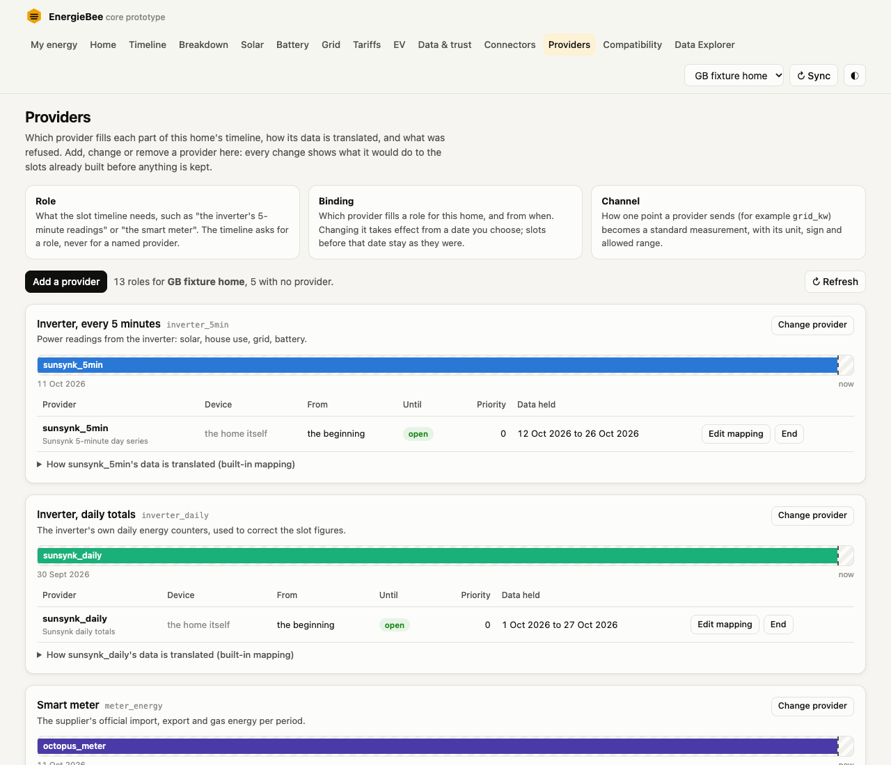
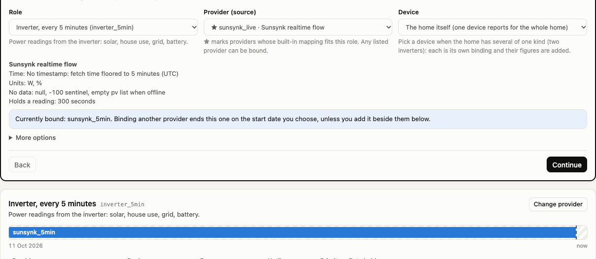
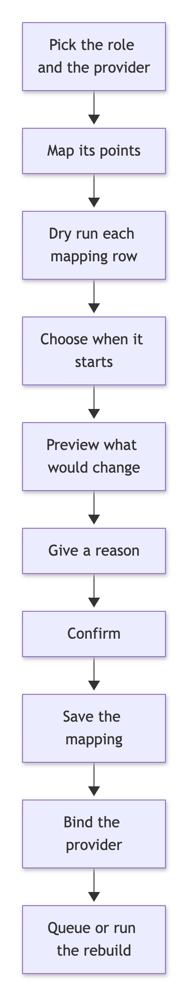
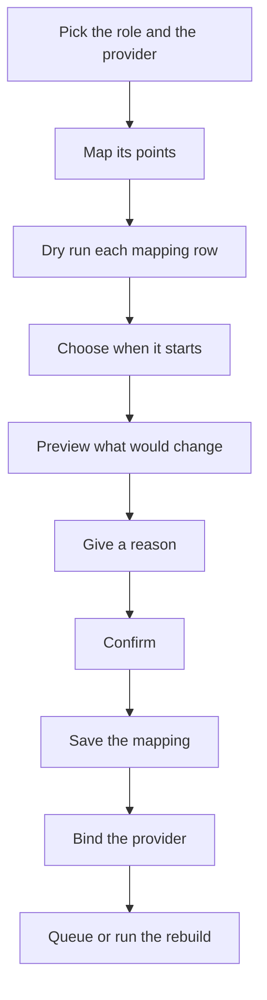
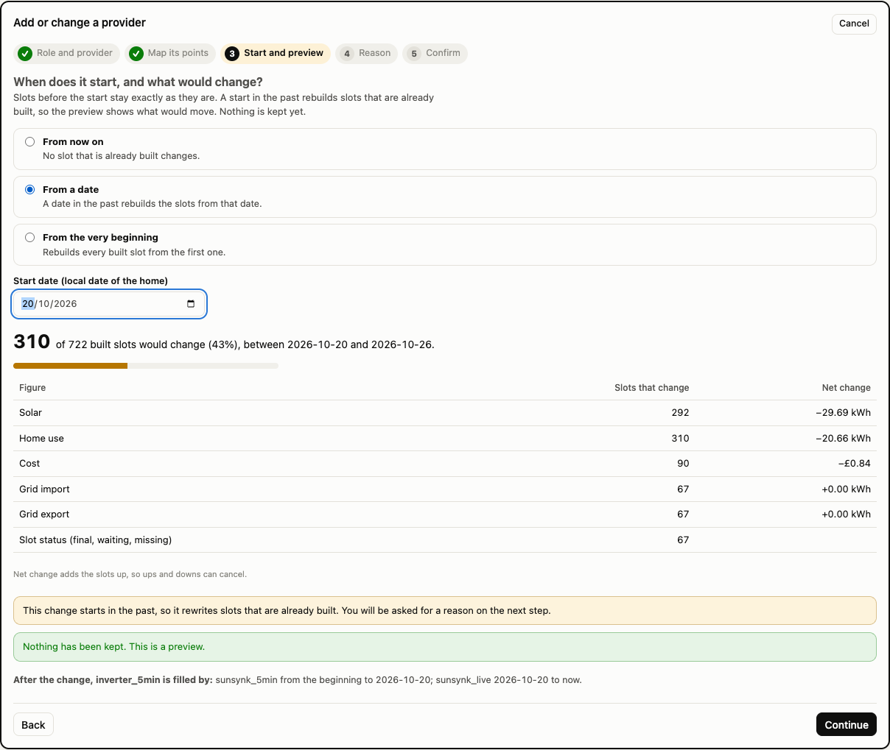
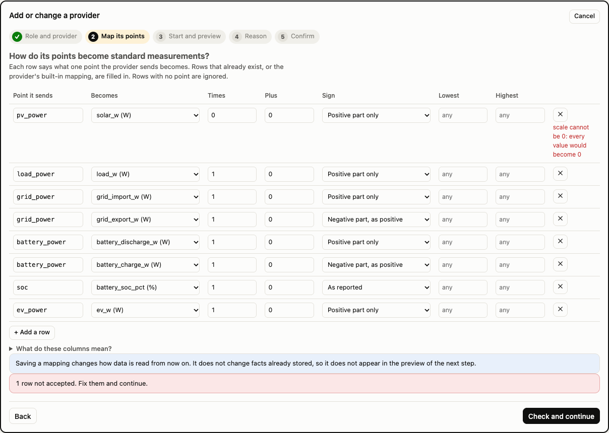
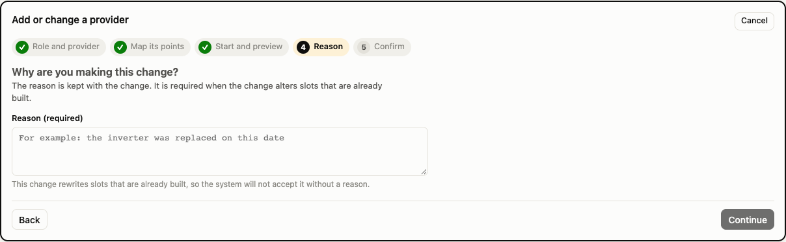
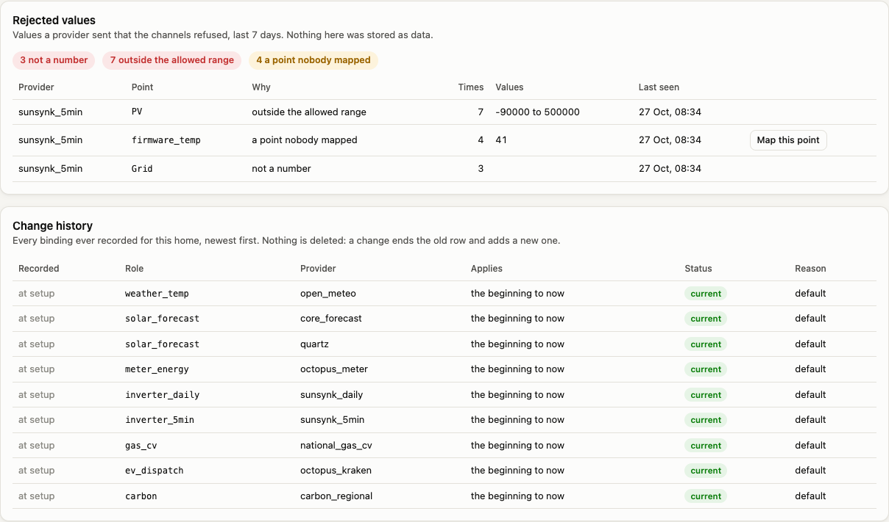
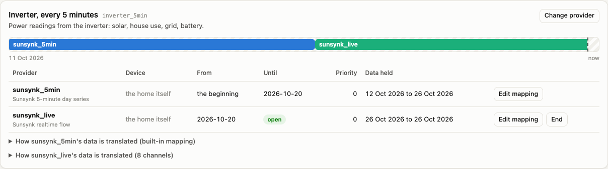

# Provider onboarding: API and the Providers screen

Until now, binding a provider to a role, mapping its points to standard measurements and checking what a change would do to the slots already built could only be done through code and tests. This adds an API and a screen for it, so an operator can add, change or remove a provider and see the effect before anything is kept.

Three ideas, in the words the screen uses:

| Term | Meaning |
|---|---|
| **Role** | What the slot timeline needs, such as "the inverter's 5-minute readings" or "the smart meter". The timeline asks for a role, never for a named provider. |
| **Binding** | Which provider fills a role for a home, and from when. A change takes effect from a date you choose; slots before it stay as they were. |
| **Channel** | How one point a provider sends (for example `grid_kw`) becomes a standard measurement, with its unit, sign and allowed range. |

The code is `src/core/onboarding.js` (read model, validation, writes), the routes are one commented block in `src/server.js`, and the screen is `public/providers.html` with `public/js/pages/providers.js` and `public/js/onboarding-view.js`.

---

## 1. The API

All routes return JSON. A start date is a local date in the home's own zone (`2026-10-12`), epoch seconds, or the word `now`. For a binding's start, an empty value means "from the very beginning".

| Route | What it does |
|---|---|
| `GET /api/sources` | Every source: code, name, contract in words, traits (hold time and so on), the default channels the system gives it, and the roles those defaults can fill. Also the list of measurements, the roles, and the allowed sign parts. |
| `GET /api/sites/:id/onboarding` | Everything the screen shows for one home: each role with its current bindings (period, device, priority, reason, when it was recorded, how much data the source holds for this home), the history of binding changes, the channels, the devices, and a summary of rejected values. |
| `GET /api/sites/:id/channels?source=&all=1` | The channels of a home, optionally of one source. `all=1` includes replaced ones. |
| `POST /api/sites/:id/channels` | Define a channel (a point becoming a measurement). The same point and measurement replaces the current one; the old row is kept as replaced. |
| `POST /api/sites/:id/channels/retire` | Stop using a channel (`{ id }`). It is kept; the point is reported as unmapped from then on. |
| `POST /api/sites/:id/bindings/preview` | What a binding or unbinding would do, with `action: "bind"` or `"unbind"`. Keeps nothing. |
| `POST /api/sites/:id/bindings` | Bind a source to a role from a date. |
| `POST /api/sites/:id/bindings/unbind` | End a role at a date. |
| `GET /api/sites/:id/rejects?days=&source=` | Values the channels refused, by reason and by point, and the points nobody mapped. |

### Request fields

| Field | Used by | Meaning |
|---|---|---|
| `role` | bindings | One of the roles the system knows. The list is read when the request is made, so a role added later is accepted without a change here. |
| `source` | bindings, channels | A source code from `GET /api/sources`. |
| `from` | bind, preview | Start date. `now` touches no built slot. A past date rebuilds slots from then. Empty means from the beginning. |
| `at` | unbind, preview | End date, same formats. Omitted means now. |
| `deviceId` | bindings, channels | A device id means that device. `"home"` means the home's own binding only. Omitted on a binding means every open binding of the role. This is how two inverters are added together. |
| `priority`, `keep` | bind | Order among several providers of one role, and "add beside the current ones instead of replacing them". |
| `reason` | bind, unbind | Required when the change alters slots that are already built. |
| `rebuild` | bind, unbind | Rebuild the affected days now. Otherwise they are queued for the next sync. |
| `dryRun` | every write | In the body or as `?dryRun=1`. Returns what would happen and keeps nothing. |
| `point`, `metric`, `scale`, `shift`, `part`, `min`, `max`, `access` | channels | The mapping. `part` is `all`, `positive`, `negative` or `abs`. |

### What the answers carry

A **preview** returns `needsReason`, `warnings`, `would` (the bindings of that role after the change), and `impact`: how many built slots would change, the net change per figure, the first and last changed date, and the currency. A **bind** returns the new bindings of the role and `queued`, the date the rebuild starts from, plus `rebuilt` when the days were rebuilt on the spot. An **unbind** returns how many bindings it ended.

### Errors

Every error is `{ error, code, field? }`: a plain message, a machine code, and the field at fault when there is one.

| Code | Status | When |
|---|---|---|
| `unknown_role` | 400 | The role is not one the system knows |
| `unknown_source` | 400 | The source code does not exist yet |
| `unknown_metric` | 400 | The measurement does not exist |
| `unknown_device` | 400 | The device is not a device of this home |
| `bad_part` | 400 | The sign part is not one of the four |
| `bad_number` | 400 | A number is not a number, is out of range, is 0 for the scale, or min is above max |
| `bad_date` | 400 | The date is not a real local date, epoch seconds or `now` |
| `missing_field` | 400 | A required field is empty |
| `reason_required` | 409 | The change alters built slots and no reason was given. Nothing was written |
| `not_found` | 404 | No such home, or no such current channel |

Two guarantees hold for every write. A change is made inside one transaction, so a bind either fully applies or not at all. A preview and a dry run run the change inside a savepoint that is rolled back, so nothing is kept, and neither needs a reason because nothing is recorded.

---

## 2. The screen

The Providers page sits in the navigation next to Connectors, and follows the existing look: same header, cards, badges, colours and light and dark themes.

**Per role.** One card with a plain-language title and hint. A timeline shows which provider fills the role over time. Bars that overlap in time sit on separate rows (two inverters at once). A hatched track with a message means no provider fills the role, and any gap between providers is named in words. Below it a table lists each binding with its device, start, end, priority and how much data the provider holds for the home, with Edit mapping and End buttons. A collapsible block shows how the provider's data is translated: its channels, or the built-in mapping that is created the first time it delivers data.

**Rejected values.** Counts by reason (not a number, outside the allowed range, a point nobody mapped), a table by provider and point, and a Map this point button for unmapped points.

**Change history.** Every binding ever recorded, newest first. Nothing is deleted: a change ends the old row and adds a new one.

### The flow

Adding or changing a provider takes five steps, and removing one takes four. Cancel and the Escape key close it at any point. The step headings take keyboard focus as the steps change.

Mermaid source of diagram 1

1. **Role and provider.** Pick a role and a provider. Providers whose built-in mapping fits the role are starred. If the home has several devices, pick one; each device is its own binding and their figures are added. Under More options are the priority and the choice to add beside the current providers.
2. **Map its points.** A table of rows: the point the provider sends, what it becomes, times and plus (the unit conversion), the sign part in plain words, and the lowest and highest allowed value. Rows are filled from the existing channels, or the provider's built-in mapping, or one blank row per measurement the role needs. A help block explains each column. Continuing runs a dry run of every row, so a mistake is shown next to its row before the step moves on.
3. **Start and preview.** Choose from now on, from a date, or from the very beginning. The preview runs at once and again whenever the choice changes.
4. **Reason.** Required when the preview said the change alters built slots. The Continue button stays off until one is written.
5. **Confirm.** A summary, and a choice to rebuild the affected days now. Confirming saves the mapping, then binds, then queues or runs the rebuild.

The preview above is the real home with its inverter provider replaced from 20 October: 310 of 722 built slots would change, solar falls by 29.69 kWh and cost by £0.84. The screen also says plainly that nothing has been kept.

A mistake in the mapping is shown next to the row and in a banner, and the flow stays on that step:

The reason step, and the rejected values panel:

After confirming, the screen says what happened and how many days were rebuilt, and the role's timeline shows the switch:

States handled: loading, no provider for a role, no rejected values, no history, an API error shown with its message in place of the page or the step, and success. The page works at phone width without sideways scrolling, in dark mode, and from the keyboard.

---

## 3. Decisions

- **The start date is chosen next to the preview.** The preview depends on the date, so asking for the date after the preview would show numbers for a date not yet chosen. Step 3 holds both, step 4 holds the reason.
- **"From now on" never needs a reason.** The word `now` is accepted for dates and means this instant, which no built slot is at or after.
- **Binding a provider queues a rebuild.** The built slots follow the binding, so the affected days are queued (or rebuilt on request) from the start date. A start date still in the future queues nothing.
- **Roles are read, not copied.** Roles added later to the engine appear on the screen by a readable version of their code, with no change here.
- **The mapping is saved before the binding.** If the binding is then refused (for a missing reason), the mapping stays. The preview and the required-reason step make that unlikely.
- **The deviceId convention.** A number is that device, `"home"` is the home's own binding, and leaving it out applies to every open binding of the role.

---

## 4. Not covered

- **No sign-in.** Anyone who can reach the server can change bindings. That matches the prototype scope; the control-access check is not applied to these routes.
- **A channel change is not in the impact preview.** A channel changes how data is read from now on and does not rewrite facts already stored, so only the binding has an impact to show. The screen says so.
- **Adding a source that does not exist yet.** The screen binds sources that exist. Adding a new source row, and its description, is still done in code.
- **Editing control points.** The API accepts `access` on a channel, but the screen does not offer it, and a mode's allowed values are not editable.
- **Changing the priority of an existing binding.** Bind it again with the new priority.
- **Size.** A preview runs the whole home twice in memory. On the real home (722 built slots) that takes about 0.1 second; it grows with the number of built slots. A large home would need the preview limited to a period.
- **History is the last 100 rows**, and the screen shows 15.
- **No undo.** Ending a binding or binding another is itself a recorded change, so going back is another change with its own reason.
