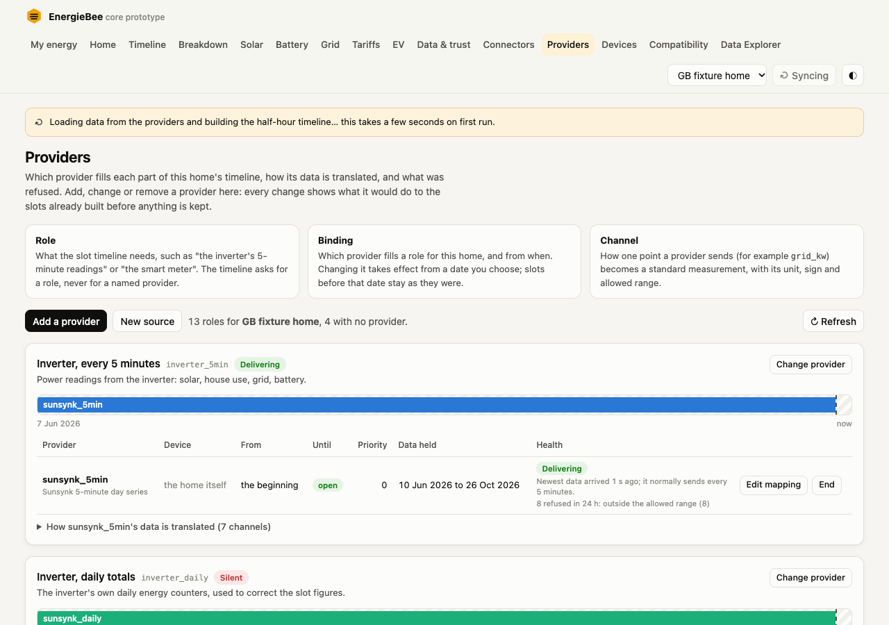
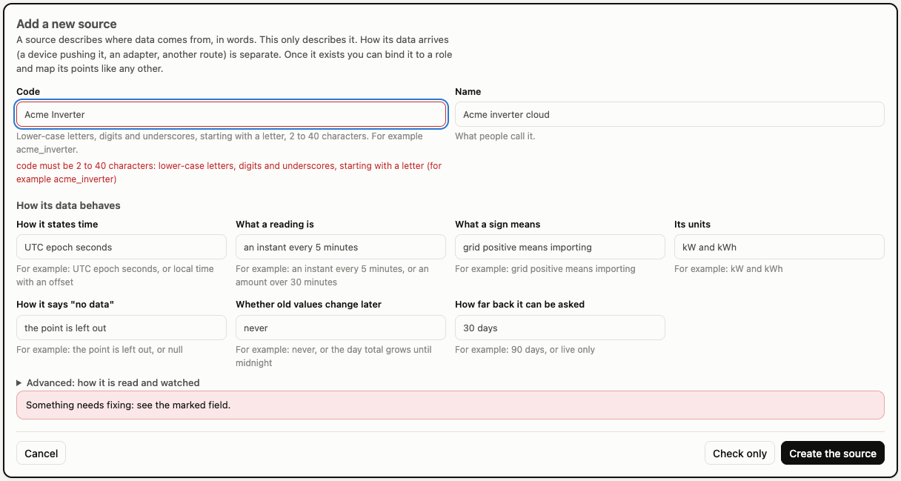
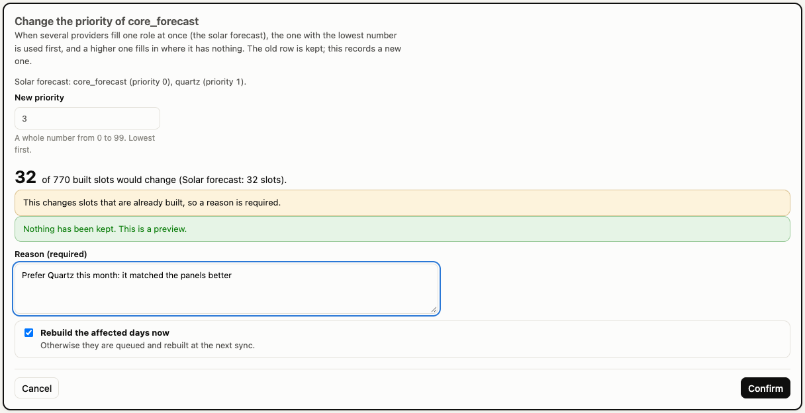
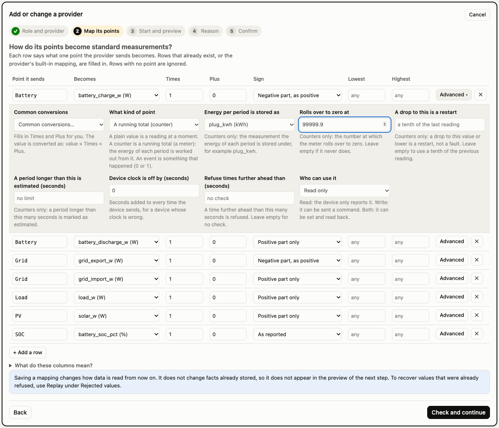
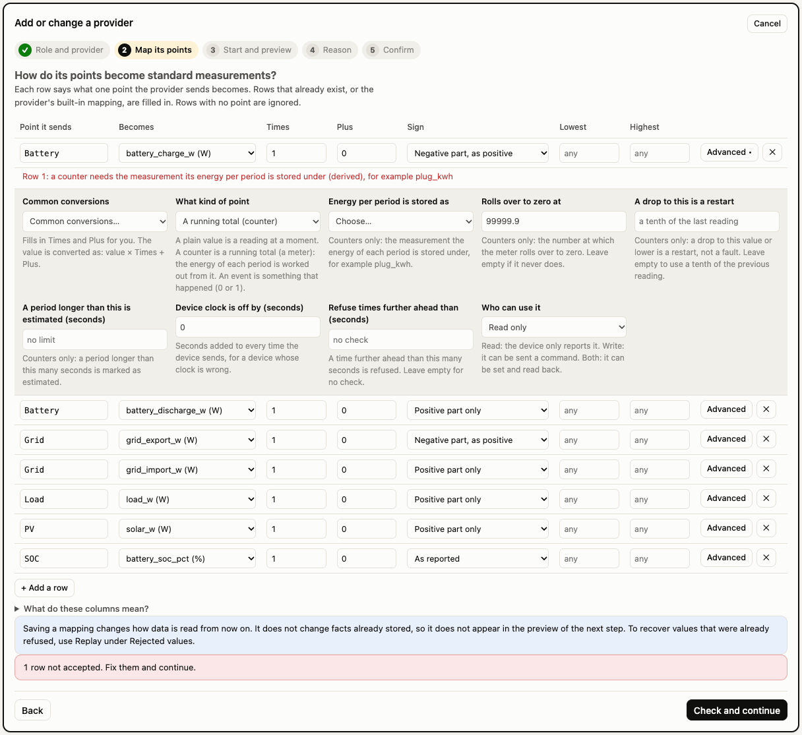
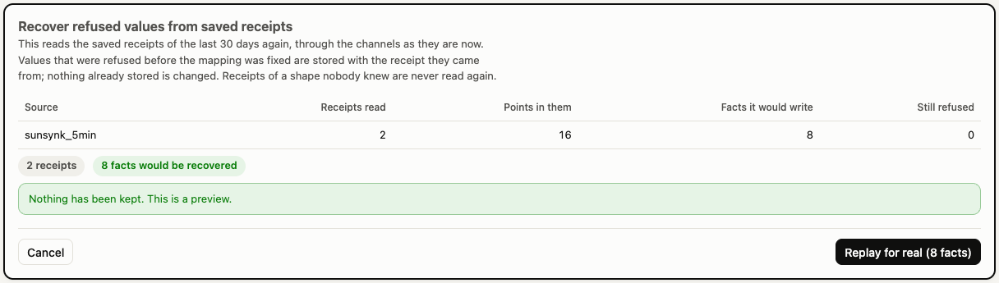
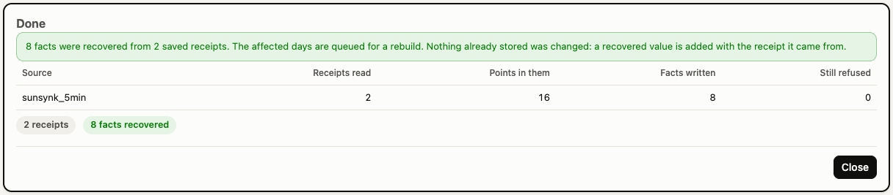
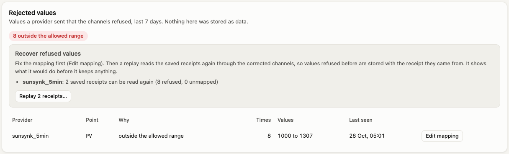
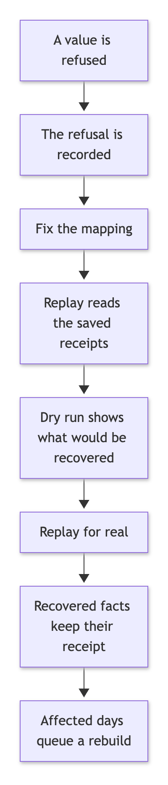
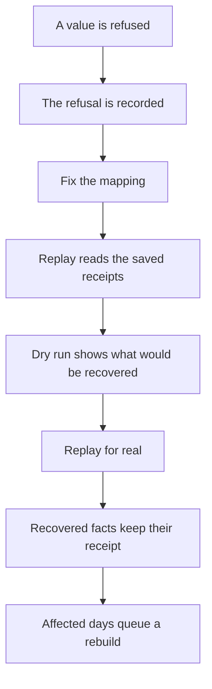

# Providers, completed: new sources, priorities, advanced mapping, health, replay and retention

The Providers screen (`docs/onboarding-api.md`) could bind, end and map providers, but it left four gaps and the backend had no way to say whether a provider was still delivering or to recover values that had been refused. This closes them:

| Gap | What exists now |
|---|---|
| A provider the system has never heard of could only be added in code | **Add a new source** from the screen or the API |
| A binding's priority could only be changed by binding again | **Edit a priority**, recorded as a new row, with a preview |
| The mapping table hid most channel options | An **Advanced** part for counters, events, settings, stuck sensors, clocks and times in the future |
| Nothing said whether a provider was alive | **Source health** per role and per provider, in plain words |
| Values refused before a mapping was fixed were lost | **Replay** of the saved raw receipts through the corrected channels |
| Refusal rows and receipts grew for ever | **Retention** for them, with a configurable age |

The code is in `src/core/onboarding.js` (new source, priority, advanced channel fields), `src/core/health.js`, `src/core/replay.js` and `src/core/maintenance.js` (retention). The screen is `public/js/pages/providers.js` with `public/js/onboarding-view.js`. One new delta, 075, adds the replay log.

---

## 1. Routes

All routes return JSON, and every error is `{ error, code, field? }` as in `docs/onboarding-api.md`.

| Route | What it does |
|---|---|
| `POST /api/sources` | Add a source row: code, name, a contract in words, optional traits. `dryRun` supported. |
| `POST /api/sites/:id/bindings/priority` | Re-record a binding with a new priority (`bindingId`, `priority`, `reason`, `rebuild`, `dryRun`). |
| `GET /api/sites/:id/source-health` | Per role with a provider in force now: is each provider delivering, and the plain reason. |
| `GET /api/sites/:id/replay?days=` | What a replay could recover: per source with refusals, how many saved receipts can be read again, or why not. |
| `POST /api/sites/:id/replay` | Read saved receipts again. **A dry run unless the body says `dryRun: false`.** Body: `source`, `days`, `receiptIds`, `dryRun`. |
| `POST /api/sites/:id/channels` | (existing) now also accepts the advanced fields in section 4. |

The health route is `source-health` because `GET /api/sites/:id/health` already belongs to the Data & trust page and is left as it was.

New error codes:

| Code | Status | When |
|---|---|---|
| `bad_code` | 400 | A source code that is not 2 to 40 lower-case letters, digits and underscores starting with a letter |
| `bad_value` | 400 | A text that is too long, or a combination that cannot be (a feed that is both realtime and forecast-only) |
| `source_exists` | 409 | The code is already a source, whether built in or added earlier |
| `not_applicable` | 400 | A channel option that does not apply to its kind (a counter wrap on a plain value) |
| `no_change` | 400 | A priority edit to the number it already has |
| `not_replayable` | 400 | A replay of a source whose parse is not separated from its fetch (the message says why) |

---

## 2. Adding a new source

A source is data: a row in `source` with its code, name, a **contract** in words and machine-read **traits**. Adding one does not make data flow. It makes the source something you can bind to a role and map points for, with its data arriving by a push from a device, an adapter written later, or any other route.

The form asks for the seven things every source description answers (how it states time, what a reading is, what a sign means, its units, how it says "no data", whether old values change, how far back it can be asked), each with an example under the field. Advanced holds the traits:

| Trait | Meaning |
|---|---|
| `holdS` | Seconds a reading is held between two readings |
| `expectedEveryS` | How often new data should arrive; the health chip is judged against it |
| `live`, `forecastOnly`, `namedOnly` | A realtime feed, predictions only, or daily totals read only when named |
| `irregular` | Reports only when something happens (smart-charge dispatches): never shown as late |

**It is never overwritten.** The registry seed (`seedRegistry` in `db.js`) writes only the sources defined in code (`registry.js`) and never deletes a row. A source added here carries `created_by: 'user'` in its traits so the screen can tell it apart. A code that exists in `registry.js` cannot be created here (`source_exists`). A test opens a copy of the database twice in a fresh process and checks the source and its traits survive each open.

**Check only** runs the same validation and keeps nothing. When the form was opened from the add-a-provider flow, creating the source returns to that flow with the new source already selected.

---

## 3. Editing a binding's priority

Priority orders several providers that fill one role at once (the solar forecast): the lowest number is used first. The control appears on a role that has more than one binding.

- The old row is **superseded and kept**; a copy with the new priority is recorded. A build "as known before" the change still sees the old order (tested).
- The preview reuses the impact preview (`src/core/impact.js`). The forecast column is now one of the fields it compares, because a changed order moves the forecast of record. On the frozen real home, moving `core_forecast` behind Quartz changes 32 built slots (the screenshot's home has a few more built slots from its demo data).
- A **reason is required only when built slots would change**. A change that moves nothing (both forecasts agree, or only one has a value) needs none.
- A change that alters slots queues those days for a rebuild, and the screen can run it on the spot.

---

## 4. Advanced mapping options

Each mapping row has an **Advanced** button (a dot marks a row where something is set). It reveals the options that exist in the channel table:

| Option | Applies to | Meaning |
|---|---|---|
| Common conversions | any | Fills Times and Plus: kW to W, W to kW or Wh to kWh, kWh to Wh, degrees F to C, 15-minute kW to kWh, fraction to percent |
| What kind of point | any | A plain value, a running total (counter) or an event |
| Energy per period is stored as | counter (required) | The measurement the derived energy is stored under, for example `plug_kwh` |
| Rolls over to zero at | counter | The value at which the meter wraps |
| A drop to this is a restart | counter | A drop to this or lower is a restart, not a fault (default: a tenth of the previous reading) |
| A period longer than this is estimated | counter | Seconds |
| Identical readings that look stuck | plain value | Samples in a row marked suspect |
| Device clock is off by | any | Seconds added to every time the device sends |
| Refuse times further ahead than | any | Seconds; empty is no check |
| Who can use it | any | Read, write, or both (a point that can be set) |
| Allowed values | plain value | A setting that takes only certain words, one per line or comma separated |

Combinations that make no sense are refused with the field at fault: a counter option on a plain value, a counter with no derived measurement, a derived measurement equal to the counter itself, a wrap of 0, a stuck-sample count below 2, allowed values on a counter. When a row is refused for an advanced field, that row's Advanced panel opens by itself and the message sits across the full width of the table.

---

## 5. Source health

The question is "is this provider still delivering?", answered from the facts its series hold, not from a connection flag that can say "ok" while nothing arrives.

**What counts as new data.** Facts are stored change-only and stamped with when the core **received** them. The freshest series of the bound source for this home decides (its own series, its device's series, or the region series it reads), so a source is not blamed for one quiet series such as a relay that rarely changes. A binding that names a device reads only that device's series.

**How often new data should arrive**, in this order:

| Order | Source of the answer |
|---|---|
| 1 | The source's `expectedEveryS` trait (set in `registry.js`, or on the new-source form) |
| 2 | By kind: an instant reading 300 s, a counter 300 s, a forecast 3600 s, a period its own length (the median of its newest periods, 1800 s when unknown) |

**Status**, with `age` the seconds since the newest fact was received:

| Status | Rule |
|---|---|
| ok | `age` up to 2 periods |
| late | up to the larger of 12 periods and 6 hours |
| silent | older than that |
| never | no data at all for this home |
| irregular sources | never late or silent: ok when they have data, never when not |
| unbound | a role with no provider in force now is not listed |

A role's status is the worst of its providers in force. The screen shows a chip beside each role's title, and in each binding's row the chip, the reason in plain words (`No new data for 3 h; it normally sends every 5 minutes.`), what the channels refused in the last 24 hours with the top reasons, and the last push when the push log exists. The push log is feature-detected, never assumed.

Limits: a forecast that repeats itself unchanged stores nothing, so it is invisible to this rule. Give forecast sources a generous `expectedEveryS`. The "silent after 6 hours" floor means a 5-minute source is late after 10 minutes and silent after 6 hours; that is a choice, not a measurement of anything.

---

## 6. Replay

After a mapping is fixed, the values that were refused or unmapped are not in the facts, but the receipt that carried them is still saved. A replay reads the saved receipts again through the parser and the channels as they are now.

Mermaid source of diagram 1

**What it guarantees**

- **A dry run first, by default.** The route is a dry run unless the body says `dryRun: false`. A dry run runs inside a savepoint that is rolled back, so it keeps no fact, no series, no refusal row and no log row.
- **Idempotent.** Facts are change-only, so a second run writes nothing. A corrected value (the scale of a channel changed) is a new version; the old one is kept, superseded.
- **Each recovered fact carries the receipt it came from,** exactly as the first read would have.
- **No duplicate refusals.** The receipts were refused when first read; a replay that would refuse again reports it in its own answer and does not add rows to `channel_reject`.
- **Quarantined bodies are never replayed.** A body of a shape nobody knew produced no facts on purpose, and asking for it by id does not replay it.
- **A missing file or an unreadable body is counted,** not an error, and nothing is guessed.
- **The recovered days are queued for a rebuild** through the same path as any new data. A real run writes a row to `replay_log` (delta 075).

**Which sources can replay**

| Source | Replays? | Why |
|---|---|---|
| `sunsynk_5min` | yes | The parse is a pure function of the saved body; the date is in the receipt's request and the zone is the home's |
| `sunsynk_daily` | yes | Same |
| `sunsynk_live` | yes | The realtime flow has no timestamp; it is stamped with the receipt's fetch time. Other receipts of this source (plant record, battery details) are not flows and are skipped |
| `push_native`, `push_shelly_gen2`, `push_tasmota`, `push_homeassistant` | yes, when `push-formats.js` is there | The body is the sender's own text, and the format and device are in the receipt's request. An ack in a saved body is never replayed |
| `octopus_meter` | no | The meter, its unit (kWh or m3) and the measurement are decided from the home's devices at fetch time, and the parse is inside the adapter |
| `octopus_kraken`, `carbon_regional`, `national_gas_cv`, `open_meteo`, `quartz` | no | The parse is inline in the adapter and depends on state the receipt does not record (a region, a zone, the clock at fetch time) |
| `octopus_rates`, `tariffscanner`, `tounify` | no | Tariff prices and catalogues are a different store, not channel facts |

A refused replay says why in its message. Separating an adapter's parse from its fetch (as `src/adapters/sunsynk.js` already does) is what makes its receipts replayable.

---

## 7. Retention

`src/core/maintenance.js` already reports and, with `RETENTION=apply`, deletes old raw payloads, sync runs, forecast issues and finished queue rows. It now also covers receipts and refusals, with one new window:

| Setting | Default | Meaning |
|---|---|---|
| `RECEIPT_RETENTION_DAYS` | 90 | How long refusal rows, the push log and replayable raw receipts are kept |

| Rule | What it does |
|---|---|
| `channel_reject` | Refusal rows recorded longer ago than the window are deleted. Counts only; the values live in the receipts |
| `push_log` | Rows older than the window are deleted, only where the table exists |
| Replayable raw receipts | The 14-day raw rule deletes a receipt that no fact refers to, and that is exactly the receipt a replay recovers from (a body whose values were all refused). Such receipts of replayable sources are kept until the receipt window instead. The report counts them as `keptReplayable`. A receipt a fact refers to is kept as before |
| Facts | Never deleted by any of these rules |

`npm run retention` (and the start-up report) show the new counts: refusal rows, push log rows, receipts kept for replay. The mode is unchanged: a dry run unless `RETENTION=apply`.

---

## 8. Decisions

- **Received time, not data time, decides health.** A provider that sends yesterday's data today is delivering; a provider whose newest fact was received three days ago is not, whatever the fact's own timestamp.
- **"Silent" is at least 6 hours.** The brief said "more than 12 periods or more than 6 hours". I read it as the larger of the two, because the smaller would call a 5-minute source silent after an hour and a daily source silent after 6 hours.
- **Replay is a dry run by default,** unlike the other write routes, where leaving `dryRun` out writes. A replay can write thousands of facts, and the dry run costs nothing.
- **Replay does not add refusal rows,** so repeated replays do not bury the real record under copies.
- **The impact preview now compares the solar forecast column.** One field added to `src/core/impact.js`, so a priority change shows its real effect.
- **A tiny addition to the fact writer:** `forgetSeriesCache()` in `src/core/facts.js`, called after a dry run or a failed run, because a rolled-back run can leave cached ids of series rows that no longer exist.

---

## 9. Not covered

- **Only Sunsynk and pushed receipts can replay.** Every other adapter needs its parse separated from its fetch first (section 6).
- **Health judges one series per source.** The freshest one decides; a quiet series next to a lively one is not reported.
- **Health of a forecast that repeats itself is invisible** (change-only storage).
- **Replay reads at most 2000 receipts per run** and says so when it stops; run it again for the rest.
- **A replay cannot recover a receipt that retention already deleted,** or one whose file is gone.
- **Channel changes are still not in the impact preview** (they only change how data is read from now on); the screen says so.
- **A new source has no adapter.** The row describes it; how its data arrives is separate.
- **No sign-in.** Anyone who can reach the server can add sources, change priorities and replay.
- **The screen's retention numbers are not shown;** retention is reported by `npm run retention` and the start-up line.
