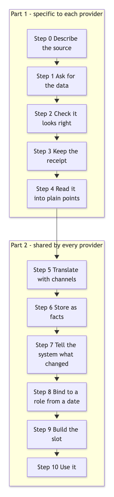
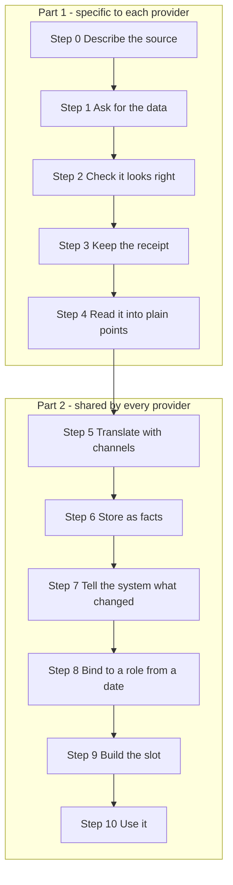
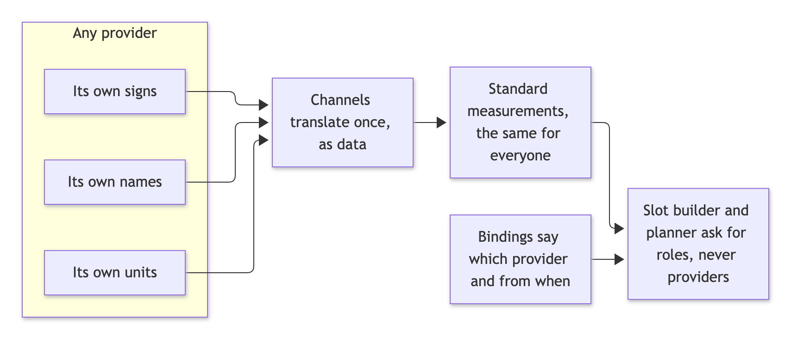
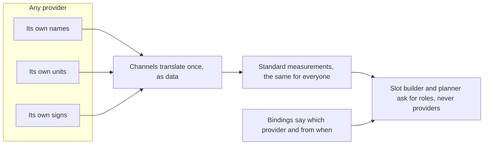
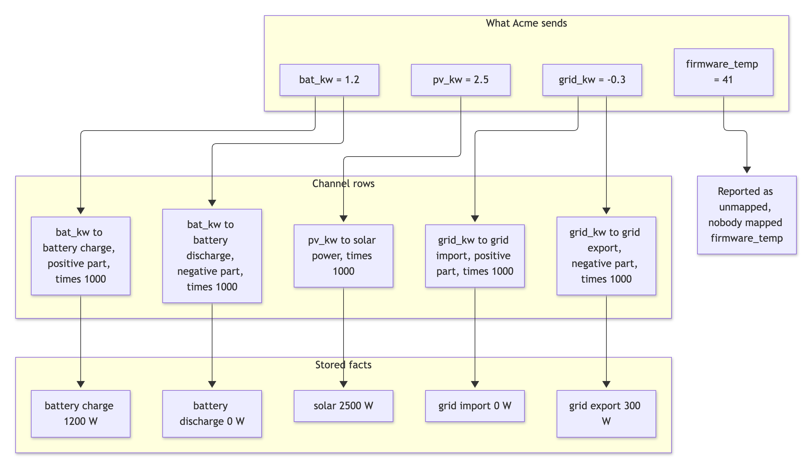
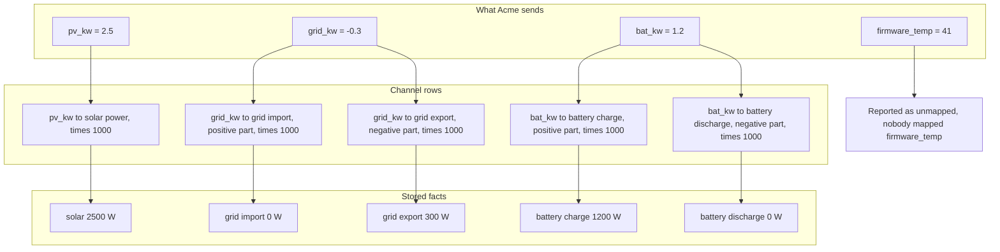

# From a provider's data to a slot: the template, step by step

**Status: prototype.** Everything in this guide is built and tested on the prototype core, using a real home's data (a UK home with a Sunsynk inverter and an Octopus smart meter). Where something is not built yet, it says so in section 9.

This guide explains two things:

1. **The journey.** How a number that a provider sends (an inverter, a smart meter, a weather service) becomes one slot in the home's timeline.
2. **Why it is provider-agnostic.** Why adding, replacing or removing a provider does not mean changing the core.

It is organised around the **processor template**, the standard shape every provider follows. If you understand the template, you understand how any provider is added.

---

## 1. The idea in one picture

A slot is a short, fixed period of a home's day (15, 30 or 60 minutes, chosen per home) with one row of numbers: how much solar, how much the home used, what came from the grid, what it cost, and where each figure came from.

Every provider takes the same road to get there. Only the first part of the road is specific to the provider. The rest is shared.

Mermaid source of diagram 1

Part 1 is written once per provider. Part 2 is the core and is never edited for a new provider. Step 5 translates units, signs and limits. Step 10 is dashboards, the planner, group views and device control.

---

## 2. The template, step by step

For each step: **what happens**, **what the provider side supplies**, and **what the core does**.

### Step 0. Describe the source

*What happens.* Before any data moves, the provider is described in plain terms, once. This is a short record, not code.

*The provider side supplies:*

| Question | Example answer (an inverter cloud) |
|---|---|
| How does it state time? | Hours and minutes on the plant's local clock, date from the request |
| What does a sign mean? | Grid positive means importing; battery positive means discharging |
| What are the units? | Watts for power, percent for battery charge |
| How does it say "no data"? | An empty list, or an error code |
| Does it correct old values later? | No |
| How far back can we ask? | 90 days |
| How long does a reading hold? | 5 minutes (used when filling the time between readings) |

*The core does.* Keeps this description with the source, so anyone can see what the data means. The "how long a reading holds" answer is read by the slot builder, so it needs no provider-specific rule.

### Step 1. Ask for the data

*What happens.* The processor requests the window of data it needs, using the home's credentials.

*The provider side supplies:* the address to call, how to sign in, and which period to ask for.

*The core does.* Provides safe fetching (timeouts, retries, never logging secrets).

### Step 2. Check it looks right

*What happens.* The reply is checked against the shape the provider documents. If it is not that shape (an outage page, a changed format), it is **quarantined**: kept for inspection, but it produces no data.

*Why it matters.* A reply of the wrong shape must never turn into zeros in someone's energy figures. The slot then shows the data as missing, honestly.

### Step 3. Keep the receipt

*What happens.* The exact reply is saved, with a fingerprint and the time it arrived.

*Why it matters.* Every figure can be traced back to the exact reply it came from, and the reply can be read again later if the reading rules improve.

### Step 4. Read it into the provider's own points

*What happens.* A pure reading step turns the reply into a plain list: **point name, time, number**. Nothing else. It keeps the provider's own names (for example `PV`, `Grid`, `Battery`, `pv_kw`) and the provider's own numbers, including signs. It converts nothing and decides nothing.

*The provider side supplies:* this one reading step. It is the main piece of provider-specific work, and it has no side effects, so it can be tested with a saved real reply.

*The core does.* Nothing yet. This is the hand-over point.

### Step 5. Translate with channels

*What happens.* This is where provider-agnosticism lives. A **channel** is one row of data that says: *"this point of this provider becomes this standard measurement."* A channel carries:

| Part | What it does | Example |
|---|---|---|
| Point | The provider's own name | `grid_kw` |
| Measurement | The standard one it becomes | `grid_import_w` |
| Scale and shift | Converts units | kW to W: multiply by 1000 |
| Part | Which part of a signed number | `positive` for import, `negative` for export, `abs` for the size of either sign |
| Limits | The range a believable value stays within | solar between 0 and 60,000 W |

One signed point can feed two standard measurements. The same grid figure becomes *import* when positive and *export* when negative.

*Beyond instant readings,* the same translation handles three more shapes: a **period** (an amount over a time span), a **counter** (a running total such as a smart plug's energy meter, where the core works out the energy for each period and copes with the counter resetting, wrapping or restarting) and an **event** (something that happened, such as a charger being plugged in). Devices that are not inverters or meters, such as heat pumps, EV chargers and plugs, have roles of their own.

*What the core does with each value:*

| Situation | What happens |
|---|---|
| Value is inside its limits | Converted and passed on |
| Value is outside its limits (say 500,000 kW of solar) | Refused, and the refusal is recorded. It is never stored as a fact |
| Value is not a number | Refused and recorded |
| The provider sends a point nobody mapped | Reported as "unmapped", never dropped silently |
| An empty reply where data was required | An error that shows in the sync log, not a quiet success |

The standard measurements are the same for every provider. That is why the slot builder, further down, never needs to know which provider it is.

### Step 6. Store as facts

*What happens.* The translated numbers are stored as **facts**. Facts are never overwritten: if a provider later corrects a value, the new value is added as a newer version and the old one is kept. This is what lets the system show what was known at any past moment.

*Protections built in:*

- A provider can only write into its **own** series. A new provider cannot overwrite another provider's readings by accident or by mislabelling.
- The same period sent twice in one batch keeps the last value, instead of failing the whole batch.
- Sending identical data again stores nothing new.

### Step 7. Tell the system what changed

*What happens.* The processor tells the core which stretch of time changed, so the affected slots are rebuilt.

*Safety.* If a sync stops half-way, the next one still finds the facts the first one wrote and rebuilds from there. Before this was fixed, a corrected day could stay wrong for ever.

### Step 8. Bind to a role, from a date

*What happens.* The slot builder does not ask for "the Sunsynk". It asks for a **role**, such as "the inverter's 5-minute readings". A **binding** says which provider fills that role for this home, and from when.

The roles today:

| Role | What the builder uses it for |
|---|---|
| Inverter, 5-minute | Solar, house use, grid and battery power, charge level |
| Inverter, daily totals | The inverter's own daily counters, used to correct the slot figures |
| Meter energy | The supplier's official import, export and gas figures |
| Gas calorific value | Converting gas volume to energy |
| Carbon intensity | Grid carbon per period |
| Weather temperature | Outdoor temperature |
| EV charge dispatch | Smart-charge periods |
| Solar forecast | The forecast of record, with priorities between forecast sources |

A binding is just a row: *role, provider, valid from, valid to*. Changing it is a data change, not a code change (and it can be done on the **Providers** screen, which shows what would change before anything is kept), and it takes effect **from a chosen date**. Slots before that date never change.

Two or more devices of one kind (two inverters, two batteries) are two bindings at the same time, and their figures are added.

### Step 9. Build the slot

*What happens.* The builder reads the facts of whichever providers are bound, and builds each slot:

1. Takes the 5-minute readings and works out the energy in each slot, holding each reading for as long as its provider says it holds.
2. Corrects the slot figures to match the inverter's own daily totals, when they agree closely enough.
3. Prefers the official meter figure over the inverter's clamp figure when the meter has it.
4. Prices the energy using the home's tariff, in the home's currency.
5. Records the slot's **lineage**: which provider each figure came from, and whether it is final, still provisional, or missing.

*Slot length.* Everything above works at 15, 30 or 60 minutes. The slot length is set per home and the same steps apply.

*Missing data.* If a figure is not there, the slot says so. It is never filled with zero or a guess.

### Step 10. Use the result

The same slots feed everything downstream, and they read the same bindings, so they cannot disagree about which provider a figure came from:

- the dashboards and the explanation of any single slot, step by step;
- the planner's input arrays for Predbat and PredHeat style planning;
- group views across several homes (money is added only within one currency);
- device control, where a command counts as done only when the **device itself** reports the new state.

---

## 3. Why this is provider-agnostic

Three rules do the work.

Mermaid source of diagram 2

1. **Translate at the door.** Every provider's data is converted to the same standard measurements the moment it arrives, by channel rows. Past that door, nothing is provider-specific.
2. **Ask for roles.** The engine asks for what it needs ("the inverter's 5-minute readings"), never for a named provider.
3. **Decide by date, in data.** Which provider fills a role is a dated row. Switching, adding and removing are row changes that leave the past untouched.

The result for a client: **a new provider is a small reading step, some channel rows and a binding. The slot builder, the planner and the group views are not edited.**

---

## 4. A worked example: a provider that reports in kW

To show it works, a second inverter vendor, called "Acme" here, was set up as pure data. It reports power in **kilowatts**, with **one signed grid figure** and **one signed battery figure**, which is deliberately different from the original inverter (watts, with the sign convention described in step 0).

Mermaid source of diagram 3

Then Acme was bound to the inverter role **from a chosen date** on a real home.

**What was checked.** Acme's data was the real inverter's own data, re-expressed in kilowatts and signed figures. From the chosen date, the slots built from Acme matched the slots built from the real inverter to within one part in a million on solar, house use, import, export, battery charge and discharge, and total cost. Slots **before** the date were byte-identical to before. A rebuild "as known before the change" still gave the old result. No line of the slot builder or planner was edited.

The same kind of test was repeated for the meter role, the carbon role, a provider reporting every 15 minutes instead of 5, two inverters at once (a real inverter split 40 and 60 between two devices gave identical slots), and for slot lengths of 15, 30 and 60 minutes.

---

## 5. Adding, switching and removing a provider

Everything below is done while the system runs, and none of it rewrites history.

| What you want | What is done | What happens to the past |
|---|---|---|
| **Add a provider** | Describe it, add channel rows, bind it from a date | Unchanged |
| **Switch to another provider** | Bind the new one from the switch date; the old one ends there | Slots before the date are identical to before |
| **Add a second device of one kind** | Bind it beside the first | Unchanged; figures are added from the date |
| **Remove a provider** | End its binding at a date | Unchanged; the role has no source from then on |
| **A provider goes quiet** | Nothing to do. Slots show as waiting or missing with a reason | Nothing is faked |
| **Retire a meter** | Mark the device retired | The home keeps its prices; tariff agreements are not touched |

Two safeguards sit on every change:

- **Preview first.** Before a change is made, the system can show how many slots would change, in which figures, and by how much, without keeping anything.
- **A reason is required** whenever a change would alter slots that were already built. The reason is kept with the change.

---

## 6. What you can trust at each point

| Question | Answer |
|---|---|
| Can I see where a figure came from? | Yes. Each slot records the provider of its main figures, and the exact original reply is kept |
| Can a bad reading corrupt the timeline? | Out-of-range values are refused and recorded; a reply of the wrong shape is quarantined |
| Can a missing reading look like zero? | No. Missing stays missing |
| Can I see the timeline as it was known last month? | Yes. Facts and bindings are kept as versions |
| Can one provider overwrite another's data? | No. A provider can only write into its own series |
| Does a half-finished sync lose data? | No. The next sync finds and rebuilds what the first one wrote |
| Do the planner and the dashboard agree? | Yes, within 0.1 percent in the tests, because they read the same bindings |

---

## 7. The checklist for a new provider

| # | Piece | Who supplies it | Size |
|---|---|---|---|
| 1 | The description of the source (step 0) | Provider side | A short record |
| 2 | How to ask and how to check the reply (steps 1 to 3) | Provider side | A few lines, using the shared fetching |
| 3 | The reading step (step 4) | Provider side | The one real piece of provider-specific work |
| 4 | The channel rows (step 5) | Provider side | One row per point |
| 5 | The binding (step 8) | Operator | One row, with a date |
| 6 | Preview, then confirm | Operator | A review of the impact |

Everything else in the journey is shared and already built.

---

## 8. Slot lengths

The slot length is a setting of each home: 15, 30 or 60 minutes. A 45-minute slot is not allowed because it does not divide the hour. The journey is identical at all three lengths. The provider-switch, channel, two-device, crash-safety and control tests all pass at 15, 30 and 60 minutes.

Two things to know:

- A 30-minute meter reading inside a 15-minute slot is shared out in proportion to the inverter's 5-minute shape, or evenly if that shape is missing.
- An hourly slot uses a meter figure only when both of its half-hours have one; otherwise it falls back to the inverter figure.

---

## 9. What is not built yet

Said plainly, so there are no surprises.

| Not built | Detail |
|---|---|
| A real device on the push endpoint | The core now accepts pushed readings (`POST /api/ingest`, with Shelly, Tasmota and Home Assistant shapes, a push log and an emulator), but no real device has been tried, those shapes are taken from the vendors' documentation, and there is no MQTT client, per-device key or TLS |
| Real IoT device processors | Counters, events and the heating roles are built and tested on synthetic data. A **Devices page with a labelled synthetic IoT home** (a smart plug, heat pump, EV charger, battery and sensor) shows them working end to end, including a simulated period and a test command. No real plug, heat pump or EV charger has been connected |
| A real vendor control driver | The control path (command, device read-back, effect check, late acknowledgement) works against a simulated device. A real driver needs a chosen vendor, its API and a test device |
| Tariff catalogues as providers | Tariff and price feeds fill the tariff store the builder prices from. They are not part of this journey |
| Rules as data | Rules such as "the official meter beats the clamp" are still in the builder. They stay there until a provider needs a different rule |
| Sign-in and row-level security | Out of scope for the prototype. The check "may this person control this home" exists and is enforced when a person acts |
| A real second inverter vendor | The design is proven with a vendor built as test data on real figures. A true second vendor's live feed is the next real test |

---

## 10. Where to look

| Topic | Document |
|---|---|
| The architecture in diagrams | `docs/slot-engine-architecture.md` |
| The reasoning and the plan | `docs/slot-engine-solution.md` |
| Control with device read-back | `docs/control-readback.md` |
| Groups and access | `docs/groups-and-access.md` |
| The processor template itself | `src/adapters/_template.js` |
