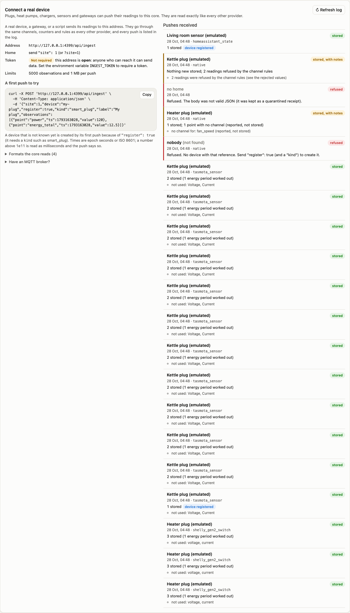
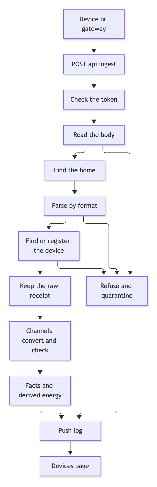
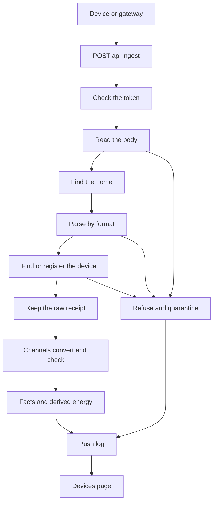
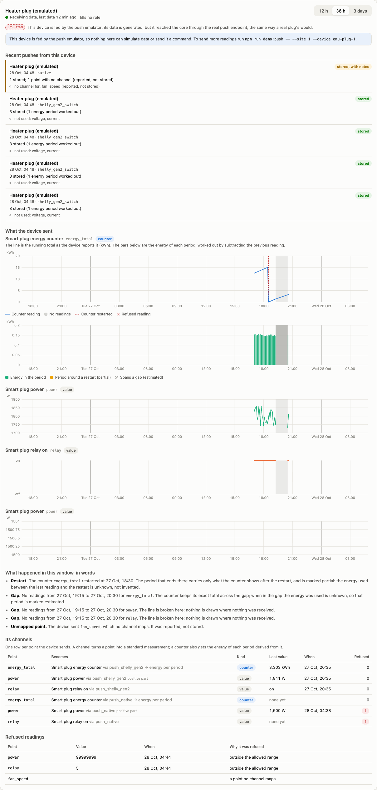
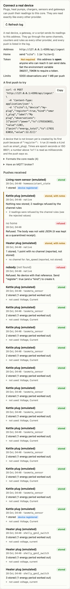
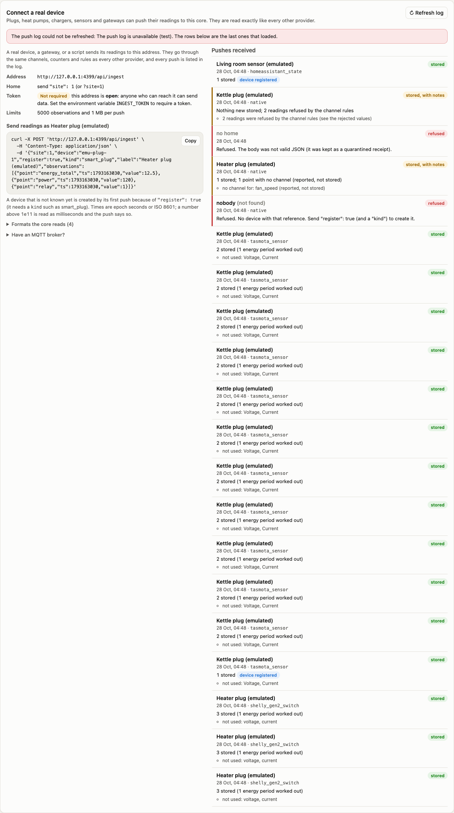

# Push ingest: a device sends its readings to the core

**Status: prototype.** The endpoint, the four body formats, the log and the Devices page panel are built and tested. Everything that has been pushed so far came from the emulator (`npm run demo:push`), which generates synthetic data. The Shelly, Tasmota and Home Assistant shapes follow those products' documentation and **have not been tried on a real device**.

Until now the core pulled everything: it asked an inverter's cloud, a supplier's API or a weather service for data. A smart plug, a heat pump gateway, a Home Assistant flow or a script cannot be asked: it has to **send**. `POST /api/ingest` is the door for that, and what comes through it is read exactly like data from any other provider: through channels, counters, events and the same rules.



## 1. The path of one push

A push is handled in ten steps. The first half is the same for every sender, and only the parsing step depends on the format.



<details>
<summary>Mermaid source of diagram 1</summary>



</details>

| Step | What happens | If it fails |
|---|---|---|
| Check the token | Only when `INGEST_TOKEN` is set | 401, and no log row (see section 6) |
| Read the body | Text up to 1 MB, parsed as JSON by the core itself | 400 `malformed_json`, the body is kept as a quarantined receipt |
| Find the home | `site` in the body or `?site=`; when the core has exactly one real home it is the default | 400 `site_required` or 404 `unknown_site` |
| Parse by format | A pure function per format (`src/core/push-formats.js`) | 400 with a code and the field, the body is quarantined |
| Find or register the device | By reference; created on the first push when asked | 404 `unknown_device`, 400 `unknown_kind` or `kind_required` |
| Keep the raw receipt | The exact body, once (identical bodies share a receipt) | |
| Channels convert and check | `ingestObservations`, the same call every provider uses | Refused readings go to `channel_reject`, unmapped points are reported |
| Facts and derived energy | Instants, counters (with energy per period), events, states | |
| Push log | One row per body, accepted or refused | |

## 2. The endpoint

`POST /api/ingest`, any content type, a JSON body of at most **1 MB** and **5000 observations**.

### The native body

```json
{
  "site": 1,
  "device": "my-plug",
  "register": true,
  "kind": "smart_plug",
  "label": "My plug",
  "observations": [
    { "point": "energy_total", "ts": 1782000000, "value": 12.5 },
    { "point": "power",        "ts": 1782000000, "value": 120 },
    { "point": "relay",        "ts": 1782000000, "value": 1 }
  ]
}
```

| Field | Meaning |
|---|---|
| `site` | The home. Optional when the core has exactly one real home |
| `device` | The device reference (or its numeric id). Left out, the push is about the home itself |
| `register`, `kind`, `label` | Create the device on its first push. `kind` must be a known device kind (smart_plug, heat_pump, ev_charger, temperature_sensor and others). The device brings its standard channels |
| `emulated` | Mark the device as fed by an emulator, so the page says so (the emulator sets it) |
| `source` | A source already described in the core. Default `push_native` |
| `observations` | The readings |

An observation has a `point` (the device's own name for the measurement) and one of these shapes:

| Shape | Fields | Becomes |
|---|---|---|
| An instant | `ts`, `value` | A reading. A counter's cumulative total, a power, a relay state |
| A period | `start`, `end`, `value` | An amount over a time span |
| A forecast | `start`, `end`, `issuedAt`, `value` | A prediction made at `issuedAt` |
| An event | `ts` or `start` and `end`, `kind: "event"` (a `value` of 0 means no event) | A 0/1 period, never integrated |
| A state | `kind: "state"`, `ts`, `value` | What a device says its own setting is |
| An ack | `kind: "ack"`, `commandId`, `ref` | A receipt for a command the core sent. **Never stored as a fact** |

**The shorthand:** `{ "device": "my-plug", "points": { "power": 120, "relay": true }, "ts": 1782000000 }` reads several points at one time. `ts` defaults to the moment the push arrives.

**Times** are epoch seconds or ISO 8601. A number above 1e11 is read as milliseconds and the response says so in `warnings`. An ISO time with no offset is read as UTC and warned. A time that is not a time is a 400 with the field named. **Values** are numbers, numeric strings, booleans (1 or 0) and the words on and off. Anything else, including infinity, is refused.

### Vendor formats

A vendor's own JSON can be posted as it is. Because the body is the vendor's, the envelope (`site`, `device`, `register`, `kind`, `label`, `emulated`) goes in the query string, or in a wrapper `{ "format": "...", "device": "...", "payload": { ... } }`.

| Format | The body | Points it produces |
|---|---|---|
| `shelly_gen2_switch` | The status object of a Shelly Gen2 switch, also inside a NotifyStatus message or a whole device status. Energy arrives in Wh and is turned into kWh | `power`, `energy_total`, `relay`. Voltage, current, frequency and temperature are named as not used |
| `tasmota_sensor` | SENSOR telemetry with an ENERGY block, and POWER from a STATE message. `Time` is the device **local** time and is read in the home time zone (a time that does not exist when clocks go forward is refused; a repeated hour takes the instant nearest the moment the push arrived) | `power`, `energy_total`, `relay` |
| `homeassistant_state` | A state object or a list of them. Energy (Wh, kWh), power (W, kW), temperature (C, F) and switch entities | `energy_total`, `power`, `temperature`, `relay`. An unavailable or unmapped entity is named in `warnings` |

```
curl -X POST 'http://localhost:4100/api/ingest?format=shelly_gen2_switch&site=1&device=shelly-1&register=1&kind=smart_plug&label=Shelly%20plug' \
  -H 'Content-Type: application/json' \
  -d '{"id":0,"output":true,"apower":1823.4,"aenergy":{"total":12345.678}}'
```

**Unverified.** The three vendor shapes were written from the vendors' documentation. The fixtures in `test/fixtures/push/*.documented-shape.json` are those documented shapes, not captures from a real device. A real device that sends something slightly different gets a 400 `unrecognised_shape` and its body is quarantined for inspection, so the difference is visible, not silently misread.

### The answer

```json
{ "ok": true, "site": 1, "device": 5, "deviceRef": "my-plug", "created": false, "format": "native", "source": "push_native",
  "observations": 3, "written": 3, "forecasts": 0, "derived": 1, "counters": 1, "events": 0, "states": 0, "acks": 0, "stuck": 0,
  "rejected": 0, "unmapped": [], "warnings": [], "rawId": 118, "duplicate": false, "logId": 52 }
```

`written` counts facts about the past or present (derived counter energy included), `derived` the energy periods worked out from counters, `unmapped` the points no channel maps (reported, never dropped silently), `rejected` the readings the channel rules refused (out of range, a counter that went backwards, a time in the future). A refusal of the whole push is `{ "error", "code", "field?", "logId?" }`:

| Code | Status | Meaning |
|---|---|---|
| `token_required`, `bad_token` | 401 | The core requires a token and none or the wrong one was sent |
| `malformed_json`, `bad_body` | 400 | The body is not JSON, or not an object |
| `too_large` | 413 | Over 1 MB |
| `too_many_observations` | 400 | Over 5000 |
| `no_observations`, `bad_observation`, `bad_point`, `bad_value`, `bad_timestamp` | 400 | A malformed observation, with the field named, for example `observations[2].ts` |
| `unknown_format`, `unknown_source`, `unrecognised_shape`, `nothing_to_store` | 400 | The format or source is not known, or the body does not look like its format |
| `site_required`, `unknown_site` | 400 / 404 | Which home is not clear, or does not exist |
| `unknown_device` | 404 | No such device; send `"register": true` |
| `unknown_kind`, `kind_required` | 400 | Registration needs a known device kind |
| `synthetic_device` | 400 | A synthetic demo device is fed by the demo generator, not by pushes |
| `unknown_command` | 404 | An ack names a command this home never sent. Nothing in that body is stored |
| `internal` | 500 | The core failed to store the push. It is logged |

## 3. What the core does with the points

The points go through **channels** like everything else. A device registered with `register: true` brings the standard channels of its kind, so it works at once:

| Kind | Standard points |
|---|---|
| `smart_plug` | `energy_total` (a counter, kWh), `power` (W, 0 to 50 000), `relay` (0 or 1) |
| `heat_pump` | `elec_total`, `heat_total` (counters), `flow_temp`, `return_temp`, `defrost` (an event) |
| `ev_charger` | `energy_total` (counter), `power`, `connected`, `plugged_in` (an event) |
| `temperature_sensor` | `temperature` |

A counter keeps its raw value and the core works out the energy of each period by difference. A restart to zero, a wrap, a gap and a backwards step are handled as described in `docs/counters-events-roles.md`. Pushing a counter through the endpoint behaves exactly as pushing it any other way: the tests push a counter with a restart and check that the energy of the periods equals what the counter shows.

The same push twice stores nothing new: facts are change-only, the raw receipt is shared, and the log row says "this exact body was received before".

## 4. Registering a device

The first push of an unknown device is refused (404), unless it says `register: true`. Registration creates a device with provider `push`, the kind given, and the kind's standard channels. A device registered with `emulated: true` is badged **Emulated** on the Devices page: a real endpoint, generated data. A device that pushes is not automatically bound to a role (a role is how the slot timeline reads a device): that is a choice made on the Providers screen.

## 5. The log and the Devices page

Every body, accepted or refused, leaves a row in `push_log` (delta 073): when, home, device, format, source, how many observations, what was written, refused and unmapped, the warnings, the raw receipt, and the status. `GET /api/sites/:id/pushes` returns it newest first, together with what a sender needs to connect (the address, whether a token is needed, the formats and limits). `?device=<id>` filters to one device. A push that could not be given a home is listed too, marked as having no home.

The Devices page has a **Connect a real device** panel: the address, the token note, a copy-and-paste curl example filled in with the home and, when a pushed device is selected, its reference and its real points, the formats, and the **Pushes received** log. The log follows the pushes every few seconds while the page is open. A refused push is shown in plain words and names the device the sender used; a push that was stored but had an unmapped point or refused readings is marked "stored, with notes".





## 6. The token, and its honest limits

Set the environment variable `INGEST_TOKEN` and every push must carry it, as `Authorization: Bearer <token>` or `X-Ingest-Token: <token>`. It is compared in constant time (both sides are hashed to the same length first). Unset, the endpoint is **open**, and the Devices panel says so in those words.

This is a shared secret, nothing more:

- **One token for every sender.** There are no per-device keys and no way to revoke one device.
- **No TLS here.** Put the core behind a reverse proxy that does TLS before it leaves a trusted network.
- **No rate limiting** beyond the size limits. For that reason a refused token leaves **no** log row: anyone who can reach the port could otherwise fill the log.
- A wrong body from a sender with the right token is logged and quarantined as described.



## 7. Putting MQTT in front of it

The core has no MQTT client. A broker, a Home Assistant automation, a Node-RED flow or a shell loop can post each message. A sketch for Tasmota, **not tried against a real broker**:

```
mosquitto_sub -h broker -t 'tele/+/SENSOR' -F '%t %p' | while read topic payload; do
  dev=$(echo "$topic" | cut -d/ -f2)
  curl -s -X POST "http://core:4100/api/ingest?site=1&format=tasmota_sensor&device=$dev&register=1&kind=smart_plug" \
    -H 'Content-Type: application/json' -d "$payload"
done
```

## 8. The emulator

`scripts/push-emulator.mjs` behaves like a smart plug, so the whole path can be watched without a device. Its data is **synthetic** and it says so on its first line. It posts to the endpoint only and never opens a database.

```
npm run demo:push -- --url http://localhost:4100 --site 1 --device emu-plug-1 --format shelly_gen2_switch --every 10
```

| Option | Meaning |
|---|---|
| `--format` | `native`, `shelly_gen2_switch`, `tasmota_sensor` or `homeassistant_state` |
| `--every N` | Seconds between pushes in real time. `0` means no waiting: time advances by `--step` per push (default 300), ending now unless `--start` gives an ISO time |
| `--count N` | Number of pushes (forever in real time, 12 when `--every` is 0) |
| `--restart-after N` | The plug's counter restarts from 0 after N pushes |
| `--gap-after K --gap N` | The plug sends nothing for N pushes after push K; time and the counter keep going |
| `--tz` | The home time zone, used for Tasmota local times (default Europe/London) |

The token comes from `INGEST_TOKEN` in the environment when the core requires one.

## 9. What is not covered

| Not covered | Detail |
|---|---|
| A real device | Nothing real has pushed. The vendor shapes are documented shapes, unverified |
| MQTT, websockets, GET webhooks | Only an HTTP POST of a JSON body. MQTT needs something in front |
| Per-device keys, revocation, TLS, rate limiting | See section 6 |
| A priority lane | A push is handled synchronously, like any request. Acks and events get no faster path |
| Binding a pushed device to a role | Done on the Providers screen; a push does not do it |
| Pulling history from a device | The core never asks a pushing device for older data; only what is posted is stored |
| Another Shelly channel | Only the first `switch:N` of a body is read, and it says so |
| Tasmota times in the repeated hour | The nearest instant to the arrival is a guess, documented as one |

## 10. Where things are

| Piece | File |
|---|---|
| The endpoint's logic: token, home, device, receipt, log | `src/core/push-ingest.js` |
| The four format parsers (pure) | `src/core/push-formats.js` |
| The routes `POST /api/ingest`, `GET /api/sites/:id/pushes` | `src/server.js` (one commented block; the 100 KB JSON parser skips `/api/ingest`, which reads its own 1 MB body so a malformed body can be quarantined) |
| The log table | `src/db/deltas/073-push-log.sql` |
| The sources `push_native`, `push_shelly_gen2`, `push_tasmota`, `push_homeassistant`; the relay metric; the plug, sensor and relay defaults | `src/db/registry.js` |
| The Connect panel and the log | `public/js/devices-view.js`, `public/js/pages/devices.js`, `public/css/devices.css` |
| The emulator | `scripts/push-emulator.mjs` |
| Fixtures (documented shapes) | `test/fixtures/push/` |
| Tests | `test/push-formats.test.js`, `test/push-api.test.js`, `test/push-emulator.test.js`, `test/push-view.test.js` |
