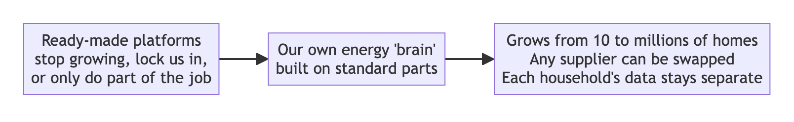
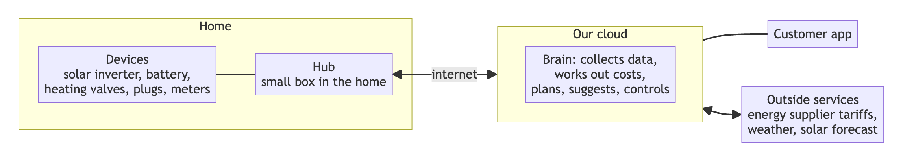
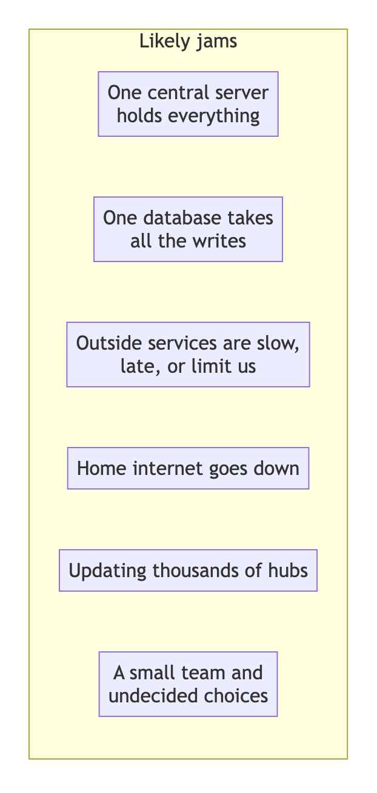
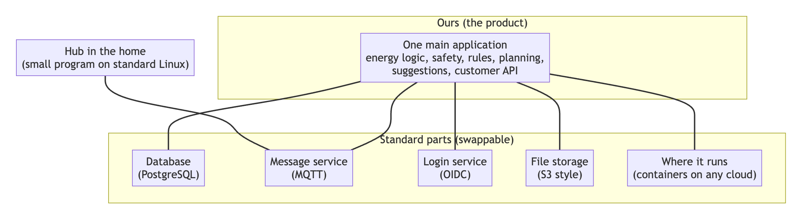
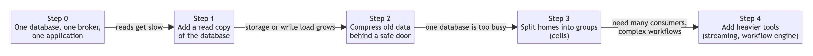
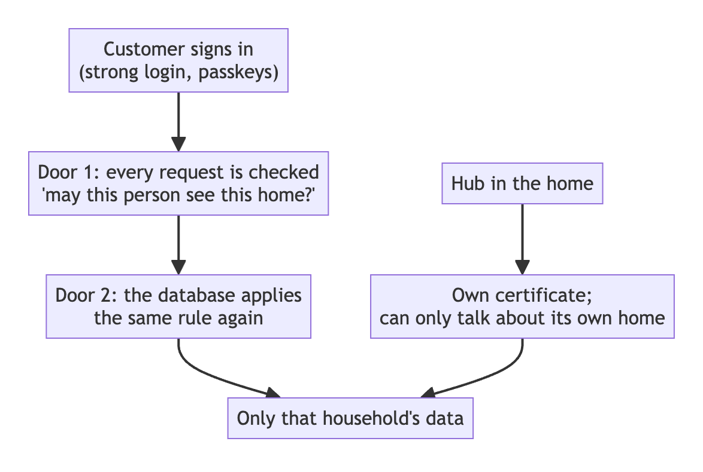
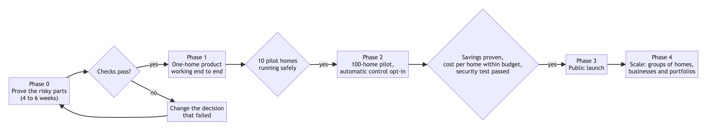

# A connected-home energy platform that can grow: the problems, and a solution without lock-in

Date: 23 October 2026 · Status: proposal for decision

This report explains, in plain words, what is hard about building an energy platform for millions of homes, why ready-made products fall short, and what we recommend instead. Technical terms are explained in the [glossary](#10-glossary). Numbers marked **estimate** are calculations from stated assumptions. Nothing here has been load-tested yet.

## Contents

1. [The short version](#1-the-short-version)
2. [What we are building](#2-what-we-are-building)
3. [The problems](#3-the-problems)
4. [What we checked](#4-what-we-checked)
5. [The solution](#5-the-solution)
6. [The options compared](#6-the-options-compared)
7. [How we get there](#7-how-we-get-there)
8. [Decisions we need from you](#8-decisions-we-need-from-you)
9. [Risks that remain](#9-risks-that-remain)
10. [Glossary](#10-glossary)
11. [Sources](#11-sources)

---

## 1. The short version

**What we want:** an app and a cloud service that connect to a home's solar panels, battery, heating and meters, show what is happening, let people control it safely, and suggest ways to save money and energy. It must work for one home, and keep working for millions.

**The problem:** we looked at the ready-made platforms and the standard building blocks. None does the whole job. The ones that come closest either stop growing at a few thousand homes, tie us to one company, or are built for factories and offices, not families. A few of the open tools we considered have also changed their licences, so using them can later force a bill or a rewrite.

**The answer:** build our own central application, which understands energy, tariffs, safety and privacy, but build it from standard, swappable parts. Keep it simple at the start (one application, one database, one message service, one login service, one file store, and a small program on each home's hub), and add more only when growth demands it. Because every part speaks an open standard, any supplier can be replaced without rewriting the product.

**What we need from you:** nine decisions (section 8), starting with whether we are selling to households or to businesses, and what hardware we control.

---

## 2. What we are building

Think of the platform as a **smart concierge for a home's energy**. It watches, advises, and acts, and it must always be safe and honest.

It does four things:

1. **See:** one trusted picture of where energy came from, where it went, and what it cost, in half-hour steps.
2. **Control:** change settings on devices (charge the battery, set a temperature) within safe limits.
3. **Suggest:** "charge now, the price is cheap", "your solar power is going unused", "turning the heating down 1°C would save about this much".
4. **Explain:** every number and every action can be traced back to where it came from.

**The core job is "see" and "control":** managing and controlling devices, and showing their status in dashboards and apps. The energy insights (usage, cost, solar, battery) come from integrations such as Sunsynk and Octopus, which we read and display honestly. Suggestions and smart planning are built on top, later.

The idea of the design is that everything is a **thing**: the hub, each device, even a feed of weather data. Every thing is described in the same way, so one set of tools can show it, control it and analyse it.

---

## 3. The problems

### 3.1 Growth: it works for 10 homes and breaks at 100,000

**In plain words:** many platforms are like a single shop counter. One person serves every customer. Fine for a village, hopeless for a city. You can hire a faster person, but you cannot easily add a second counter.

| What we found | What it means | Why it matters |
|---|---|---|
| The OpenRemote platform's staff say it "does not scale well horizontally": it runs as one central process, and several copies side by side are not supported | It is one counter | Its maker claims it handles "thousands, if not ten thousands of assets". A home has about 20 of them. That is roughly **500 to 2,500 homes per installation (estimate)**. For 100,000 homes: **40 to 200 separate installations** |
| Giving each home its own private space in the login system makes the login system slow | One locker room per customer, until the building can't open its doors | A recent test recommends only a few hundred such spaces per login cluster. A 2,000-space cluster took 7.5 minutes to restart |
| Every home produces a lot of readings | Each reading is a row in a database | About 29,000 per home per day **(estimate)**: 1,000 homes produce about 29 million rows a day, about 35 GB a month. 100,000 homes produce about 2.9 billion rows a day |
| A popular time-series database feature (compression) switches off a security feature (row-level security) | Saving space makes one safety guard unavailable | We cannot compress and also rely on that guard, so we must design around it |

### 3.2 Incompleteness: nothing does the whole job

**In plain words:** ready-made platforms are like a kitchen without a cook. They give you ovens and benches, but nobody to plan the meal.

What no platform we found gives us out of the box:

- Understanding **energy**: tariffs with VAT, import and export, battery stock cost, solar value, savings that add up.
- **Safe control**: a rule that stops a heating or battery command from going outside safe limits, and checks that the device really did what we asked.
- **Smart planning**: working out the cheapest way to charge a battery or heat a home tomorrow, using weather and price forecasts.
- **Privacy between households**: one customer must never see another's data.
- A **customer-friendly app**: simple schedules and rules a family can build without being an engineer.
- **Trustworthy numbers**: every figure traced back to its source, with honest labels when data is missing or late.
- **Looking after thousands of homes**: updates to the hubs, support tools, monitoring.

| Platform | What it gives | What is missing for us |
|---|---|---|
| OpenRemote | Device connections, rules, admin screens | Does not grow, no energy logic, built for business sites |
| ThingsBoard | Dashboards, devices, rules, updates | Built for business dashboards; no energy logic; its licence recently changed (see 3.4) |
| Cloud IoT services (Amazon, Microsoft) | Message handling, device identity, updates | The plumbing only: everything above it must be built; ties us to them |
| Tuya (white-label smart home cloud) | App, cloud, updates | Ties us to Tuya's cloud and parts; we found nothing on energy-specific features |
| Home Assistant | A very large library of device connections, popular with energy hobbyists | A home hub, not a service for millions of customers |

### 3.3 Bottlenecks: where things will jam

| Bottleneck | In plain words | What we do about it (section 5) |
|---|---|---|
| One central server | If it stops or fills up, everyone is affected | Spread the work: stateless application copies, a database with a standby |
| The database | All the readings arrive in one place | Group readings into batches, keep recent data fast, move old data away, split homes into groups when needed |
| Outside services | The solar maker's service only keeps 90 days of history and limits how fast we can ask; the energy supplier's meter data arrives about a day late; some terms forbid automated access | Ask politely and slowly, label late data honestly, get written permission before launch |
| Home internet failures | The hub loses contact with the cloud | The hub remembers messages and sends them later, keeps running its schedules, and relies on the device's own safety settings |
| Updating hubs | A bad update to 100,000 boxes would be a disaster | Updates go in stages (few homes first), can be rolled back, and are signed |
| People and decisions | A small team cannot build everything; key choices (login, hardware, cloud) are not yet made | Build in small steps with clear pass/fail checks (section 7), decide the big choices first (section 8) |

### 3.4 Lock-in: a supplier can change the deal

**In plain words:** if our product is built on one company's special features, that company can raise prices or change terms, and moving away becomes a rewrite.

Recent examples we found:

| Tool | What happened |
|---|---|
| **EMQX** (a message broker) | Moved to a "source-available" licence from version 5.9. Free for one server in production; running a cluster needs a commercial licence. Its free licence turns into open source only after four years |
| **Redis** (a fast cache) | Moved away from an open licence in 2024 |
| **MinIO** (file storage) | Its free community edition went into maintenance mode, with its repository archived in 2026 |
| **ThingsBoard** (IoT platform) | From version 4.4, a business-source licence. Free for commercial use only up to 100 devices on one server and with their branding |
| **TimescaleDB** (database add-on) | Its compression feature is in an edition with a restrictive licence, not the fully open one |
| **Cloud IoT services** | Special features (device shadows, jobs, rules) work only on that cloud. Moving later means rewriting those parts |

Lock-in also hides in **data**: if users, devices and history cannot be exported, we cannot leave.

### 3.5 Safety and privacy: energy data says when people are home

Energy readings reveal when a family wakes up, goes to work, goes on holiday. A mistake in control can cost money or comfort, or cause harm (heating, batteries, plugs). So:

- One customer's data must never reach another.
- Devices must not be pushed outside their safe range.
- We must follow product-security, privacy and energy-safety rules. These need legal advice and are not yet confirmed.

### 3.6 Trust: a savings number nobody believes is worse than none

If our app says "you saved £120" and the bill disagrees, trust is gone. We must show savings we can prove, and be honest about estimates.

---

## 4. What we checked

We looked at the vendors' own documentation, forum discussions with their staff, and independent comparisons, between 22 and 23 October 2026. **We did not run any load test.** We also made one error and corrected it, described below.

> [!CAUTION]
> **Key evidence on OpenRemote at consumer scale**
>
> 1. OpenRemote staff, March 2026: "OR does not scale well horizontally and there is no real provision at this stage." They are "pretty sure" running several copies would not work, and get best results from one machine made bigger. [Forum](https://forum.openremote.io/t/best-practices-for-horizontal-scaling-of-openremote-manager-and-keycloak-on-kubernetes/4171)
>
> 2. A 2022 reply: the "high availability" setups it once had were "discontinued"; building one is up to you. [Forum](https://forum.openremote.io/t/on-prem-high-availability-setup-options/1381)
>
> 3. The maker claims "thousands, if not ten thousands of assets". No benchmark is given. [Vendor page](https://openremote.io/asset-management/)
>
> 4. A maintainer: "total number of events / sec is more impactful than total number of devices." [Forum](https://forum.openremote.io/t/scalability-for-vehicle-tracking-system/3499)
>
> 5. Login spaces ("realms"): a 2026 test recommends a few hundred per cluster. [Test](https://skycloak.io/blog/keycloak-realm-scaling-how-many-realms-per-cluster/)
>
> **Conclusion: OpenRemote is not suitable as the central platform for a consumer product that must grow to millions of homes.** It suits business and industrial sites and fast prototyping.
>
> **Limits of this evidence:** one staff reply, a vendor marketing figure and forum reports. A load test would replace them with measurements.

**A correction we made:** an early draft said a central OpenRemote login space could hold only one home's hub. That was a misreading of the documentation. The real limit is that one edge installation can connect to one central server. How many hubs a central space can hold is not documented, and is the first thing to test if OpenRemote stays in the plan.

**Other checks:**

| Question | Finding | Confidence |
|---|---|---|
| Is a [single login space able to hold millions of users](https://skycloak.io/blog/open-source-authentication-comparison-2026/)? | Yes, this is commonly done with tuning; sources differ on exact limits | Medium |
| Can the [security guard (row-level security) work with compressed time-series data](https://docs.timescale.com/api/latest/compression)? | No, not on compressed chunks | High (documented) |
| Will sending [hub data in batches keep message costs low](https://hubble.com/community/comparisons/aws-iot-core-vs-azure-iot-hub-pricing-what-10-000-devices-actually-costs/)? | At quoted cloud prices, one batch a minute is a few cents per hub per month (estimate); prices vary by source | Low to medium: prices must be rechecked |
| Do the open message-broker benchmarks show large capacity? | Vendors report [100 million](https://dev.to/emqx/reaching-100m-mqtt-connections-with-emqx-50-4lki) and [200 million](https://hivemq.com/news/hivemq-achieves-200-million-concurrent-connections-mqtt-platform) connections | Low: vendor-run, ideal conditions |
| Is a managed database failover quick? | Reported at 60 to 120 seconds for the basic setup and roughly 35 to 60 seconds for the faster setups | Low: third-party figures, to be tested |

---

## 5. The solution

### 5.1 The big idea: build the brain, rent the plumbing, use standard plugs

- **The brain is ours.** The part that understands energy, tariffs, safety, privacy and customers is our own application. That is where our product's value is, and where ready-made platforms are weakest.
- **The plumbing is rented or reused.** Databases, message services, login, file storage and updates are standard parts that we can buy as a service or run ourselves.
- **Everything uses a standard plug.** Each part connects through an open standard: Postgres for data, MQTT for device messages, OIDC for login, S3 for files, containers for running programs, OpenTelemetry for monitoring. That is the opposite of lock-in. Any supplier can be unplugged and replaced.

### 5.2 Not a swarm of microservices

We start with **one main application**, organised inside into clear sections (collecting data, building the half-hourly picture, rules, control, planning, the customer API). Splitting it into many small services early would add cost and failure points without benefit. We split a section off only when a measured trigger says it is needed.

What actually runs in the first phases:

| # | Part | What it does |
|---|---|---|
| 1 | Main application | All the logic |
| 2 | Database (PostgreSQL) | All data; a standby copy for failover |
| 3 | Message service (MQTT) | Carries data between homes and the cloud |
| 4 | Login service | Who is allowed in |
| 5 | File storage | Raw data copies, exports |
| 6 | Hub program | Runs in each home |

### 5.3 How the solution answers each problem

| Problem | The answer |
|---|---|
| One central server cannot grow | The main application is stateless, so several copies can run side by side. The database has a standby. We group homes into "cells" only when needed |
| Too many readings | Hubs send readings in batches and skip tiny changes. Recent data stays quick to read, old data is rolled up and archived |
| Login spaces are too slow | One login space for everyone. Households are kept apart by a household label on every record plus database rules, not by separate login spaces |
| Missing energy logic | We build it, once, in our own application (section 5.6) |
| Outside services are slow or late | The system labels data "final", "provisional" or "missing". Late data fixes earlier numbers without hiding the change |
| Home internet fails | The hub stores and forwards messages, keeps running its schedules, and the devices' own safety settings stay on |
| Bad updates | Signed updates, staged rollouts, rollback |
| Lock-in | Standard plugs everywhere (section 5.7) |
| Privacy | Every household is separated at several layers (section 5.5) |
| Trust | Every number traces to its source, and savings are split into proven and estimated (section 5.6) |

### 5.4 How it grows

We do not build for a million homes on day one. We build so that each next step is a **move, not a rewrite**, and we decide to take a step when a measured signal says so.

The signals (for example "recent-data queries take more than 0.3 seconds" or "more than one terabyte of recent data") are starting points we will tune by measuring.

Design rules that keep these steps possible: every record carries its household label, there are no links between households in the database, identifiers can never collide, and all times are stored in UTC.

**Staying up (high availability and fault tolerance):** stateless application copies in more than one data centre zone; a managed database with a standby; hubs that remember and replay; commands with time limits and a check that they worked; and a regular failover drill. We do not need to run in several regions at once early on, but we do keep tested backups elsewhere.

### 5.5 Privacy and safety built in

- **Many locks.** A customer is checked when they make a request, and the database checks again. Series data can be read only through one guarded door.
- **Hubs are separate.** Each hub has its own certificate and can only send and receive for its own home. A stolen hub exposes one home.
- **Customers never touch the device platform directly.** Only our application does.
- **Keys per household.** Secrets are encrypted per household, so deleting a household's key makes its archived data unreadable.
- **Staff access is exceptional.** No standing access; approvals, time limits, recordings, and a log the customer can see.
- **Safe control.** Every command goes through a check against the device's safe limits, is sent, and then **verified** against what the device reports. Devices keep their own built-in protections (frost protection, over-temperature), so our software is never the only safeguard.
- **Tests that must pass before every release:** automated attempts to read another household's data from every route, database role, message topic and file path.

### 5.6 How the energy "brain" works, in plain words

1. **One trusted picture.** Data from the inverter, meters, prices and weather is lined up in half-hour steps, balanced so that energy in equals energy out, and priced. Each half-hour is marked final, provisional or missing.
2. **Forecasts.** Expected solar output, the home's likely use, prices and carbon intensity for the next two days, each with a range, not just one number.
3. **A plan.** A planner works out, for example, when to charge the battery. It starts with the battery and tariff, and heating and EV charging come later.
4. **Suggestions with two kinds of savings:**
   - **Proven savings:** exact arithmetic from metered energy and real prices ("this charge was in a cheap slot: saved £0.42").
   - **Estimated savings:** model-based ("turning the heating down 1°C would save between X and Y"), shown as a range, and only when the home's model is good enough.
5. **Control through one referee.** Schedules, rules, the planner and the customer can all want different things. A fixed order decides: safety first, then a manual override (which expires), then rules, then schedules, then the planner. The app can always answer "why did my heating turn on?"

What the customer sees: a weekly grid for heating times, simple rules written as sentences ("When solar export stays above 1.5 kW for 3 minutes, and the battery is at least 95%, turn on the immersion heater for 15 minutes"), templates and one-tap suggestions, a preview of how often a rule would have run, and a history of what happened and why.

### 5.7 How we avoid vendor lock-in

**Rule:** use any supplier for ordinary services with open standards; avoid their special features; always have a tested way out.

| Need | Standard we build on | Special features we avoid | How we leave |
|---|---|---|---|
| Data | PostgreSQL (community) | Cloud-only database engines | Back up and restore elsewhere |
| Device messages | MQTT; hubs trust **our own certificate authority** and connect to **our own address** | Cloud-specific device shadows, jobs and rules | Point the address at a new message service; hubs keep working |
| Login | OIDC and WebAuthn, our own user table keyed by the standard user id | Provider-only sign-in flows | Export users and move; test it |
| Files | S3-style storage | Cloud-only storage features | Copy the files |
| Running programs | Standard containers | Heavy dependence on one platform's special features | Redeploy elsewhere |
| Monitoring | OpenTelemetry | Proprietary agents | Change the receiving tool |
| Secrets and keys | An interface with swappable key stores | Non-exportable key formats | Re-wrap keys |
| Setting up infrastructure | OpenTofu (open) | Click-built setups | Re-run |

Supporting rules:

- **Prefer projects run by foundations** (CNCF, Apache, Eclipse, Linux Foundation) with open licences like Apache-2.0, MIT, MPL or the PostgreSQL licence.
- **Check licences automatically** in the build, and review every new dependency.
- **Practise leaving.** Twice a year: restore a backup to another provider, move a test fleet to another message service, export users and sign in elsewhere.
- **Buy operation, not APIs.** Where we want less work, pay a company to run the open-source tool with written exit rights.

Things we cannot avoid depending on: the solar and energy providers' own interfaces and terms, Apple and Google for phone notifications and sign-in, payment providers, and the hub's hardware and radio parts.

### 5.8 Open-source picks (with honest limits)

"Checked" means we saw a source this session. "Memory" means it comes from general knowledge and must be verified before use.

| Layer | Recommended | Alternative | Evidence |
|---|---|---|---|
| Login | Keycloak (one login space) | Ory (build your own screens); Zitadel (licence reported as AGPL in one source, check) | Checked |
| Message service | VerneMQ (clustered) or Mosquitto (single node) | EMQX, but running a cluster needs its commercial licence | EMQX licence checked, others memory |
| Device certificates | step-ca with cert-manager | EJBCA Community | Memory |
| Hub updates | RAUC, with our own staged-rollout service | Mender (turnkey, but some features are paid) | Partly checked |
| Database | PostgreSQL with partitioning | Add Timescale only if its licence terms suit | Checked for Timescale |
| Cache | Valkey | none | Memory |
| File storage | Your provider's S3-style service; self-run: Ceph or SeaweedFS | Not MinIO | Checked |
| Keys and secrets | OpenBao or a cloud key store behind an interface | none | Memory |
| Monitoring | OpenTelemetry, Prometheus or VictoriaMetrics, Grafana (note: AGPL) | SigNoz | Memory |
| Infrastructure setup | OpenTofu | none | Memory |
| Planning maths | HiGHS, OR-tools | none | Memory |
| Hub device connections | Home Assistant as a driver host (to be tested), or zwave-js, matter.js, zigbee2mqtt | Own Go program | Memory |

### 5.9 Where the hub fits

The hub in each home does four jobs: talk to the local devices, remember and replay messages, run schedules and rules when the internet is down, and apply updates. It speaks one simple, versioned protocol (the "Hub Link Protocol") over standard MQTT to our cloud. Whatever software runs on the hub (our own small program, Home Assistant, or OpenRemote's edge software) is **replaceable** because the cloud only knows the protocol.

### 5.10 Choosing the programming language

**In plain words:** a programming language is the "material" we build the software from. The choice affects how fast we build, how many people we can hire, how much computer power we pay for, and how well the system survives failures. It is hard to change later, so it belongs with the early decisions.

We compared four languages. Python is not in the comparison because we can use it separately, as its own worker, for the planning and forecasting maths.

| Language | Known for |
|---|---|
| **Elixir** | Handling huge numbers of simultaneous connections, working across several servers, and recovering from failures automatically |
| **JavaScript / TypeScript** | The most widely known language; one language for web, mobile and servers; the richest set of ready-made smart-home device connectors |
| **Go** | Simple, fast, produces one small self-contained program that is easy to install and run |
| **Rust** | Very small, very safe programs; the strongest guarantees against whole classes of bugs, but slower to write |

#### A correction first

An earlier draft of this section picked Elixir clearly, mostly from reputation and from matching its features to our wish list. We then rechecked with real measurements and found that some of that was overstated. The corrected picture is below. **Only some criteria are measured; the rest are still judgement, and we say which.**

#### What we measured

We wrote the same small server in each language and ran it on one laptop (Apple M3 Pro). Each server held **15,000 persistent connections**, read a small JSON message from each, and replied. We then raised the message rate to about **37,500 messages per second**. Two passes, in opposite orders. The code, raw results and limits are in [docs/benchmarks/language-connections/](benchmarks/language-connections/README.md).

| Measured (15,000 connections) | Rust | Node | Go | Elixir |
|---|---|---|---|---|
| Memory when idle (total) | 73 MB | 76 MB | 143 MB | 254 MB |
| Memory per connection, including the runtime's own starting memory | 5.0 KB | 5.2 KB | 9.8 KB | 17.3 KB |
| The runtime's starting memory with no connections | 2 MB | 42 MB | 5 MB | 74 MB |
| Memory at the highest load | 77 to 85 MB | 82 to 85 MB | 302 to 313 MB | 703 to 737 MB |
| Same, after one simple tuning step | n/a | n/a | 199 to 204 MB | 239 to 267 MB |
| Processor time per message at 37,500 msg/s | 18 to 20 µs | 11 µs | 29 to 32 µs | 52 to 54 µs |
| Response time (median) | 0.2 to 0.3 ms (0.95 ms in one run) | 0.2 to 0.3 ms | 0.2 to 0.3 ms | 0.2 to 0.3 ms |
| Response time (slowest 1 in 100) | 9 to 15 ms | 8 to 20 ms | 8 to 16 ms | 6 to 16 ms |
| Errors | 0 | 0 | 0 | 0 |

How to read it:

- **All four kept up** at 37,500 messages per second with no errors and similar response times. The response-time figures are mostly noise from running the load generator on the same laptop, so they do not separate the languages.
- **Elixir used the most memory and the most processor time** in this test: about 2 times Go's memory, about 2 times Go's processor time, and about 3 to 5 times Rust's and Node's processor time. A simple, standard tuning step (letting idle connections "sleep") cut its memory under load from about 700 MB to about 260 MB, but not its processor time. A similar small step cut Go's idle memory from 143 MB to 95 MB.
- **Rust was the leanest in memory.** Node was the leanest in processor time here, but it ran on a single core and the work per message was tiny, so it would hit a ceiling sooner on real work.
- **A claim we saw elsewhere was not confirmed.** One article reported that Go's memory "explodes" in a test with a million tasks, while Elixir coped. Our test is different (15,000 connections, not a million tasks) and in it Go used less memory than Elixir. We did not run a million-task test.

**What this test does not show:** it measures only connection handling and parsing on one laptop. It cannot show frameworks, database writes, working across servers, surviving failures, deployments or how fast people build. We could not run more than 15,000 connections here (a laptop network limit), and we did not run Linux. We also could not find independent web-framework benchmark tables to cross-check, so none are used here.

#### Why the connection numbers matter less than they look

In our design the **message broker** (a standard MQTT service) holds the connections from the homes. Our own application mostly receives batches from the broker, stores them, runs rules and jobs, and serves the apps. So the per-connection cost is largely the broker's cost, not our language's. At, say, 100,000 homes sending one batch a minute we are at about 1,700 messages per second on average. At 52 µs per message, even Elixir would use under a tenth of one processor core for that, so the processor difference is small in absolute terms. Memory per connection only matters for the live app dashboards, which are far fewer than the number of homes.

#### Real-world evidence for and against

- **Elixir at scale:** Discord reported [nearly five million concurrent users in 2017](https://discord.com/blog/how-discord-scaled-elixir-to-5-000-000-concurrent-users), and an [Elixir blog post in 2020](https://elixir-lang.org/blog/2020/10/08/real-time-communication-at-scale-with-elixir-at-discord/) said more than 12 million, with more than 26 million events per second to clients. Discord also said its first bottleneck was passing messages between processes, and [InfoQ reported](https://www.infoq.com/news/2019/07/rust-elixir-performance-at-scale) it hit limits with large data structures and moved that part to Rust.
- **Go at scale:** [Discord moved one Go service to Rust](https://discord.com/blog/why-discord-is-switching-from-go-to-rust) because Go's garbage collector caused latency spikes about every two minutes. We did not retrieve the after-numbers. General guidance says Go's pauses are usually under a millisecond, but long tails appear with large heaps and high allocation rates.
- **Deploys:** Elixir developers [mostly use ordinary rolling updates](https://smartlogic.io/podcast/elixir-wizards/transcripts/S1E10_Elixir_in_Production_Recap.txt), not the famous "hot code swap". So zero-downtime updates are not special to Elixir. Joining servers into a cluster on Kubernetes works with a standard library, but forum threads show it can fail to connect.
- **Device connectors favour JavaScript.** The Matter connector [matter.js](https://github.com/mow/matter.js) is in TypeScript, though some Matter features are not yet implemented. The Rust version, [rs-matter](https://docs.rs/crate/rs-matter/0.2.0), is promising but still in development. For Elixir, the Matter library [Matterlix](https://hex.pm/packages/matterlix) is early-stage, the Z-Wave library needs a hard-to-build extra component, and Zigbee support is thin. We found nothing on Matter for Go. These matter for the hub, not the cloud.
- **Elixir's maths tools:** Elixir now has a numerical stack: Nx (v0.13 released in July 2026, per the [Nx news page](https://elixirforum.com/nx/news)), EXLA, Axon, Scholar and Explorer. For planning, the [Dantzig](https://forum.elixirforum.com/t/dantzig-linear-programming-for-elixir-using-the-open-source-highs-solver/56962) package solves linear, mixed-integer and quadratic problems with the open HiGHS solver (MIT licence, version 0.2.0, February 2025, Mac and Linux only), and [Soothsayer](https://hexdocs.pm/soothsayer/readme.md) is a Prophet-style forecasting library that is still alpha. They are young: Dantzig had one dependent package and a low third-party health score, and we found no solar-physics library like Python's pvlib.
- **People:** in the 2025 Stack Overflow survey Elixir was [66% "admired"](https://elixirforum.com/t/stack-overflow-developer-survey-2025/71073) but only 2.7% of respondents use it for extensive work. Rust was the most admired (72%) but takes the longest to learn.

#### Scores for the whole cloud service

(5 is the best fit. "M" means the score rests on our measurement, "D" on documentation or other people's reports, "J" on judgement only.)

| What we need | Basis | Elixir | TypeScript | Go | Rust |
|---|---|---|---|---|---|
| Many things at once (concurrency) | M, partly | 4 | 3 | 4 | 4 |
| Growing to more homes (scalability) | M, D | 4 | 3 | 4 | 4 |
| Working across several servers (clustering) | D | **5** | 2 | 2 | 2 |
| Easy zero-downtime updates and growth | D | 4 | 4 | **5** | **5** |
| Speed of building | J | 4 | **5** | 3 | 2 |
| Low computer use | **M** | 2 | 3 | 4 | **5** |
| Ready-made building blocks | D, J | **5** | 3 | 2 | 2 |
| Surviving failures | D, J | **5** | 3 | 3 | 4 |
| Community and hiring | D | 2 | **5** | 4 | 2 |
| **Total (out of 45)** | | **35** | 30 | 31 | 30 |

Elixir still leads, but by less than before (35 against 30 to 31, not 37 against 30 to 32), and its lead rests mainly on criteria that are documented, not measured here. The totals are simple sums, so they hide how much each need matters to us.

**Where Elixir leads:** built-in ways to join servers and share live state, supervisors that restart failed parts, and ready-made parts we would otherwise assemble: Phoenix (web, live connections, live dashboards), Ecto (database), Oban (background jobs stored in our own database), Broadway (taking in streams without being overwhelmed). One process per home or device (holding state, timers, rules and command checks) also fits our "things" naturally. These are from our own knowledge and should be rechecked.

**Where it does not:** it costs more memory and processor time (measured), has the smallest hiring pool, checks fewer mistakes before running (Gleam, a stricter language on the same runtime, has fewer tools and we have not evaluated it), and needs specialist skills to diagnose an overloaded system.

#### Verdict on each language

| Language | Verdict | Strongest | Weakest |
|---|---|---|---|
| **Elixir** | **Narrow favourite for the cloud, if we can hire and train** | Joining servers, surviving failures, ready-made parts | Highest memory and processor use (measured), smallest hiring pool |
| **Go** | **The safe default for the cloud, and best for the hub program** | Low computer use, simple installs and updates, easy hiring | No built-in server joining or failure recovery, so more parts to assemble |
| **TypeScript** | Best for the apps; fastest to start | Speed of building, community, hiring | Single core per process, no built-in server joining, weaker failure isolation |
| **Rust** | Best for small, safe shared components | Memory, processor use, safety | Speed of building, ready-made parts |

#### Recommendation

- **Cloud service: Elixir or Go. It is a close call and the deciding factor is the team,** not performance. Choose **Elixir** if we can hire or train for it and we want one cohesive toolset with built-in server joining and failure recovery. Choose **Go** if hiring is hard, or running cost per home is the top concern (it used about half the memory and processor time in our test), or we prefer small stateless programs on a managed platform.
- **Hub program: Go**, or Rust if the hub turns out too small for Go. The hub is not part of the cloud: it must be tiny. Elixir's runtime used 74 MB before holding a single connection in our test, against 5 MB for Go and 2 MB for Rust, though that figure was not tuned.
- **Customer web and mobile apps: TypeScript.** This is unavoidable on the front end and has the largest pool of engineers.
- **Planning and forecasting maths: Python as a separate worker,** or Elixir for the first, linear battery planner, using Dantzig. Python still has the deepest and most mature tools.

**A cost to manage if the cloud is Elixir and the hub is Go:** there would be two copies of the rules engine, and they must give identical results. We keep a shared test suite of rule examples that both must pass. (Another option is one small shared core in Rust, used on the hub and from Elixir. This is from our own knowledge and untested.)

#### What would change our mind

| If… | Then… |
|---|---|
| We cannot hire or train Elixir engineers in our market | Use Go for the cloud |
| A load test on Linux with our real workload shows Elixir's memory or processor cost is too high | Use Go for the cloud |
| We want the fastest first prototype and the team knows JavaScript | Start the backend in TypeScript |
| The Go hub program turns out too heavy | Write the hub program and rules engine in Rust |
| Our broker choice changes how much connection handling our own service does | Re-run the comparison on the new design |

#### Before we commit: a bigger test

The laptop test is a start. The decision needs a test on Linux, on the cloud hardware we would actually use, with a realistic slice: take messages from the broker, store them in the database in batches, run one rule, serve a live dashboard. Then update the service while traffic is running, shut down a server in the middle, and cut the database for a minute. Measure lost messages, memory, processor use and recovery time, and how easy the code is for the team to read. Run the same slice in Elixir and Go.

**Limits of this section:** only the memory, processor and response-time rows are measured, on one laptop, with simple untuned programs. Everything else is documentation, other people's reports, or our judgement, and some library details come from memory and need verifying.

---

## 6. The options compared

| Option | In one sentence | Strengths | Weaknesses | Verdict |
|---|---|---|---|---|
| **A. OpenRemote as the centre** | One ready-made platform for devices, rules and screens | Quick to start; many device connections | Cannot grow across servers; business-oriented; no energy logic | Use only for business sites or as an optional hub component |
| **B. ThingsBoard** | Ready-made IoT dashboard platform | Most complete open platform | Dashboards not a consumer app; licence changed to a business licence from v4.4 (v4.3 LTS stays Apache-2.0 until July 2027) | Not recommended for a consumer product |
| **C. Amazon or Microsoft IoT services** | Rented plumbing | Mature, scalable, little to run | Special features lock us in; we still build everything above | Acceptable as a short-term step if only used as a plain MQTT broker |
| **D. Tuya or similar white-label cloud** | A near-finished consumer smart home platform | Fastest to a branded app; certified updates | Their cloud, their parts; energy logic unknown | Consider only if the hardware is already theirs |
| **E. Home Assistant on the hub** | A large library of home device connections | Saves writing drivers | Not a cloud service; heavier on a hub (not yet measured) | Test as the hub software |
| **F. Our own application on standard parts (recommended)** | We build the brain; everything else is swappable | Fits the product; grows; no lock-in; private by design | We must build and run it; needs engineering skill | **Recommended** |

---

## 7. How we get there

### Phase 0: the eight checks that must pass first

| # | Question in plain words | Pass looks like |
|---|---|---|
| 1 | Does the hub program fit on cheap hardware and survive a day without internet? | Small memory use; no lost or doubled messages after reconnecting |
| 1b | Can OpenRemote's or Home Assistant's software run as the hub? | Fits the hardware and works reliably |
| 1c | If we kept OpenRemote in the centre, does it hold up? | Thousands of hubs connect; restarts quickly; has spare capacity |
| 2 | Is each household's data really separate? | Zero cross-household reads in automated attacks |
| 3 | Does plain PostgreSQL handle the readings quickly enough? | About 1,000 rows per second sustained; one home's day view in under 0.1 seconds |
| 4 | Does our "thing" description fit real devices (solar plant, meters, valve, plug, heat pump)? | All fit without changing the design |
| 5 | Does the control loop work, including when things go wrong? | At least 99% of commands verified; every failure visible |
| 6 | Can people build rules in the editor, and do hub and cloud agree? | Most testers succeed unaided; identical results on both sides |
| 7 | Can we legally and commercially use the data providers? | Written confirmation |
| 8 | What does one home cost to run? | Under the agreed budget |

These thresholds are proposals to agree before running anything.

### Phase 1 to 3 in brief

- **Phase 1:** hub program, data pipeline, half-hour picture, schedules and simple rules, referee, run history, three proven-savings suggestions, login and privacy checks.
- **Phase 2:** 100 homes, battery planner, automatic control as an opt-in, support console, legal review done.
- **Phase 3:** launch with per-household keys, customer-visible access log, hub rules with a test suite, heating model and heating suggestions.

---

## 8. Decisions we need from you

1. **Who are the first customers:** households, installers, landlords or businesses? This decides whether group and portfolio features come early.
2. **Hardware:** do we control the hub and devices, use pre-certified modules, or work with whatever people already own?
3. **Cloud:** which provider for ordinary services (it is a commodity, not a platform).
4. **Login service:** managed or self-run, always on the OIDC standard.
5. **Hub software:** our own program, Home Assistant, or OpenRemote's edge software, decided by the phase 0 checks.
6. **Language and skills:** what the engineering team is strongest in. Our recommendation is in section 5.10: Elixir or Go for the cloud (a close call decided by the team and running cost), Go (or Rust) for the hub, TypeScript for the apps, and Python for heavier maths. We back it with measurements, but only partly.
7. **Markets and rules:** UK only, or EU too (product-security and radio rules differ).
8. **Budget:** maximum cost per home per month, and the margin target.
9. **Pilot size and length,** and the team shape available.

---

## 9. Risks that remain

| Risk | Plain-language description | What we do |
|---|---|---|
| Our evidence is documents, not tests | We have not load-tested anything | Phase 0 turns assumptions into measurements |
| Scope is large for a small team | Many features compete | Build in tiers (now, next, later), cut early, gate each phase |
| Hardware and certification | Radios and hubs need approvals and logistics | Use pre-certified modules; decide the hardware route early |
| Provider terms | The solar maker's terms forbid automated scraping of its consumer app | Get a partner agreement before launch |
| Rules and liability | Heating, batteries and personal data are regulated | Legal review (product security, privacy, energy safety); staged control; kill switch |
| Savings credibility | Estimates can mislead | Separate proven from estimated; show ranges |
| Rule editor too hard | Households may not use it | Sentence-style editor, templates, user testing in phase 0 and 1 |
| Plain PostgreSQL limits | It may hit limits sooner than expected | Phase 0 check; written steps to grow |
| Licences change again | A tool we pick could relicense | Foundation-run projects, licence scans, tested exit routes |

---

## 10. Glossary

- **App / API:** the screens people use, and the doorway programs use to talk to our service.
- **Batch:** many readings sent together in one message.
- **Broker (MQTT):** a post office for small device messages. MQTT is the standard language for those messages.
- **Cell:** a self-contained group of homes with its own database and workers. Adding a cell adds capacity.
- **Container:** a program packaged to run the same way anywhere.
- **Fault tolerance / high availability:** keeping working when a part fails, with little or no interruption.
- **Hub:** the small box in a home that talks to the devices and to our cloud.
- **Cluster / clustering:** several servers joined so they act as one system and share live information.
- **Fault tolerance:** keeping working, or recovering by itself, when parts fail. In Elixir, "supervisors" restart failed parts.
- **Garbage collection:** a language feature that frees unused memory automatically. It saves effort but uses some extra memory and occasionally pauses.
- **Lock-in:** being unable to leave a supplier without a costly rewrite.
- **Microservices:** many small separate programs that together make a system. Powerful, but expensive to run; we avoid them at the start.
- **Monolith (modular):** one program, organised into clear sections inside. Our starting point.
- **OIDC:** the standard way services handle sign-in.
- **OTA update:** updating software on devices over the internet.
- **PostgreSQL:** a widely used open-source database.
- **Realm:** a separate space inside the Keycloak login software. OpenRemote also treats each realm as a separate data silo.
- **Row-level security:** a database rule that shows each user only their own rows.
- **Single self-contained program:** a program that runs without installing anything else, which makes it easy to put on many hubs.
- **Stateless:** a program that keeps no important memory of its own, so more copies can run side by side.
- **Tenant / household:** one customer whose data must be kept apart from everyone else's.
- **Thing:** anything we manage in the same way: a hub, a device, a part of a device, or a data feed.
- **Time series:** readings recorded over time, like a meter reading every minute.

---

## 11. Sources

- OpenRemote: [horizontal scaling thread](https://forum.openremote.io/t/best-practices-for-horizontal-scaling-of-openremote-manager-and-keycloak-on-kubernetes/4171), [high availability thread](https://forum.openremote.io/t/on-prem-high-availability-setup-options/1381), [scalability thread](https://forum.openremote.io/t/scalability-for-vehicle-tracking-system/3499), [asset management page](https://openremote.io/asset-management/), [edge gateway docs](https://docs.openremote.io/docs/user-guide/gateways-and-devices/edge-gateway), [docker profiles](https://docs.openremote.io/docs/developer-guide/docker-compose-profiles)
- Keycloak realm limits: [measurement](https://skycloak.io/blog/keycloak-realm-scaling-how-many-realms-per-cluster/), [open-source login comparison](https://skycloak.io/blog/open-source-authentication-comparison-2026/)
- TimescaleDB: [compression limits](https://docs.timescale.com/api/latest/compression), [licence summary](https://dev.to/okedialf/what-the-timescale-license-means-for-database-administrators-in-the-cloud-era-1h82)
- EMQX: [licence FAQ](https://www.emqx.com/en/content/license-faq); benchmarks: [EMQX](https://dev.to/emqx/reaching-100m-mqtt-connections-with-emqx-50-4lki), [HiveMQ](https://hivemq.com/news/hivemq-achieves-200-million-concurrent-connections-mqtt-platform)
- MinIO: [maintenance mode and alternatives](https://blog.elest.io/minio-is-in-maintenance-mode-your-guide-to-s3-compatible-storage-alternatives/)
- ThingsBoard: [licence change](https://thingsboard.io/blog/one-thingsboard-source-available/), [performance page](https://thingsboard.io/docs/reference/performance/), [self-registration](https://thingsboard.io/docs/pe/user-guide/security/self-registration/)
- Tuya: [Matter support](https://www.tuya.com/news-details/tuya-officially-announces-support-for-matter-smart-home-standard-Kb8lf5he7pq9g)
- Programming languages: [Matter in Rust (rs-matter)](https://docs.rs/crate/rs-matter/0.2.0), [matter.js](https://github.com/mow/matter.js), [Elixir Z-Wave library Grizzly](https://elixirforum.com/t/grizzly-z-wave-library-for-elixir/25150), [Elixir Matter library Matterlix](https://hex.pm/packages/matterlix), [Stack Overflow 2025 survey discussion](https://elixirforum.com/t/stack-overflow-developer-survey-2025/71073), [language footprint discussion](https://community.tmpdir.org/t/selecting-a-programming-language/98)
- Authorisation engines: [OpenFGA and SpiceDB comparison](https://aicoolies.com/comparisons/spicedb-vs-openfga)
- OTA tools: [hawkBit UI deprecation](https://memfault.com/blog/hawkbit-ui-deprecated-whats-next/), [open-source OTA comparison](https://www.embedded.com/?p=4461020)
- Cloud IoT and identity cost estimates (third-party, to be rechecked): [IoT pricing](https://hubble.com/community/comparisons/aws-iot-core-vs-azure-iot-hub-pricing-what-10-000-devices-actually-costs/), [identity pricing](https://guptadeepak.com/ciam-compass/guides/ciam-pricing-at-scale-2026/)
- Database failover figures (third-party, to be tested): [RDS and Aurora comparison](https://dev.to/wakeup_flower_8591a6cb6a9/rds-multi-az-db-clusters-vs-amazon-aurora-global-database-3flb)

Technical detail: [architecture-v3.md](architecture-v3.md) (decisions and plan) and [architecture-v2.md](architecture-v2.md) (full target design).
