# Slot engine: how the new system fits together

This page draws the provider-agnostic slot system as it is built today, in Mermaid. Each diagram marks what exists (solid, green) and what is planned (dashed, grey). The reasoning behind the design is in `docs/slot-engine-solution.md`; the root causes it answers are in `docs/resilient-slot-engine.md`.

**The idea in one line.** The slot builder never asks for a vendor. It asks for a *role* ("the inverter's 5-minute samples"), and a dated *binding* says which source fills that role for this home. A vendor's own units and signs are handled by *channel* rows when its data is written, so a new provider is rows, not engine code.

Contents: 1 Overview · 2 Data model · 3 Writing data in · 4 Reading data out · 5 Roles · 6 Provider lifecycle · 7 A vendor switch, worked through · 8 Crash safety · 9 Control: a command with read-back · 10 Groups and access · 11 What is built and what is not

---

## 1. Overview

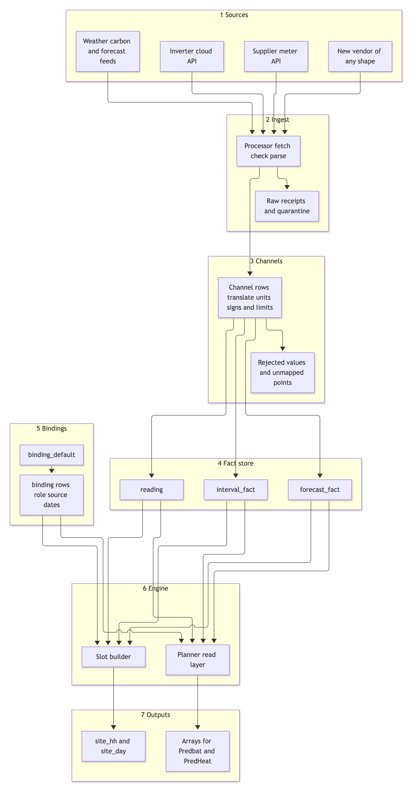

Mermaid source of diagram 1

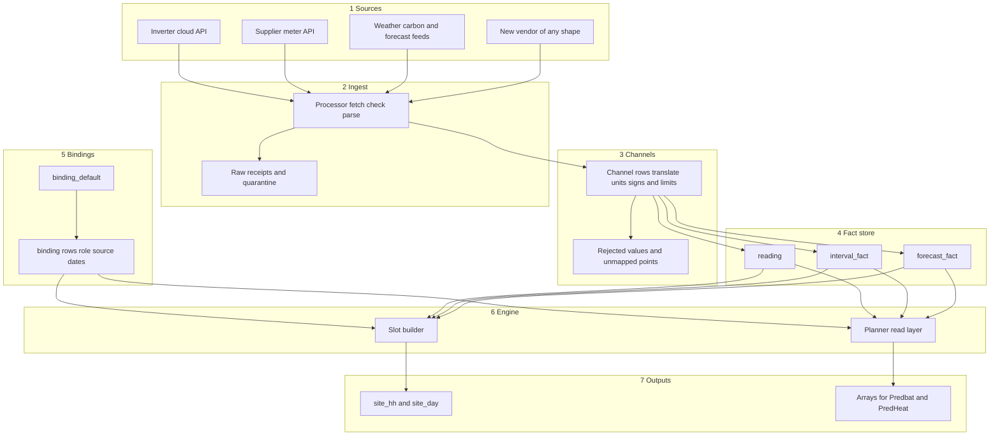

How to read it: data flows top to bottom. Vendors differ only in step 2. Steps 3 and 5 are rows in tables, not code, so adding, switching or removing a provider changes rows only. Both engine parts in step 6 read the same bindings, so the slot builder and the planner agree on which source a slot used (within 0.1 percent in the tests).

---

## 2. Data model

Only the tables this design adds or relies on, with the control and access tables in brief (their full definitions are in `docs/control-readback.md` and `docs/groups-and-access.md`). `source.traits` is a new column; `channel`, `channel_reject`, `binding` and `binding_default` are new tables (deltas 061 to 066).

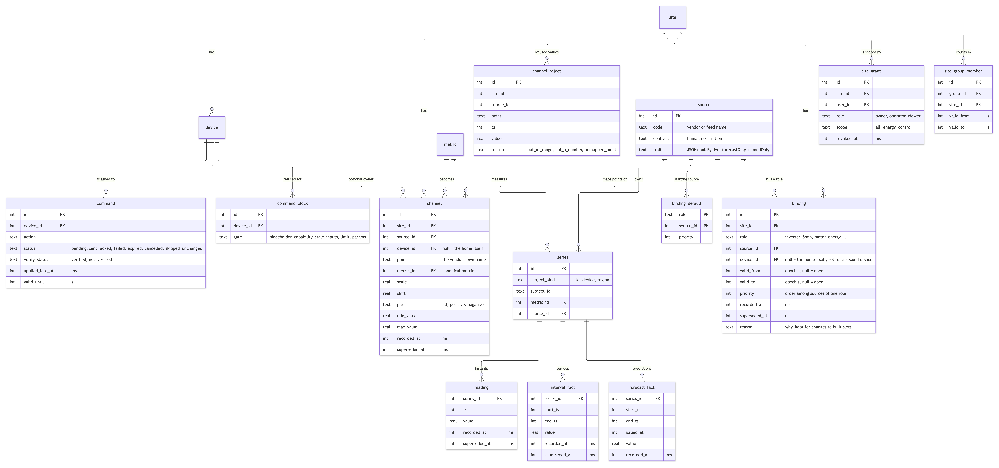

Mermaid source of diagram 2

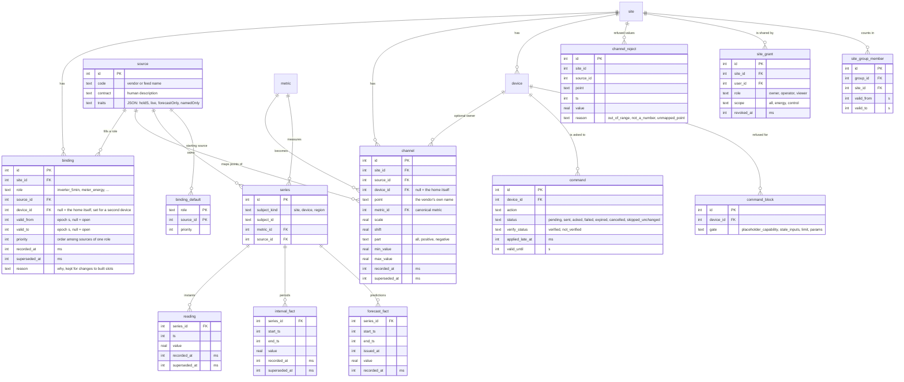

---

## 3. Writing data in

Every vendor takes the same path. The processor knows the vendor's shape; the channels know the vendor's units and signs; the fact writer knows nothing about vendors and refuses writes outside the declared source.

Observations come in six kinds: an instant, a period, a forecast issue, a **counter** (a cumulative total such as a plug's energy meter, turned into energy per period by difference, with resets, wraps and backwards steps handled), an **event** (a 0 or 1 period), and the control kinds **state** and **ack**. The kinds are described in `docs/counters-events-roles.md` and `docs/control-readback.md`.

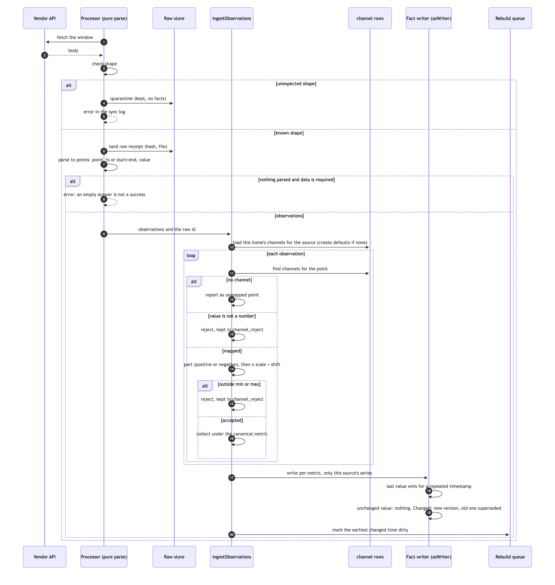

Mermaid source of diagram 3

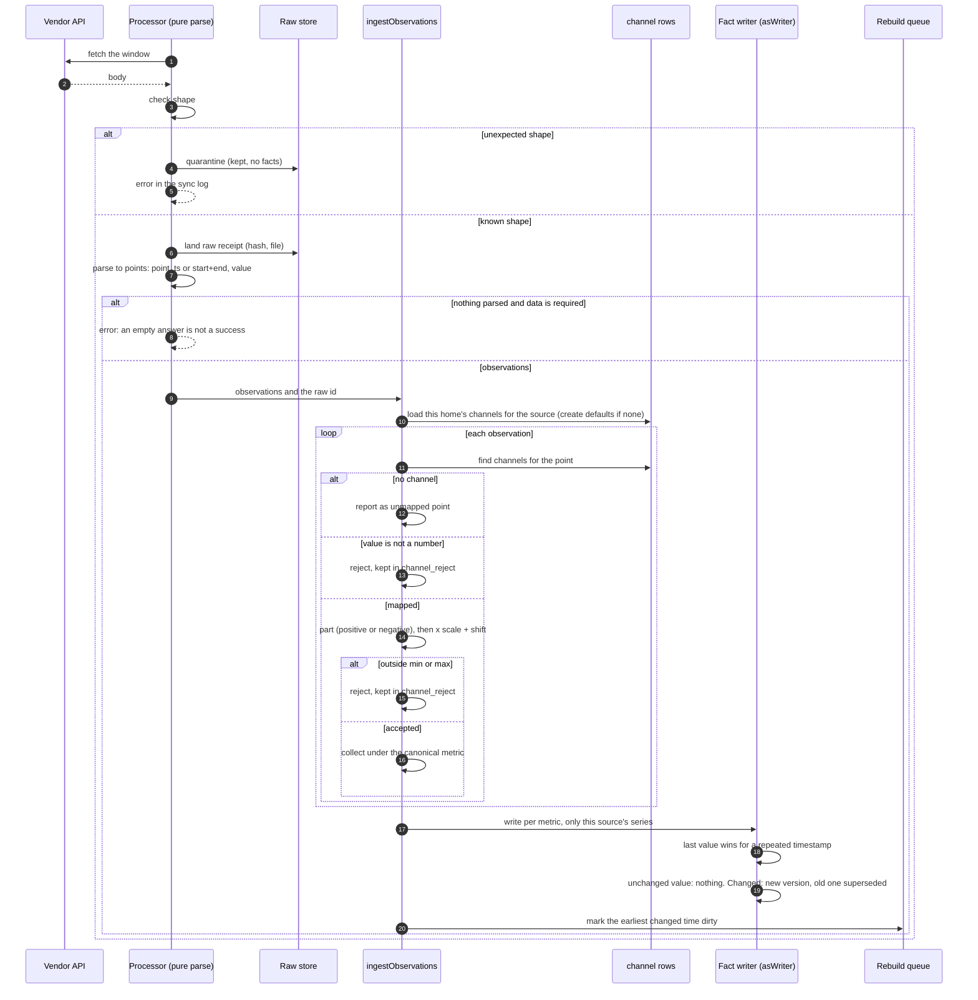

**What the channel row does, by example** (the same inverter reported two ways):

| Vendor point | Vendor value | Channel (metric, part, scale) | Stored fact |
|---|---|---|---|
| `Grid` (signed W, + = import) | +500 | `grid_import_w`, positive, 1 | 500 |
| `Grid` | -300 | `grid_import_w`, positive, 1 | 0 |
| `Grid` | -300 | `grid_export_w`, negative, 1 | 300 |
| `grid_kw` (kW, a second vendor) | -0.3 | `grid_export_w`, negative, 1000 | 300 |
| `pv_kw` | 500000 | `solar_w`, scale 1000, max 60000 | rejected, kept in `channel_reject` |
| `firmware_temp` | 41 | none | reported as unmapped, not stored |

---

## 4. Reading data out

The builder and the planner read layer take their inputs from the same bindings, so they cannot disagree about which source a slot used.

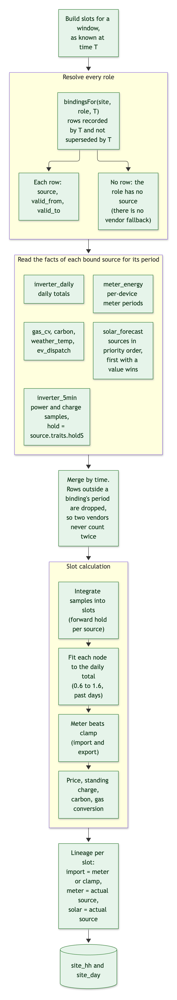

Mermaid source of diagram 4

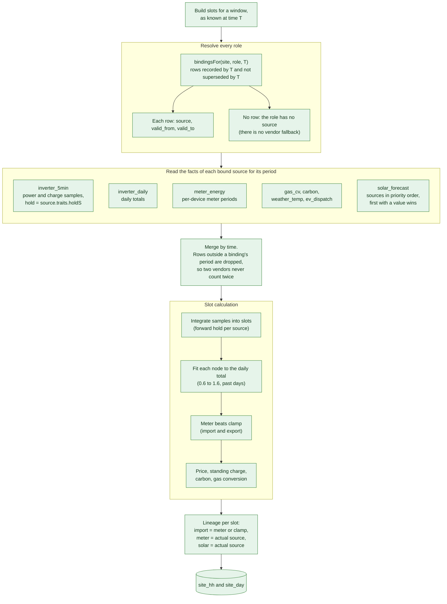

---

## 5. Roles

A role is what the engine asks for. A source fills it. The defaults below are what a new home starts with (`binding_default`); a home can bind anything else.

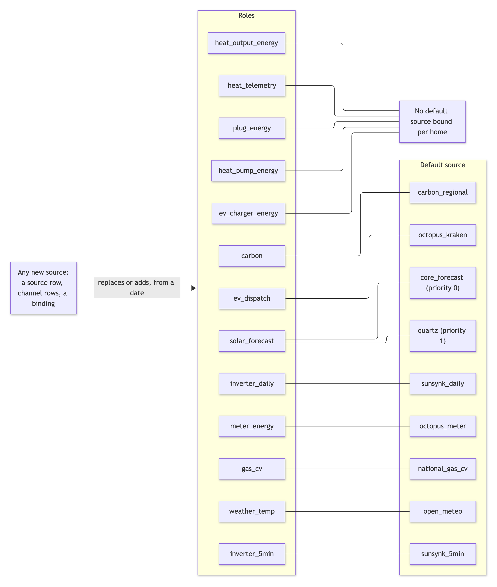

Mermaid source of diagram 5

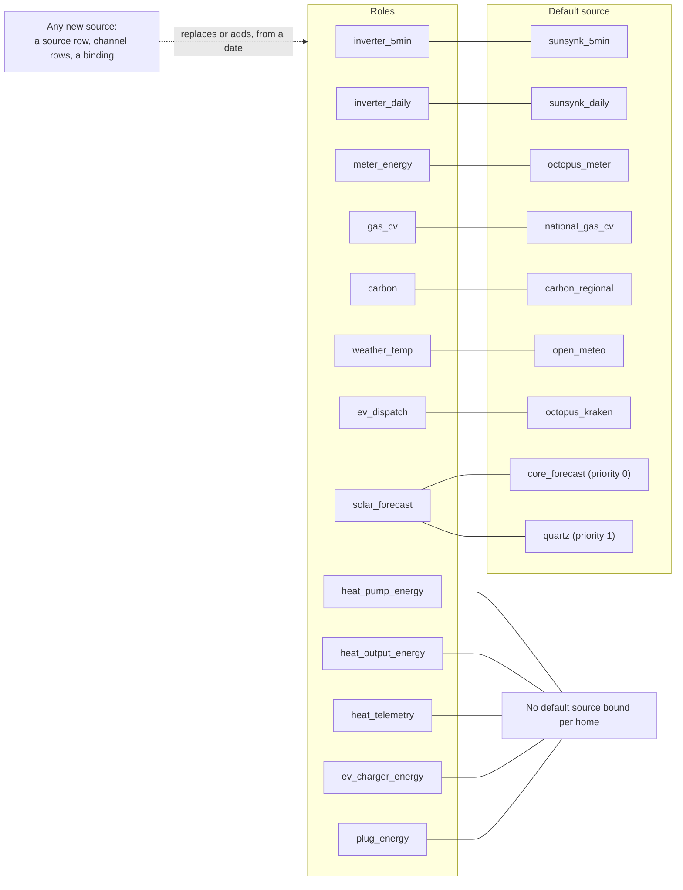

| Role | What the builder uses it for | Stored as |
|---|---|---|
| `inverter_5min` | Solar, load, grid, battery power and charge level, integrated into slots | `reading`, site subject |
| `inverter_daily` | The inverter's daily totals, used to fit the integrated slots | `interval_fact`, site subject |
| `meter_energy` | The supplier meter's import, export and gas per period (official figure) | `interval_fact`, device subject |
| `gas_cv` | Gas calorific value, to convert m3 to kWh | `interval_fact`, region subject |
| `carbon` | Grid carbon intensity per period | `interval_fact`, region subject |
| `weather_temp` | Outdoor temperature | `reading`, site subject |
| `ev_dispatch` | Smart-charge dispatch periods (the daily allowance) | `interval_fact`, site subject |
| `solar_forecast` | The forecast of record per slot, our own first, then Quartz | `forecast_fact`, site subject |
| `heat_pump_energy` | Electricity into a heat pump (read by the heating build) | `reading` or counter, device subject |
| `heat_output_energy` | Heat delivered by a heat pump or boiler (read by the heating build) | counter or `interval_fact`, device subject |
| `heat_telemetry` | Heating temperatures and on or off states (read by the heating build) | `reading`, site or device subject |
| `ev_charger_energy` | Energy delivered to an EV by a charger (defined, no consumer yet) | counter or `interval_fact`, device subject |
| `plug_energy` | A smart plug's energy, per device (defined, no consumer yet) | counter, device subject |

The five heating and IoT roles have no default source: a home binds one when it has the device. Roles are read from one list (`ROLES` in `src/core/inputs.js`), so the Providers screen shows new ones automatically.
---

## 6. Provider lifecycle

Everything below is a row change, done while the system runs. Slots before a change never move.

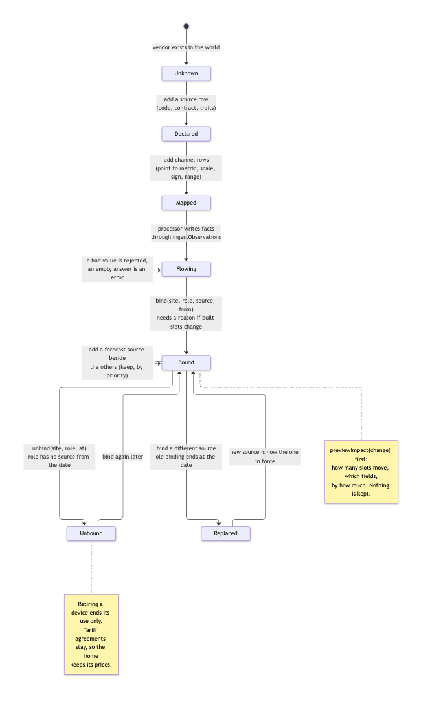

Mermaid source of diagram 6

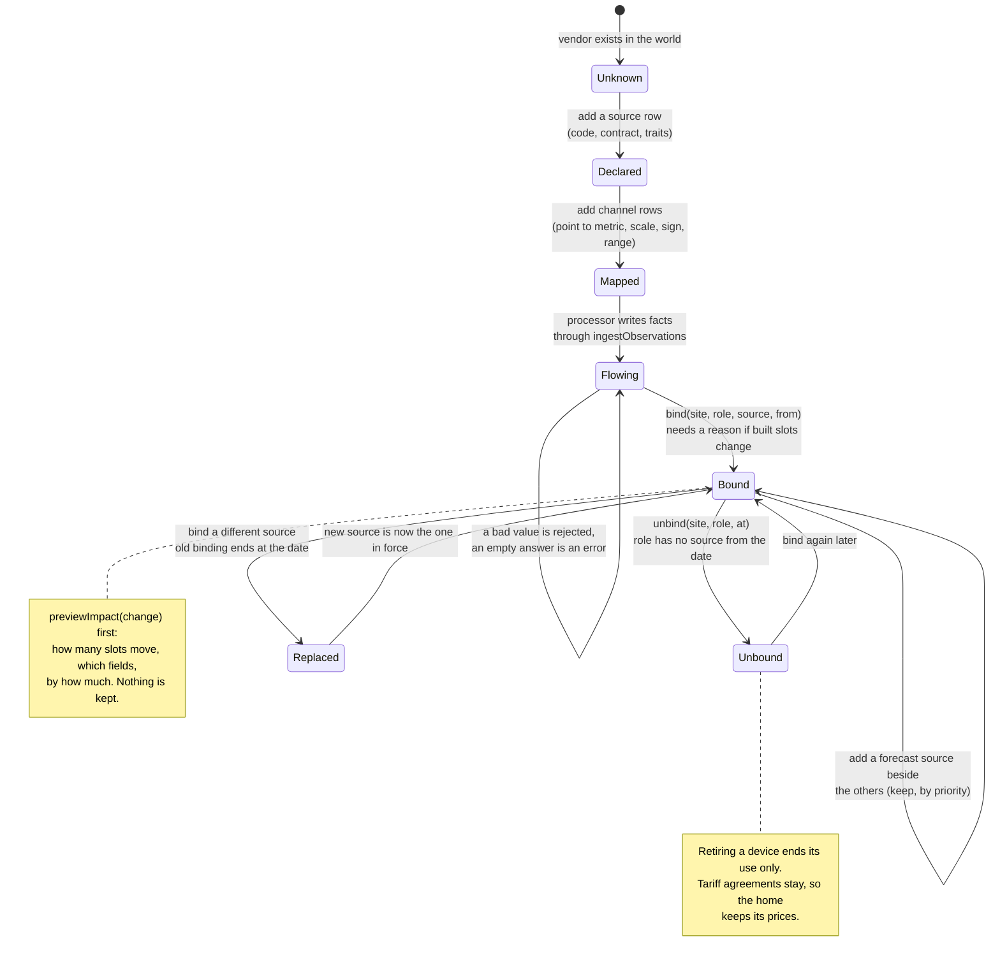

Each inverter binding is a *unit*: a source, optionally a device, for a period. Units that follow one another take turns (a vendor switch). Units that overlap in time are two devices of one kind (two inverters, two batteries) and their figures are **added**: each is integrated on its own with its own hold, the slot energies are summed, a slot is covered only as far as its least covered unit, and a day's counter total is the sum of the units' totals (unknown if one is missing). Charge level is the average of the batteries weighted by size (the device's `battery_kwh`). `solar_forecast` is the one role that has several sources at once by priority instead of adding them.

**Safety rules that go with it**

| Rule | Where it is enforced |
|---|---|
| A change that alters built slots needs a written reason, kept on the binding row | `inputs.js` (`bind`, `unbind`) |
| A processor can only write series of its own source | `facts.js` (`asWriter`) |
| A new source or metric row is found without a restart | `db.js` (lookup on a cache miss) |
| A "preview" runs the change in a savepoint and rolls it back | `impact.js` (`previewImpact`) |
| A build "as known before" a change still sees the old binding | binding `recorded_at` and `superseded_at`, `bindingsFor(..., asOf)` |

---

## 7. A vendor switch, worked through

Tested on the real home's data (`test/runtime-provider.test.js`, `test/channels.test.js`): a second inverter vendor reports in kW with one signed grid figure, is wired in as rows, and is bound from a date.

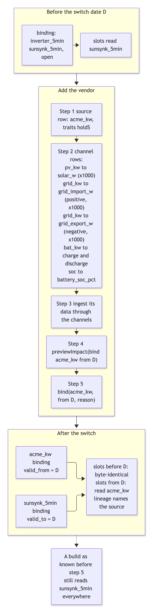

Mermaid source of diagram 7

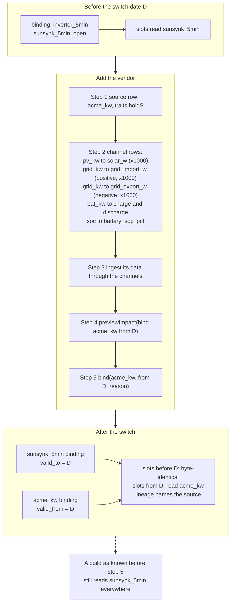

**Result of that test:** slots from D equal the real inverter's within 1e-6 on solar, home use, import, export, battery charge and discharge, and total cost. The planner read agrees with the builder within 0.1% across the switch.

---

## 8. Crash safety

The old failure: a sync wrote corrected facts, stopped before its rebuild, and the next sync fetched the same window, found nothing changed, and never rebuilt the day.

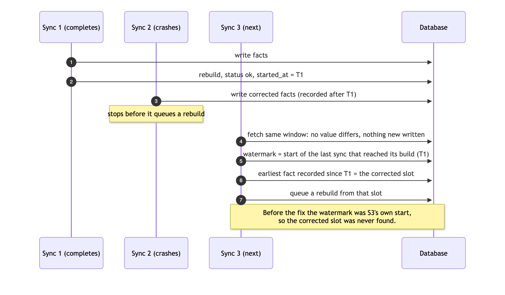

Mermaid source of diagram 8

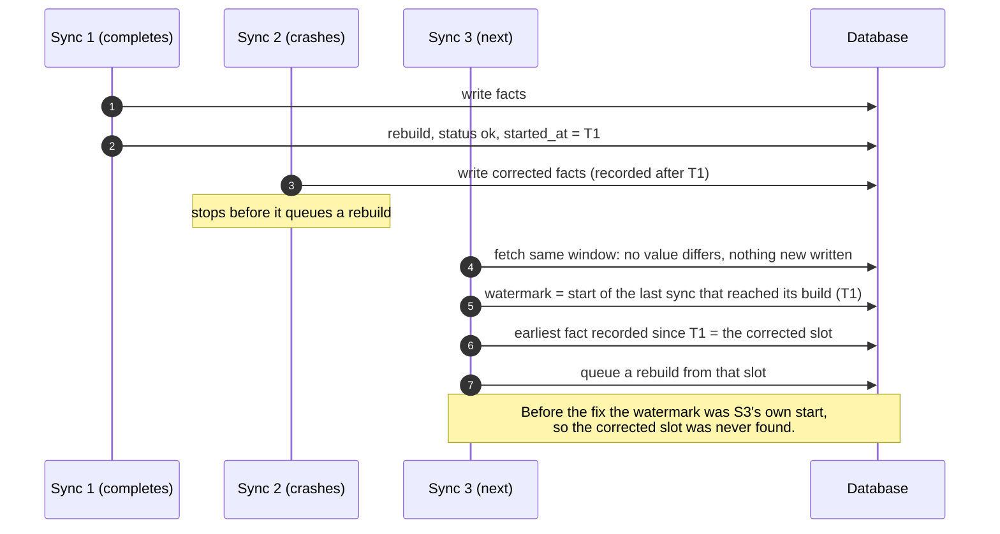

Also in this stage: a batch with the same timestamp twice keeps the last value (it used to break the unique key and abort the whole batch), and `requireData` turns an empty answer into an error the sync log shows.

---

## 9. Control: a command with read-back

Writing to a device uses the same channels as reading from it. A device's settings come back as `state` observations through the same ingest path, a receipt is an `ack` that is never stored as a fact, and a command counts as done only when the **device** reports the desired state. Full detail: `docs/control-readback.md`.

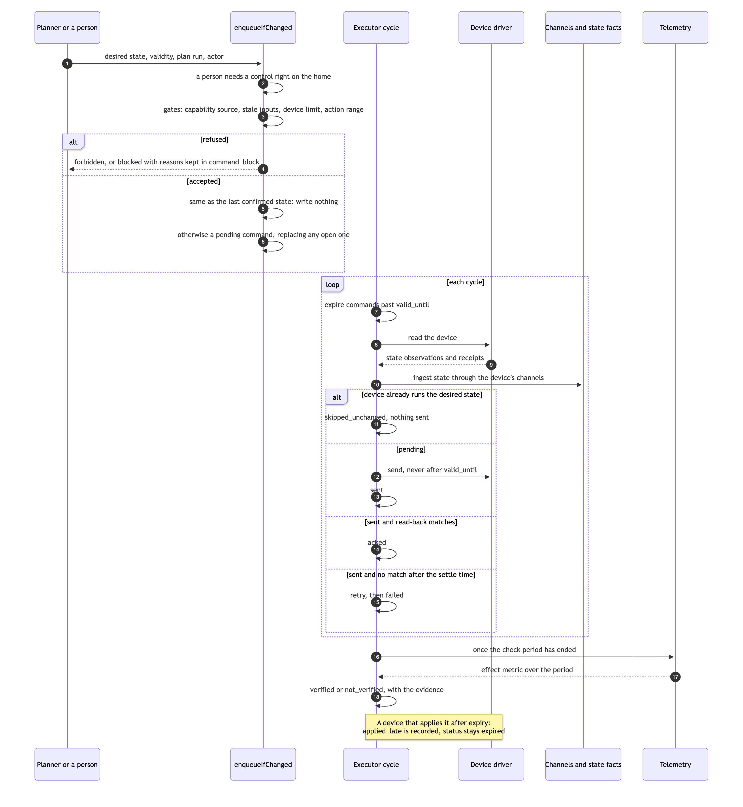

Mermaid source of diagram 9

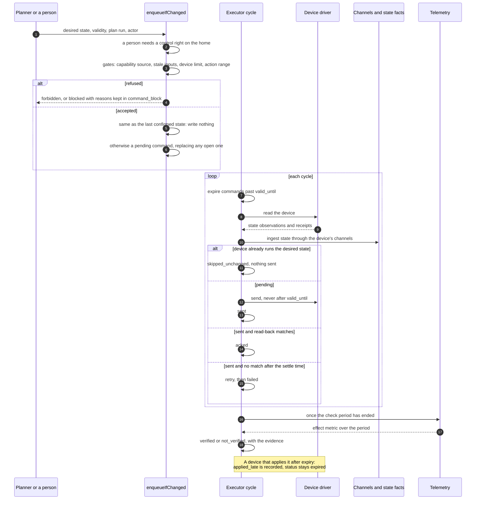

| Gate or rule | What it stops | Kept where |
|---|---|---|
| Control right | A viewer, a stranger or a revoked user commanding a home | error `forbidden`, nothing written |
| Placeholder capability | A command for an action whose support was only stated, not confirmed | `command_block` |
| Stale inputs | A non-demand action planned on stale data | `command_block` |
| Device limit | A value outside the installer's limit for that device | `command_block` |
| Action range | A value outside the action's own parameter range | `command_block` |
| Read-back decides | Marking a command done on the database's belief | `acked` only when the device reports it |

---

## 10. Groups and access

A group is a dated set of homes. Its views are built from the homes' slot rows, never from daily totals, and who may see or command a home is a grant, not a tenant. Full detail: `docs/groups-and-access.md`.

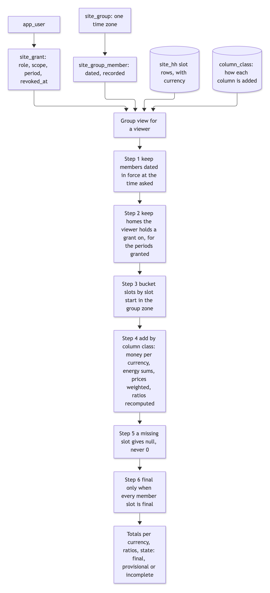

Mermaid source of diagram 10

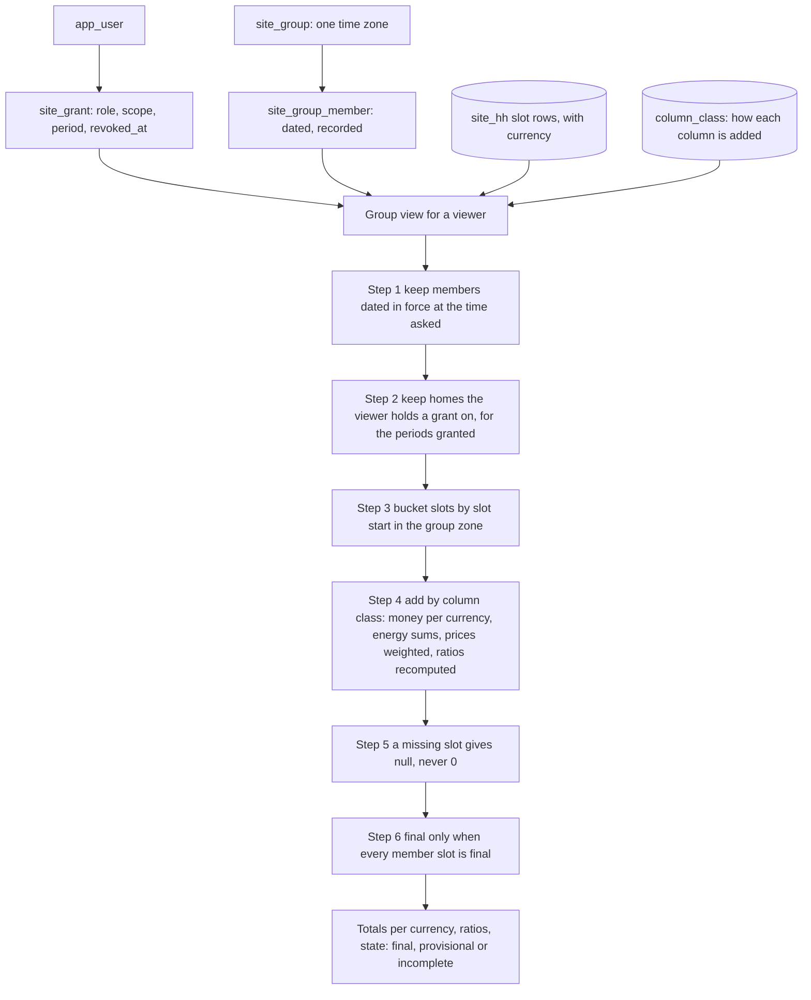

| Question | Answer in this design |
|---|---|
| A group has GBP and EUR homes | Two money totals; no exchange rate exists |
| A home leaves on day X | Counted before X and not after; an earlier report re-runs identically |
| A member the viewer has no grant on | Left out completely: no count, no gap marker |
| One member slot is missing | The column is null with a `partial` figure; never 0 |
| Homes with different slot lengths | Default bucket is the longest slot; a shorter bucket is refused, not split |
| A viewer with scope energy | Reads energy and cost; cannot command |

---

## 11. What is built and what is not

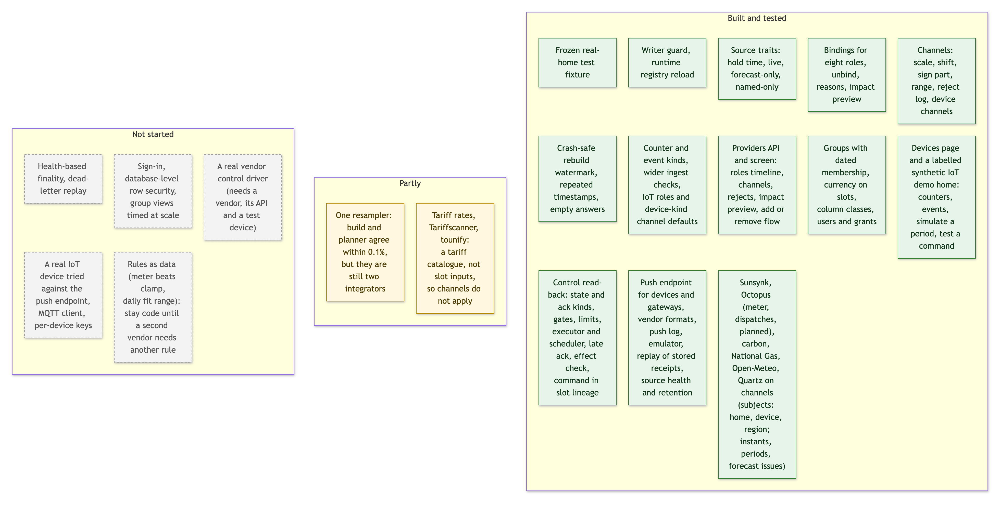

Mermaid source of diagram 11

```mermaid
flowchart TB
  subgraph DONE["Built and tested"]
    direction TB
    d1["Frozen real-home test fixture"]
    d2["Bindings for eight roles, unbind, reasons, impact preview"]
    d3["Channels: scale, shift, sign part, range, reject log, device channels"]
    d4["Source traits: hold time, live, forecast-only, named-only"]
    d5["Writer guard, runtime registry reload"]
    d6["Crash-safe rebuild watermark, repeated timestamps, empty answers"]
    d8["Control read-back: state and ack kinds, gates, limits,<br/>executor and scheduler, late ack, effect check,<br/>command in slot lineage"]
    d10["Counter and event kinds, wider ingest checks,<br/>IoT roles and device-kind channel defaults"]
    d13["Push endpoint for devices and gateways, vendor formats,<br/>push log, emulator, replay of stored receipts,<br/>source health and retention"]
    d12["Devices page and a labelled synthetic IoT demo home:<br/>counters, events, simulate a period, test a command"]
    d11["Providers API and screen: roles timeline,<br/>channels, rejects, impact preview, add or remove flow"]
    d9["Groups with dated membership, currency on slots,<br/>column classes, users and grants"]
    d7["Sunsynk, Octopus (meter, dispatches, planned),<br/>carbon, National Gas, Open-Meteo, Quartz on channels<br/>(subjects: home, device, region;<br/>instants, periods, forecast issues)"]
  end

  subgraph PART["Partly"]
    direction TB
    p1["One resampler: build and planner agree within 0.1%,<br/>but they are still two integrators"]
    p2["Tariff rates, Tariffscanner, tounify:<br/>a tariff catalogue, not slot inputs,<br/>so channels do not apply"]
  end

  subgraph TODO["Not started"]
    direction TB
    t1["Rules as data (meter beats clamp,<br/>daily fit range): stay code until a second vendor needs another rule"]
    t2["A real vendor control driver<br/>(needs a vendor, its API and a test device)"]
    t3["Sign-in, database-level row security,<br/>group views timed at scale"]
    t4["Health-based finality, dead-letter replay"]
    t5["A real IoT device tried against the push endpoint,<br/>MQTT client, per-device keys"]
  end

  classDef built fill:#e6f4ea,stroke:#2e7d32,color:#12351a
  classDef part fill:#fff7e0,stroke:#b58900,color:#4a3a00
  classDef todo fill:#f3f3f3,stroke:#9e9e9e,color:#555,stroke-dasharray: 4 3
  class d1,d2,d3,d4,d5,d6,d7,d8,d9,d10,d11,d12,d13 built
  class p1,p2 part
  class t1,t2,t3,t4,t5 todo
```

### Where each piece lives

| Piece | File |
|---|---|
| Roles, bindings, `bind`, `unbind`, hold lookup | `src/core/inputs.js` |
| Impact preview | `src/core/impact.js` |
| Channels, `ingestObservations`, `setDeviceChannel` | `src/core/channels.js` |
| Writer guard, fact writers, rebuild queue | `src/core/facts.js` |
| Slot builder | `src/core/build.js` |
| Planner read layer | `src/core/planner-read.js` |
| Sync watermark | `src/jobs/sync.js` (`sinceWatermark`) |
| Source definitions, default channels, traits | `src/db/registry.js` |
| Default bindings seed | `src/db/seed/bindings.js` |
| Schema | `src/db/deltas/061` to `066` |
| Processor template | `src/adapters/_template.js` |
| Control (stage 4) | `src/core/executor.js`, `src/core/control.js`, `src/core/commands.js`, `src/db/deltas/067-control.sql`; see `docs/control-readback.md` |
| Counters, events and IoT roles | `src/core/counters.js`, `src/core/channels.js`, `src/core/heat.js`, `src/db/deltas/072-channel-kinds.sql`; see `docs/counters-events-roles.md` |
| Providers API and screen | `src/core/onboarding.js`, routes in `src/server.js`, `public/providers.html`, `public/js/pages/providers.js`; see `docs/onboarding-api.md` |
| Push ingest | `src/core/push-ingest.js`, `src/core/push-formats.js`, `src/db/deltas/073-push-log.sql`, `scripts/push-emulator.mjs`; see `docs/push-ingest.md` |
| Source health, replay, retention | `src/core/health.js`, `src/core/replay.js`, `src/db/deltas/075-replay-log.sql`; see `docs/provider-health-replay.md` |
| Devices page and synthetic IoT demo | `src/core/devices-view.js`, `src/core/synthetic-iot.js`, `public/devices.html`, `public/js/pages/devices.js`, `npm run demo:iot`; see `docs/devices-page.md` |
| Groups and access (stage 5) | `src/core/groups.js`, `src/core/access.js`, `src/db/deltas/070-groups.sql`; see `docs/groups-and-access.md` |
| Tests | `test/runtime-provider.test.js`, `test/channels.test.js`, `test/ingest-durability.test.js`, `test/sunsynk-channels.test.js`, `test/octopus-channels.test.js`, `test/channels-subjects.test.js`, `test/multi-device.test.js` |

### Reading these diagrams

Mermaid renders in GitHub, GitLab, VS Code (Markdown preview with the Mermaid extension) and most documentation tools. If a diagram shows as plain text, open the file in one of those.
