# EnergieBee thing platform: design

Status: design, 17 November 2026. This is the target design. Real-world gaps found after it was written (shared things, a change of owner, several hubs, devices that report nothing, devices moving home) and the 22-case catalogue it is tested against are in [the design review](thing-platform-design-review.md#real-world-gaps-added-17-november) (R20–R24, C1). The order of work is in [the plan](thing-platform-plan.md); the problems this design already avoids are in [the design review](thing-platform-design-review.md) (R1–R19, D1–D10); progress is tracked in [the fix list](fix-list.md). The device edge (hub agent, Hub Link Protocol) is specified in [architecture v3, section 5](architecture-v3.md); this document says how the core models what the hub sends and how it commands the hub.

Scope for now: **one home, its rooms, its devices, their controls, and the home's power, heating and consumption.** Many homes, other countries and scale come later; nothing here may block them.

---

## 1. Principles

1. **Everything is a thing.** The home, its floors and rooms, its devices, the systems they form and shared context (region, tariff, weather point) are all rows of one `thing` table with a kind and a type.
2. **Two structures over the same things.** A **spatial tree** (`located_in`: home → floor → room) says where a thing is. An **energy system graph** (`feeds`, `meters`, through ports) says how energy and heat flow. Energy totals follow the graph only, never the rooms, so nothing is counted twice. Home-wide devices (inverter, PV, battery, main meters) sit in the graph at home level and need no room.
3. **All devices talk through a local hub.** The hub agent owns the device protocols, local safety and offline operation; the core owns the model, the history, the money and the decisions. They speak only the Hub Link Protocol. Cloud adapters remain for cloud sources (tariffs, weather, carbon, gas calorific value, solar forecast, supplier meter data) and as stand-ins for a device until its home has a hub.
4. **Every thing exposes points**: measurements, totals (counters), states, setpoints and events, grouped into capabilities.
5. **Every thing has a timeline on one grid**, and groups and the home roll up from their members. A timeline has four lanes: actual, forecast, plan and price.
6. **The slotted tariff is the baseline for all money.** Every tariff becomes a price per slot, past and future; every cost, saving, comparison and plan is energy per slot × price per slot.
7. **Controls are desired state, decided centrally, enforced locally.** The core arbitrates requests by priority and ranked limits; the hub enforces limits again before it writes, runs programs only until they expire, and falls back to each point's safe default.
8. **Raw data is kept, immutable and traceable.** Every hub message and every provider answer is stored as received; every fact names the raw payload it came from; facts are versioned, never overwritten.
9. **Data, not code.** A new device type, capability, relationship, tariff structure or integration is registry rows and a driver or adapter, never a schema change.
10. **Everything can be replayed "as known at" any moment.** Facts and every configuration table carry valid time and record time.

---

## 2. Architecture


*Devices speak their own protocols to the local hub; the hub speaks only the Hub Link Protocol to the core; cloud sources reach the core through adapters. Orange: hub. Blue: core. Green: devices. Purple: cloud.*

<details><summary>Mermaid source (docs/diagrams/tm-architecture.mmd)</summary>

```mermaid
flowchart LR
  subgraph DEV["Devices in the home"]
    direction TB
    INV["Inverter<br/>Modbus / SunSpec"]
    BAT["Battery<br/>(via inverter)"]
    HP["Heat pump<br/>Modbus"]
    TRV["TRVs, thermostat<br/>Zigbee"]
    PLUG["Smart plugs<br/>Wi-Fi / local HTTP"]
    MTR["Smart meter<br/>P1 / CAD"]
    EVC["EV charger<br/>OCPP / local"]
  end

  subgraph HUB["Local hub agent (one per home)"]
    direction TB
    DRV["Driver processes<br/>Zigbee · Z-Wave · Modbus · Matter · HTTP/MQTT"]
    REG["Local registry<br/>things · points · limits"]
    ARB["Local arbiter<br/>limit enforcement · safe defaults"]
    PRG["Edge program<br/>schedules · rules · price slots"]
    BUF["Store and forward<br/>buffer · replay"]
    DRV --> REG
    PRG --> ARB --> DRV
    REG --> BUF
  end

  subgraph CORE["EnergieBee core (cloud)"]
    direction TB
    ING["HLP ingest<br/>dedupe by hub + seq"]
    RAW[("raw_payload<br/>immutable, encrypted")]
    MOD["Thing model<br/>things · relations · points · bindings"]
    FCT[("Facts<br/>reading · interval · forecast")]
    TL["Timelines<br/>point_slot → node_slot → home"]
    MON["Money<br/>price runs → price slots"]
    CTL["Control<br/>requests · limits · commands · verifier"]
    API["API and pages"]
    ING --> RAW --> FCT --> TL --> API
    ING --> MOD
    MON --> TL
    CTL --> API
    TL --> CTL
  end

  subgraph CLOUD["Cloud sources"]
    direction TB
    OCT["Octopus<br/>meters · tariffs · Kraken"]
    TAR["Tariffscanner · tounify"]
    CTX["Open-Meteo · NESO / RTE<br/>National Gas · Quartz"]
  end

  DEV <-->|local protocols| DRV
  BUF <==>|"Hub Link Protocol<br/>MQTT 5 · mTLS · up/* down/*"| ING
  CTL ==>|"down/command · down/program<br/>down/data · down/config"| BUF
  CLOUD -->|cloud adapters| RAW
  OCT -.->|"stand-in connector<br/>until a hub exists"| ING

  classDef hub fill:#fff4e0,stroke:#d08a00,color:#3a2a00
  classDef core fill:#e8f1ff,stroke:#2f6fd6,color:#0b2350
  classDef dev fill:#eef8ee,stroke:#3f9142,color:#123d14
  classDef cloud fill:#f3eefa,stroke:#7a52b3,color:#2a1747
  class DRV,REG,ARB,PRG,BUF hub
  class ING,RAW,MOD,FCT,TL,MON,CTL,API core
  class INV,BAT,HP,TRV,PLUG,MTR,EVC dev
  class OCT,TAR,CTX cloud
```

</details>

| Concern | Hub | Core |
|---|---|---|
| Device protocols, discovery, polling | ✅ drivers | — |
| Thing identity | creates the uid (UUIDv7) when it discovers a device | stores it; places the thing in rooms and the energy graph |
| Raw telemetry | batches, deadband, device time | stores each message as a raw payload; turns samples into facts |
| History, timelines, money | only a bounded buffer | ✅ |
| Decisions (planner, optimiser, schedules, manual requests) | runs the signed program it was sent | ✅ arbitrates, compiles, sends |
| Limits | enforces before every write | enforces before sending; owns the ranking |
| Safety | safe defaults when a program expires or the link is down | never relied on for safety (ADR-11) |
| Offline | keeps running until TTL, buffers, replays in order | accepts late data as bitemporal facts |

---

## 3. Things

### 3.1 The thing table

```sql
thing (
  id           bigint identity PRIMARY KEY,        -- internal
  uid          uuid NOT NULL UNIQUE,               -- the identity everywhere else (UUIDv7; the hub's for devices)
  home_id      bigint REFERENCES thing(id),        -- the home this thing belongs to; NULL only for shared context
  kind         text NOT NULL,                      -- home | space | device | system | context
  type         text NOT NULL REFERENCES thing_type(type),
  name         text NOT NULL,
  attrs        jsonb,                              -- current details; every version in thing_attr_version
  std_ref      text,                               -- Brick / Matter / SAREF type for interoperability
  recorded_at  bigint NOT NULL, superseded_at bigint, retired_at bigint
)
```

| Kind | Types (first set) | Notes |
|---|---|---|
| `home` | house, flat | Holds the home's settings as versioned attributes (time zone, slot length, currency, location, market, region). Replaces `site` and `site_version`. |
| `space` | floor, room, garage, loft, outdoor, outside_wall, driveway | Spatial only; optional for home-wide devices. |
| `device` | hub, inverter, battery, pv_array, meter_import, meter_export, meter_gas, heat_pump, boiler, emitter, trv, thermostat, temperature_sensor, ev_charger, ev, smart_plug | A physical device. A replaced device is a new thing (`replaces`). The hub itself is a device thing. |
| `system` | solar_battery, heating, hot_water, ev_charging, heating_zone | Things that work together; may cross rooms. |
| `context` | region, weather_point, gas_zone, tariff, market | Shared between homes; never deleted with a home. |

`thing_type` is a registry: type → kind, default capabilities, ports, the attributes it may carry, and its standard reference. A hub announcing an unknown device type creates a read-only thing of a generic type until a type row is added (architecture v3, "type packs").

### 3.2 Relationships

```sql
thing_relation (
  from_id bigint NOT NULL REFERENCES thing(id), from_port text,
  rel     text NOT NULL,           -- located_in | part_of | feeds | meters | controls | supplied_on | replaces | served_by
  to_id   bigint NOT NULL REFERENCES thing(id), to_port text,
  required boolean NOT NULL DEFAULT true,   -- does this member decide its group's data state (R8)
  valid_from bigint, valid_to bigint,       -- s, when it is true (snapped to slot boundaries for timelines, R13)
  recorded_at bigint NOT NULL, superseded_at bigint,
  EXCLUDE USING gist (...)                  -- no overlapping current rows per (from, rel, to, ports)
)
```

| Relationship | Example | Rules |
|---|---|---|
| `located_in` | TRV → living room → ground floor → home | at most one current per thing; no cycles |
| `part_of` | battery → solar + battery system; battery module → battery | a device may be part of several systems |
| `feeds` | grid connection.out → import meter.in; PV.dc → inverter.pv; inverter.ac → home supply; heat pump.flow → emitter → room | directed per port; the energy graph is a **flow network, not a tree** (R1) |
| `meters` | import meter meters home supply; smart plug meters heater; EV charger meters EV | each kWh counted once; untracked = parent − Σ children |
| `controls` | thermostat controls heat pump; TRV controls emitter | where a command reaches |
| `supplied_on` | import meter supplied_on tariff (dated) | replaces `tariff_agreement` |
| `replaces` | new inverter replaces old inverter | timelines of the home and systems run on unbroken (R2) |
| `served_by` | device served_by hub | which hub a device talks through, and since when |

### 3.3 The two structures for home 1


*The spatial tree: home → floors → rooms → devices. Home-wide devices sit in the energy graph and need no room; systems group things across rooms.*

<details><summary>Mermaid source (docs/diagrams/tm-home-spatial.mmd)</summary>

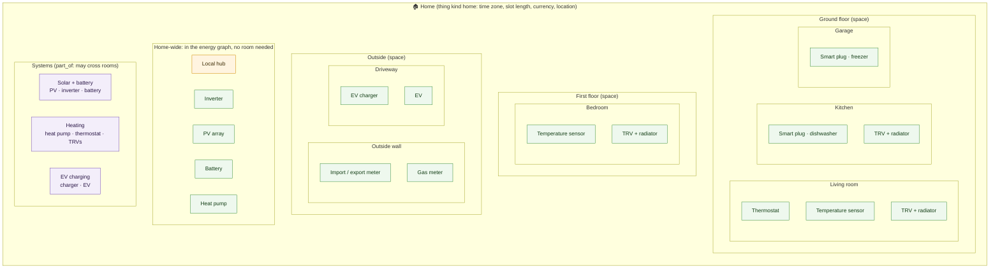

</details>


*The energy system graph of home 1: a flow network through ports, not a tree. The battery and the grid connection both take and give energy; untracked consumption is derived; the tariff is a context thing the meter is supplied_on.*

<details><summary>Mermaid source (docs/diagrams/tm-energy-graph.mmd)</summary>

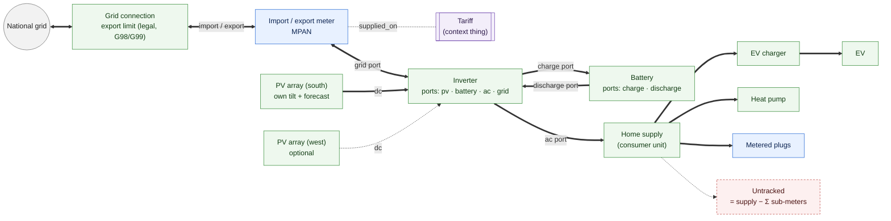

</details>

### 3.4 An example home: devices, rooms and flows

An interactive version, with both homes (home 1 today, and an example home with a hub), layer toggles, and each device's points and four-lane timeline, is [docs/visual/home-graph.html](visual/home-graph.html): open it in a browser.

The same things seen through both structures: each device is labelled with its room (spatial tree), and the arrows are the energy graph (thick: energy, thin: heat, dotted: `controls`).


*Energy flows from the meter, PV and battery through the inverter to the home supply and its loads; heat flows from the heat pump to the radiators in each room; thermostats and TRVs control the heat pump and radiators.*

<details><summary>Mermaid source (docs/diagrams/tm-home-flows.mmd)</summary>

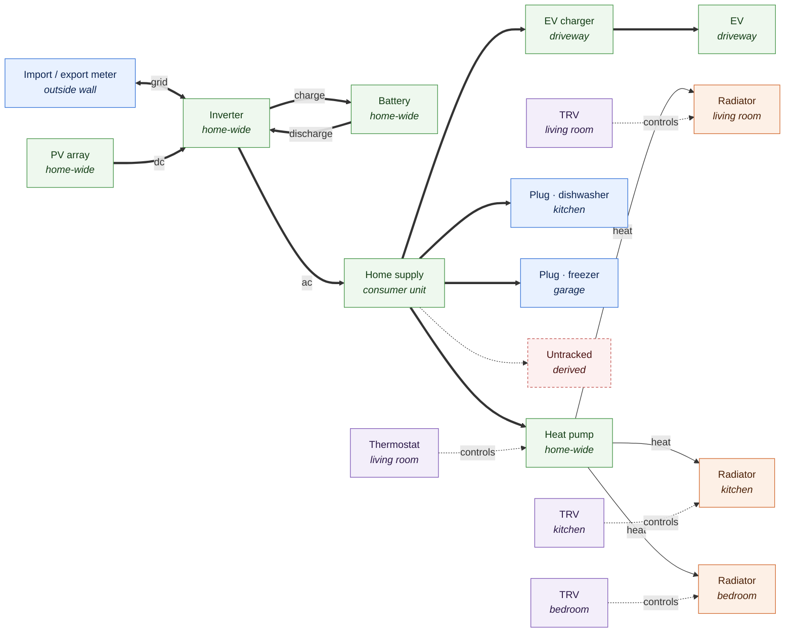

</details>

---

## 4. Points and capabilities

```sql
capability (code PRIMARY KEY, points jsonb, actions jsonb)        -- power_meter, energy_meter, battery_storage, pv_generation,
                                                                    -- grid_connection, thermostat, heat_source, valve, on_off,
                                                                    -- ev_charging, temperature_sensor
point (
  id bigint identity PRIMARY KEY, uid uuid UNIQUE, home_id bigint,
  thing_id bigint NOT NULL REFERENCES thing(id),
  capability text REFERENCES capability(code), key text NOT NULL,        -- 'power', 'soc', 'setpoint' ...
  metric_id bigint NOT NULL REFERENCES metric(id),
  class text NOT NULL,                    -- measurement | total | state | setpoint | event
  access text NOT NULL,                   -- read | write | readwrite
  safe_default jsonb,                     -- what the hub reverts to (writable points)
  recorded_at, superseded_at, UNIQUE (thing_id, key)
)
```

| Class | Example | Per slot |
|---|---|---|
| `measurement` | power_w, indoor_temp_c, soc_pct | mean, min, max, last (time-weighted, with each sample's hold) |
| `total` | energy_import_kwh, heat_output_kwh | change over the slot, through resets and wraps |
| `state` | mode = heating / off / hot_water | share of the slot in each state |
| `setpoint` | target_temp_c, reserve_pct | the value in force |
| `event` | fault, door open, command applied | listed on the event timeline, never averaged |

**Point binding: where values come from, and how sources combine.**

```sql
point_binding (
  point_id bigint NOT NULL REFERENCES point(id),
  link_id  bigint NOT NULL REFERENCES thing_link(id),    -- the hub or cloud connector that supplies it
  external_point text NOT NULL,                          -- the hub's point key, or the provider's field
  mapping  jsonb,                                        -- scale, shift, sign part, counter wrap / reset, range, clock offset
  role     text NOT NULL,                                -- shape | total | fallback (R6)
  priority int NOT NULL,
  valid_from, valid_to, recorded_at, superseded_at
)
```

A point can take its **shape** from one source (the hub's 10-second power) and its **total** from another (the inverter's daily counter or the supplier's half-hourly meter), scaled within a tolerance; this is today's align, fit and "meter beats CT" logic, made data. **Derived points** (home use by energy balance, untracked consumption, COP, degree-hours) are points with a formula and inputs, evaluated in dependency order (R5). **`point_state`** holds the latest reported and desired value per point, updated on every message and command: the device shadow the pages and the control loop read (R15).

---

## 5. Devices and sources

### 5.1 The local hub (all devices)

The hub agent and the Hub Link Protocol are specified in architecture v3, section 5. What the core does with each message:

| HLP message | The core |
|---|---|
| `up/announce` (hub and device descriptors) | stores the raw message; creates or matches `thing` (by the hub's uid) and `point` rows from the type pack; records `served_by` and a `thing_link`; a device it does not know becomes read-only. The owner places new devices in rooms (onboarding). |
| `up/telemetry` (batched samples: thing, point, ts, value, q) | stores the raw message, de-duplicated by (hub, seq); writes samples as facts through the point bindings (device time as `ts`, receive time as `recorded_at`); marks the affected points dirty |
| `up/event` | event facts on the thing's event timeline |
| `up/state` | updates `point_state` (reported); a change no command explains is an external override (§9.4) |
| `up/ack` (received, applied, rejected) | moves the command along; `applied` is confirmed only by a matching `up/state` |
| `up/health` | hub health, clock skew, buffer depth, driver status, applied program version: the hub thing's own timeline and alerts |
| `down/command`, `down/program` | sent by the control layer (§9) |
| `down/data` | the home's price slots and the planner schedule, with an expiry, so the hub can run on price while offline |
| `down/config` | the registry slice the hub needs: things, points, mappings, limits, safe defaults |

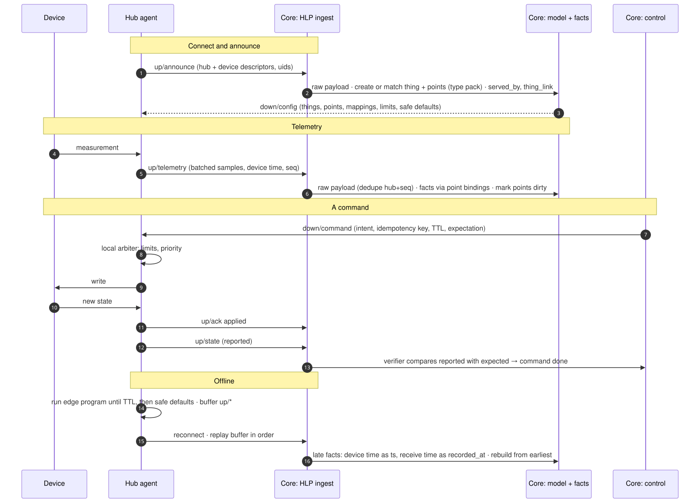

*What the core does with each hub message: announce creates or matches things and points, telemetry becomes raw payloads and facts, a command is confirmed only by the reported state, and an offline hub replays its buffer as late, bitemporal facts.*

<details><summary>Mermaid source (docs/diagrams/tm-hlp-sequence.mmd)</summary>

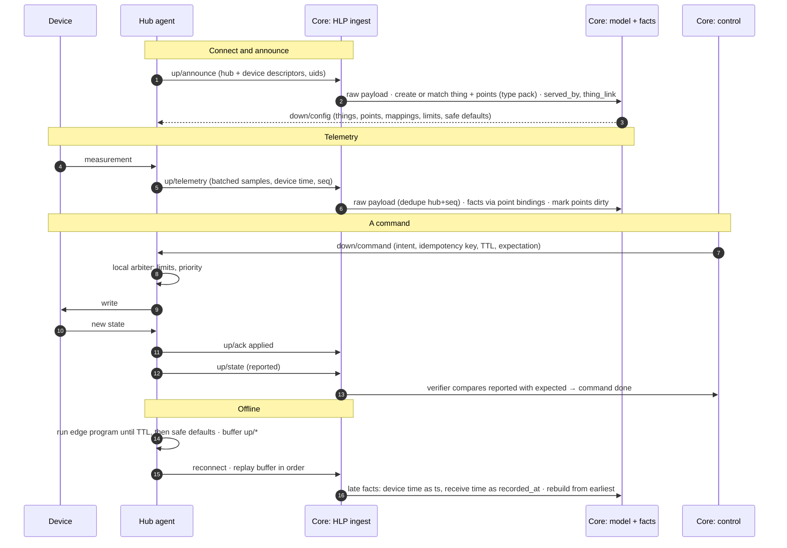

</details>

**Ownership:** the hub creates device identities; the core owns everything above them (rooms, the energy graph, systems, tariffs, limits ranking). The hub caches what it needs (`down/config`) and never decides the model.

### 5.2 Cloud sources (no device behind them)

| Source | Role | What it supplies |
|---|---|---|
| Octopus account | supplier | meter half-hours (until a local meter reader is on the hub), tariff agreements → `supplied_on` |
| Octopus rates, Tariffscanner, tounify | tariff catalogue and prices | tariff things and their price runs (§8) |
| Octopus Kraken | external controller of the EV | dispatches (price overlay), and bump charge as a command channel |
| Open-Meteo, NESO / RTE carbon, National Gas CV | context | weather point, region and gas zone timelines |
| Quartz | forecast | solar forecast on each PV array thing |

These stay core-side adapters: fetch → check the shape (quarantine if wrong) → land raw → pure parse → facts through bindings. Their contract, rate limits, licence and credentials are per integration and per connection, as today.

### 5.3 Before a home has a hub

A cloud device API (Sunsynk Connect today) runs as a **cloud connector**: a `thing_link` of kind `cloud` that feeds the same ingest path as a hub (it emits announce-like descriptors and telemetry-like samples). When the home gets a hub and the inverter is reached over Modbus, the hub's link is added at a higher binding priority and the cloud link ends; the inverter thing, its points and its timeline do not change.


*Before a hub, the inverter is read through the Sunsynk cloud; with a hub, a hub link takes over at a higher priority and the cloud link ends. The thing, its points and its timeline do not change.*

<details><summary>Mermaid source (docs/diagrams/tm-handover.mmd)</summary>

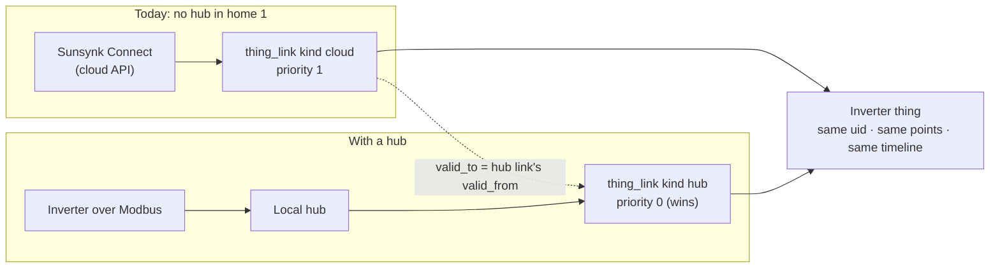

</details>

```sql
thing_link (
  id bigint identity PRIMARY KEY,
  thing_id bigint NOT NULL REFERENCES thing(id),
  kind text NOT NULL,                  -- hub | cloud
  hub_id bigint REFERENCES thing(id),  -- the hub thing (kind hub)
  connection_id bigint,                -- the cloud connection (kind cloud)
  external_ref text NOT NULL,          -- the hub's device uid, or the provider's serial / plant / MPAN
  valid_from, valid_to, recorded_at, superseded_at
)
```

### 5.4 Integration manifest

One entry per integration (today's `source`, `market_provider` and `registerAdapter` merged): access mode (hub driver, cloud pull, cloud push), auth, markets, licence, rate limits, history depth, and what it **discovers**, **reads** and **writes**. Hub drivers are listed the same way, so the core knows which device types a hub can serve.

---

## 6. Raw data and facts

- **Raw payload:** every HLP message and every provider answer, with its hash (dedup), source, home, hub, sequence and receive time; the file is stored encrypted with a per-home key on storage apart from the database (R14).
- **Facts:** `reading` (instant), `interval_fact` (an amount over a period), `forecast_fact` (issued predictions), each keyed by the point's source series, each naming its `raw_id`, versioned with `recorded_at` / `superseded_at`.
- **Append-only, enforced by the database:** facts and raw rows can only be superseded, never updated or deleted, except by the one logged whole-home erasure path.
- **Late and offline data:** a hub replaying its buffer after an outage writes facts with their device time and today's receive time; timelines rebuild from the earliest affected slot; "as known at" yesterday still shows what was known yesterday.

---

## 7. Timelines

### 7.1 Layers on one grid


*L1 is each thing's own timeline, L2 rolls up rooms, floors and systems, L3 is the home's energy, money and checks; the source mix and cost per kWh are mixed back down to every device and room. Every timeline has four lanes on one grid.*

<details><summary>Mermaid source (docs/diagrams/tm-timeline-layers.mmd)</summary>

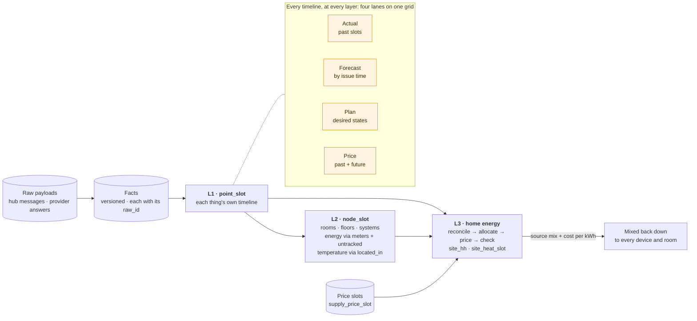

</details>

- **One grid:** every layer cuts time with the home's slot length (15, 30 or 60 minutes, from local midnight), so any timelines can be overlaid.
- **Four lanes on every timeline (R7):** actual (past slots), forecast (future, by issue time), plan (desired states from the planner), price (§8).
- **Data states:** final, provisional, missing per slot; a group's state is decided by its **required** members only (R8); every row records its lineage (inputs, sources, versions, method).
- **Allocation** is a rule set over the energy graph. Today's algorithm (solar to home, then battery, then grid) is the rule for the "one hybrid inverter" topology; a topology the rules do not cover is refused with a reason, never built wrong (R1).

### 7.2 Rebuilds

A dependency graph: a new fact marks its point dirty from its time; its point slots are rebuilt; the groups it belonged to at those times are marked; then the home. Shared changes (a tariff, a region's carbon) are queued once and expanded to the homes in batches. A rebuild **stops when it converges**: once a day ends with the same carried-over state (battery stock and the like) as the stored build, later days cannot change (R9). Each layer has its own method version.


*A change marks what depends on it, layer by layer; shared changes are queued once and batched; a home's rebuild stops on the first day that ends in the same carried-over state as the stored build.*

<details><summary>Mermaid source (docs/diagrams/tm-rebuild.mmd)</summary>

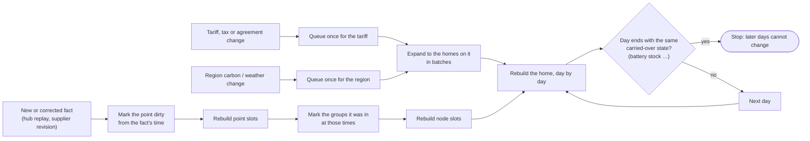

</details>

---

## 8. Money: the slotted tariff


*Tariff rules expand into price runs; the home's agreement, taxes, own windows and dispatches turn them into price slots per supply point; every cost is slot energy × slot price, and future slots go to the hub.*

<details><summary>Mermaid source (docs/diagrams/tm-money.mmd)</summary>

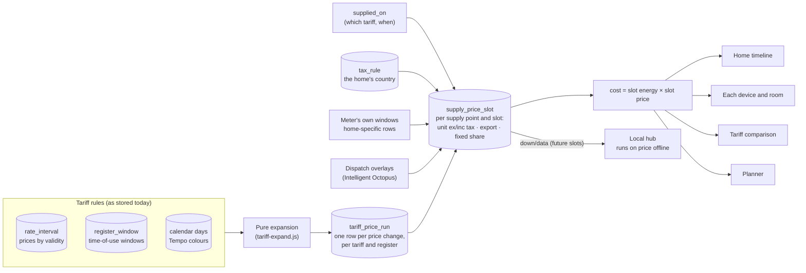

</details>

- Every tariff type converts: flat, day/night and time-of-use windows, Intelligent Octopus Go (windows plus the home's dispatches), Agile and Tracker (published intervals), day-type calendars (Tempo), tounify day-ahead, export, gas; standing, subscription and capacity charges become a fixed share of each slot.
- **Never guess:** an unpublished price is missing; estimated only by a stated rule.
- **Future horizon:** known prices run ahead (14 days to start) and are sent to the hub (`down/data`) for offline operation.
- **Sub-meter tariffs:** a supply point can be a sub-meter with its own tariff; its energy is priced with that tariff and taken out of the main meter's priced energy (R11).
- **Consumption-dependent charges** (tiers, peak demand) carry the rate per slot; the dependent part is added in L3 once energy is known.

---

## 9. Controls

### 9.1 Actions and requests

Actions belong to capabilities (`capability_action`: action, parameter schema, side-effect class, effect check). A **control request** is a wish with a priority and an expiry:

```sql
control_request (id, uid, home_id, thing_id, capability, desired jsonb,
                 priority text,      -- safety > manual > schedule > optimiser
                 source text,        -- owner, installer, planner, schedule:<id>, external:<controller>
                 valid_from, valid_until, recorded_at, superseded_at)
```

The highest current request per point wins and becomes a `command` (desired state, idempotency key, TTL, expectation); a lower request comes back into force when the higher one expires. A request on a room or system splits into one command per member with the capability, linked by `parent_command_id`.

### 9.2 Limits

`control_limit` on any thing (device, room, circuit, home), with sum limits across members. Sources are ranked **physical > legal > installer > owner > optimiser**; a lower source can only tighten a higher one (R17). The export limit under the network operator's G98/G99 approval is legal and can never be loosened. The core checks limits before sending; the hub checks them again before writing.

### 9.3 The command path


*Requests by priority, then ranked limits, then a command (split per member for a room or system), sent to the hub, which checks limits again before writing. Done only when the reported state matches; a change no command explains becomes a manual request.*

<details><summary>Mermaid source (docs/diagrams/tm-control.mmd)</summary>

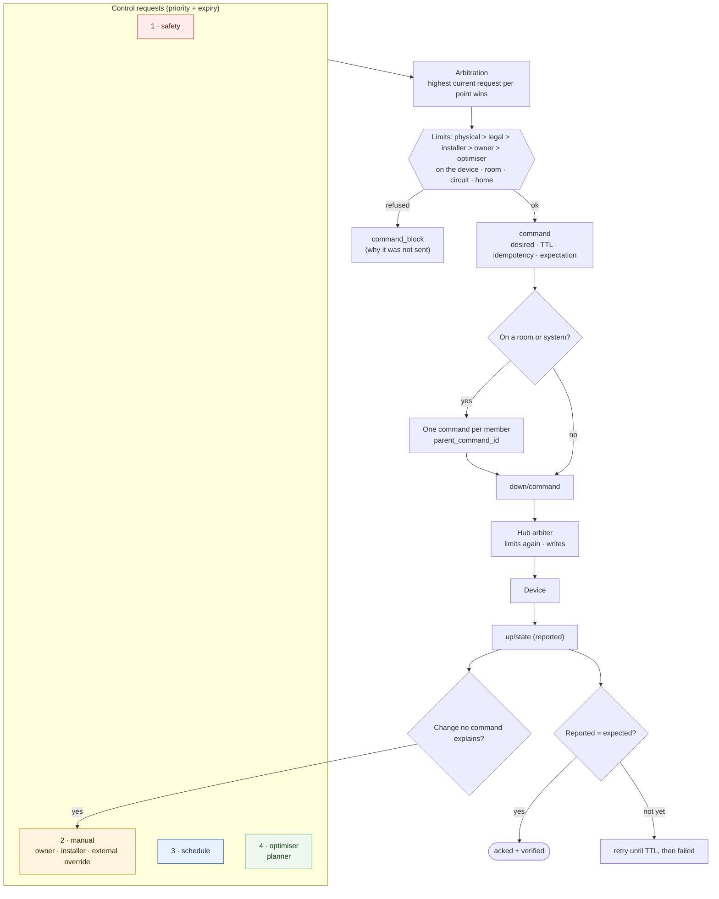

</details>

A command is done only when the device's reported state matches the expectation (read-back), as the executor already requires. Schedules, scenes and rules are compiled into a signed **edge program** (`down/program`) that the hub runs until its TTL, then reverts each controlled point to its safe default.

### 9.4 Someone else changed it

A reported change that no EnergieBee command explains (the owner used the inverter's own app, an installer changed a setting) becomes a **manual** request with an expiry and is shown to the owner; it is never silently reverted. A thing can name an **external controller** (Octopus Intelligent Go for the EV); EnergieBee then sends only what that controller allows (R16).

---

## 10. Heating and consumption

- **Heating graph:** heat source `feeds` emitters, which `feed` rooms; thermostats and TRVs `control` the source and emitters; a heating zone is a system.
- **Room heating timeline:** indoor temperature, setpoint, valve opening, demand, heating-on share.
- **Heating system timeline:** flow / return temperature, heat output, energy in, COP, degree-hours; `site_heat_slot` is its home-level view.
- **Consumption:** per device → room → floor → home, plus untracked, each line with cost and carbon from the mix and price of its slots.

---

## 11. Storage

- **PostgreSQL through Prisma.** The schema is the SQL in `prisma/migrations` (constraints, triggers, exclusion constraints, views); Prisma's models are pulled from it. Fix list P1–P9.
- **Every row knows its home** (`home_id`, set on insert) for access, erasure and partitioning; shared context rows have none (R4).
- **Stable ids:** `uid` UUIDv7 on things, points, links, requests and commands; the hub creates device uids (R3).
- **Versioned configuration:** every configuration table has valid time and record time, checked by a test (R19).
- **Rules in two places:** every invariant a constraint or trigger enforces is also checked by a code test (D1).
- **Data model:**

  
  *The core tables: things and their types, relations, attribute versions, points, links and bindings, the facts and raw payloads, the slot tables, control and money.*
  
  <details><summary>Mermaid source (docs/diagrams/tm-er.mmd)</summary>
  
  ```mermaid
  erDiagram
    thing_type ||--o{ thing : "types"
    thing ||--o{ thing : "home_id"
    thing ||--o{ thing_relation : "from"
    thing ||--o{ thing_relation : "to"
    thing ||--o{ thing_attr_version : "versions"
    thing ||--o{ point : "exposes"
    capability ||--o{ point : "groups"
    metric ||--o{ point : "measures"
    thing ||--o{ thing_link : "reached through"
    thing_link ||--o{ point_binding : "supplies"
    point ||--o{ point_binding : "filled by"
    point ||--o{ series : "feeds (one per link)"
    series ||--o{ reading : ""
    series ||--o{ interval_fact : ""
    series ||--o{ forecast_fact : ""
    raw_payload ||--o{ reading : "raw_id"
    raw_payload ||--o{ interval_fact : "raw_id"
    point ||--o{ point_slot : "timeline"
    point ||--|| point_state : "shadow"
    thing ||--o{ node_slot : "group timeline"
    thing ||--o{ control_request : "wished"
    control_request ||--o{ command : "winner"
    command ||--o{ command : "parent (group)"
    thing ||--o{ control_limit : "limits"
    thing ||--o{ tariff_price_run : "tariff (context)"
    thing ||--o{ supply_price_slot : "supply point"
  
    thing {
      bigint id PK
      uuid uid UK
      bigint home_id FK
      text kind
      text type FK
      text name
      jsonb attrs
    }
    thing_relation {
      bigint from_id FK
      text from_port
      text rel
      bigint to_id FK
      text to_port
      boolean required
      bigint valid_from
      bigint valid_to
    }
    point {
      bigint id PK
      uuid uid UK
      bigint thing_id FK
      text capability FK
      text key
      text class
      text access
    }
    point_binding {
      bigint point_id FK
      bigint link_id FK
      text external_point
      jsonb mapping
      text role
      int priority
    }
    thing_link {
      bigint id PK
      bigint thing_id FK
      text kind
      bigint hub_id FK
      text external_ref
    }
    control_request {
      bigint id PK
      bigint thing_id FK
      jsonb desired
      text priority
      bigint valid_until
    }
  ```
  
  </details>

- **Retention tiers:** raw and fine samples for a set period, slots and days for ever (D5).

---

## 12. API (shape)

| Endpoint | Returns |
|---|---|
| `GET /api/things/:uid` | the thing, its points, relations, links, current state |
| `GET /api/things/:uid/timeline?from&to&res&lanes` | slots of the thing (device, room, system or home) with the lanes asked for |
| `GET /api/things/:uid/events?from&to` | commands, state changes, faults, overrides, rolled up for a group |
| `POST /api/things/:uid/requests` | a control request (capability, desired, priority, valid_until) |
| `GET /api/homes/:uid/graph` | the spatial tree and the energy graph |
| `GET /api/tariffs/:uid/slots?from&to`, `GET /api/homes/:uid/prices` | price runs and the home's price slots, past and future |
| `GET /api/hubs/:uid/health` | the hub's link, drivers, buffer, program version |

---

## 13. From today's schema

| Today | Becomes |
|---|---|
| `site`, `site_version` | `thing` of kind `home` (the same id); `site` and `site_version` stay as its typed detail: the settings and their versions |
| `device`, `device_kind`, `device_attr_version` | `thing` of kind `device` or `system` (same uid; id moved up by G), `thing_type`; `device` and `device_attr_version` stay as its detail (provider, external reference, adapter attributes) |
| `series.subject_kind / subject_id` | `series.point_id` (a point's feed from one link) |
| `channel`, `binding` | `point_binding` (mapping, role, priority) |
| `tariff_agreement` | `supplied_on` relations |
| `device_action`, `device_capability` | `capability_action`, the capabilities of the thing's type and links |
| `control_limit` | `control_limit` on any thing, with ranked sources |
| `site_hh`, `site_heat_slot` | L3 views built from `point_slot` and `node_slot` |
| `rate_interval` + `register_window` priced per slot on the fly | `tariff_price_run` and `supply_price_slot` |
| push ingest (`/api/ingest`) | kept for development and third-party pushes; devices use the hub |

The facts (`reading`, `interval_fact`, `forecast_fact`), raw payloads, metric and source registries, the slot builder's data states and lineage, and the command read-back carry over unchanged in meaning.

---

## 14. Open questions

1. **The hub's first hardware and the first drivers** for home 1 (the Sunsynk inverter over Modbus, the meter over a consumer access device or P1). Until then the Sunsynk cloud connector stands in (§5.3).
2. **Whether the Sunsynk consumer login may be used for automated writes** before the hub reads the inverter locally (plan 4.5).
3. **Where the hub's edge program comes from first:** the planner's schedule only, or owner-set schedules and scenes too.
