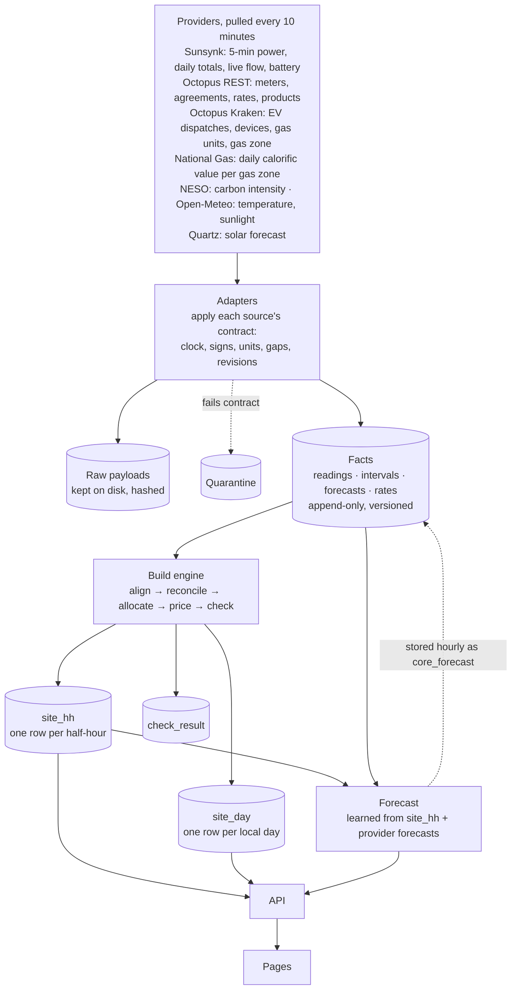
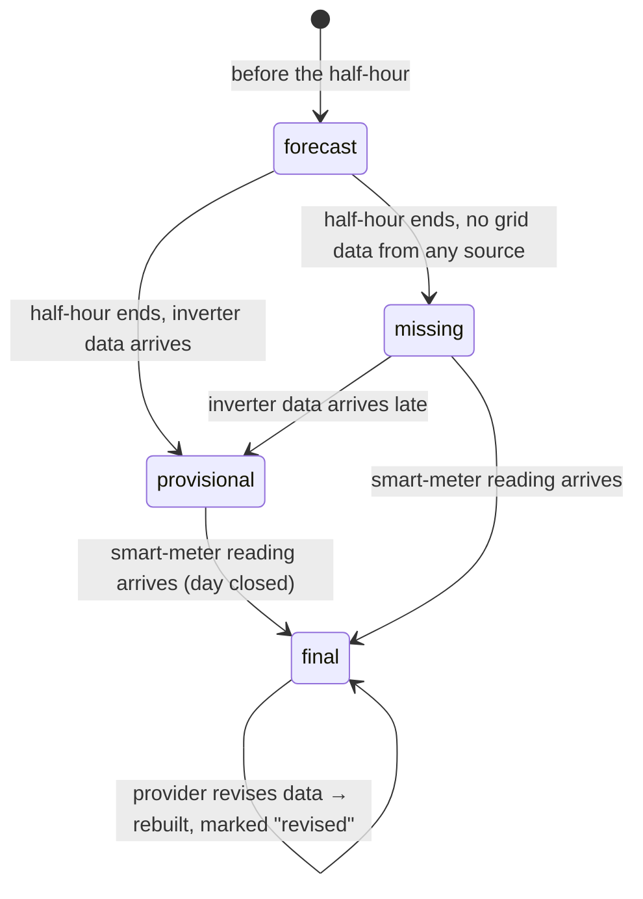

# EnergieBee core: timeline, forecast, data states and data provenance

Prototype `energiebee-core-prototype` · Build method `v2-measured-load` · Forecast model v3 · Prepared by Technext · 16 October 2026

This document explains:

1. **How the half-hour timeline is created** from the providers' data.
2. **What `final`, `provisional`, `missing` and `forecast` mean.**
3. **How the 48-hour forecast works.**
4. **Where every number comes from, and what it affects** in the timeline, the daily table, the forecast, the tariff comparison and the pages.
5. **How the values the core learns from data are derived** (detection methods).
6. **What is still assumed, what are reporting choices, and what was removed.**

**The rule the core follows:** no number is shown unless it comes from a provider's data, is calculated from that data by a method described here, or is cited from a named public source. When none of these applies, the value stays empty (`null`), the half-hour stays unpriced, or the step is skipped with a reason. **Nothing falls back to a default.**

Examples use the real home **10 Acresbrook**: Sunsynk plant 292543, panels 6.5 kWp (Sunsynk), tilt about 20° facing about 60° east-north-east (estimated from the home's output, section 7), battery 11.0 kWh (measured, section 5.5); Octopus region G, Intelligent Octopus Go, gas zone NW.

---

## 1. How the timeline is created

### 1.1 The idea

Every provider measures something different, on its own clock, in its own units and with its own sign conventions. No page ever calls a provider. Each provider has an **adapter** that applies that provider's **contract**: its time zone, signs, units, how it shows missing data, and how it revises data. The adapter:
- stores the untouched payload (**raw**);
- writes **facts**, which are append-only and versioned: a changed value is a new version, and the old one is marked superseded.

A deterministic **build engine** turns facts into one row per UTC half-hour (`site_hh`) and one row per local day (`site_day`). The pages read only these rows, plus the forecast. The same facts and the same method always give the same numbers.

Mermaid source

### 1.2 The sync job (every 10 minutes)

Each step succeeds or fails on its own; a failure is shown on its connection.

1. **Sunsynk:** the named plant (`SUNSYNK_PLANT_ID`; this login sees 17 plants).
   - 5-minute series for yesterday and today (14 days on first run);
   - the month's daily totals and the live flow;
   - plant details: time zone, kWp (used only when `.env` has none), location;
   - the battery reading (capacity in Ah, voltage, lifetime counters), and a measured capacity check (section 5.5).
2. **Location:** postcode → coordinates (postcodes.io), Octopus grid supply point, NESO region. With no postcode, the nearest postcode to the inverter's registered location is used. Here both give BB12 9BY.
3. **Weather and carbon:** Open-Meteo temperature, cloud and horizontal sunlight, refilled to 15 days until 14 days are held; NESO regional carbon.
4. **Octopus:**
   - the account (meters, profile class, annual estimates, tariff agreements);
   - gas units and gas zone (LDZ) from Kraken;
   - meter readings with a 4-day look-back (14 days the first time);
   - rates for the tariffs in force;
   - Kraken dispatches and devices.
5. **Gas calorific value:** National Gas's daily value for the meter's gas zone (section 5.3).
6. **Comparison tariffs:** Agile and Agile Outgoing for the region (public prices).
7. **Quartz:** only when panel size, tilt and direction are known. It runs with the estimated angles (section 7). Recent output is not sent, because that made Quartz overshoot (section 3).
8. **Build:** every half-hour is rebuilt from the earliest day forward.
9. **Forecast record:** the forecast's house use, grid import and solar per half-hour are stored once an hour as `core_forecast`.

Fetching again is harmless:
- an identical payload hash is skipped;
- an identical fact is skipped;
- a changed fact becomes a new version.

### 1.3 The build engine (method `v2-measured-load`)

The build engine runs over every UTC half-hour of every local day. A local day has 46, 48 or 50 half-hours, depending on the clock change.

**Step 1: Align (power → energy)**
- Each 5-minute power sample is held until the next one (at most 5 minutes) and converted to kWh, split exactly at half-hour boundaries.
- Each closed day is then scaled to the inverter's own daily counter for that flow.
- The factor is limited to 0.6–1.6 so that a corrupt counter is ignored. At 10 Acresbrook the factors run 0.94–1.20 (medians 1.01–1.04).

**Step 2: Reconcile (one value per flow)**

| Value | Rule |
|---|---|
| Grid import / export | Smart meter where it has a reading, otherwise the inverter clamp (the half-hour is then provisional) |
| House use | The inverter's measured load, limited to what the sources supplied |
| Balance | solar + import + battery out − export − battery in |
| Inverter loss | balance − measured load (about **3.0 kWh/day** here) |
| Gas | Gas meter reading as delivered (m³ here), converted to kWh with that gas day's published calorific value (section 5.3); unknown until it is published |
| EV | Kraken completed dispatches |

**Step 3: Allocate (who fed whom)**

| Flow | Rule |
|---|---|
| solar → home | min(solar, home) |
| solar → battery | min(solar left, battery in) |
| solar → grid | min(solar left, export) |
| battery → home | min(battery out, home not yet covered) |
| battery → grid | min(battery out left, export left) |
| grid → home | min(home still not covered, import) |
| grid → battery | min(battery in not covered by solar, import left) |
| each source → loss | what each source supplied beyond the flows above |

**Step 4: Price**

- **Tariff:** the agreement in force for that meter at that half-hour (from the Octopus account).
- **Rate band:**
  - Intelligent Octopus Go: night inside the off-peak window **learned from Octopus's time-stamped IOG prices** (section 5.4), or in a completed smart-charge dispatch half-hour that is within the car's daily allowance (first 12 half-hours, i.e. 6 hours, per midday-to-midday period, as Octopus states; section 5.4); day otherwise.
  - Economy 7: **not priced**, because no source gives the switch times.
  - Agile and flat tariffs: the single published price.
- **Payment method:** a price is used only if it applies to any payment method, or every payment method has the same price. The API does not say how the customer pays.
- **VAT:** from the dated table (section 4.3).
- **Standing charge:** the daily charge divided by the number of half-hours in that local day.
- **Battery stock, first in first out:**
  - the opening layer is the energy at the first charge-level reading, with **cost unknown** (section 5.2);
  - grid charging adds a layer at price ÷ **measured** round-trip efficiency (section 5.1);
  - solar charging adds a layer at 0p (no fuel cost);
  - energy drawn from the opening layer has no stored cost (`null`).
- **Bill** = every imported kWh × price (house + battery charging + inverter loss) + standing charge + gas − export credit.
- **Grid-only** = house use × price + standing + gas.
- **Saving** = grid-only − bill.
- **Carbon** = import × regional intensity; avoided = house use × intensity − that.

**Step 5: Check and set the state**

| Check (daily) | Pass when | What it means |
|---|---|---|
| Completeness | no half-hour missing | Every half-hour has a grid reading |
| Rate coverage | every half-hour priced | No unpriced energy |
| Energy balance | inverter loss within 10% of house use | Meter, clamp and load agree |
| Meter vs clamp | daily import within 5% | The clamp is a sound fallback |
| Counter fit (solar) | within 10% of the daily counter | The 5-minute samples are complete |
| Battery efficiency | measured | Shows the value and how it was measured |
| Battery stock | — | Warns that opening energy has unknown cost |

**Rebuild:** the battery stock carries from one half-hour to the next, so a rebuild always runs forward from the earliest day. 15 days take about 0.2 s, and the totals come out identical every time (Data & trust → Rebuild).

### 1.4 Worked example: Fri 9 Oct, 11:00–11:30 (10 Acresbrook)

**Facts in:**
- Sunsynk 5-minute samples: solar 633 → 1,316 W; load 1.0–5.7 kW; battery 0.5–4.1 kW out; charge level 54% → 42%.
- Octopus meter: import 0.215 kWh, export 0.009 kWh.

| Result | Value | Comes from |
|---|---|---|
| Solar | 0.560 kWh | Sunsynk 5-min × that day's counter fit 1.126 |
| Battery out | 1.552 kWh | Sunsynk 5-min × fit |
| Import | 0.215 kWh | Octopus smart meter |
| House use | 2.224 kWh | Sunsynk measured load |
| Inverter loss | 0.094 kWh | balance − load |
| solar / battery / grid → home | 0.560 / 1.552 / 0.112 kWh | allocation |
| Price | 32.14p/kWh, 0% VAT | IOG day band (learned window), dated VAT |
| Battery energy's stored cost | 12.4p | first in first out: overnight charge at 7.62p ÷ measured round-trip efficiency |
| Bill | **8.7p** = 3.6p grid→home + 3.3p grid→loss + 1.5p standing + 0.3p gas | |
| Grid-only | **73.3p** = 2.224 × 32.14p + standing + gas | |
| Saving | **64.6p** | |
| State | `final`; quality 129 = measured + revised | |

---

## 2. What the data states mean

| State | Meaning | What the user sees |
|---|---|---|
| **final** | Built from the smart meter (homes with a supplier account) with every check run. Changes only if a provider revises its data. | Normal figures |
| **provisional** | Built from the inverter's grid clamp because the meter reading hasn't arrived (Octopus is about a day late), or the day isn't over. Rebuilt automatically when the reading arrives. | "Estimate until your smart meter reports" |
| **missing** | No grid reading from any source. | A gap, never a zero |
| **forecast** | After now, from the forecast (section 3). | Faded bars after "Now" |

Mermaid source

**Revised:** once a final half-hour's numbers change, it is marked permanently (a dot on the Timeline). 566 half-hours here are revised. They were first built before the Octopus key worked, and corrected when the meter data, the account's tariff, gas units and measured values arrived.

**Quality flags:**

| Flag | Meaning |
|---|---|
| measured (1) | grid from the meter |
| fallback (2) | grid from the clamp |
| estimated (8) | battery energy of unknown cost |
| partial (16) | inverter covered under 80% of the half-hour |
| suspect (32) | negative balance |
| check failed (64) | no price |
| revised (128) | changed after being final |

Every half-hour's evidence page lists its lineage, every fact version and the raw payloads.

---

## 3. How the forecast works (model v3)

The forecast covers the next 48 half-hours × 2. Every parameter is learned from this home's last 14 days, or taken from a provider's forecast. Anything that can't be learned is left out, with the reason given in `model`.

| Part | Method | Learned at 10 Acresbrook |
|---|---|---|
| **Solar** | Two methods; the one checked against this home is used. **Learned from this home:** Open-Meteo's forecast of horizontal sunlight × this home's own output per unit of sunlight for each hour of the day, fitted over the last 14 days. **Quartz** (Open Climate Fix), for the configured size and angles, is used only once 2 days and 2 kWh of its forecasts can be compared with actual output; it is then scaled by the observed ratio. No half-hour is forecast above the most this home has produced in one (2.3 kWh). | Learned path, R² 0.72 on 15 days. Quartz is checked from 18 Oct. |
| **House use** | Median of each half-hour of the day, from days of the same type (weekday or weekend), plus planned EV charging. A temperature adjustment is fitted (heating degree days, base searched 10–20 °C) and applied only if use rises in colder weather with R² ≥ 0.3. | Weekday 11 days, weekend 4; temperature **not applied**: use does not rise in the cold |
| **Battery** | Starts at the latest charge level. Uses the observed charge range, half-hour limits and measured efficiency. Charges from the grid in the **learned charge window**, holds in the **learned hold window**, stores spare solar, and covers shortfalls otherwise. | 20–100%; 1.94 kWh in / 1.55 kWh out per half-hour; efficiency 95.4%; charge 00:00–02:30 up to ~100%; hold 23:30–00:00 and 02:30–05:30 |
| **Prices** | Published rates of the home's tariff agreements, with VAT. No price → no cost. | IOG 7.62p / 32.14p |
| **Carbon** | NESO regional forecast, latest issue. | Region 3 |
| **Results** | Expected import = use − solar ± battery; export = spare solar. Cost = import × price − export × export price. Grid-only = use × price. Saving = the difference. | |
| **Ranges** | House use: 10th and 90th percentiles at each half-hour. Solar: spread of daily actual-to-fitted ratios (needs ≥ 3 days). Three battery runs: expected, low (low use, high solar) and high (high use, low solar). | Solar ×0.87–1.22 over 13 days (in-sample) |
| **Accuracy** | Our forecasts are stored hourly. Each finished half-hour of the last 7 days is compared with the latest forecast issued ≥ 12 h before it. | First scores once a whole day has been forecast 12 h ahead |

**Limits:**
- The solar range is in-sample, so it does not include errors in the sunlight forecast itself.
- 24-hour range totals add up the half-hour bounds, so they are wider than a true daily spread.
- Agile prices beyond what is published are not estimated.
- The past dashed "forecast at the time" line on the Solar page fills in from 16 Oct onward. Earlier Quartz forecasts were deleted because they were made with invented panel angles (section 6.3).

---

## 4. Where every number comes from, and what it affects

### 4.1 Provider data

| Provider · data | Used for | Lands in | Affects |
|---|---|---|---|
| **Sunsynk 5-min** (PV, load, grid clamp, battery, charge level) | Half-hour solar, house use, battery in/out, charge level; grid fallback | `reading` → `site_hh.solar, home, battery_*, soc_end`, `grid_*` when provisional | Every page; flows; inverter loss; battery valuation; forecast learning |
| **Sunsynk daily totals** | Counter fit per day | lineage `fit` | All Sunsynk-based energy (±0–20%); counter-fit check |
| **Sunsynk live flow** | "Right now" | `reading` (live) | Home flow diagram; forecast start charge level |
| **Sunsynk plant** | Time zone, location; kWp only if `.env` has none (it reports 6.5 kWp; `.env` says 5.0) | `site` | Day boundaries; postcode (via location) |
| **Sunsynk battery reading** | 200 Ah × 51.5 V = 10.3 kWh; lifetime counters 8,173.1 kWh in / 7,873.7 kWh out | `connection.meta`, raw #533 | Cross-check of capacity and efficiency (section 5.5) |
| **Octopus meters** (import, export, gas) | Billed energy | `interval_fact` → `site_hh.grid_*`, `gas` | Bill, saving, state (final vs provisional), meter-vs-clamp check |
| **Octopus account** | Meters, MPAN/MPRN, **profile class**, annual estimates, **tariff agreements** | `device`, `tariff_agreement` | Which price applies when; typical-home comparison (profile class) |
| **Octopus rates** | Unit and standing prices, VAT-exclusive | `rate_interval` | Every cost; IOG window learning; tariff comparison |
| **Octopus products** | Current Agile and Agile Outgoing codes | `connection.meta` (compare) | Tariff comparison only |
| **Octopus Kraken** | EV dispatches and devices; **gas `consumptionUnits`** and **gas zone (`ldz`)** | `interval_fact` (EV), `device` | EV energy, IOG dispatch pricing, which gas readings are m³, which calorific value applies |
| **National Gas Data Portal** | Daily calorific value for the gas zone (item "Calorific Value, LDZ(NW)", PUBOB4512) | `interval_fact` (one row per gas day) | Gas kWh, gas cost, bill |
| **NESO** | Regional carbon intensity (history = NESO's forecast) | `interval_fact`, `forecast_fact` | Carbon emitted/avoided, greenest window |
| **Open-Meteo** | Temperature; horizontal sunlight; sunlight on the panels (only with tilt and direction) | `reading`, `interval_fact`, `forecast_fact` | Timeline weather row; temperature fit; sunlight-based solar forecast |
| **Quartz** | Solar forecast for the panels (with size, tilt and direction) | `forecast_fact` | Solar forecast; Solar page forecast line |
| **`.env`** | Postcode; panel tilt 20° and direction 60° **estimated from the home's output** (section 7); panel size and battery left empty so the providers' values are used | `site` | Quartz request, sunlight on the panels |
| **postcodes.io / Octopus GSP / NESO region** | Postcode, region keys | `site` | Which prices and carbon series apply |
| **Ofgem TDCV 2026** (public document) | Typical-home figures: 2,500 kWh electricity (profile class 1), 3,400 (class 2), 9,500 kWh gas | page constant, cited | "How you compare" on My energy only |

### 4.2 The core data matrix: each serving column and its inputs

| `site_hh` columns | Inputs | Methods (section) |
|---|---|---|
| `solar`, `battery_charge`, `battery_discharge` | Sunsynk 5-min, daily totals | align + fit (1.3) |
| `grid_import`, `grid_export` | Octopus meter; else Sunsynk clamp | reconcile (1.3) |
| `home` | Sunsynk load, limited to the balance | reconcile (1.3) |
| `loss`, `*_to_loss`, `loss_cost` | balance − load; allocation; price | 1.3 |
| `gas`, `gas_cost` | Octopus gas meter (m³) × 1.02264 × National Gas calorific value ÷ 3.6; gas tariff | 5.3 |
| `ev` | Kraken dispatches | 1.3 |
| `soc_end` | Sunsynk charge level | — |
| seven flows `*_to_*` | all of the above | allocate (1.3) |
| `import_rate_ex`, `import_vat`, `export_rate` | Octopus agreements + rates; learned IOG window; VAT table | 1.3, 5.4, 4.3 |
| `grid_to_home_cost`, `grid_to_battery_cost`, `export_credit`, `standing_cost`, `total_cost`, `grid_only_cost`, `saving` | flows × prices | 1.3 |
| `battery_to_home_cost` | first-in-first-out stock; measured efficiency; opening layer | 5.1, 5.2 |
| `carbon_*` | NESO | — |
| `outdoor_temp` | Open-Meteo | — |
| `solar_forecast` | latest forecast issued before the half-hour (Quartz, else `core_forecast`) | 3 |
| `state`, `quality`, `lineage` | all checks | 1.3, 2 |

`site_day` is the sum or extreme of these per local day, plus self-consumption, self-sufficiency, blended cost (unknown when stored cost is unknown), peak import, base load, charge range, cycles and integrity.

### 4.3 VAT

| Fuel · direction | Rate | Source |
|---|---|---|
| Electricity import from 30 Sep 2026 23:00 UTC | 0% | Octopus prices: VAT-inclusive equals VAT-exclusive |
| Electricity import before that | 5% | UK VAT law (outside the current data window, so no effect on today's figures) |
| Electricity export | 0% | Octopus Outgoing prices |
| Gas | 5% | Octopus gas prices: inclusive = exclusive × 1.05 |

---

## 5. How the learned values are derived (detection methods)

### 5.1 Battery round-trip efficiency

- **Formula:** energy out ÷ (energy in − change in stored energy) over the window. Energy in and out come from the Sunsynk counters; stored-energy change = Δ charge level × capacity.
- **Result** (recomputed on every build; at the time of writing): 110.2 kWh out ÷ 115.6 kWh in = **95.2%**. The forecast's own measure over unbroken half-hour pairs is **95.4%**.
- **Affects:** the stored cost of grid-charged battery energy (price ÷ efficiency), and therefore `battery_to_home_cost`, blended cost, stored-energy p/kWh on the Battery and Breakdown pages, and forecast battery losses.
- **Without enough data:** no loss is applied and the check says "not measured".

### 5.2 Opening battery stock

- The energy in the battery at the first charge-level reading (70% × 11.0 kWh = 7.7 kWh on 2 Oct 00:00) becomes the first stock layer, **with unknown cost**.
- **Affects:** `battery_to_home_cost` is `null` for half-hours drawing from it (2–3 Oct only), and blended cost is unknown for periods that include them. The bill and the saving are **not** affected: battery charging is paid when it happens.

### 5.3 Gas units and calorific value

**Unit.** Decided once per meter and stored with its source:
1. **Octopus states it:** Kraken `consumptionUnits`. This meter reports **m³** (SMETS2).
2. Only if Octopus says nothing: a half-hour above 2.5 can only be kWh; otherwise the yearly rate is compared with the meter's annual estimate (19,270 kWh). Without data the unit stays unknown and the readings are not used.

Readings are stored **exactly as delivered** (`gas_m3`), never pre-converted.

**Calorific value.** GB gas is billed on volume × the calorific value (CV) of the gas delivered in that zone on that day:
- the meter's gas zone comes from Octopus (Kraken `ldz` = **NW**, exit zone NW1);
- National Gas publishes the daily CV per zone on its Data Portal. The data item is found by its name, "Calorific Value, LDZ(NW)", which is id **PUBOB4512**;
- each value applies to one **gas day, 05:00 to 05:00 GB local time** (UNC Modification 0461; SI 2015/953);
- values at 10 Acresbrook, 1–15 Oct: **38.9–40.6 MJ/m³**.

**Conversion per half-hour:** kWh = m³ × **1.02264** (volume correction, Gas (Calculation of Thermal Energy) Regulations 1996) × CV for that gas day ÷ 3.6.

| Gas day | m³ | CV (MJ/m³) | kWh |
|---|---|---|---|
| 2 Oct | 1.114 | 40.44 | 12.79 |
| 11 Oct | 5.761 | 39.40 | 64.38 |
| 14 Oct | 3.360 | 39.06 | 37.31 |

- **Until a day's CV is published** (the next morning, about 10:30), that gas day's kWh stay empty. The daily check `gas_calorific_value` says how many half-hours are waiting. Nothing is converted with a typical value.
- **Affects:** `gas`, `gas_cost`, the bill, grid-only cost, gas on My energy and Breakdown.
- **History:** earlier versions converted with a fixed 39.5 MJ/m³ and are kept as superseded facts. Against them, the 7-day gas total moved from 193.5 to 191.7 kWh (−0.9%), with individual days moving by up to about 2.5%.

### 5.4 Intelligent Octopus Go off-peak window

- **Problem:** the current tariff (IOG-SMB-FIX) publishes day and night prices without times.
- **Method:** Octopus's time-stamped IOG price lists in the same region mark the window as the cheaper rows. Here, the 17 off-peak rows (of 33) of this home's previous tariff E-1R-INTELLI-FIX-12M-25-07-30-G give **23:30–05:30 local**.
- **Confirmation:** the meter data shows the battery charging and the house drawing from the grid in exactly that window.
- **Also stated by Octopus:** "a super low price between 11:30pm - 5:30am for your whole home" (Octopus help article *How does Intelligent Octopus Go work*).
- **Smart-charge slots:** "Your car gets up to 6 hours of off-peak charging per day (measured midday to midday). If we schedule your car to charge outside of the 23:30–05:30 window, your home also gets the off-peak rate for that half-hour when it's within your car allowance." (Octopus blog, 7 May 2026). The core applies exactly this: the first 12 dispatched half-hours in each midday-to-midday period are priced at the night rate for the whole home. There are no dispatches here today, so it has no effect yet.
- **Affects:** the register (day/night) for every half-hour, and so every import cost, the tariff comparison and the price strips.
- **Without such rows:** IOG half-hours stay unpriced and the rate-coverage check fails.

### 5.5 Battery capacity

The core uses capacity mainly to turn the battery's charge level (%) into kWh, so the figure it uses is **measured kWh per 1% of charge**.

| Figure | Value | Source | Used? |
|---|---|---|---|
| Installer's rated capacity | not known | `BATTERY_KWH` in `.env` (empty) | would take priority |
| **Measured from use** | **11.0 kWh per 100%** = 104.6 kWh discharged over 951 points of charge drop, 1,724 discharge-only 5-minute steps in 30 days | Sunsynk 5-minute power and charge level (`src/core/derive.js`) | **yes** |
| Battery's own reading | 200 Ah (`correctCap`) × voltage at that moment: 10.3, 10.6, 10.7 kWh on three readings | Sunsynk battery payload (raw kept) | cross-check only; it drifts with voltage |

- **Lifetime counters** (Sunsynk): 8,173.1 kWh charged, 7,873.7 kWh discharged, 96.3% over the battery's life. That is consistent with the 95.2% measured over the recent window (5.1).
- **Affects:** kWh of stored energy, cycles, the stored-energy term in efficiency, opening stock, and forecast battery limits.

### 5.6 Location and region

- Postcode **BB12 9BY**, from the nearest postcode to the inverter's registered coordinates. It is confirmed by the Octopus supply address and set in `.env`.
- That gives Octopus region G (prices) and NESO region 3 (carbon).

### 5.7 Forecast detections

| Detection | Rule |
|---|---|
| **Grid-charge window** | Half-hours where the battery took > 0.05 kWh from the grid on ≥ 50% of the last 14 days. Target = median charge level at the window's end. |
| **Hold window** | Half-hours where the house drew from the grid while the battery had charge above its observed minimum and did not discharge, on ≥ 50% of days. |
| **Solar response to sunlight** | For each local hour of the day: solar kWh per unit of horizontal sunlight over 14 days (least squares through the origin). |
| **Day type and temperature** | Section 3. |

### 5.8 Typical-home figure

- **Rule:** the import meter's **profile class from Octopus** (1 = single rate, here) selects Ofgem's 2026 medium figure: 2,500 kWh. Gas uses 9,500 kWh.
- **Source:** Ofgem, *Review of typical domestic consumption values: decision* (May 2026), Table 1, in force from 1 July 2026.

---

## 6. What is still assumed, reporting choices, and what was removed

### 6.1 Still assumed

**None of the values that feed costs or energy is assumed any more.** The three that were assumed in the previous version now have sources:

| Was assumed | Now |
|---|---|
| Gas calorific value 39.5 MJ/m³ | National Gas daily value for the meter's zone, from Octopus's `ldz` (5.3) |
| IOG: whole home at night price during a smart-charge dispatch | Octopus's published rule, including the 6-hour midday-to-midday allowance (5.4) |
| Battery capacity from one voltage reading | Measured kWh per 1% of charge (5.5) |
| Panel tilt and direction (placeholder 30°, south) | Estimated from the home's output (section 7) |
| Panel size (placeholder 5.0 kWp) | Sunsynk plant record, 6.5 kWp. Consistent with output peaking at 5,345 W, above 5 kW in 20 samples on 5 days. |

**What is estimated rather than measured directly:** the panel tilt and direction (section 7). Installer values from the MCS certificate replace them when available.

### 6.2 Reporting choices (methods, not data)

These shape how results are summarised, never the measured values:
- check tolerances (10%, 5%, 10%);
- counter-fit limits 0.6–1.6;
- the 14-day learning window;
- 10th/90th percentiles;
- "≥ 50% of days" for learned windows;
- the 0.05 kWh activity threshold;
- the 2-hour cheapest/greenest window;
- price bands (0–10p, …);
- the comparison's 16:00–19:00 window;
- "last 7 days" projections on My energy;
- the 12-hour lead for accuracy.

Each is named where it is shown.

### 6.3 Removed (invented without a source)

| Removed | Where it was | Replaced by |
|---|---|---|
| Appliance list and kWh per run (dishwasher, washing machine, tumble dryer, 10 kWh car top-up) | My energy | Price difference per kWh only |
| "Miles added" at 3.5 miles/kWh | EV page | — |
| Panel tilt 35°, facing south (put in `.env` by me) | Quartz forecast, sunlight on panels | Forecasts made with them deleted; the owner has since given the real values (30°, 180°) |
| Demo home (fully simulated house) | Whole app | Removed from code, database and picker |
| Advice text not backed by data (thermostat 10%, "fridge, router", "normal for an inverter", appliance timing, Agile behaviour claims, "reconnect the car") | Insights, comparison, My energy | Statements of measured or provider-reported facts only |
| Ofgem 2023 typical figures from memory | My energy | Cited 2026 figures by profile class |
| Battery efficiency 0.95 | Build, forecast | Measured (5.1) |
| Gas calorific value 39.5 MJ/m³ | Gas conversion | National Gas daily value (5.3) |
| Opening battery energy at 0p | Build | Unknown-cost layer (5.2) |
| IOG window typed into code | Pricing | Learned from Octopus rates (5.4) |
| Economy 7 hours | Pricing | Not priced |
| "Pays by direct debit" | Pricing, comparison | Payment-independent prices only; Flexible removed from the comparison |
| Quartz 4 kWp fallback | Solar forecast | No call without real values |
| Forecast battery 3.6 kW cap, 10%/98% limits, ±25% solar range, 15.5 °C base | Forecast | Observed limits; no range without data; searched base |
| "About 10% round-trip loss" | Battery page | Measured loss shown |

---

## 7. Panel tilt and direction

The installer's values are not known, and Sunsynk does not report angles. They are **estimated from the home's own output** (`src/core/derive.js`, `estimatePanelAngles`) and written to `.env` with a note saying so.

**Method:**
1. Hourly actual solar for the last 14 days, from `site_hh`.
2. For each candidate tilt and direction, Open-Meteo's sunlight on a panel at that angle for the same hours. The coarse grid is tilt 10–60° × direction 90–270°, refined around the best (71 candidates).
3. For each candidate, fit actual = k × sunlight through the origin over sunny hours (sunlight ≥ 50 W/m²; 99 hours) and score it by R².

**Result:**

| Tilt · direction | R² |
|---|---|
| **20° · 60° (east-north-east)**, best | **0.602** |
| 15–25° · 60–90° | 0.57–0.60 |
| 30° · 90° (east) | 0.510 |
| 30° · 180° (south, the earlier placeholder) | 0.400 |
| 30° · 270° (west) | −0.146 |

- **The direction is clear; the exact degree is not.** East to east-north-east at a shallow tilt fits; south and west do not.
- **One direction is right for this home.** Sunsynk's live readings show both strings producing almost the same power through the morning (for example 1,959 W and 1,993 W at 10:12), so both face the same way.
- **Limits:** 14 October days of mixed cloud; afternoon shading would look like an easterly direction.

To confirm the values, in order of reliability:
1. **The installation paperwork:** the MCS certificate and handover pack list each array's pitch and orientation.
2. **Measure on site:** a compass app for direction and an inclinometer app on the panel frame for tilt.
3. **Re-run the estimate** with more days, especially clear ones.

---

## Sources

- Octopus Energy: [How does Intelligent Octopus Go work](https://octopus.energy/help-and-faqs/articles/how-does-intelligent-octopus-go-work/); [Intelligent Octopus Go charge limit](https://octopus.energy/blog/intelligent-octopus-go-charge-limit/) (7 May 2026)
- National Gas: [Gas Data Portal](https://www.nationalgas.com/our-businesses/operational-data/gas-data-portal); data item "Calorific Value, LDZ(NW)" (PUBOB4512) via `https://data.nationalgas.com/api/find-gas-data-download`
- Gas day 05:00–05:00: [UNC Modification 0461](https://gasgovernance.co.uk/sites/default/files/archive/modes/0451-0475/0461%20-%20Changing%20the%20UNC%20Gas%20Day%20to%20Align%20with%20the%20Gas%20Day%20in%20EU%20Network%20Codes/Final%20Modification%20Report%200461%20v2.0.pdf); [SI 2015/953](https://www.legislation.gov.uk/uksi/2015/953/made/data.html)
- Ofgem: [Review of typical domestic consumption values: decision (May 2026)](https://www.ofgem.gov.uk/sites/default/files/2026-05/Review%20of%20typical%20domestic%20consumption%20values%20decision.pdf)
